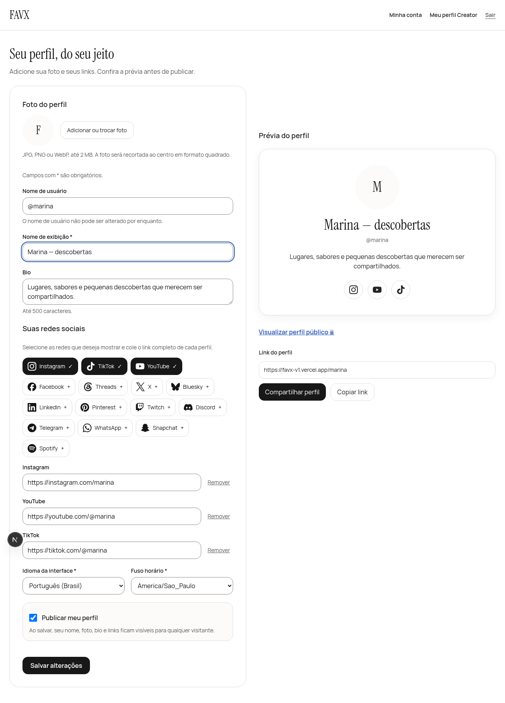

# Perfil Creator — incremento de 15/11/2026

## Pedido e entrega

Pedido explícito: foto, redes com logos e opção de adicionar, visualizar perfil público, compartilhar/copiar link, check/X no username e validação de obrigatórios. Referências: PRD FAVX-ID-001/002/004/008 e FAVX-PRO-001/002/003/005; DOC03 CRE-001/002/003/005/027 e PUB-001; DOC06 F03, EX-03-04 e marco M1.

Fluxo: identidade (nome + username obrigatórios) → personalização (foto, bio, redes, idioma/fuso) → prévia → opção explícita de publicar → salvar → abrir/compartilhar. Foto, bio e redes são opcionais conforme PRD; ao adicionar uma rede, seu link completo passa a ser obrigatório. A confirmação de disponibilidade é informativa: índice único no banco decide a criação em caso de concorrência. Username existente continua imutável, preservando a pendência de política de renomeação/redirecionamento.

Há 15 redes no catálogo inicial: Instagram, TikTok, YouTube, Facebook, Threads, X, Bluesky, LinkedIn, Pinterest, Twitch, Discord, Telegram, WhatsApp, Snapchat e Spotify. URLs são HTTPS e precisam pertencer à rede escolhida. Não há conexão OAuth nem importação de dados sociais neste incremento.

## Configuração Bunny

| Variável (server-only) | Origem |
|---|---|
| BUNNY_STORAGE_ACCESS_KEY | Password/AccessKey específica da Storage Zone, não a chave da conta ou de Stream |
| BUNNY_STORAGE_ZONE | Nome exato da Storage Zone ligada à Pull Zone |
| BUNNY_STORAGE_HOST | Host regional exibido no painel, sem esquema/caminho; exemplo storage.bunnycdn.com ou ny.storage.bunnycdn.com |
| BUNNY_CDN_URL | URL HTTPS da Pull Zone; informada pela Product Owner: https://favxdevderivados.b-cdn.net/ |

As chaves Stream cadastradas são para vídeo e não são usadas por fotos. Cadastrar essas variáveis no ambiente Vercel correspondente e redeployar. Preview deve ter recursos/credenciais de teste. Não copiar segredos Production para Preview automaticamente.

O `.env` local existente está ignorado pelo Git. `.env.local` também é ignorado. Não é preciso duplicar as chaves para executar na Vercel; arquivos locais servem apenas à execução no computador. Somente `.env.example`, vazio, deve ser versionado.

JPG/PNG/WebP até 2 MiB e 16 megapixels; o servidor verifica bytes, recorta ao centro, normaliza orientação e produz WebP 512×512 sem EXIF. AccessKey nunca é enviada ao navegador. O upload exige sessão, mesma origem e conta/Creator ativos. A chave do objeto contém namespace aleatório, não user_id. Esta é uma foto pública de apresentação; não é o pipeline de originais de posts descrito no DOC05. O original não é armazenado. Objetos antigos precisam de política de retenção/limpeza antes de escala; uma falha de persistência tenta remover o novo objeto.

## Banco e conciliação documental

O projeto existente usa `public.profiles` e `public.creator_profiles` com RLS. DOC05 propõe schema privado `app` e um baseline maior. Substituir a base ativa não está no escopo desta entrega. Os SQLs recebidos foram preservados em `docs/source/DOC05_reference`, sem execução. O workspace 1.3.2 é a versão mais recente enviada; seus prompts F00 não são executados automaticamente, e propostas continuam propostas.

`supabase/proposals/creator_public_profile.sql` é uma mudança aditiva preparada e testada em PostgreSQL embarcado (PGlite): namespace/foto, links sociais, política de conta ativa, salvamento transacional, projeção pública explícita e validação de username com autenticação. Não publica perfis existentes automaticamente. A projeção pública não retorna user_id, estado interno, preferências, e-mail ou métricas. Perfis privados/suspensos retornam vazio. Funções que leem além de RLS ficam no schema não exposto `favx_private`, com search_path vazio, grants específicos e wrappers invoker; não expor esse schema na Data API.

Antes de publicar o código: inspecionar as políticas atuais do projeto FAVX, gerar migration com `supabase migration new creator_public_profile`, copiar a proposta revisada, aplicar e verificar A/B/anônimo no ambiente alvo. O CLI disponível falhou na inicialização no ambiente de trabalho; por isso a proposta não recebeu um nome de migration inventado. A inspeção SQL remota foi concluída após um limite temporário de uso; as políticas do projeto conferem com a fundação. A aplicação da proposta foi rejeitada pela revisão automática por alterar schema, RLS, grants e funções de produção sem autorização específica para aplicar a proposta. Nenhuma mudança foi executada no Supabase. A aprovação da Product Owner para esta proposta concreta está pendente. Não integrar a branch em produção antes de concluir esse passo.

## Verificação

`npm test` inclui isolamento entre duas identidades, ausência de dados privados na projeção, recusa de anônimo, suspensão, rollback de salvamento parcial, colisão de username, validação de links e processamento de foto. São testes em banco embarcado e transportes simulados; não comprovam entrega real no Bunny nem configuração do Supabase de produção. Complementar com typecheck, build e teste completo no ambiente alvo após aplicar a migration.

## Origem dos ícones

SVGs de redes selecionados de Simple Icons 16.37.0 (CC0), vendorizados para carregar apenas os ícones necessários. LinkedIn usa o desenho de marca da distribuição histórica Simple Icons. Nomes e marcas pertencem aos respectivos titulares. Fonte: https://github.com/simple-icons/simple-icons.

### Evidências desta entrega

- 29 testes aprovados; TypeScript e build aprovados; auditoria npm sem vulnerabilidades.
- Navegador com backend simulado: seleção de rede, edição refletida na prévia, salvar, público anônimo sem ID/e-mail privado, 404, username ocupado/disponível e nome obrigatório.
- Desktop 1280 px e celular 390 px; sem overflow horizontal. Fotos e delivery Bunny reais ainda pendentes de hostname/configuração e homologação.
- `BUNNY_CDN_URL` cadastrado em Production com a origem pública informada. As chaves existentes não foram lidas nem copiadas para o Git.

As imagens abaixo usam dados fictícios e não são uma conta real.

[Prévia no celular](previews/creator/mobile.png) · [Username disponível e campo obrigatório](previews/creator/username.png)
