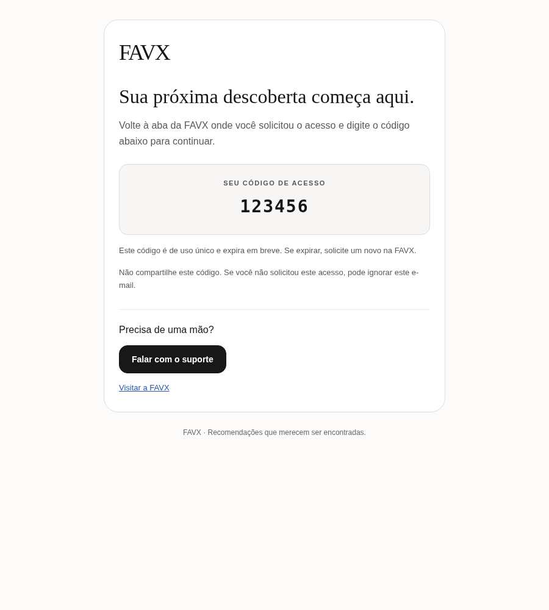
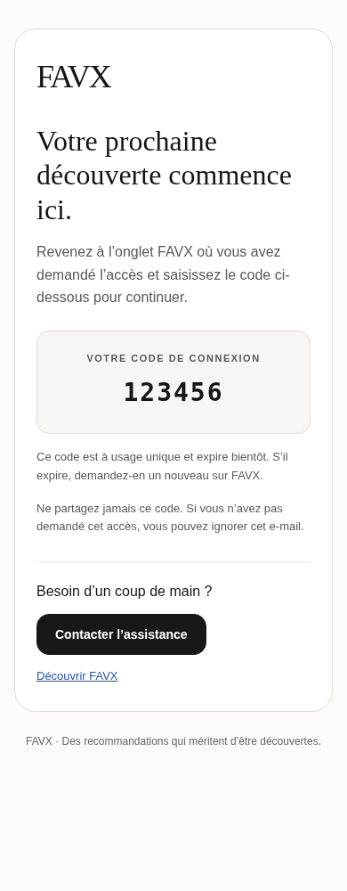

# E-mails de autenticação FAVX

## Diagnóstico confirmado

Em 14/11/2026 (America/Sao_Paulo), o Supabase registrou rejeição SMTP 550 do Resend: `The mail.favx.app domain is not verified`.
O envio por API também exige domínio verificado. Publicar código ou mudar senha SMTP não verifica o domínio.

## Fluxo implementado

`Tela de login → Supabase gera OTP → Send Email Hook assinado → /api/auth/send-email na Vercel → API Resend → caixa de entrada → verifyOtp no Supabase`.

O hook monta o HTML e a versão texto; Supabase continua responsável pela geração, expiração, uso único e validação do código. Não existe um código paralelo criado pela FAVX.
O hook substitui o transporte SMTP para e-mails Auth enquanto estiver habilitado. Não configurar um segundo envio da mesma mensagem no formulário.

- Remetente definido pela Product Owner: `FAVX <noreply@mail.favx.app>`.
- Reply-To e botão de suporte: `suporte@favx.app`.
- Idiomas: pt-br, pt-pt, en, es, it, fr.
- Caixa do código, botão de suporte, link para a FAVX, versão texto e instruções no idioma escolhido.
- `EMAIL_LOGO_URL` permite usar a logo definitiva. Enquanto não fornecida, a assinatura é tipográfica FAVX, sem inventar um símbolo oficial.
- HTML de e-mail com tabelas de apresentação, estilos inline, cores do DOC04 e fontes de fallback; clientes de e-mail não suportam fontes e CSS como o navegador.

## Domínio e remetente

1. Em https://resend.com/domains, abrir **mail.favx.app**.
2. Copiar os registros DNS apresentados pelo próprio Resend para o provedor de DNS autoritativo. Não inventar valores de DKIM/SPF/MX.
3. Usar a verificação do Resend e aguardar o status **Verified**. Verificar `favx.app` sozinho não confirma automaticamente o subdomínio configurado `mail.favx.app`.
4. Confirmar que a API key tem permissão de envio para esse domínio.
5. O endereço `suporte@favx.app` precisa de uma caixa ou serviço de recebimento. Ter um domínio de envio no Resend não cria essa caixa.

## Variáveis da Vercel

Cadastrar em Production; para Preview, usar recursos de teste separados. Segredos não devem ter prefixo NEXT_PUBLIC nem ser enviados ao chat/Git.

| Variável | Valor/origem |
|---|---|
| `RESEND_API_KEY` | API key com permissão de enviar pelo domínio verificado |
| `SEND_EMAIL_HOOK_SECRET` | Segredo do Send Email Hook no formato `v1,whsec_...` |
| `APP_URL` | `https://favx-v1.vercel.app` (ajustar quando houver domínio próprio) |
| `RESEND_FROM_EMAIL` | `noreply@mail.favx.app` |
| `EMAIL_SUPPORT_ADDRESS` | `suporte@favx.app` |
| `EMAIL_LOGO_URL` | Opcional: imagem PNG pública em HTTPS; vazio usa assinatura FAVX |

Apenas o handler de e-mail precisa desses segredos. A aplicação continua usando as duas variáveis Supabase publicáveis já existentes. Nenhuma chave `service_role` é necessária.

## Ativação do hook

1. Revisar e integrar a branch/PR. Confirmar o deploy do endpoint **antes** de ativar o hook no Supabase.
2. Em Authentication → URL Configuration, adicionar exatamente as seis URLs `https://favx-v1.vercel.app/{locale}/login`, uma para cada idioma. O `APP_URL` deve coincidir com essa origem.
3. Em Authentication → Hooks, preparar **Send Email**, tipo HTTPS, URL `https://favx-v1.vercel.app/api/auth/send-email`; gerar o segredo e colocá-lo na Vercel. Manter o hook desativado até concluir as variáveis e o redeploy. Se o painel não permitir salvar desativado, manter o fluxo de login em manutenção durante a troca.
4. Fazer redeploy com as variáveis. Validar que o endpoint está acessível ao Supabase: requisição sem assinatura deve receber **401**, sem envio. **500** de configuração indica segredo/variáveis ausentes; uma página de login da Vercel indica proteção de deployment impedindo o hook.
5. Ativar o hook e manter o provedor Email habilitado no Supabase. Não desativar confirmação de e-mail.
6. Pedir um código novo pela aplicação, verificar o registro no Resend e testar o código na mesma aba. Repetir com novo usuário e usuário existente e em outro idioma. Não reutilizar link/código de tentativas anteriores.

O Send Email Hook está disponível no plano Free segundo a documentação consultada. A limitação de personalização dos templates do SMTP padrão não exige upgrade para este fluxo por hook.

## Idioma

A ação de login envia `emailRedirectTo` apontando para a URL de login no idioma atual. O handler só aceita a origem configurada em `APP_URL` e um dos seis caminhos conhecidos para escolher o idioma; ele não transforma esse valor em link arbitrário no e-mail.
Isso funciona também para usuários existentes, pois `options.data` do signup não atualiza metadados em todo login. Fallback: `user_metadata.preferred_locale`, depois pt-br. Esses metadados só escolhem a tradução e nunca concedem autorização.

## Escopo e falhas

Este incremento atende os eventos de OTP `signup`, `magiclink` e `email` usados pela aplicação atual. O Send Email Hook é global ao projeto: **não habilitar** em um projeto que use recuperação de senha, convites, troca de e-mail, reautenticação ou notificações de segurança sem antes implementar/testar esses eventos. O handler recusa eventos fora do escopo em vez de dizer que enviou.

- Assinatura e timestamp são verificados com Standard Webhooks antes do envio; payload limitado a 20 KiB.
- Idempotência Resend usa identificador do webhook sem incluir e-mail/OTP; reentregas do mesmo evento são deduplicadas pelo provedor por 24 horas.
- Timeout de 3 segundos no Resend, dentro do orçamento global de 5 segundos do hook. Erros transitórios retornam 503 para o mecanismo de retry do Supabase.
- Erros não retornam sucesso. Logs contêm somente categoria/status; não gravar payload, código, destinatário ou chaves.
- Aceite pela API não comprova entrega: consultar logs/estado de entrega no Resend e testar a caixa de entrada.
- Um rollback por desativação do hook volta ao SMTP do Supabase. Só fazê-lo com SMTP verificado e templates por código (`{{ .Token }}`) configurados; senão o problema original retorna.

## Preview e verificação

`npm run email:preview` gera [seis HTMLs estáticos](previews/) com o código fictício `123456`, sem enviar mensagens.
`npm test` verifica assinatura válida/inválida, corpo adulterado, timestamp antigo/futuro, ações recusadas, respostas do provedor, idempotência, idiomas e escape de conteúdo. Complementar com typecheck e build.
A prévia de navegador não substitui homologação em Gmail, Outlook e Apple Mail.

Checks desta implementação: 25 testes passaram, TypeScript e build passaram, auditoria de dependências sem vulnerabilidades. Prévia inspecionada em desktop (900 px) e celular (390 px). Nenhum envio real foi realizado e o hook ainda precisa ser configurado e ativado.

### Desktop · português brasileiro

### Celular · francês

## Fontes

- [Supabase Send Email Hook](https://supabase.com/docs/guides/auth/auth-hooks/send-email-hook)
- [Supabase Auth Hooks: assinaturas, planos e retries](https://supabase.com/docs/guides/auth/auth-hooks)
- [Restrição de templates do SMTP padrão no Free](https://supabase.com/changelog/46599-changes-to-email-template-customisation-on-free-tier)
- [Resend: domínios](https://resend.com/docs/dashboard/domains/introduction)
- [Resend: idempotência](https://resend.com/docs/dashboard/emails/idempotency-keys)
