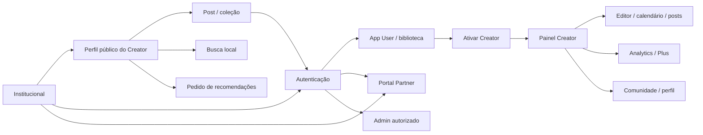

# FAVX — App Flow & Screen Specifications

**Documento:** FAVX-UX-FLOW-003 • **Versão:** 1.0 • **Status:** baseline funcional de UX com decisões pendentes sinalizadas • **Referências:** PRD v1.0 e TRD v1.0 • **Abrangência:** web responsiva e PWA quando tecnicamente suportada, visitante, User, Creator, Partner e Admin.  
**Regra de precedência:** decisões explícitas posteriores da Product Owner prevalecem; conflitos são registrados e resolvidos no PRD/TRD antes de implementação. **O DOC 03 define experiência e comportamento, não escolhe banco de dados nem confere aprovação a hipóteses comerciais.**

## Guia de leitura

- **APROVADO** = regra fixada anteriormente; **DERIVADO** = comportamento de UX necessário para implementar regra aprovada; **RECOMENDAÇÃO** = desenho proposto, validável; **PENDENTE** = decisão que não deve ser criada silenciosamente pelo desenvolvimento; **FUTURO** = fora do MVP.
- **P0** = condição de lançamento; **P1** = evolução não bloqueante, salvo dependência; **FUT** = não disponibilizar no MVP.
- **Screens ID** estável (`PUB-001`, `CRE-014` etc.). **Flow ID** (`J-01` etc.). **Overlay ID** (`O-01` etc.). IDs devem ser associados a tickets, testes E2E, analytics e Design System.
- Rotas são **contratos de navegação propostos**, não definição final de convenções Next.js. Links públicos usam slug raiz sem conflitar com rotas reservadas. Segmentos de `/app`, `/partner` e `/admin` são sugestões do DOC 03; o DOC 05 valida implementação.
- A especificação declara estrutura semântica e interação, **não mockup pixel-perfect**. O DOC 04 definirá dimensões, cor, componentes, breakpoints e estados visuais definitivos.
- Os testes de privacidade devem verificar **HTML, payload/API, metadados, cache, prévias sociais e busca**, não apenas elementos visíveis.

## 1. Contrato transversal de experiência

### 1.1. Modelo mental e navegação

A experiência pública da FAVX é **uma biblioteca de curadoria pesquisável**, não um feed de popularidade. Visitantes entram por páginas de Creator, posts ou coleções e podem buscar sem login. User autenticado possui biblioteca privada e coleções próprias; Creator possui seu espaço User e painel separado, sem duplicar identidade; Partner e Admin têm ambientes separados com RBAC. A navegação pública nunca apresenta contadores de seguidores, seguindo, views, saves, CTR ou receita.

**Entradas e saídas principais:** `favx.com/username` (perfil público); `favx.com/username/posts/slug` (post); `favx.com/username/collections/slug` (coleção); `favx.com/username/requests/slug` (pedido comunitário); `/app` (biblioteca); `/app/creator` (painel Creator); `/partner` (parceiros); `/admin` (admin). A escolha de convenção de URLs finais depende da decisão sobre domínios/slugs e redirecionamentos; nenhum link pode criar rota pública que exponha conteúdo privado.

### 1.2. Cabeçalho, rodapé e dispositivos

**Desktop:** navegação por áreas, breadcrumb contextual em painéis, busca à vista quando houver corpus pesquisável, toolbar de ações; listas com filtros e tabelas apenas para ambientes de gestão. **Mobile:** navegação concisa adaptada ao contexto, ações primárias acessíveis por polegar, painéis de filtros em bottom sheet, tabelas responsivas em cards, editor dividido em etapas/abas sem perder o rascunho. **Tablet:** adaptar pelo espaço disponível, não apenas pelo user-agent. Modais críticos exigem foco preso, Esc/cancelamento quando seguro, leitura por leitor de tela e retorno de foco. **Branding:** assinatura `by FAVX` discreta em páginas públicas, nunca cobrindo mídia ou ação.

### 1.3. Tokens de estado reutilizáveis

- **Loading:** skeleton apropriado por conteúdo; não exibir zeros enquanto dados carregam.
- **Empty-first-use:** explicar benefício e oferecer CTA de criação, quando autorizado.
- **Empty-filtered:** informar que filtros podem estar restringindo resultado; oferecer limpar.
- **Success:** feedback acessível sem bloquear navegação; confirma estado persistido.
- **Validation error:** erro inline associado ao campo e resumo acessível quando necessário.
- **Network/offline:** manter edições não sincronizadas quando possível, não afirmar persistência; oferecer retentar.
- **Forbidden / plan-gated:** explicar motivo, nunca simular sucesso ou revelar dados no HTML.
- **Unavailable:** conteúdo expirado, moderado, removido ou privado apresenta mensagem neutra, sem vazamento de metadados.
- **Partial failure:** operações compostas (upload, transcrição, analytics) exibem progresso e parte pendente.
- **Time-sensitive:** mostrar fuso explícito, data por extenso e confirmação do instante absoluto.

### 1.4. Regras globais aprovadas

1. Visitante lê perfil e posts públicos sem autenticar.
2. Login é exigido para salvar, criar/editar coleções próprias, seguir, publicar, obter métricas ou baixar originais próprios.
3. Nenhuma contagem de seguidores/seguindo/salvos/views/cliques/impressões é pública; listas de seguidores/seguindo são particulares ao titular.
4. O Creator Free visualiza apenas a métrica geral de cliques no link do perfil; dashboards avançados ficam restritos ao Plus, embora eventos sejam coletados desde o Free.
5. Post/banner expirado é ocultado imediatamente pelo critério de visibilidade, **mesmo se job e CDN atrasarem**; histórico fica gerenciável pelo titular.
6. Fixação altera posição de destaque, **não** existência nem prazo da publicação.
7. FAVX Context nunca é exposto em API pública, HTML, prévia, resultado de IA ou futura empresa.
8. Download de original exige propriedade/direitos e autenticação; upload não comprova automaticamente autoria.
9. Busca inicial tem escopo local ao Creator ou aos próprios salvos; busca global e FAVX for Brands não têm tela acessível no MVP.
10. Dados de audiência são privados; insights por pesquisas devem ser agregados e protegidos contra reidentificação.
11. Idiomas: pt-BR, pt-PT, en, es, it, fr; moeda BRL/USD/EUR e fuso independentes entre si.
12. Não reutilizar slogans, logotipo ou componentes da marca GalleryX sem homologação FAVX.

### 1.5. Padrão das ações

- **Criar/Salvar:** disabled apenas quando requisito mínimo não cumprido; prevenir clique duplo e informar persistência.
- **Voltar:** preferir histórico interno e fallback seguro para URL direta, sem perder alteração não salva sem aviso.
- **Cancelar/Descartar:** perguntar quando houver alterações não salvas ou gravação em andamento.
- **Excluir:** confirmação nomeando o recurso e consequência; exclusão lógica / janela de recuperação dependerá da política de retenção aprovada.
- **Compartilhar:** API de compartilhamento nativa quando disponível, senão copiar link; CTA com estado copiado.
- **Links externos:** aviso de saída quando necessário, sem alegar qualidade/preço/verificação não comprovados.
- **Paywall:** restrição no servidor; mostrar explicação de benefício sem enviar conteúdo privado do Plus ao Free.

## 2. Mapa de informação e arquitetura de navegação



**Resolução de rota raiz:** slug deve ser resolvido após a tabela de rotas reservadas. Slugs antigos podem ter redirecionamento seguro caso política de mudança seja aprovada; jamais redirecionar `/admin` como username. **Deep links:** abrir post/coleção/pedido diretamente deve funcionar mesmo sem visita prévia ao perfil. **Retorno após autenticação:** o app preserva `returnTo` validado em allowlist interna e a intenção (salvar/seguir), nunca um redirecionamento arbitrário externo.

### 2.1. Navegação e conteúdo por papel

| Contexto | Entrada padrão | Navegação primária | Não disponibilizar |
|---|---|---|---|
| Visitante | link de creator/post ou landing | perfil, buscar, posts, coleções, compartilhar | salvar sem autenticar, métricas privadas |
| User | `/app` | salvos, coleções, seguindo, conta | analytics de terceiros |
| Creator | `/app/creator` | visão geral, posts, coleções, banners/fixados Plus, comunidade, analytics, perfil | edição de conteúdo alheio |
| Partner aprovado | `/partner` | visão geral, link, indicações, comissões, pagamentos, materiais | dados pessoais de clientes além do estritamente autorizado |
| Admin autorizado | `/admin` | operação, creators, conteúdo, finanças, parceiros, moderação, saúde, logs | telas sem motivo/permissionamento apropriado |

### 2.2. Componentes de navegação compartilhados

`PublicHeader`, `PublicFooter`, `ByFavxAttribution`, `ScopedSearchBar`, `CreatorSidebar`, `UserNav`, `PartnerNav`, `AdminNav`, `Breadcrumb`, `RoleSwitcher`, `ActionMenu`, `ConfirmDialog`, `DateTimePickerTZ`, `MediaProgress`, `SearchScopeChip`, `Cookie/ConsentPanel`, `NotificationCenter`, `InlineError`, `FeedbackToast`, `OfflineBanner`, `EmptyState`, `ErrorBoundary`, `Skeleton`. Componentes comuns devem ter contrato e estados no DOC 04, sem duplicações por equipe.

## 3. Catálogo de jornadas end-to-end

Cada jornada inclui **gatilho, rota principal, desvios obrigatórios, condição de conclusão e requisito PRD**. Não supor que um estado de UI corresponde a operação persistida: teste a resposta do servidor e um refresh. Eventos de analytics não devem usar dados pessoais sensíveis nem fornecer tracking sem fundamento de consentimento.

### J-01 — Descobrir recomendação de creator

**Persona:** Visitante. **Gatilho:** abre URL de Creator compartilhada.  
**Caminho principal:** PUB-001 perfil → PUB-004 busca local → SRH-002 resultados → PUB-003 post → CTA externo.  
**Ramos, falhas e exceções:** Busca vazia → sugestão para refinar; post expira entre clique e abertura → PUB-009 indisponível.  
**Saída verificável:** Acessa informação pública sem login e sem números de popularidade.  
**Rastreio PRD:** `FAVX-ID-002, FAVX-SRCH-001, FAVX-PRO-003`.

### J-02 — Salvar a partir de link sem sessão

**Persona:** Visitante → User. **Gatilho:** toca “Salvar” em post público.  
**Caminho principal:** PUB-003 → AUT-001 login/cadastro → retorno validado → USR-002 salvamento confirmado.  
**Ramos, falhas e exceções:** Cancela login → retorno ao post sem salvar; clique repetido → único vínculo.  
**Saída verificável:** Recomendação salva uma vez na conta correta.  
**Rastreio PRD:** `FAVX-ID-003, FAVX-COL-004`.

### J-03 — Ativar Creator mantendo biblioteca

**Persona:** User. **Gatilho:** seleciona “Tornar-me Creator”.  
**Caminho principal:** USR-001 → CRE-001 introdução → CRE-002 identidade/username → CRE-003 preferências → CRE-004 dashboard.  
**Ramos, falhas e exceções:** Username ocupado → sugerir ajuste; abandonar → continuar User e retomar depois.  
**Saída verificável:** Conta única, biblioteca de salvos intacta.  
**Rastreio PRD:** `FAVX-ID-001, FAVX-ID-004`.

### J-04 — Publicar recomendação com captura

**Persona:** Creator. **Gatilho:** toca “Nova recomendação”.  
**Caminho principal:** CRE-007 editor → MED-001 escolha → MED-002 câmera/vídeo ou MED-003 áudio → MED-006 processamento → CRE-011 revisar → CRE-012 publicar.  
**Ramos, falhas e exceções:** Permissão negada → upload; mídia excede limite → feedback; rede cai → retry seguro.  
**Saída verificável:** Post público apenas após mídia elegível e validação.  
**Rastreio PRD:** `FAVX-POST-003, FAVX-MED-001/003/008`.

### J-05 — Post agendado com fim automático

**Persona:** Creator. **Gatilho:** define janela de exibição.  
**Caminho principal:** CRE-007 → CRE-010 agenda do post → CRE-011 revisão → CRE-013 calendário → CRE-015 expirados.  
**Ramos, falhas e exceções:** Fim ≤ início → erro inline; mudança de fuso → horário confirmado; fila atrasada → leitura pública já oculta.  
**Saída verificável:** Post visível exclusivamente no intervalo aprovado; histórico preservado.  
**Rastreio PRD:** `FAVX-LIFE-001/002/003/004/008/009`.

### J-06 — Editar um post publicado

**Persona:** Creator. **Gatilho:** abre menu de post.  
**Caminho principal:** CRE-006 lista → CRE-007 editor → CRE-011 confirmação → CRE-008 detalhe de gestão.  
**Ramos, falhas e exceções:** Alteração de mídia requer processamento; sair sem salvar → confirmar; post moderado → restrição.  
**Saída verificável:** Mesmo ID/URL e métricas anteriores preservadas.  
**Rastreio PRD:** `FAVX-POST-009, FAVX-LIFE-008`.

### J-07 — Ocultar, arquivar, excluir e restaurar

**Persona:** Creator. **Gatilho:** solicita gestão de visibilidade.  
**Caminho principal:** CRE-008 → O-05 confirmação → CRE-015 encerrados ou CRE-016 lixeira → O-06 restauração.  
**Ramos, falhas e exceções:** Prazos de lixeira pendentes; sem direito de restauração → explicação; deep link público indisponível.  
**Saída verificável:** Sem exposição pública, sem apagamento instantâneo de históricos legais.  
**Rastreio PRD:** `FAVX-LIFE-005/006/007/010`.

### J-08 — Agendar banner e fixação independentes

**Persona:** Creator Plus. **Gatilho:** inicia campanha.  
**Caminho principal:** PLS-004 banners → PLS-005 editor → CRE-013 agenda → PLS-007 fixados → PUB-001 página pública.  
**Ramos, falhas e exceções:** Plano Free → paywall; capacidade sobreposta → conflito explicado; post base expira → destaque não força visibilidade.  
**Saída verificável:** Banner expira sem excluir; pin termina sem despublicar post.  
**Rastreio PRD:** `FAVX-PLUS-001/003/004/005`.

### J-09 — Enviar recomendação comunitária

**Persona:** Seguidor. **Gatilho:** abre link dedicado a pedido.  
**Caminho principal:** PUB-007 pedido → PUB-008 formulário → confirmação → CRE-020 caixa comunitária.  
**Ramos, falhas e exceções:** Pedido encerrado → mensagem neutra; spam/anexo indevido → erro; não publicar automaticamente.  
**Saída verificável:** Submissão privada até revisão explícita.  
**Rastreio PRD:** `FAVX-COM-001/002`.

### J-10 — Publicar recomendação da comunidade

**Persona:** Creator. **Gatilho:** seleciona submissão recebida.  
**Caminho principal:** CRE-020 caixa → CRE-021 detalhe → CRE-007 editor com proveniência → CRE-011 publicar.  
**Ramos, falhas e exceções:** Falta licença de mídia → bloqueia reutilização; rejeição → motivo quando apropriado.  
**Saída verificável:** Post público identificado como originado da comunidade.  
**Rastreio PRD:** `FAVX-COM-003/004`.

### J-11 — Busca conversacional, voz e geografia

**Persona:** Visitante/User. **Gatilho:** busca por intenção complexa.  
**Caminho principal:** SRH-001 digitar/voz → SRH-004 transcrição → SRH-005 filtros/localização → SRH-002 resultados → SRH-003 refinar.  
**Ramos, falhas e exceções:** Áudio negado → texto; IA lenta → fallback lexical; geolocalização negada → cidade/bairro manual.  
**Saída verificável:** Resultados reais apenas no escopo permitido, sem revelar Context.  
**Rastreio PRD:** `FAVX-SRCH-004/005/006/007/008`.

### J-12 — Salvar e compartilhar coleção pessoal

**Persona:** User. **Gatilho:** cria biblioteca temática.  
**Caminho principal:** USR-002 salvos → USR-004 coleções → USR-006 editor → USR-005 detalhe → USR-007 compartilhar.  
**Ramos, falhas e exceções:** Privado por padrão; altera visibilidade → aviso; post expira → placeholder indisponível.  
**Saída verificável:** Somente itens explicitamente autorizados aparecem no link compartilhado.  
**Rastreio PRD:** `FAVX-COL-002/003/005`.

### J-13 — Acompanhar analytics por plano

**Persona:** Creator Free/Plus. **Gatilho:** abre painel de métricas.  
**Caminho principal:** CRE-004 painel Free → PLS-001 plano → PLS-002 checkout → PLS-009 analytics.  
**Ramos, falhas e exceções:** Pagamento pendente → status neutro; downgrade → dashboard Plus bloqueado e histórico preservado.  
**Saída verificável:** Free só vê cliques no link geral; Plus vê séries permitidas.  
**Rastreio PRD:** `FAVX-ANA-001/002/003/005`.

### J-14 — Assinar trial e cancelar

**Persona:** Creator. **Gatilho:** inicia upgrade e posteriormente cancela.  
**Caminho principal:** PLS-001 planos → PLS-002 checkout → PLS-003 status → PLS-008 gestão → confirmação.  
**Ramos, falhas e exceções:** Retorno Stripe sem webhook → pendente; reembolso/disputa → reconciliar; trial inelegível → explicar.  
**Saída verificável:** Benefícios seguem entitlement validado, nunca retorno da URL.  
**Rastreio PRD:** `FAVX-BIL-002/003/004/005`.

### J-15 — Candidatar-se a parceiro e acompanhar comissão

**Persona:** Candidate Partner. **Gatilho:** abre programa de parceiros.  
**Caminho principal:** PAR-001 programa → PAR-002 inscrição → PAR-003 análise → PAR-004 dashboard → PAR-006 comissões → PAR-007 pagamentos.  
**Ramos, falhas e exceções:** Candidatura rejeitada → motivo autorizado; comissão em análise → não marcar como paga.  
**Saída verificável:** Comissões apenas sobre base ativa e paga conforme regra aprovada.  
**Rastreio PRD:** `FAVX-PAR-001/002/003/004`.

### J-16 — Moderar conteúdo com segurança

**Persona:** Moderator. **Gatilho:** recebe denúncia.  
**Caminho principal:** ADM-007 fila → ADM-008 caso → O-05 confirmação → revisão → publicação indisponível.  
**Ramos, falhas e exceções:** Operador sem role → negar; ação desfeita → audit; conteúdo em cache → invalidação.  
**Saída verificável:** Conteúdo suspenso inacessível e trilha auditável.  
**Rastreio PRD:** `FAVX-ADM-001/002/003`.

### J-17 — Exportar, gerenciar consentimento e excluir conta

**Persona:** User/Creator. **Gatilho:** solicita direitos de privacidade.  
**Caminho principal:** USR-010 privacidade → USR-011 exportação → USR-012 encerramento → confirmação.  
**Ramos, falhas e exceções:** Assinatura ativa → informar impacto; obrigações legais → informar retenção; sessão expirada → reautenticar.  
**Saída verificável:** Pedido rastreável sem promessas falsas de exclusão imediata.  
**Rastreio PRD:** `FAVX-ID-007, FAVX-UX-003`.

### J-18 — Download seguro de mídia própria

**Persona:** Creator. **Gatilho:** toca “Baixar” no gerenciamento de mídia.  
**Caminho principal:** CRE-008/ MED-007 biblioteca → MED-008 opções original/otimizado → download temporário.  
**Ramos, falhas e exceções:** Arquivo original indisponível → explicar; mídia alheia → acesso negado; link expira → regenerar.  
**Saída verificável:** Arquivo autenticado e autorizado, auditado, sem URL privada exposta.  
**Rastreio PRD:** `FAVX-MED-004/005/006`.

### J-19 — Publicar cupom e conteúdo patrocinado

**Persona:** Creator. **Gatilho:** cria recomendação comercial.  
**Caminho principal:** CRE-007 editor → CRE-009 links/cupons → CRE-011 revisão → PUB-003 detalhe.  
**Ramos, falhas e exceções:** Cupom vencido → não comunicar benefício válido; disclosure ausente → impedir publicação quando obrigatório.  
**Saída verificável:** Atribuição clara de patrocínio e ofertas.  
**Rastreio PRD:** `FAVX-POST-005/007`.

### J-20 — Admin soluciona falha operacional

**Persona:** Admin Ops. **Gatilho:** alerta de upload/agendamento/faturamento.  
**Caminho principal:** ADM-001 visão geral → ADM-013 jobs → ADM-014 mídia ou ADM-011 billing → log → ação de recuperação.  
**Ramos, falhas e exceções:** Falha de retry → DLQ; webhook duplicado → idempotência; sem permissão → bloquear.  
**Saída verificável:** Incidente com histórico, responsável e resultado.  
**Rastreio PRD:** `FAVX-ADM-002/004`.

### J-21 — Pesquisar salvos e encontrar indisponível

**Persona:** User. **Gatilho:** usa busca pessoal.  
**Caminho principal:** USR-001 biblioteca → SRH-001 busca restrita → SRH-002 resultados → USR-003 detalhe de item salvo.  
**Ramos, falhas e exceções:** Post removido → placeholder com Remover dos salvos; perfil de outro Creator não invade busca.  
**Saída verificável:** Apenas sua biblioteca é consultável.  
**Rastreio PRD:** `FAVX-SRCH-002, FAVX-COL-005`.

### J-22 — Alternar papéis e sessões

**Persona:** User + Creator + Partner autorizado. **Gatilho:** abre seletor de ambiente.  
**Caminho principal:** SHR-004 seletor → USR-001 / CRE-004 / PAR-004 → SHR-003 sessão.  
**Ramos, falhas e exceções:** Papel sem autorização → opção não visível nem rota acessível; atualização de entitlement → reevaluar.  
**Saída verificável:** Nenhuma conta duplicada nem fuga de permissões.  
**Rastreio PRD:** `FAVX-ID-001/008`.

### J-23 — Retomar gravação após falha de rede

**Persona:** Creator. **Gatilho:** rede cai durante captura/upload.  
**Caminho principal:** MED-002 gravação → MED-005 fila de upload → MED-006 processamento → CRE-007 editor.  
**Ramos, falhas e exceções:** Saída sem arquivo persistido → alerta; browser mata aba → não prometer recuperação; reconectar → retomada suportada.  
**Saída verificável:** Não duplicar mídia e status de persistência sempre verdadeiro.  
**Rastreio PRD:** `FAVX-MED-007/008`.

### J-24 — Usuário recebe notificação e altera preferências

**Persona:** User/Creator. **Gatilho:** recebe evento relevante.  
**Caminho principal:** SHR-001 notificações → destino contextual → USR-009 preferências.  
**Ramos, falhas e exceções:** Notificação de post excluído → destino indisponível; notificação opt-out → respeitar preferência.  
**Saída verificável:** Somente eventos autorizados e sem conteúdo sensível na prévia.  
**Rastreio PRD:** `FAVX-ID-005, FAVX-UX-003`.

## 4. Inventário completo de superfícies e telas

**Taxonomia:** WEB institucional; AUT autenticação; PUB público; USR usuário; CRE Creator; MED mídia; SRH busca; PLS Plus; PAR parceiro; ADM administrativo; SHR componentes interativos globais; FUT arquitetura/roadmap não implementável no MVP. Algumas “telas” são **estados, modais ou drawers com contrato próprio** e foram nomeadas para garantir QA rastreável.

| Grupo | Descrição | Escopo |
|---|---|---|
| WEB | Aquisição, planos, ajuda e legal | MVP |
| AUT | Autenticação e consentimentos | MVP |
| PUB | Páginas públicas e páginas compartilhadas | MVP |
| USR | Biblioteca, salvos, coleções, conta e privacidade | MVP |
| CRE | Editor e gestão de Creator | MVP |
| MED | Captura, envio, processamento e download | MVP |
| SRH | Busca, voz, geografia e filtros | MVP |
| PLS | Creator Plus, banners, fixados e cobrança | MVP condicionado a regras comerciais |
| PAR | Programa e portal Partner | MVP condicionado a regras operacionais |
| ADM | Backoffice e operação | MVP com permissões granulares |
| SHR | Modais, notificações e estados comuns | MVP |
| FUT | Preparação futura, sem rotas funcionais | FUTURO |

### 4.1. Matriz de rastreabilidade resumida das telas

| ID | Tela/superfície | Papel | URL/superfície | Status |
|---|---|---|---|---|
| `WEB-001` | Landing institucional | Público | `/` | MVP P0 |
| `WEB-002` | Como funciona | Público | `/como-funciona` | MVP P0 |
| `WEB-003` | Página de preços e planos | Público/Creator | `/precos` | MVP P0 |
| `WEB-004` | Ajuda — início | Público | `/ajuda` | MVP P0 |
| `WEB-005` | Artigo de ajuda | Público | `/ajuda/:slug` | MVP P0 |
| `WEB-006` | Contato e suporte | Público/User | `/contato` | MVP P0 |
| `WEB-007` | Termos e políticas | Público | `/legal/:documento` | MVP P0 |
| `WEB-008` | Programa de parceiros — apresentação | Público | `/parceiros` | MVP P0 |
| `AUT-001` | Login | Visitante | `/entrar` | MVP P0 |
| `AUT-002` | Cadastro | Visitante | `/criar-conta` | MVP P0 |
| `AUT-003` | Verificação de e-mail | Novo User | `/verificar-email` | MVP P0 |
| `AUT-004` | Recuperar acesso | Visitante | `/recuperar-acesso` | MVP P0 |
| `AUT-005` | Definir nova senha | Titular com token | `/redefinir-senha` | MVP P0 |
| `AUT-006` | Sessão expirada | Autenticado | `overlay/redirecionamento` | MVP P0 |
| `AUT-007` | Verificação adicional e conta restrita | User/Creator | `/conta-restrita` | MVP P0 |
| `AUT-008` | Consentimentos iniciais | Novo User | `modal/primeiro-acesso` | MVP P0 |
| `PUB-001` | Perfil público do Creator | Visitante/User | `/:username` | MVP P0 |
| `PUB-002` | Coleção pública Creator | Visitante/User | `/:username/collections/:slug` | MVP P0 |
| `PUB-003` | Detalhe público da recomendação | Visitante/User | `/:username/posts/:slug` | MVP P0 |
| `PUB-004` | Entrada de busca no perfil | Visitante/User | `/:username/search ou overlay` | MVP P0 |
| `PUB-005` | Lista de resultados Creator | Visitante/User | `/:username/search?q=...` | MVP P0 |
| `PUB-006` | Coleção compartilhada de User | Visitante/User | `/collections/shared/:token-ou-slug` | MVP P0 |
| `PUB-007` | Pedido comunitário público | Visitante/seguidor | `/:username/requests/:slug` | MVP P0 |
| `PUB-008` | Enviar sugestão comunitária | Seguidor | `/:username/requests/:slug/enviar` | MVP P0 |
| `PUB-009` | Conteúdo indisponível / link antigo | Visitante/User | `/:username/posts/:slug (fallback)` | MVP P0 |
| `PUB-010` | Prévia segura de compartilhamento | Bots sociais/visitante | `metadados de rotas públicas` | MVP P0 |
| `USR-001` | Início do User / biblioteca | User | `/app` | MVP P0 |
| `USR-002` | Todos os salvos | User | `/app/salvos` | MVP P0 |
| `USR-003` | Item salvo e ações | User | `/app/salvos/:postId ou drawer` | MVP P0 |
| `USR-004` | Lista de minhas coleções | User | `/app/colecoes` | MVP P0 |
| `USR-005` | Detalhe de coleção pessoal | User | `/app/colecoes/:id` | MVP P0 |
| `USR-006` | Criar ou editar coleção User | User | `/app/colecoes/nova ou /:id/editar` | MVP P0 |
| `USR-007` | Compartilhar / revogar coleção | User | `modal da USR-005` | MVP P0 |
| `USR-008` | Seguindo e seguidores — privado | User | `/app/relacoes` | MVP P0 |
| `USR-009` | Configurações da conta | User/Creator | `/app/configuracoes` | MVP P0 |
| `USR-010` | Privacidade e consentimentos | User/Creator | `/app/privacidade` | MVP P0 |
| `USR-011` | Solicitar exportação dos dados | User/Creator | `/app/privacidade/exportacao` | MVP P0 |
| `USR-012` | Encerrar/excluir conta | User/Creator | `/app/privacidade/excluir-conta` | MVP P0 |
| `USR-013` | Central de notificações pessoais | User/Creator | `/app/notificacoes` | MVP P0 |
| `CRE-001` | Ativar perfil Creator — introdução | User | `/app/creator/ativar` | MVP P0 |
| `CRE-002` | Ativar Creator — identidade | User | `/app/creator/ativar/perfil` | MVP P0 |
| `CRE-003` | Ativar Creator — finalizar | User | `/app/creator/ativar/concluir` | MVP P0 |
| `CRE-004` | Dashboard Creator Free | Creator Free | `/app/creator` | MVP P0 |
| `CRE-005` | Editar perfil Creator | Creator | `/app/creator/perfil` | MVP P0 |
| `CRE-006` | Gerenciar publicações | Creator | `/app/creator/posts` | MVP P0 |
| `CRE-007` | Editor de recomendação — conteúdo | Creator | `/app/creator/posts/novo e /:id/editar` | MVP P0 |
| `CRE-008` | Detalhe de gestão de post | Creator | `/app/creator/posts/:id` | MVP P0 |
| `CRE-009` | Links, cupons, oferta e patrocínio | Creator | `etapa do CRE-007` | MVP P0 |
| `CRE-010` | Agendar publicação e encerramento | Creator | `modal/etapa CRE-007` | MVP P0 |
| `CRE-011` | Revisão e prévia de publicação | Creator | `/app/creator/posts/:id/revisar` | MVP P0 |
| `CRE-012` | Confirmação de publicação / agendamento | Creator | `/app/creator/posts/:id/sucesso` | MVP P0 |
| `CRE-013` | Calendário editorial e agenda | Creator | `/app/creator/agenda` | MVP P0 |
| `CRE-014` | Gerenciar rascunhos e agendados | Creator | `/app/creator/posts/agendados` | MVP P0 |
| `CRE-015` | Ocultos, expirados e arquivados | Creator | `/app/creator/posts/encerrados` | MVP P0 |
| `CRE-016` | Lixeira de conteúdo | Creator | `/app/creator/lixeira` | MVP P0 |
| `CRE-017` | Coleções Creator — lista | Creator | `/app/creator/colecoes` | MVP P0 |
| `CRE-018` | Editor de coleção Creator | Creator | `/app/creator/colecoes/novo ou :id/editar` | MVP P0 |
| `CRE-019` | Solicitações comunitárias — lista | Creator | `/app/creator/comunidade/pedidos` | MVP P0 |
| `CRE-020` | Caixa de recomendações recebidas | Creator | `/app/creator/comunidade/recebidas` | MVP P0 |
| `CRE-021` | Detalhe da sugestão recebida | Creator | `/app/creator/comunidade/recebidas/:id` | MVP P0 |
| `CRE-022` | Criar/editar pedido comunitário | Creator | `/app/creator/comunidade/pedidos/novo` | MVP P0 |
| `CRE-023` | Métricas gerais Creator | Creator Plus / Free restrito | `/app/creator/analytics` | MVP P0 |
| `CRE-024` | Analytics por publicação | Creator Plus | `/app/creator/analytics/posts/:id` | MVP P0 |
| `CRE-025` | Analytics de coleções e busca | Creator Plus | `/app/creator/analytics/descoberta` | MVP P0 |
| `CRE-026` | Histórico e versões de publicação | Creator | `/app/creator/posts/:id/historico` | MVP P0 |
| `CRE-027` | Gerenciar links do perfil | Creator | `/app/creator/links` | MVP P0 |
| `MED-001` | Escolha da origem da mídia | Creator | `modal editor` | MVP P0 |
| `MED-002` | Capturar foto/vídeo com câmera | Creator | `modal editor/media/camera` | MVP P0 |
| `MED-003` | Gravar áudio | Creator | `modal editor/media/audio` | MVP P0 |
| `MED-004` | Prévia da mídia original | Creator | `modal após captura/seleção` | MVP P0 |
| `MED-005` | Gerenciador de uploads | Creator | `drawer/editor` | MVP P0 |
| `MED-006` | Processamento de mídia | Creator | `drawer/media/:id/status` | MVP P0 |
| `MED-007` | Biblioteca de mídias próprias | Creator | `/app/creator/midias` | MVP P0 |
| `MED-008` | Opções de download do Creator | Creator | `modal mídia` | MVP P0 |
| `MED-009` | Transcrição e edição de áudio | Creator | `modal editor/transcricao` | MVP P0 |
| `SRH-001` | Campo de busca contextual | Visitante/User | `overlay em perfil e biblioteca` | MVP P0 |
| `SRH-002` | Resultados e cards de busca | Visitante/User | `:username/search ou /app/buscar` | MVP P0 |
| `SRH-003` | Refinamento conversacional | Visitante/User | `drawer ao lado resultados` | MVP P0 |
| `SRH-004` | Busca por voz | Visitante/User | `modal microfone` | MVP P0 |
| `SRH-005` | Filtros avançados de busca | Visitante/User | `bottom-sheet/drawer` | MVP P0 |
| `SRH-006` | Escolha de localização para busca | Visitante/User | `modal localização` | MVP P0 |
| `SRH-007` | Falha / fallback da busca IA | Visitante/User | `estado de SRH-002` | MVP P0 |
| `SRH-008` | Nenhum resultado — orientação contextual | Visitante/User | `estado SRH-002` | MVP P0 |
| `PLS-001` | Apresentação Creator Plus / upgrade | Creator | `/app/creator/plus` | MVP P0 |
| `PLS-002` | Checkout e retorno seguro | Creator | `/app/creator/plus/checkout + retorno` | MVP P0 |
| `PLS-003` | Resultado de trial, pagamento e assinatura | Creator | `/app/creator/plus/status` | MVP P0 |
| `PLS-004` | Banners — lista e biblioteca | Creator Plus | `/app/creator/banners` | MVP P0 |
| `PLS-005` | Editor de banner | Creator Plus | `/app/creator/banners/novo ou /:id/editar` | MVP P0 |
| `PLS-006` | Detalhes e desempenho de banner | Creator Plus | `/app/creator/banners/:id` | MVP P0 |
| `PLS-007` | Fixados — gestão e agenda | Creator Plus | `/app/creator/fixados` | MVP P0 |
| `PLS-008` | Gerenciar assinatura e cancelamento | Creator | `/app/creator/plus/gerenciar` | MVP P0 |
| `PLS-009` | Visão analítica Plus | Creator Plus | `/app/creator/plus/insights` | MVP P0 |
| `PLS-010` | Paywall contextual de recurso Plus | Creator Free | `modal ou rota segura` | MVP P0 |
| `PAR-001` | Programa de parceiros — detalhes | Público | `/parceiros/programa` | MVP P0 |
| `PAR-002` | Cadastro/candidatura de parceiro | Candidato | `/partner/candidatar-se` | MVP P0 |
| `PAR-003` | Status da candidatura | Candidato | `/partner/status` | MVP P0 |
| `PAR-004` | Dashboard Partner | Partner aprovado | `/partner` | MVP P0 |
| `PAR-005` | Meu link e materiais | Partner aprovado | `/partner/links` | MVP P0 |
| `PAR-006` | Indicações e comissões | Partner aprovado | `/partner/comissoes` | MVP P0 |
| `PAR-007` | Pagamentos e dados para repasse | Partner aprovado | `/partner/pagamentos` | MVP P0 |
| `PAR-008` | Termos e documentação Partner | Partner aprovado | `/partner/documentos` | MVP P0 |
| `PAR-009` | Histórico de atribuição do parceiro | Partner aprovado | `/partner/indicacoes` | MVP P0 |
| `PAR-010` | Ajuda e revisão de comissão | Partner aprovado | `/partner/suporte` | MVP P0 |
| `ADM-001` | Admin overview e saúde operacional | Admin autorizado | `/admin` | MVP P0 |
| `ADM-002` | Gestão de contas User | Support/Admin | `/admin/users` | MVP P0 |
| `ADM-003` | Detalhe de User e direitos | Support/Admin | `/admin/users/:id` | MVP P0 |
| `ADM-004` | Gestão de Creators | Support/Admin | `/admin/creators` | MVP P0 |
| `ADM-005` | Detalhe e saúde Creator | Support/Admin | `/admin/creators/:id` | MVP P0 |
| `ADM-006` | Conteúdo e ativos — catálogo | Moderator/Admin | `/admin/conteudo` | MVP P0 |
| `ADM-007` | Fila de denúncias e moderação | Moderator | `/admin/moderacao` | MVP P0 |
| `ADM-008` | Detalhe da denúncia e decisão | Moderator | `/admin/moderacao/:id` | MVP P0 |
| `ADM-009` | Taxonomia — categorias e aliases | Content Admin | `/admin/taxonomia` | MVP P0 |
| `ADM-010` | Localidades e idiomas | Content Admin | `/admin/localizacao` | MVP P0 |
| `ADM-011` | Cobrança e assinaturas | Finance Admin | `/admin/billing` | MVP P0 |
| `ADM-012` | Finanças e receita por moeda | Finance Admin | `/admin/financeiro` | MVP P0 |
| `ADM-013` | Filas, jobs e agendamentos | Ops Admin | `/admin/jobs` | MVP P0 |
| `ADM-014` | Operações de mídia e storage | Ops Admin | `/admin/midia` | MVP P0 |
| `ADM-015` | Busca e IA — qualidade/custo | Ops/Content Admin | `/admin/ai` | MVP P0 |
| `ADM-016` | Programa de parceiros — inscrições | Partner Admin | `/admin/partners/candidaturas` | MVP P0 |
| `ADM-017` | Programa de parceiros — pagamentos | Finance Admin | `/admin/partners/pagamentos` | MVP P0 |
| `ADM-018` | Suporte — tickets e SLA | Support Agent | `/admin/suporte` | MVP P0 |
| `ADM-019` | Central de auditoria e segurança | Security Admin | `/admin/auditoria` | MVP P0 |
| `ADM-020` | Roles e permissões do admin | Super Admin | `/admin/permissoes` | MVP P0 |
| `ADM-021` | Configurações e feature flags | Super Admin / Ops | `/admin/configuracoes` | MVP P0 |
| `ADM-022` | Entidades canônicas e indexação | Content/Ops Admin | `/admin/entidades` | MVP P0 |
| `ADM-023` | Política e governança de privacidade | Privacy Admin | `/admin/privacidade` | MVP P0 |
| `ADM-024` | Satisfação e feedback | Admin Product/Support | `/admin/satisfacao` | MVP P0 |
| `ADM-025` | Notificações e templates transacionais | Content/Ops Admin | `/admin/notificacoes` | MVP P0 |
| `SHR-001` | Centro global de notificações | User/Creator/Partner | `componente app` | MVP P0 |
| `SHR-002` | Central de ajuda contextual | Todos | `overlay/ajuda` | MVP P0 |
| `SHR-003` | Gestão de sessão/dispositivos | User | `/app/seguranca` | MVP P0 |
| `SHR-004` | Seletor de ambiente User/Creator/Partner | User com papéis | `menu do perfil` | MVP P0 |
| `SHR-005` | Confirmação de ação destrutiva | User/Creator/Admin | `modal de confirmação` | MVP P0 |
| `SHR-006` | Modo offline/reconexão | Todos | `estado transversal` | MVP P0 |
| `SHR-007` | Páginas 403/404/500 | Todos | `/403,/404,/erro` | MVP P0 |
| `SHR-008` | Notificação e configuração de cookies | Visitante/User | `banner/modal conforme região` | MVP P0 |
| `SHR-009` | Relatar conteúdo / denunciar | Visitante/User | `modal post/creator` | MVP P0 |
| `SHR-010` | Confirmação de cópia e compartilhamento | Todos | `toast/share sheet` | MVP P0 |
| `FUT-001` | Busca global — placeholder de roadmap | Futuro | `NÃO EXISTE NO MVP` | FUTURO — fora do MVP |
| `FUT-002` | FAVX for Brands — adesão Creator | Futuro | `NÃO EXISTE NO MVP` | FUTURO — fora do MVP |
| `FUT-003` | FAVX for Brands — interesse/match | Futuro | `NÃO EXISTE NO MVP` | FUTURO — fora do MVP |
| `FUT-004` | Events / Proof / Perfil Comercial | Futuro | `NÃO EXISTE NO MVP` | FUTURO — fora do MVP |

## 5. Contratos detalhados de cada tela

**Estrutura normativa de cada contrato:** objetivo, acesso e entrada, regiões de interface, ações/fluxos, estados e falhas, privacidade/regras, telemetria mínima, aceite e requisito rastreado. O identificador principal **não poderá ser reciclado** quando a tela for reformulada. Os componentes exatos e microinterações são refinados no Design System.

### 5.1. Grupo WEB — Aquisição, conteúdo institucional e legal

#### WEB-001 — Landing institucional

**Status:** MVP P0. **Papéis/autoridade:** Público. **Rota ou superfície:** `/`.  
**Objetivo de UX:** Explicar valor de recomendações permanentes e levar Creator ao produto sem vender Events/Proof.  
**Estrutura e hierarquia:** Hero editorial com proposta curta; demonstração de perfil pesquisável; casos de uso; CTAs Criar perfil, Explorar exemplo e Ver planos; footer legal e idiomas.  
**Ações e navegação:** Escolher ação; abrir exemplo; mudar idioma; clicar by FAVX originado de perfil público.  
**Estados vazios, erros e exceções:** Carregamento de mídia, sem JS, idioma não traduzido, links indisponíveis.  
**Regras e proteção:** Nunca prometer busca global nem marketplace ativo; sem métricas públicas em demonstração.  
**Telemetria mínima (nomes conceituais):** `landing.view, landing.cta_click, acquisition.source`. Implementação final deve usar o dicionário de eventos do TRD e não registrar PII desnecessária.  
**Critério de aceite de tela:** Abre exemplo público sem login; CTA envia à autenticação com intenção de virar Creator.  
**Referências PRD:** `FAVX-PRO-006, FAVX-ID-002`.  
**Comportamento responsivo e acessível:** componente adaptado a mobile/desktop; ordem de foco preservada; ação primária acessível sem hover; feedback de carregamento/erro anunciado; contraste, controles e foco compatíveis com WCAG 2.2 AA. Transições críticas usam confirmação e não podem depender apenas de cor.

#### WEB-002 — Como funciona

**Status:** MVP P0. **Papéis/autoridade:** Público. **Rota ou superfície:** `/como-funciona`.  
**Objetivo de UX:** Ensinar diferença entre User e Creator e o valor de busca local.  
**Estrutura e hierarquia:** Três trilhas: publicar, encontrar e salvar; demonstração de busca por Creator; perguntas frequentes; CTA contextual.  
**Ações e navegação:** Trocar trilha; abrir guia de uso; iniciar criação.  
**Estados vazios, erros e exceções:** Skeleton, recurso experimental indisponível.  
**Regras e proteção:** Não afirmar integração automática Instagram ou resultado global.  
**Telemetria mínima (nomes conceituais):** `guide.view, guide.cta_click`. Implementação final deve usar o dicionário de eventos do TRD e não registrar PII desnecessária.  
**Critério de aceite de tela:** Usuário entende que visitar é livre e salvar exige conta.  
**Referências PRD:** `FAVX-ID-002/003, FAVX-SRCH-001`.  
**Comportamento responsivo e acessível:** componente adaptado a mobile/desktop; ordem de foco preservada; ação primária acessível sem hover; feedback de carregamento/erro anunciado; contraste, controles e foco compatíveis com WCAG 2.2 AA. Transições críticas usam confirmação e não podem depender apenas de cor.

#### WEB-003 — Página de preços e planos

**Status:** MVP P0. **Papéis/autoridade:** Público/Creator. **Rota ou superfície:** `/precos`.  
**Objetivo de UX:** Comparar Free e Plus com política transparente de trial e preços regionais.  
**Estrutura e hierarquia:** Tabela de recursos Free/Plus; seletor mensal/anual; BRL/USD/EUR compatíveis; termos de renovação; 14 dias; FAQ.  
**Ações e navegação:** Escolher moeda e ciclo; entrar; iniciar trial; abrir condições.  
**Estados vazios, erros e exceções:** País não habilitado, preço anual internacional pendente, checkout indisponível.  
**Regras e proteção:** BRL R$89,90 mensal e R$899 anual; USD e EUR 19/mês; não exibir anual USD/EUR inventado.  
**Telemetria mínima (nomes conceituais):** `pricing.view, pricing.plan_select`. Implementação final deve usar o dicionário de eventos do TRD e não registrar PII desnecessária.  
**Critério de aceite de tela:** Moeda e idioma independentes; seleção elegível não altera assinatura antes de confirmação.  
**Referências PRD:** `FAVX-BIL-001/002`.  
**Comportamento responsivo e acessível:** componente adaptado a mobile/desktop; ordem de foco preservada; ação primária acessível sem hover; feedback de carregamento/erro anunciado; contraste, controles e foco compatíveis com WCAG 2.2 AA. Transições críticas usam confirmação e não podem depender apenas de cor.

#### WEB-004 — Ajuda — início

**Status:** MVP P0. **Papéis/autoridade:** Público. **Rota ou superfície:** `/ajuda`.  
**Objetivo de UX:** Encontrar resposta por tema antes de contato.  
**Estrutura e hierarquia:** Campo de busca de artigos; categorias conta, publicação, mídia, privacidade, plano, parceiros; links contato.  
**Ações e navegação:** Pesquisar; abrir artigo; relatar problema.  
**Estados vazios, erros e exceções:** Nenhum resultado; documentação não disponível no idioma; erro.  
**Regras e proteção:** Artigos não exibem dados operacionais privados; indicar data de atualização.  
**Telemetria mínima (nomes conceituais):** `help.search, help.article_open`. Implementação final deve usar o dicionário de eventos do TRD e não registrar PII desnecessária.  
**Critério de aceite de tela:** Artigo localizado abre sem conta; sugestão de contato quando não existe resposta.  
**Referências PRD:** `FAVX-UX-003`.  
**Comportamento responsivo e acessível:** componente adaptado a mobile/desktop; ordem de foco preservada; ação primária acessível sem hover; feedback de carregamento/erro anunciado; contraste, controles e foco compatíveis com WCAG 2.2 AA. Transições críticas usam confirmação e não podem depender apenas de cor.

#### WEB-005 — Artigo de ajuda

**Status:** MVP P0. **Papéis/autoridade:** Público. **Rota ou superfície:** `/ajuda/:slug`.  
**Objetivo de UX:** Resolver dúvida específica com instruções e vídeos/imagens quando aprovados.  
**Estrutura e hierarquia:** Título, passos, imagens com alt, soluções alternativas, feedback utilidade e contato.  
**Ações e navegação:** Voltar; feedback útil/não útil; copiar link; reportar desatualização.  
**Estados vazios, erros e exceções:** Artigo removido; locale sem tradução; mídia externa bloqueada.  
**Regras e proteção:** Não instruir usuário a revelar senha ou dados sensíveis.  
**Telemetria mínima (nomes conceituais):** `help.article_view, help.feedback`. Implementação final deve usar o dicionário de eventos do TRD e não registrar PII desnecessária.  
**Critério de aceite de tela:** Navegação por teclado; texto com passos claros e fallback de idioma informado.  
**Referências PRD:** `FAVX-UX-001/003`.  
**Comportamento responsivo e acessível:** componente adaptado a mobile/desktop; ordem de foco preservada; ação primária acessível sem hover; feedback de carregamento/erro anunciado; contraste, controles e foco compatíveis com WCAG 2.2 AA. Transições críticas usam confirmação e não podem depender apenas de cor.

#### WEB-006 — Contato e suporte

**Status:** MVP P0. **Papéis/autoridade:** Público/User. **Rota ou superfície:** `/contato`.  
**Objetivo de UX:** Receber relato de problema de forma rastreável.  
**Estrutura e hierarquia:** Assunto, categoria, e-mail autenticado quando disponível, descrição, anexo opcional com limites, consentimento.  
**Ações e navegação:** Enviar ticket; acompanhar por canal informado; abrir FAQ.  
**Estados vazios, erros e exceções:** Campo inválido; anexo falho; serviço indisponível; confirmação.  
**Regras e proteção:** Não pedir senhas, dados de pagamento completos nem contextos privados em texto livre.  
**Telemetria mínima (nomes conceituais):** `support.form_open, support.ticket_submitted`. Implementação final deve usar o dicionário de eventos do TRD e não registrar PII desnecessária.  
**Critério de aceite de tela:** Ticket confirmado apenas após ID recebido; canal de resposta explicado.  
**Referências PRD:** `FAVX-UX-003, FAVX-ADM-004`.  
**Comportamento responsivo e acessível:** componente adaptado a mobile/desktop; ordem de foco preservada; ação primária acessível sem hover; feedback de carregamento/erro anunciado; contraste, controles e foco compatíveis com WCAG 2.2 AA. Transições críticas usam confirmação e não podem depender apenas de cor.

#### WEB-007 — Termos e políticas

**Status:** MVP P0. **Papéis/autoridade:** Público. **Rota ou superfície:** `/legal/:documento`.  
**Objetivo de UX:** Apresentar documentos legais atuais e versionados.  
**Estrutura e hierarquia:** Documento, data de vigência, índice, link para versões anteriores quando aplicável, contato de privacidade.  
**Ações e navegação:** Buscar no documento; copiar trecho/link; trocar idioma.  
**Estados vazios, erros e exceções:** Documento não publicado; tradução indisponível.  
**Regras e proteção:** Versão aceita deve ser persistida e auditável; informar versão aplicável.  
**Telemetria mínima (nomes conceituais):** `legal.document_view`. Implementação final deve usar o dicionário de eventos do TRD e não registrar PII desnecessária.  
**Critério de aceite de tela:** Não usar termos automáticos fictícios; bloquear aceite apenas nos pontos que exigirem consentimento.  
**Referências PRD:** `FAVX-ID-007, FAVX-I18N-001`.  
**Comportamento responsivo e acessível:** componente adaptado a mobile/desktop; ordem de foco preservada; ação primária acessível sem hover; feedback de carregamento/erro anunciado; contraste, controles e foco compatíveis com WCAG 2.2 AA. Transições críticas usam confirmação e não podem depender apenas de cor.

#### WEB-008 — Programa de parceiros — apresentação

**Status:** MVP P0. **Papéis/autoridade:** Público. **Rota ou superfície:** `/parceiros`.  
**Objetivo de UX:** Explicar programa e direcionar à candidatura.  
**Estrutura e hierarquia:** Benefícios, elegibilidade, regras gerais, comissões em reais com ressalvas internacionais, CTA Candidatar-se.  
**Ações e navegação:** Abrir PAR-002; consultar termos; fazer login.  
**Estados vazios, erros e exceções:** Inscrições suspensas, região não disponível.  
**Regras e proteção:** Comissão base R$19,90 por mensalidade ativa e paga; não prometer comissão de adicionais.  
**Telemetria mínima (nomes conceituais):** `partner_landing.view, partner.apply_click`. Implementação final deve usar o dicionário de eventos do TRD e não registrar PII desnecessária.  
**Critério de aceite de tela:** Condições não aprovadas não exibidas como definitivas.  
**Referências PRD:** `FAVX-PAR-001/003`.  
**Comportamento responsivo e acessível:** componente adaptado a mobile/desktop; ordem de foco preservada; ação primária acessível sem hover; feedback de carregamento/erro anunciado; contraste, controles e foco compatíveis com WCAG 2.2 AA. Transições críticas usam confirmação e não podem depender apenas de cor.

### 5.2. Grupo AUT — Autenticação e consentimento

#### AUT-001 — Login

**Status:** MVP P0. **Papéis/autoridade:** Visitante. **Rota ou superfície:** `/entrar`.  
**Objetivo de UX:** Entrar preservando intenção e destino.  
**Estrutura e hierarquia:** E-mail, senha ou método aprovado, recuperar acesso, criar conta, aviso de privacidade; `returnTo` interno validado.  
**Ações e navegação:** Autenticar; abrir cadastro; redefinir senha; ver senha.  
**Estados vazios, erros e exceções:** Credenciais incorretas; taxa limite; rede; sessão já válida; conta suspensa.  
**Regras e proteção:** Mensagem não deve enumerar e-mails; autenticação nunca concede role de admin automaticamente.  
**Telemetria mínima (nomes conceituais):** `auth.login_started, auth.login_succeeded, auth.login_failed_reason_aggregate`. Implementação final deve usar o dicionário de eventos do TRD e não registrar PII desnecessária.  
**Critério de aceite de tela:** Retorna à intenção original uma vez e não duplica save.  
**Referências PRD:** `FAVX-ID-003/006/008`.  
**Comportamento responsivo e acessível:** componente adaptado a mobile/desktop; ordem de foco preservada; ação primária acessível sem hover; feedback de carregamento/erro anunciado; contraste, controles e foco compatíveis com WCAG 2.2 AA. Transições críticas usam confirmação e não podem depender apenas de cor.

#### AUT-002 — Cadastro

**Status:** MVP P0. **Papéis/autoridade:** Visitante. **Rota ou superfície:** `/criar-conta`.  
**Objetivo de UX:** Criar identidade User com consentimento correto.  
**Estrutura e hierarquia:** Dados mínimos, email, senha, termos versionados, opcional idioma, CTA criar; não exigir perfil Creator.  
**Ações e navegação:** Validar; cadastrar; ir para login.  
**Estados vazios, erros e exceções:** E-mail já usado com mensagem segura; senha fraca; aceite ausente; erro.  
**Regras e proteção:** Idade mínima/menores pendente; não incluir consentimentos opcionais pré-marcados.  
**Telemetria mínima (nomes conceituais):** `auth.signup_started, auth.signup_completed`. Implementação final deve usar o dicionário de eventos do TRD e não registrar PII desnecessária.  
**Critério de aceite de tela:** Conta User criada sem duplicar Creator; termos registrados.  
**Referências PRD:** `FAVX-ID-001/006`.  
**Comportamento responsivo e acessível:** componente adaptado a mobile/desktop; ordem de foco preservada; ação primária acessível sem hover; feedback de carregamento/erro anunciado; contraste, controles e foco compatíveis com WCAG 2.2 AA. Transições críticas usam confirmação e não podem depender apenas de cor.

#### AUT-003 — Verificação de e-mail

**Status:** MVP P0. **Papéis/autoridade:** Novo User. **Rota ou superfície:** `/verificar-email`.  
**Objetivo de UX:** Confirmar endereço de forma verificável.  
**Estrutura e hierarquia:** Explicação, endereço parcialmente mascarado, reenviar com cooldown, alterar e-mail.  
**Ações e navegação:** Reenviar; trocar endereço; prosseguir quando validado.  
**Estados vazios, erros e exceções:** Token expirado, uso repetido, serviço indisponível.  
**Regras e proteção:** Acesso condicionado à verificação segundo política; nunca revelar token em log.  
**Telemetria mínima (nomes conceituais):** `auth.email_verify_sent, auth.email_verified`. Implementação final deve usar o dicionário de eventos do TRD e não registrar PII desnecessária.  
**Critério de aceite de tela:** Link expirado oferece solicitação de novo link.  
**Referências PRD:** `FAVX-ID-006`.  
**Comportamento responsivo e acessível:** componente adaptado a mobile/desktop; ordem de foco preservada; ação primária acessível sem hover; feedback de carregamento/erro anunciado; contraste, controles e foco compatíveis com WCAG 2.2 AA. Transições críticas usam confirmação e não podem depender apenas de cor.

#### AUT-004 — Recuperar acesso

**Status:** MVP P0. **Papéis/autoridade:** Visitante. **Rota ou superfície:** `/recuperar-acesso`.  
**Objetivo de UX:** Solicitar recuperação segura sem enumeração.  
**Estrutura e hierarquia:** E-mail, mensagem genérica de envio, voltar ao login.  
**Ações e navegação:** Solicitar link; voltar.  
**Estados vazios, erros e exceções:** Rate limit, endereço inválido, falha temporária.  
**Regras e proteção:** Resposta pública não confirma existência de conta.  
**Telemetria mínima (nomes conceituais):** `auth.password_reset_request`. Implementação final deve usar o dicionário de eventos do TRD e não registrar PII desnecessária.  
**Critério de aceite de tela:** Pode solicitar, obtém feedback neutro e cooldown.  
**Referências PRD:** `FAVX-ID-006`.  
**Comportamento responsivo e acessível:** componente adaptado a mobile/desktop; ordem de foco preservada; ação primária acessível sem hover; feedback de carregamento/erro anunciado; contraste, controles e foco compatíveis com WCAG 2.2 AA. Transições críticas usam confirmação e não podem depender apenas de cor.

#### AUT-005 — Definir nova senha

**Status:** MVP P0. **Papéis/autoridade:** Titular com token. **Rota ou superfície:** `/redefinir-senha`.  
**Objetivo de UX:** Substituir credencial após validação.  
**Estrutura e hierarquia:** Nova senha, confirmação, recomendações, CTA continuar.  
**Ações e navegação:** Alterar senha; mostrar força; entrar.  
**Estados vazios, erros e exceções:** Token inválido, expirado, senha reutilizada se política proibir.  
**Regras e proteção:** Revogação de sessões existentes conforme política de segurança.  
**Telemetria mínima (nomes conceituais):** `auth.password_reset_complete`. Implementação final deve usar o dicionário de eventos do TRD e não registrar PII desnecessária.  
**Critério de aceite de tela:** Senha alterada apenas mediante token válido; redireciona sem expor credencial.  
**Referências PRD:** `FAVX-ID-006`.  
**Comportamento responsivo e acessível:** componente adaptado a mobile/desktop; ordem de foco preservada; ação primária acessível sem hover; feedback de carregamento/erro anunciado; contraste, controles e foco compatíveis com WCAG 2.2 AA. Transições críticas usam confirmação e não podem depender apenas de cor.

#### AUT-006 — Sessão expirada

**Status:** MVP P0. **Papéis/autoridade:** Autenticado. **Rota ou superfície:** `overlay/redirecionamento`.  
**Objetivo de UX:** Impedir perda de contexto sem fingir autorização.  
**Estrutura e hierarquia:** Mensagem, destino original, CTA entrar novamente, salvar rascunho local se seguro.  
**Ações e navegação:** Reautenticar; descartar edição local.  
**Estados vazios, erros e exceções:** Refresh token falhou; sessão revogada; dispositivo offline.  
**Regras e proteção:** Dados privados saem da tela quando sessão não é válida; limpar caches apropriados.  
**Telemetria mínima (nomes conceituais):** `auth.session_expired`. Implementação final deve usar o dicionário de eventos do TRD e não registrar PII desnecessária.  
**Critério de aceite de tela:** Rota privada bloqueada; rascunho não é enviado à conta errada.  
**Referências PRD:** `FAVX-ID-006/008`.  
**Comportamento responsivo e acessível:** componente adaptado a mobile/desktop; ordem de foco preservada; ação primária acessível sem hover; feedback de carregamento/erro anunciado; contraste, controles e foco compatíveis com WCAG 2.2 AA. Transições críticas usam confirmação e não podem depender apenas de cor.

#### AUT-007 — Verificação adicional e conta restrita

**Status:** MVP P0. **Papéis/autoridade:** User/Creator. **Rota ou superfície:** `/conta-restrita`.  
**Objetivo de UX:** Explicar bloqueio sem publicar detalhes internos de moderação.  
**Estrutura e hierarquia:** Status seguro, canal de revisão, ação permitida, documentação de suporte.  
**Ações e navegação:** Solicitar revisão; logout; consultar suporte.  
**Estados vazios, erros e exceções:** Suspensão temporária, conta encerrada, reativação pendente.  
**Regras e proteção:** Proibir acesso privilegiado mesmo que frontend mostre link antigo.  
**Telemetria mínima (nomes conceituais):** `auth.account_restricted_view`. Implementação final deve usar o dicionário de eventos do TRD e não registrar PII desnecessária.  
**Critério de aceite de tela:** Conteúdo privado permanece protegido; mensagem não revela denúncia sigilosa.  
**Referências PRD:** `FAVX-ID-008, FAVX-ADM-003`.  
**Comportamento responsivo e acessível:** componente adaptado a mobile/desktop; ordem de foco preservada; ação primária acessível sem hover; feedback de carregamento/erro anunciado; contraste, controles e foco compatíveis com WCAG 2.2 AA. Transições críticas usam confirmação e não podem depender apenas de cor.

#### AUT-008 — Consentimentos iniciais

**Status:** MVP P0. **Papéis/autoridade:** Novo User. **Rota ou superfície:** `modal/primeiro-acesso`.  
**Objetivo de UX:** Registrar aceites obrigatórios e opcionais separadamente.  
**Estrutura e hierarquia:** Versões legais, controles independentes, explicação de finalidade, CTA continuar.  
**Ações e navegação:** Aceitar necessários, selecionar opcionais, recusar opcionais.  
**Estados vazios, erros e exceções:** Documento alterado, falha de persistência, região sem política validada.  
**Regras e proteção:** Cookies opcionais desligados por padrão onde requerido; consentimento granular e revogável.  
**Telemetria mínima (nomes conceituais):** `consent.view, consent.updated`. Implementação final deve usar o dicionário de eventos do TRD e não registrar PII desnecessária.  
**Critério de aceite de tela:** Dados opcionais não tratados antes da base legal/permissão.  
**Referências PRD:** `FAVX-ID-005, FAVX-FUT-002`.  
**Comportamento responsivo e acessível:** componente adaptado a mobile/desktop; ordem de foco preservada; ação primária acessível sem hover; feedback de carregamento/erro anunciado; contraste, controles e foco compatíveis com WCAG 2.2 AA. Transições críticas usam confirmação e não podem depender apenas de cor.

### 5.3. Grupo PUB — Páginas públicas de curadoria

#### PUB-001 — Perfil público do Creator

**Status:** MVP P0. **Papéis/autoridade:** Visitante/User. **Rota ou superfície:** `/:username`.  
**Objetivo de UX:** Mostrar curadoria, identidade e caminhos para encontrar recomendações.  
**Estrutura e hierarquia:** Avatar/capa elegíveis, nome, username, bio, links, busca contextual, coleções, cards de posts, banners/pins Plus quando ativos, rodapé by FAVX.  
**Ações e navegação:** Abrir post, coleção, seguir, salvar, buscar, compartilhar, link externo.  
**Estados vazios, erros e exceções:** Perfil vazio; suspenso; sem publicações; banners em loading; slug inexistente.  
**Regras e proteção:** Não mostrar contadores sociais ou analytics; follow como ação sem número; somente cards elegíveis no instante de leitura.  
**Telemetria mínima (nomes conceituais):** `creator_profile.view, profile_link.click, creator_follow.action`. Implementação final deve usar o dicionário de eventos do TRD e não registrar PII desnecessária.  
**Critério de aceite de tela:** Visitante acessa sem login; payload não inclui seguidores/listas ou métricas privadas.  
**Referências PRD:** `FAVX-PRO-001/002/003/005/006`.  
**Comportamento responsivo e acessível:** componente adaptado a mobile/desktop; ordem de foco preservada; ação primária acessível sem hover; feedback de carregamento/erro anunciado; contraste, controles e foco compatíveis com WCAG 2.2 AA. Transições críticas usam confirmação e não podem depender apenas de cor.

#### PUB-002 — Coleção pública Creator

**Status:** MVP P0. **Papéis/autoridade:** Visitante/User. **Rota ou superfície:** `/:username/collections/:slug`.  
**Objetivo de UX:** Explorar curadoria temática de um creator.  
**Estrutura e hierarquia:** Header creator, título, descrição, capa, cards ordenados, filtro/busca na coleção se aprovada, compartilhamento.  
**Ações e navegação:** Abrir item; copiar link; seguir; retornar a perfil.  
**Estados vazios, erros e exceções:** Coleção vazia; item expirado; coleção retirada do ar; slug alterado.  
**Regras e proteção:** Exibir apenas itens públicos; não divulgar contagem de salvos/visitas.  
**Telemetria mínima (nomes conceituais):** `creator_collection.view, creator_collection.item_open`. Implementação final deve usar o dicionário de eventos do TRD e não registrar PII desnecessária.  
**Critério de aceite de tela:** Mídia de post oculto não aparece em preview nem resposta.  
**Referências PRD:** `FAVX-COL-001, FAVX-POST-012`.  
**Comportamento responsivo e acessível:** componente adaptado a mobile/desktop; ordem de foco preservada; ação primária acessível sem hover; feedback de carregamento/erro anunciado; contraste, controles e foco compatíveis com WCAG 2.2 AA. Transições críticas usam confirmação e não podem depender apenas de cor.

#### PUB-003 — Detalhe público da recomendação

**Status:** MVP P0. **Papéis/autoridade:** Visitante/User. **Rota ou superfície:** `/:username/posts/:slug`.  
**Objetivo de UX:** Apresentar experiência e links acionáveis.  
**Estrutura e hierarquia:** Galeria multimídia, título, descrição, categoria, nota pessoal opcional, badges de patrocínio/oferta, links e cupons, coleções relacionadas, autor, share/save.  
**Ações e navegação:** Abrir mídia; reproduzir áudio/vídeo; copiar cupom; abrir link; salvar; compartilhar; denunciar.  
**Estados vazios, erros e exceções:** Mídia processando, link inválido, oferta expirada, conteúdo indisponível, offline.  
**Regras e proteção:** Sem FAVX Context nem métricas; nota atribuída ao Creator, não à comunidade; download de mídia alheia desabilitado.  
**Telemetria mínima (nomes conceituais):** `post.view_qualified, post.link_click, coupon.copy, post.save_intent`. Implementação final deve usar o dicionário de eventos do TRD e não registrar PII desnecessária.  
**Critério de aceite de tela:** Divulgação comercial correta, media alternativa acessível e links funcionais sem login.  
**Referências PRD:** `FAVX-POST-004/005/007/008, FAVX-MED-006`.  
**Comportamento responsivo e acessível:** componente adaptado a mobile/desktop; ordem de foco preservada; ação primária acessível sem hover; feedback de carregamento/erro anunciado; contraste, controles e foco compatíveis com WCAG 2.2 AA. Transições críticas usam confirmação e não podem depender apenas de cor.

#### PUB-004 — Entrada de busca no perfil

**Status:** MVP P0. **Papéis/autoridade:** Visitante/User. **Rota ou superfície:** `/:username/search ou overlay`.  
**Objetivo de UX:** Comunicar escopo e iniciar busca local.  
**Estrutura e hierarquia:** Caixa busca, sugestão de categorias do Creator, exemplos de linguagem natural, microfone, chips de filtros, indicador “Neste perfil”.  
**Ações e navegação:** Digitar; voz; categoria; filtros; enviar.  
**Estados vazios, erros e exceções:** Vazio, limite técnico, voz não suportada, offline.  
**Regras e proteção:** Não dar opção global no MVP; busca local só lê posts visíveis da pessoa.  
**Telemetria mínima (nomes conceituais):** `search.open, search.submitted`. Implementação final deve usar o dicionário de eventos do TRD e não registrar PII desnecessária.  
**Critério de aceite de tela:** Busca não retorna posts de outro creator mesmo por slug ou query manipulada.  
**Referências PRD:** `FAVX-SRCH-001/004/006`.  
**Comportamento responsivo e acessível:** componente adaptado a mobile/desktop; ordem de foco preservada; ação primária acessível sem hover; feedback de carregamento/erro anunciado; contraste, controles e foco compatíveis com WCAG 2.2 AA. Transições críticas usam confirmação e não podem depender apenas de cor.

#### PUB-005 — Lista de resultados Creator

**Status:** MVP P0. **Papéis/autoridade:** Visitante/User. **Rota ou superfície:** `/:username/search?q=...`.  
**Objetivo de UX:** Exibir itens relevantes com contexto de origem.  
**Estrutura e hierarquia:** Resumo de escopo, filtros ativos, chips categorias, cards, contagem contextual de itens se não representar popularidade, refinar pergunta.  
**Ações e navegação:** Filtrar; refinar; abrir post; limpar; usar voz.  
**Estados vazios, erros e exceções:** Sem resultados, latência, IA indisponível, item expira no meio da sessão.  
**Regras e proteção:** Não mostrar contadores públicos por post; não inventar atributos de lugar, produto ou serviço.  
**Telemetria mínima (nomes conceituais):** `search.results_view, search.result_click, search.zero_results`. Implementação final deve usar o dicionário de eventos do TRD e não registrar PII desnecessária.  
**Critério de aceite de tela:** Todos os resultados elegíveis ao creator e ao período; transparência na ausência.  
**Referências PRD:** `FAVX-SRCH-001/009`.  
**Comportamento responsivo e acessível:** componente adaptado a mobile/desktop; ordem de foco preservada; ação primária acessível sem hover; feedback de carregamento/erro anunciado; contraste, controles e foco compatíveis com WCAG 2.2 AA. Transições críticas usam confirmação e não podem depender apenas de cor.

#### PUB-006 — Coleção compartilhada de User

**Status:** MVP P0. **Papéis/autoridade:** Visitante/User. **Rota ou superfície:** `/collections/shared/:token-ou-slug`.  
**Objetivo de UX:** Consumir itens selecionados sem ler a biblioteca privada.  
**Estrutura e hierarquia:** Nome/descrição autorizados, cards elegíveis, assinatura FAVX, compartilhar.  
**Ações e navegação:** Abrir post público; copiar; acessar página do Creator.  
**Estados vazios, erros e exceções:** Link revogado, item expirado, coleção vazia.  
**Regras e proteção:** Token/slug só libera coleção, nunca lista privada completa ou métricas do User.  
**Telemetria mínima (nomes conceituais):** `user_shared_collection.view, shared_collection.item_open`. Implementação final deve usar o dicionário de eventos do TRD e não registrar PII desnecessária.  
**Critério de aceite de tela:** Um item fora da coleção não aparece nem por tentativa de paginação.  
**Referências PRD:** `FAVX-COL-003/005`.  
**Comportamento responsivo e acessível:** componente adaptado a mobile/desktop; ordem de foco preservada; ação primária acessível sem hover; feedback de carregamento/erro anunciado; contraste, controles e foco compatíveis com WCAG 2.2 AA. Transições críticas usam confirmação e não podem depender apenas de cor.

#### PUB-007 — Pedido comunitário público

**Status:** MVP P0. **Papéis/autoridade:** Visitante/seguidor. **Rota ou superfície:** `/:username/requests/:slug`.  
**Objetivo de UX:** Convidar contribuições sob solicitação expressa de creator.  
**Estrutura e hierarquia:** Identidade Creator, pergunta, categoria, instruções, expiração, botão Enviar sugestão, aviso sobre privacidade/autoria.  
**Ações e navegação:** Abrir formulário; compartilhar; voltar.  
**Estados vazios, erros e exceções:** Pedido encerrado, moderado, link inexistente.  
**Regras e proteção:** Não confundir com formulário padrão de recomendação do Creator; não exibir respostas recebidas.  
**Telemetria mínima (nomes conceituais):** `community_request.view, community_request.start`. Implementação final deve usar o dicionário de eventos do TRD e não registrar PII desnecessária.  
**Critério de aceite de tela:** Submissões anteriores jamais são listadas a visitantes.  
**Referências PRD:** `FAVX-COM-001/002`.  
**Comportamento responsivo e acessível:** componente adaptado a mobile/desktop; ordem de foco preservada; ação primária acessível sem hover; feedback de carregamento/erro anunciado; contraste, controles e foco compatíveis com WCAG 2.2 AA. Transições críticas usam confirmação e não podem depender apenas de cor.

#### PUB-008 — Enviar sugestão comunitária

**Status:** MVP P0. **Papéis/autoridade:** Seguidor. **Rota ou superfície:** `/:username/requests/:slug/enviar`.  
**Objetivo de UX:** Capturar indicação com autorização de uso e privacidade.  
**Estrutura e hierarquia:** Nome do item, categoria/tipo, URL opcional, descrição, mídia apenas se habilitada, identificação opcional/obrigatória conforme política, termos de envio.  
**Ações e navegação:** Enviar, anexar, validar, corrigir, desistir.  
**Estados vazios, erros e exceções:** Pedido expirou no envio; spam; arquivo inadequado; validação; confirmação.  
**Regras e proteção:** Submissão privada por padrão; publicação só após seleção e licença adequada; proteção antiabuso.  
**Telemetria mínima (nomes conceituais):** `community_submission.sent, community_submission.blocked_reason`. Implementação final deve usar o dicionário de eventos do TRD e não registrar PII desnecessária.  
**Critério de aceite de tela:** Ao enviar não cria post público nem atribui ao Creator opinião de terceiro.  
**Referências PRD:** `FAVX-COM-002/003`.  
**Comportamento responsivo e acessível:** componente adaptado a mobile/desktop; ordem de foco preservada; ação primária acessível sem hover; feedback de carregamento/erro anunciado; contraste, controles e foco compatíveis com WCAG 2.2 AA. Transições críticas usam confirmação e não podem depender apenas de cor.

#### PUB-009 — Conteúdo indisponível / link antigo

**Status:** MVP P0. **Papéis/autoridade:** Visitante/User. **Rota ou superfície:** `/:username/posts/:slug (fallback)`.  
**Objetivo de UX:** Tratar expiração/ocultação/moderação sem revelar dados.  
**Estrutura e hierarquia:** Mensagem neutra, CTA Voltar ao perfil, busca do Creator, link suporte quando aplicável.  
**Ações e navegação:** Voltar; buscar outra recomendação.  
**Estados vazios, erros e exceções:** Perfil removido, post expirado, lixeira, slug invalido, cache desatualizado.  
**Regras e proteção:** Não expor título/imagem antigo ou motivo sigiloso; status HTTP/SEO conforme TRD.  
**Telemetria mínima (nomes conceituais):** `unavailable.view_by_reason_aggregate`. Implementação final deve usar o dicionário de eventos do TRD e não registrar PII desnecessária.  
**Critério de aceite de tela:** Deep link antigo não retorna conteúdo privado via JSON ou OG image.  
**Referências PRD:** `FAVX-LIFE-010, FAVX-POST-012`.  
**Comportamento responsivo e acessível:** componente adaptado a mobile/desktop; ordem de foco preservada; ação primária acessível sem hover; feedback de carregamento/erro anunciado; contraste, controles e foco compatíveis com WCAG 2.2 AA. Transições críticas usam confirmação e não podem depender apenas de cor.

#### PUB-010 — Prévia segura de compartilhamento

**Status:** MVP P0. **Papéis/autoridade:** Bots sociais/visitante. **Rota ou superfície:** `metadados de rotas públicas`.  
**Objetivo de UX:** Produzir cartões OpenGraph elegíveis à privacidade e ao status.  
**Estrutura e hierarquia:** Título autorizado, descrição pública, imagem derivada segura, URL canônica, `by FAVX` discreto.  
**Ações e navegação:** Compartilhar através de serviços externos.  
**Estados vazios, erros e exceções:** OG image indisponível; conteúdo expira; locale alternativo.  
**Regras e proteção:** Não renderizar mídia de terceiros sem direitos; excluir conteúdo privado e metadados de métricas/Context.  
**Telemetria mínima (nomes conceituais):** `share.preview_request_aggregate`. Implementação final deve usar o dicionário de eventos do TRD e não registrar PII desnecessária.  
**Critério de aceite de tela:** OG de post oculto não mostra material antigo mesmo após cache revalidado.  
**Referências PRD:** `FAVX-PRO-007, FAVX-LIFE-010`.  
**Comportamento responsivo e acessível:** componente adaptado a mobile/desktop; ordem de foco preservada; ação primária acessível sem hover; feedback de carregamento/erro anunciado; contraste, controles e foco compatíveis com WCAG 2.2 AA. Transições críticas usam confirmação e não podem depender apenas de cor.

### 5.4. Grupo USR — Biblioteca e gestão do usuário

#### USR-001 — Início do User / biblioteca

**Status:** MVP P0. **Papéis/autoridade:** User. **Rota ou superfície:** `/app`.  
**Objetivo de UX:** Entrada pessoal para reencontrar descobertas.  
**Estrutura e hierarquia:** Blocos Salvos recentes, Minhas coleções, continuar descoberta a partir de páginas já visitadas quando autorizado, navegação de conta e role switch.  
**Ações e navegação:** Abrir salvo; pesquisar biblioteca; criar coleção; ativar Creator.  
**Estados vazios, erros e exceções:** Primeira visita, sem salvos, conta sem verificação, offline.  
**Regras e proteção:** Não expor biblioteca ou recomendações privadas em página compartilhável por engano.  
**Telemetria mínima (nomes conceituais):** `user_home.view, user_library.open`. Implementação final deve usar o dicionário de eventos do TRD e não registrar PII desnecessária.  
**Critério de aceite de tela:** Conta recém-criada tem próximo passo útil sem exigir seguir creators.  
**Referências PRD:** `FAVX-ID-001, FAVX-COL-002`.  
**Comportamento responsivo e acessível:** componente adaptado a mobile/desktop; ordem de foco preservada; ação primária acessível sem hover; feedback de carregamento/erro anunciado; contraste, controles e foco compatíveis com WCAG 2.2 AA. Transições críticas usam confirmação e não podem depender apenas de cor.

#### USR-002 — Todos os salvos

**Status:** MVP P0. **Papéis/autoridade:** User. **Rota ou superfície:** `/app/salvos`.  
**Objetivo de UX:** Consultar recomendações próprias salvas.  
**Estrutura e hierarquia:** Lista/grid de cards, filtro categoria/creator/data, busca na própria biblioteca, ordenação, remover salvo e adicionar coleção.  
**Ações e navegação:** Buscar; ordenar; remover; adicionar coleção; abrir post.  
**Estados vazios, erros e exceções:** Sem salvos; sem resultados; post indisponível; falha sincronização.  
**Regras e proteção:** Salvos privados, sem contagem pública; remover da lista não exclui post original.  
**Telemetria mínima (nomes conceituais):** `saved.list_view, saved.unsave, saved.open`. Implementação final deve usar o dicionário de eventos do TRD e não registrar PII desnecessária.  
**Critério de aceite de tela:** Usuário A não consulta salvos de B por URL/API.  
**Referências PRD:** `FAVX-COL-002/004/005`.  
**Comportamento responsivo e acessível:** componente adaptado a mobile/desktop; ordem de foco preservada; ação primária acessível sem hover; feedback de carregamento/erro anunciado; contraste, controles e foco compatíveis com WCAG 2.2 AA. Transições críticas usam confirmação e não podem depender apenas de cor.

#### USR-003 — Item salvo e ações

**Status:** MVP P0. **Papéis/autoridade:** User. **Rota ou superfície:** `/app/salvos/:postId ou drawer`.  
**Objetivo de UX:** Oferecer contexto de organização do salvo.  
**Estrutura e hierarquia:** Card de origem, coleção(s) pessoais, data de salvamento, ações; placeholder de indisponível.  
**Ações e navegação:** Abrir publicação, mudar coleção, remover, compartilhar link público quando elegível.  
**Estados vazios, erros e exceções:** Post expirado, creator suspenso, link externo removido.  
**Regras e proteção:** Não renderizar detalhe privado de post indisponível; manter referência mínima conforme retenção.  
**Telemetria mínima (nomes conceituais):** `saved.item_open, saved.item_remove`. Implementação final deve usar o dicionário de eventos do TRD e não registrar PII desnecessária.  
**Critério de aceite de tela:** Item indisponível oferece remoção sem vazar conteúdo.  
**Referências PRD:** `FAVX-COL-005`.  
**Comportamento responsivo e acessível:** componente adaptado a mobile/desktop; ordem de foco preservada; ação primária acessível sem hover; feedback de carregamento/erro anunciado; contraste, controles e foco compatíveis com WCAG 2.2 AA. Transições críticas usam confirmação e não podem depender apenas de cor.

#### USR-004 — Lista de minhas coleções

**Status:** MVP P0. **Papéis/autoridade:** User. **Rota ou superfície:** `/app/colecoes`.  
**Objetivo de UX:** Gerenciar agrupamentos pessoais.  
**Estrutura e hierarquia:** Grid/lista de coleções, visibilidade, número privado de itens, CTA criar, busca e ordenação.  
**Ações e navegação:** Criar; editar; duplicar somente se aprovado; abrir; arquivar/excluir.  
**Estados vazios, erros e exceções:** Vazio; limite se algum for aprovado; ação indisponível.  
**Regras e proteção:** Privadas por padrão; contadores internos não devem aparecer em página pública.  
**Telemetria mínima (nomes conceituais):** `user_collections.view, collection.create_intent`. Implementação final deve usar o dicionário de eventos do TRD e não registrar PII desnecessária.  
**Critério de aceite de tela:** Apenas coleções da conta autenticada.  
**Referências PRD:** `FAVX-COL-002/003`.  
**Comportamento responsivo e acessível:** componente adaptado a mobile/desktop; ordem de foco preservada; ação primária acessível sem hover; feedback de carregamento/erro anunciado; contraste, controles e foco compatíveis com WCAG 2.2 AA. Transições críticas usam confirmação e não podem depender apenas de cor.

#### USR-005 — Detalhe de coleção pessoal

**Status:** MVP P0. **Papéis/autoridade:** User. **Rota ou superfície:** `/app/colecoes/:id`.  
**Objetivo de UX:** Organizar e recuperar itens.  
**Estrutura e hierarquia:** Nome/capa/descrição, marcação de privacidade, cards reordenáveis, menu compartilhar/editar/remover item.  
**Ações e navegação:** Reordenar; adicionar de salvos; compartilhar; mudar visibilidade.  
**Estados vazios, erros e exceções:** Coleção vazia; itens indisponíveis; alteração concorrente.  
**Regras e proteção:** Coleção só é pública quando compartilhamento foi autorizado; itens privados não são divulgados.  
**Telemetria mínima (nomes conceituais):** `user_collection.open, item.reorder`. Implementação final deve usar o dicionário de eventos do TRD e não registrar PII desnecessária.  
**Critério de aceite de tela:** Reordenação persistente e sem duplicatas após refresh.  
**Referências PRD:** `FAVX-COL-002/003/005`.  
**Comportamento responsivo e acessível:** componente adaptado a mobile/desktop; ordem de foco preservada; ação primária acessível sem hover; feedback de carregamento/erro anunciado; contraste, controles e foco compatíveis com WCAG 2.2 AA. Transições críticas usam confirmação e não podem depender apenas de cor.

#### USR-006 — Criar ou editar coleção User

**Status:** MVP P0. **Papéis/autoridade:** User. **Rota ou superfície:** `/app/colecoes/nova ou /:id/editar`.  
**Objetivo de UX:** Capturar identidade e privacidade da coleção.  
**Estrutura e hierarquia:** Nome, descrição, capa opcional, seleção dos salvos, visibilidade privada por padrão, preview de link.  
**Ações e navegação:** Salvar; cancelar; selecionar itens; informar privacidade.  
**Estados vazios, erros e exceções:** Nome ausente; URLs/itens inválidos; salvamento parcial; duplicado.  
**Regras e proteção:** Compartilhamento não deve estar pré-ativado; User pode revogar no futuro.  
**Telemetria mínima (nomes conceituais):** `user_collection.saved, collection.visibility_changed`. Implementação final deve usar o dicionário de eventos do TRD e não registrar PII desnecessária.  
**Critério de aceite de tela:** Criar não publica coleção involuntariamente.  
**Referências PRD:** `FAVX-COL-002/003`.  
**Comportamento responsivo e acessível:** componente adaptado a mobile/desktop; ordem de foco preservada; ação primária acessível sem hover; feedback de carregamento/erro anunciado; contraste, controles e foco compatíveis com WCAG 2.2 AA. Transições críticas usam confirmação e não podem depender apenas de cor.

#### USR-007 — Compartilhar / revogar coleção

**Status:** MVP P0. **Papéis/autoridade:** User. **Rota ou superfície:** `modal da USR-005`.  
**Objetivo de UX:** Conceder acesso à coleção selecionada e revogar.  
**Estrutura e hierarquia:** Seletor compartilhamento, prévia do que será público, URL, Copiar, Revogar, explicação de links antigos.  
**Ações e navegação:** Habilitar; copiar; revogar; confirmar.  
**Estados vazios, erros e exceções:** Link não gerado; cópia falha; item indisponível.  
**Regras e proteção:** Revogar bloqueia rota imediatamente, mesmo se link já copiado; não compartilhar biblioteca inteira.  
**Telemetria mínima (nomes conceituais):** `collection.share_on, collection.share_off, collection.share_link_copy`. Implementação final deve usar o dicionário de eventos do TRD e não registrar PII desnecessária.  
**Critério de aceite de tela:** URL revogada não consulta conteúdo antigo.  
**Referências PRD:** `FAVX-COL-003`.  
**Comportamento responsivo e acessível:** componente adaptado a mobile/desktop; ordem de foco preservada; ação primária acessível sem hover; feedback de carregamento/erro anunciado; contraste, controles e foco compatíveis com WCAG 2.2 AA. Transições críticas usam confirmação e não podem depender apenas de cor.

#### USR-008 — Seguindo e seguidores — privado

**Status:** MVP P0. **Papéis/autoridade:** User. **Rota ou superfície:** `/app/relacoes`.  
**Objetivo de UX:** Consultar próprios vínculos sem placares sociais públicos.  
**Estrutura e hierarquia:** Duas abas Seguindo/Seguidores, busca privada, card simples do perfil, opção deixar de seguir/bloquear se aprovada.  
**Ações e navegação:** Abrir perfil; deixar de seguir; filtrar.  
**Estados vazios, erros e exceções:** Nenhum vínculo; perfil indisponível; erro de paginação.  
**Regras e proteção:** Apenas proprietário vê lista e quantidade; sem recomendação invasiva de ranking.  
**Telemetria mínima (nomes conceituais):** `relationships.private_list_view, relationship.unfollow`. Implementação final deve usar o dicionário de eventos do TRD e não registrar PII desnecessária.  
**Critério de aceite de tela:** Visitante e outra conta não enumeram dados por endpoint ou slug.  
**Referências PRD:** `FAVX-PRO-004`.  
**Comportamento responsivo e acessível:** componente adaptado a mobile/desktop; ordem de foco preservada; ação primária acessível sem hover; feedback de carregamento/erro anunciado; contraste, controles e foco compatíveis com WCAG 2.2 AA. Transições críticas usam confirmação e não podem depender apenas de cor.

#### USR-009 — Configurações da conta

**Status:** MVP P0. **Papéis/autoridade:** User/Creator. **Rota ou superfície:** `/app/configuracoes`.  
**Objetivo de UX:** Editar identificação e preferências de conta.  
**Estrutura e hierarquia:** Nome, avatar, e-mail, idioma, região, fuso, moeda, privacidade, segurança, notificações.  
**Ações e navegação:** Editar; salvar; abrir sessão; ir para exclusão/exportação.  
**Estados vazios, erros e exceções:** E-mail exigindo revalidação; senha atual inválida; mudança parcial.  
**Regras e proteção:** Mudar idioma não altera moeda/fuso; e-mail sensível com confirmação.  
**Telemetria mínima (nomes conceituais):** `settings.updated, locale.changed`. Implementação final deve usar o dicionário de eventos do TRD e não registrar PII desnecessária.  
**Critério de aceite de tela:** Mudança de fuso não muda data absoluta já agendada em Creator.  
**Referências PRD:** `FAVX-ID-005/006, FAVX-I18N-003`.  
**Comportamento responsivo e acessível:** componente adaptado a mobile/desktop; ordem de foco preservada; ação primária acessível sem hover; feedback de carregamento/erro anunciado; contraste, controles e foco compatíveis com WCAG 2.2 AA. Transições críticas usam confirmação e não podem depender apenas de cor.

#### USR-010 — Privacidade e consentimentos

**Status:** MVP P0. **Papéis/autoridade:** User/Creator. **Rota ou superfície:** `/app/privacidade`.  
**Objetivo de UX:** Dar transparência e controle sobre preferências opcionais.  
**Estrutura e hierarquia:** Tabela de finalidades, consentimento atual, data/versão, acesso a exportação/exclusão.  
**Ações e navegação:** Alterar consentimento; consultar políticas; abrir direitos.  
**Estados vazios, erros e exceções:** Falha de persistência; política regional divergente.  
**Regras e proteção:** Não confundir opt-in de eventual FAVX for Brands com consentimento atual do User; marketplace fora do MVP.  
**Telemetria mínima (nomes conceituais):** `privacy.preference_changed`. Implementação final deve usar o dicionário de eventos do TRD e não registrar PII desnecessária.  
**Critério de aceite de tela:** Revogação bloqueia usos sujeitos a consentimento conforme regra aplicável.  
**Referências PRD:** `FAVX-ID-007, FAVX-FUT-001/002`.  
**Comportamento responsivo e acessível:** componente adaptado a mobile/desktop; ordem de foco preservada; ação primária acessível sem hover; feedback de carregamento/erro anunciado; contraste, controles e foco compatíveis com WCAG 2.2 AA. Transições críticas usam confirmação e não podem depender apenas de cor.

#### USR-011 — Solicitar exportação dos dados

**Status:** MVP P0. **Papéis/autoridade:** User/Creator. **Rota ou superfície:** `/app/privacidade/exportacao`.  
**Objetivo de UX:** Possibilitar requerimento e acompanhamento.  
**Estrutura e hierarquia:** Explicação do escopo, formatos quando aprovados, verificação recente, histórico e status de solicitação.  
**Ações e navegação:** Solicitar; baixar pacote após autorização; cancelar quando viável.  
**Estados vazios, erros e exceções:** Pedido pendente; falha de geração; link expirado.  
**Regras e proteção:** Links temporários, sem dados de terceiros ou segredos; retenção definida em política.  
**Telemetria mínima (nomes conceituais):** `privacy.export_requested, privacy.export_downloaded`. Implementação final deve usar o dicionário de eventos do TRD e não registrar PII desnecessária.  
**Critério de aceite de tela:** Geração não é prometida instantânea; conclusão sinalizada verificavelmente.  
**Referências PRD:** `FAVX-ID-007/008`.  
**Comportamento responsivo e acessível:** componente adaptado a mobile/desktop; ordem de foco preservada; ação primária acessível sem hover; feedback de carregamento/erro anunciado; contraste, controles e foco compatíveis com WCAG 2.2 AA. Transições críticas usam confirmação e não podem depender apenas de cor.

#### USR-012 — Encerrar/excluir conta

**Status:** MVP P0. **Papéis/autoridade:** User/Creator. **Rota ou superfície:** `/app/privacidade/excluir-conta`.  
**Objetivo de UX:** Esclarecer perda de acesso, publicações, assinatura e retenções.  
**Estrutura e hierarquia:** Consequências por papel, pagamentos ativos, confirmação forte, opções exportar e cancelar assinatura.  
**Ações e navegação:** Solicitar exclusão; cancelar; reautenticar.  
**Estados vazios, erros e exceções:** Assinatura ativa; pendências financeiras; prazo legal; sessão expirada.  
**Regras e proteção:** A exclusão não deve apagar dados de terceiro nem violar obrigação legal; janela de recuperação pendente.  
**Telemetria mínima (nomes conceituais):** `account.deletion_requested`. Implementação final deve usar o dicionário de eventos do TRD e não registrar PII desnecessária.  
**Critério de aceite de tela:** Confirma somente quando backend registra solicitação com estado e número.  
**Referências PRD:** `FAVX-ID-007, FAVX-LIFE-007`.  
**Comportamento responsivo e acessível:** componente adaptado a mobile/desktop; ordem de foco preservada; ação primária acessível sem hover; feedback de carregamento/erro anunciado; contraste, controles e foco compatíveis com WCAG 2.2 AA. Transições críticas usam confirmação e não podem depender apenas de cor.

#### USR-013 — Central de notificações pessoais

**Status:** MVP P0. **Papéis/autoridade:** User/Creator. **Rota ou superfície:** `/app/notificacoes`.  
**Objetivo de UX:** Consultar comunicações do próprio usuário.  
**Estrutura e hierarquia:** Lista por data, lidas/não lidas, tipo, links contextuais, limpar conforme política.  
**Ações e navegação:** Abrir; marcar lida; gerenciar preferências.  
**Estados vazios, erros e exceções:** Nenhuma notificação, destino não existe, permissão revogada.  
**Regras e proteção:** Não enviar consultas privadas ou Context em push/e-mail sem base adequada.  
**Telemetria mínima (nomes conceituais):** `notifications.open, notifications.read`. Implementação final deve usar o dicionário de eventos do TRD e não registrar PII desnecessária.  
**Critério de aceite de tela:** Usuário não acessa notificações de outra conta.  
**Referências PRD:** `FAVX-UX-003`.  
**Comportamento responsivo e acessível:** componente adaptado a mobile/desktop; ordem de foco preservada; ação primária acessível sem hover; feedback de carregamento/erro anunciado; contraste, controles e foco compatíveis com WCAG 2.2 AA. Transições críticas usam confirmação e não podem depender apenas de cor.

### 5.5. Grupo CRE — Painel e gestão Creator

#### CRE-001 — Ativar perfil Creator — introdução

**Status:** MVP P0. **Papéis/autoridade:** User. **Rota ou superfície:** `/app/creator/ativar`.  
**Objetivo de UX:** Explicar efeitos, responsabilidades e continuidade de conta.  
**Estrutura e hierarquia:** Benefícios, exemplos de página, etapas, informações públicas, termos autorais, botão Começar.  
**Ações e navegação:** Prosseguir; voltar à biblioteca.  
**Estados vazios, erros e exceções:** Creator já ativado; conta suspensa; rede.  
**Regras e proteção:** Não afirmar que Creator automaticamente vende serviços ou recebe recomendações alheias.  
**Telemetria mínima (nomes conceituais):** `creator_activation.start`. Implementação final deve usar o dicionário de eventos do TRD e não registrar PII desnecessária.  
**Critério de aceite de tela:** User mantém salvos e conta após ativação.  
**Referências PRD:** `FAVX-ID-001, FAVX-PRO-001`.  
**Comportamento responsivo e acessível:** componente adaptado a mobile/desktop; ordem de foco preservada; ação primária acessível sem hover; feedback de carregamento/erro anunciado; contraste, controles e foco compatíveis com WCAG 2.2 AA. Transições críticas usam confirmação e não podem depender apenas de cor.

#### CRE-002 — Ativar Creator — identidade

**Status:** MVP P0. **Papéis/autoridade:** User. **Rota ou superfície:** `/app/creator/ativar/perfil`.  
**Objetivo de UX:** Definir presença pública única e memorável.  
**Estrutura e hierarquia:** Avatar, nome público, username com verificador, bio, preview de link e URLs reservadas.  
**Ações e navegação:** Validar slug; editar bio; continuar; salvar progresso.  
**Estados vazios, erros e exceções:** Slug ocupado; caracteres proibidos; conflito simultâneo; upload avatar falha.  
**Regras e proteção:** Não publicar dados privados do User; username único global e casefold.  
**Telemetria mínima (nomes conceituais):** `creator_activation.username_checked, creator_profile.created`. Implementação final deve usar o dicionário de eventos do TRD e não registrar PII desnecessária.  
**Critério de aceite de tela:** Não há duplicação de slug nem de conta; preview seguro.  
**Referências PRD:** `FAVX-ID-004, FAVX-PRO-002`.  
**Comportamento responsivo e acessível:** componente adaptado a mobile/desktop; ordem de foco preservada; ação primária acessível sem hover; feedback de carregamento/erro anunciado; contraste, controles e foco compatíveis com WCAG 2.2 AA. Transições críticas usam confirmação e não podem depender apenas de cor.

#### CRE-003 — Ativar Creator — finalizar

**Status:** MVP P0. **Papéis/autoridade:** User. **Rota ou superfície:** `/app/creator/ativar/concluir`.  
**Objetivo de UX:** Confirmar visibilidade e preparar primeiro conteúdo.  
**Estrutura e hierarquia:** Resumo do perfil, escolha de informações públicas, preview, checklist primeira recomendação e link de perfil.  
**Ações e navegação:** Confirmar; abrir painel; criar primeiro post.  
**Estados vazios, erros e exceções:** Falha de criação, configurações incompletas, conflito de dados.  
**Regras e proteção:** Criar perfil pode começar vazio; não impor assinatura Plus.  
**Telemetria mínima (nomes conceituais):** `creator_activation.completed`. Implementação final deve usar o dicionário de eventos do TRD e não registrar PII desnecessária.  
**Critério de aceite de tela:** Perfil acessível por URL apropriada; User ainda acessível.  
**Referências PRD:** `FAVX-ID-001, FAVX-PRO-001`.  
**Comportamento responsivo e acessível:** componente adaptado a mobile/desktop; ordem de foco preservada; ação primária acessível sem hover; feedback de carregamento/erro anunciado; contraste, controles e foco compatíveis com WCAG 2.2 AA. Transições críticas usam confirmação e não podem depender apenas de cor.

#### CRE-004 — Dashboard Creator Free

**Status:** MVP P0. **Papéis/autoridade:** Creator Free. **Rota ou superfície:** `/app/creator`.  
**Objetivo de UX:** Conduzir criação e mostrar único indicador gratuito permitido.  
**Estrutura e hierarquia:** Checklist, CTA Nova recomendação, últimos posts, avisos de agendamento, bloco cliques no link geral do perfil, convite Plus discreto.  
**Ações e navegação:** Criar; abrir perfil; consultar posts; ir ao Plus.  
**Estados vazios, erros e exceções:** Perfil recém-ativado; sem cliques; falha de analytics.  
**Regras e proteção:** Não enviar nem mostrar métricas avançadas em Free, nem placeholders com números bloqueados vindos de API.  
**Telemetria mínima (nomes conceituais):** `creator_dashboard.free_view, creator.new_post_click`. Implementação final deve usar o dicionário de eventos do TRD e não registrar PII desnecessária.  
**Critério de aceite de tela:** Dashboard Free contém somente métrica geral autorizada; operações de conteúdo funcionam.  
**Referências PRD:** `FAVX-ANA-002, FAVX-POST-001`.  
**Comportamento responsivo e acessível:** componente adaptado a mobile/desktop; ordem de foco preservada; ação primária acessível sem hover; feedback de carregamento/erro anunciado; contraste, controles e foco compatíveis com WCAG 2.2 AA. Transições críticas usam confirmação e não podem depender apenas de cor.

#### CRE-005 — Editar perfil Creator

**Status:** MVP P0. **Papéis/autoridade:** Creator. **Rota ou superfície:** `/app/creator/perfil`.  
**Objetivo de UX:** Atualizar identidade editorial e visibilidade.  
**Estrutura e hierarquia:** Nome, username, avatar/capa, bio, links, prévia pública, informações publicáveis e avisos de impacto na URL.  
**Ações e navegação:** Salvar; pré-visualizar; alterar slug; reordenar links.  
**Estados vazios, erros e exceções:** Username ocupado; campos inválidos; tentativa de mudar slug sem política aprovada.  
**Regras e proteção:** Links somente seguros; não incluir contagens públicas; histórico/redirecionamento de username pendente.  
**Telemetria mínima (nomes conceituais):** `creator_profile.updated, creator_link.updated`. Implementação final deve usar o dicionário de eventos do TRD e não registrar PII desnecessária.  
**Critério de aceite de tela:** Atualização refletida em perfil público sem dados pessoais ocultos.  
**Referências PRD:** `FAVX-PRO-001/002/003`.  
**Comportamento responsivo e acessível:** componente adaptado a mobile/desktop; ordem de foco preservada; ação primária acessível sem hover; feedback de carregamento/erro anunciado; contraste, controles e foco compatíveis com WCAG 2.2 AA. Transições críticas usam confirmação e não podem depender apenas de cor.

#### CRE-006 — Gerenciar publicações

**Status:** MVP P0. **Papéis/autoridade:** Creator. **Rota ou superfície:** `/app/creator/posts`.  
**Objetivo de UX:** Operar biblioteca completa de posts sem perdas de histórico.  
**Estrutura e hierarquia:** Tabela/cards por estado, busca interna, filtros rascunho/agendado/publicado/oculto/expirado/arquivado, ações duplicar/editar/ocultar/excluir, datas TZ.  
**Ações e navegação:** Abrir; editar; agendar; duplicar; ocultar; arquivar; excluir.  
**Estados vazios, erros e exceções:** Sem posts; erro de filtro; sessão expirada; concorrência de alteração.  
**Regras e proteção:** Cards privados podem mostrar estado e métricas apenas conforme plano; nenhuma publicação oculta no público.  
**Telemetria mínima (nomes conceituais):** `post_management.view, post.action_started`. Implementação final deve usar o dicionário de eventos do TRD e não registrar PII desnecessária.  
**Critério de aceite de tela:** Todo post próprio pode ser localizado e ter estado explicado.  
**Referências PRD:** `FAVX-POST-001/009/010, FAVX-LIFE-005`.  
**Comportamento responsivo e acessível:** componente adaptado a mobile/desktop; ordem de foco preservada; ação primária acessível sem hover; feedback de carregamento/erro anunciado; contraste, controles e foco compatíveis com WCAG 2.2 AA. Transições críticas usam confirmação e não podem depender apenas de cor.

#### CRE-007 — Editor de recomendação — conteúdo

**Status:** MVP P0. **Papéis/autoridade:** Creator. **Rota ou superfície:** `/app/creator/posts/novo e /:id/editar`.  
**Objetivo de UX:** Criar/editar post multimídia com autosave seguro.  
**Estrutura e hierarquia:** Título, descrição até 10.000 caracteres, galeria, categoria/tags, opção patrocínio, avaliação pessoal 0–10 por 0,5, links, contexto privado, botões Salvar rascunho/Prévia/Agendar/Publicar.  
**Ações e navegação:** Escrever; inserir mídia; reordenar; trocar abas; salvar; duplicar; sair.  
**Estados vazios, erros e exceções:** Editor vazio; autosave pendente/falho; campo longo; conflito de edição; post moderado.  
**Regras e proteção:** Rascunho nunca aparece em público; UI distingue alterações salvas/pendentes; usuário não pode perder gravação sem aviso.  
**Telemetria mínima (nomes conceituais):** `post.draft_created, post.editor_autosaved, post.editor_validation_error`. Implementação final deve usar o dicionário de eventos do TRD e não registrar PII desnecessária.  
**Critério de aceite de tela:** Após refresh rascunho salva versão correta; no duplo publish.  
**Referências PRD:** `FAVX-POST-001/002/003/006/008/009`.  
**Comportamento responsivo e acessível:** componente adaptado a mobile/desktop; ordem de foco preservada; ação primária acessível sem hover; feedback de carregamento/erro anunciado; contraste, controles e foco compatíveis com WCAG 2.2 AA. Transições críticas usam confirmação e não podem depender apenas de cor.

#### CRE-008 — Detalhe de gestão de post

**Status:** MVP P0. **Papéis/autoridade:** Creator. **Rota ou superfície:** `/app/creator/posts/:id`.  
**Objetivo de UX:** Controlar ciclo de vida, arquivos, vínculos e estatísticas permitidas.  
**Estrutura e hierarquia:** Preview privado, estado e janela TZ, tags, links, coleções, ações editar/reagendar/duplicar/arquivar/download/abrir público, trilha de alterações.  
**Ações e navegação:** Alterar status; baixar mídia; copiar link; consultar histórico; ver analytics Plus.  
**Estados vazios, erros e exceções:** Post expirado, oculto, processando, excluído logicamente, autorização insuficiente.  
**Regras e proteção:** CTA “Ver público” apenas se visível; preview privado exige auth; métricas Free não podem escapar via payload.  
**Telemetria mínima (nomes conceituais):** `post.manage_open, post.status_change`. Implementação final deve usar o dicionário de eventos do TRD e não registrar PII desnecessária.  
**Critério de aceite de tela:** Mesmo ID entre edições; operação crítica possui confirmação.  
**Referências PRD:** `FAVX-POST-009/011/012, FAVX-LIFE-008`.  
**Comportamento responsivo e acessível:** componente adaptado a mobile/desktop; ordem de foco preservada; ação primária acessível sem hover; feedback de carregamento/erro anunciado; contraste, controles e foco compatíveis com WCAG 2.2 AA. Transições críticas usam confirmação e não podem depender apenas de cor.

#### CRE-009 — Links, cupons, oferta e patrocínio

**Status:** MVP P0. **Papéis/autoridade:** Creator. **Rota ou superfície:** `etapa do CRE-007`.  
**Objetivo de UX:** Estruturar destino comercial sem prometer preços em tempo real.  
**Estrutura e hierarquia:** Repetidor de links com rótulo, ordem, URL; cupons com validade/condição/tipo de desconto; toggle oferta; disclosure de patrocínio.  
**Ações e navegação:** Adicionar/remover/reordenar link; copiar teste; declarar relação comercial; validar cupom.  
**Estados vazios, erros e exceções:** URL inválida, código duplicado, cupom vencido, sem link de destino.  
**Regras e proteção:** Divulgação patrocinada obrigatória quando aplicável; link não pode executar protocolo perigoso.  
**Telemetria mínima (nomes conceituais):** `post.link_added, coupon.created, sponsorship.declared`. Implementação final deve usar o dicionário de eventos do TRD e não registrar PII desnecessária.  
**Critério de aceite de tela:** Publicado mostra aviso patrocínio e não promete cupom vencido.  
**Referências PRD:** `FAVX-POST-004/005/007`.  
**Comportamento responsivo e acessível:** componente adaptado a mobile/desktop; ordem de foco preservada; ação primária acessível sem hover; feedback de carregamento/erro anunciado; contraste, controles e foco compatíveis com WCAG 2.2 AA. Transições críticas usam confirmação e não podem depender apenas de cor.

#### CRE-010 — Agendar publicação e encerramento

**Status:** MVP P0. **Papéis/autoridade:** Creator. **Rota ou superfície:** `modal/etapa CRE-007`.  
**Objetivo de UX:** Configurar início e/ou fim da visibilidade com fuso explícito.  
**Estrutura e hierarquia:** Opções Publicar agora / Em data futura; data/hora inicial; toggle até data/hora; fuso; prévia de janela; resumo de efeitos.  
**Ações e navegação:** Escolher horário; validar; salvar; limpar fim; reagendar.  
**Estados vazios, erros e exceções:** Fim ≤ início; horário DST inexistente; fuso não suportado; data passada conforme ação.  
**Regras e proteção:** Timestamp UTC persistido; mudança futura de fuso só altera apresentação, não instante, salvo reagendamento explícito.  
**Telemetria mínima (nomes conceituais):** `post.schedule_set, post.schedule_validation_error`. Implementação final deve usar o dicionário de eventos do TRD e não registrar PII desnecessária.  
**Critério de aceite de tela:** Antes da janela nada público; a partir de fim nada público, mesmo cron atrasado.  
**Referências PRD:** `FAVX-LIFE-001/002/003/004/009`.  
**Comportamento responsivo e acessível:** componente adaptado a mobile/desktop; ordem de foco preservada; ação primária acessível sem hover; feedback de carregamento/erro anunciado; contraste, controles e foco compatíveis com WCAG 2.2 AA. Transições críticas usam confirmação e não podem depender apenas de cor.

#### CRE-011 — Revisão e prévia de publicação

**Status:** MVP P0. **Papéis/autoridade:** Creator. **Rota ou superfície:** `/app/creator/posts/:id/revisar`.  
**Objetivo de UX:** Revisar exatamente o que terceiros verão no horário escolhido.  
**Estrutura e hierarquia:** Prévia mobile/desktop, título, mídia, links, nota, tags, sponsorship, agenda, checklist de processamento e acessibilidade.  
**Ações e navegação:** Voltar a editar; salvar rascunho; confirmar publicação/agendamento.  
**Estados vazios, erros e exceções:** Arquivo pendente; falta campo obrigatório; link inválido; horário conflitante.  
**Regras e proteção:** Não incluir Context na prévia pública; validar publicação no servidor, não só no botão.  
**Telemetria mínima (nomes conceituais):** `post.review_view, post.publish_confirmed`. Implementação final deve usar o dicionário de eventos do TRD e não registrar PII desnecessária.  
**Critério de aceite de tela:** Conteúdo público bate com prévia aprovada e nunca inclui contexto privado.  
**Referências PRD:** `FAVX-POST-007/008, FAVX-SRCH-008`.  
**Comportamento responsivo e acessível:** componente adaptado a mobile/desktop; ordem de foco preservada; ação primária acessível sem hover; feedback de carregamento/erro anunciado; contraste, controles e foco compatíveis com WCAG 2.2 AA. Transições críticas usam confirmação e não podem depender apenas de cor.

#### CRE-012 — Confirmação de publicação / agendamento

**Status:** MVP P0. **Papéis/autoridade:** Creator. **Rota ou superfície:** `/app/creator/posts/:id/sucesso`.  
**Objetivo de UX:** Comprovar resultado e oferecer distribuição.  
**Estrutura e hierarquia:** Status efetivo ou agendado, hora/fuso, link copiar/compartilhar se público, ação Criar outro, voltar a posts.  
**Ações e navegação:** Copiar; compartilhar; agendar alteração; sair.  
**Estados vazios, erros e exceções:** Publicação pendente por mídia; job ainda não executou; erro de consistência.  
**Regras e proteção:** “Publicado” só se status confirmado e elegível; futuro deve dizer “Agendado”.  
**Telemetria mínima (nomes conceituais):** `post.publish_success, post.schedule_success`. Implementação final deve usar o dicionário de eventos do TRD e não registrar PII desnecessária.  
**Critério de aceite de tela:** Link público somente ao conteúdo elegível; hora informada corretamente.  
**Referências PRD:** `FAVX-LIFE-001/002, FAVX-UX-003`.  
**Comportamento responsivo e acessível:** componente adaptado a mobile/desktop; ordem de foco preservada; ação primária acessível sem hover; feedback de carregamento/erro anunciado; contraste, controles e foco compatíveis com WCAG 2.2 AA. Transições críticas usam confirmação e não podem depender apenas de cor.

#### CRE-013 — Calendário editorial e agenda

**Status:** MVP P0. **Papéis/autoridade:** Creator. **Rota ou superfície:** `/app/creator/agenda`.  
**Objetivo de UX:** Visualizar todas as janelas de posts, banners e pins com filtros.  
**Estrutura e hierarquia:** Calendário mês/semana + lista acessível, itens por tipo/estado, fuso, sobreposições e avisos Plus.  
**Ações e navegação:** Navegar datas; abrir item; editar janela; criar novo; filtrar tipo.  
**Estados vazios, erros e exceções:** Sem itens; renderização TZ; conflito de entitlement; agendamento expirado.  
**Regras e proteção:** Nunca representar post expirado como ativo; separar calendário de visibilidade vs fixação.  
**Telemetria mínima (nomes conceituais):** `schedule.calendar_view, schedule.item_open`. Implementação final deve usar o dicionário de eventos do TRD e não registrar PII desnecessária.  
**Critério de aceite de tela:** Calendário e listas correspondem a instantes persistidos e a limites de entitlement.  
**Referências PRD:** `FAVX-LIFE-001/004, FAVX-PLUS-003`.  
**Comportamento responsivo e acessível:** componente adaptado a mobile/desktop; ordem de foco preservada; ação primária acessível sem hover; feedback de carregamento/erro anunciado; contraste, controles e foco compatíveis com WCAG 2.2 AA. Transições críticas usam confirmação e não podem depender apenas de cor.

#### CRE-014 — Gerenciar rascunhos e agendados

**Status:** MVP P0. **Papéis/autoridade:** Creator. **Rota ou superfície:** `/app/creator/posts/agendados`.  
**Objetivo de UX:** Revisar conteúdo ainda não visível e editar agenda.  
**Estrutura e hierarquia:** Filtros rascunho/agendado, ordem por próxima exibição, alertas de mídia pendente, ações editar/cancelar agendamento.  
**Ações e navegação:** Abrir; editar; publicar já; cancelar programação.  
**Estados vazios, erros e exceções:** Começo alcançado durante interação, post bloqueado por moderação.  
**Regras e proteção:** Não disponibilizar rota pública antecipada com dados do draft.  
**Telemetria mínima (nomes conceituais):** `scheduled_posts.view, schedule.cancelled`. Implementação final deve usar o dicionário de eventos do TRD e não registrar PII desnecessária.  
**Critério de aceite de tela:** Mudança de hora persistida corretamente, sem duplicar post.  
**Referências PRD:** `FAVX-POST-001, FAVX-LIFE-001/004`.  
**Comportamento responsivo e acessível:** componente adaptado a mobile/desktop; ordem de foco preservada; ação primária acessível sem hover; feedback de carregamento/erro anunciado; contraste, controles e foco compatíveis com WCAG 2.2 AA. Transições críticas usam confirmação e não podem depender apenas de cor.

#### CRE-015 — Ocultos, expirados e arquivados

**Status:** MVP P0. **Papéis/autoridade:** Creator. **Rota ou superfície:** `/app/creator/posts/encerrados`.  
**Objetivo de UX:** Recuperar material e manter histórico sem exibição pública.  
**Estrutura e hierarquia:** Abas por estado, período, preview autenticado, analytics por plano, ações reagendar/reativar/excluir/baixar.  
**Ações e navegação:** Filtrar; restaurar elegibilidade; editar datas; copiar mídia própria.  
**Estados vazios, erros e exceções:** Conteúdo moderado, arquivo ausente, janela passada, plano expirado.  
**Regras e proteção:** Reativar exige nova validação de direitos/agenda/entitlement; não manter cache público antigo.  
**Telemetria mínima (nomes conceituais):** `expired_posts.view, post.reactivated`. Implementação final deve usar o dicionário de eventos do TRD e não registrar PII desnecessária.  
**Critério de aceite de tela:** Conteúdo encerrado é privado e ainda gerenciável pelo titular.  
**Referências PRD:** `FAVX-LIFE-002/005/006/008`.  
**Comportamento responsivo e acessível:** componente adaptado a mobile/desktop; ordem de foco preservada; ação primária acessível sem hover; feedback de carregamento/erro anunciado; contraste, controles e foco compatíveis com WCAG 2.2 AA. Transições críticas usam confirmação e não podem depender apenas de cor.

#### CRE-016 — Lixeira de conteúdo

**Status:** MVP P0. **Papéis/autoridade:** Creator. **Rota ou superfície:** `/app/creator/lixeira`.  
**Objetivo de UX:** Permitir recuperação conforme prazo aprovado.  
**Estrutura e hierarquia:** Lista de removidos, tipo post/banner/coleção, data da solicitação, prazo de restauração quando definido, efeitos da restauração.  
**Ações e navegação:** Restaurar; solicitar exclusão definitiva quando cabível; consultar política.  
**Estados vazios, erros e exceções:** Prazo expirado; titular solicitou eliminação; mídia expurgada; moderação em aberto.  
**Regras e proteção:** Prazo sugerido 30 dias NÃO aprovado; não prometer restore após eliminação definitiva.  
**Telemetria mínima (nomes conceituais):** `trash.view, content.restore_requested`. Implementação final deve usar o dicionário de eventos do TRD e não registrar PII desnecessária.  
**Critério de aceite de tela:** Excluído não reentra em público sem nova checagem de janela e moderação.  
**Referências PRD:** `FAVX-LIFE-007/008`.  
**Comportamento responsivo e acessível:** componente adaptado a mobile/desktop; ordem de foco preservada; ação primária acessível sem hover; feedback de carregamento/erro anunciado; contraste, controles e foco compatíveis com WCAG 2.2 AA. Transições críticas usam confirmação e não podem depender apenas de cor.

#### CRE-017 — Coleções Creator — lista

**Status:** MVP P0. **Papéis/autoridade:** Creator. **Rota ou superfície:** `/app/creator/colecoes`.  
**Objetivo de UX:** Curar conteúdos próprios por tema.  
**Estrutura e hierarquia:** Grid ordenável com capa, visibilidade, estado, menu ações, CTA criar, aviso de limite comercial se aplicável.  
**Ações e navegação:** Criar; editar; ordenar; abrir; ocultar coleção.  
**Estados vazios, erros e exceções:** Nenhuma coleção; limite ambíguo; posts expirados dentro da coleção.  
**Regras e proteção:** Limite Plus de seis coleções tem interpretação pendente; não restringir total arbitrariamente.  
**Telemetria mínima (nomes conceituais):** `creator_collections.view, collection.create`. Implementação final deve usar o dicionário de eventos do TRD e não registrar PII desnecessária.  
**Critério de aceite de tela:** Uma postagem pode pertencer a várias coleções sem duplicar ID.  
**Referências PRD:** `FAVX-COL-001, FAVX-PLUS-006`.  
**Comportamento responsivo e acessível:** componente adaptado a mobile/desktop; ordem de foco preservada; ação primária acessível sem hover; feedback de carregamento/erro anunciado; contraste, controles e foco compatíveis com WCAG 2.2 AA. Transições críticas usam confirmação e não podem depender apenas de cor.

#### CRE-018 — Editor de coleção Creator

**Status:** MVP P0. **Papéis/autoridade:** Creator. **Rota ou superfície:** `/app/creator/colecoes/novo ou :id/editar`.  
**Objetivo de UX:** Montar seção pública de curadoria com ordem controlada.  
**Estrutura e hierarquia:** Nome, descrição, capa, busca de posts próprios elegíveis, drag-and-drop com alternativa teclado, visibilidade, preview.  
**Ações e navegação:** Salvar; reordenar; adicionar/remover posts; publicar/ocultar coleção.  
**Estados vazios, erros e exceções:** Sem posts, post expira, arquivo capa falha, limitação de plano.  
**Regras e proteção:** Coleção pública filtra posts privados/expirados individualmente; nunca revela Context.  
**Telemetria mínima (nomes conceituais):** `creator_collection.updated, creator_collection.published`. Implementação final deve usar o dicionário de eventos do TRD e não registrar PII desnecessária.  
**Critério de aceite de tela:** Reordenar por teclado e mouse persiste; escondidos não vazam.  
**Referências PRD:** `FAVX-COL-001, FAVX-POST-012`.  
**Comportamento responsivo e acessível:** componente adaptado a mobile/desktop; ordem de foco preservada; ação primária acessível sem hover; feedback de carregamento/erro anunciado; contraste, controles e foco compatíveis com WCAG 2.2 AA. Transições críticas usam confirmação e não podem depender apenas de cor.

#### CRE-019 — Solicitações comunitárias — lista

**Status:** MVP P0. **Papéis/autoridade:** Creator. **Rota ou superfície:** `/app/creator/comunidade/pedidos`.  
**Objetivo de UX:** Criar perguntas públicas deliberadas e acompanhar recebimento.  
**Estrutura e hierarquia:** Lista ativos/encerrados/rascunhos, datas, URL, quantidade privada de recebimentos, CTA novo pedido.  
**Ações e navegação:** Criar; editar; encerrar; copiar link; abrir caixa.  
**Estados vazios, erros e exceções:** Sem pedidos; envio suspenso; pedido vencido.  
**Regras e proteção:** Não instalar intake genérico como CTA permanente sem pedido; analytics restritos.  
**Telemetria mínima (nomes conceituais):** `community_requests.view, request.link_copy`. Implementação final deve usar o dicionário de eventos do TRD e não registrar PII desnecessária.  
**Critério de aceite de tela:** Visitante só acessa pedidos compartilhados/ativos.  
**Referências PRD:** `FAVX-COM-001`.  
**Comportamento responsivo e acessível:** componente adaptado a mobile/desktop; ordem de foco preservada; ação primária acessível sem hover; feedback de carregamento/erro anunciado; contraste, controles e foco compatíveis com WCAG 2.2 AA. Transições críticas usam confirmação e não podem depender apenas de cor.

#### CRE-020 — Caixa de recomendações recebidas

**Status:** MVP P0. **Papéis/autoridade:** Creator. **Rota ou superfície:** `/app/creator/comunidade/recebidas`.  
**Objetivo de UX:** Moderar contribuições antes de qualquer publicação.  
**Estrutura e hierarquia:** Submissões por pedido, estados novo/em revisão/selecionado/rejeitado, filtros, privacidade do remetente.  
**Ações e navegação:** Abrir; selecionar; descartar; iniciar revisão para publicar.  
**Estados vazios, erros e exceções:** Nenhum envio; spam, abuso, arquivo inseguro.  
**Regras e proteção:** Não publicar automaticamente e não atribuir opinião comunitária ao Creator.  
**Telemetria mínima (nomes conceituais):** `community_inbox.view, submission.review_started`. Implementação final deve usar o dicionário de eventos do TRD e não registrar PII desnecessária.  
**Critério de aceite de tela:** Outra pessoa não consulta fila por URL/API; nome de remetente tratado conforme política.  
**Referências PRD:** `FAVX-COM-002/003/004`.  
**Comportamento responsivo e acessível:** componente adaptado a mobile/desktop; ordem de foco preservada; ação primária acessível sem hover; feedback de carregamento/erro anunciado; contraste, controles e foco compatíveis com WCAG 2.2 AA. Transições críticas usam confirmação e não podem depender apenas de cor.

#### CRE-021 — Detalhe da sugestão recebida

**Status:** MVP P0. **Papéis/autoridade:** Creator. **Rota ou superfície:** `/app/creator/comunidade/recebidas/:id`.  
**Objetivo de UX:** Revisar origem, direitos e qualidade da sugestão.  
**Estrutura e hierarquia:** Texto/link/mídia elegível, aviso de proveniência, termos de licença, ações rejeitar/publicar com atribuição.  
**Ações e navegação:** Selecionar para post; rejeitar; reportar; arquivar.  
**Estados vazios, erros e exceções:** Licença insuficiente, conteúdo denunciado, duplicata, anexo falho.  
**Regras e proteção:** Ao publicar, indicador da comunidade é obrigatório e Context pessoal nunca é fabricado a partir da sugestão.  
**Telemetria mínima (nomes conceituais):** `community_submission.accepted, community_submission.rejected`. Implementação final deve usar o dicionário de eventos do TRD e não registrar PII desnecessária.  
**Critério de aceite de tela:** Nenhuma ação cria publicação até confirmação explícita no editor.  
**Referências PRD:** `FAVX-COM-003/004`.  
**Comportamento responsivo e acessível:** componente adaptado a mobile/desktop; ordem de foco preservada; ação primária acessível sem hover; feedback de carregamento/erro anunciado; contraste, controles e foco compatíveis com WCAG 2.2 AA. Transições críticas usam confirmação e não podem depender apenas de cor.

#### CRE-022 — Criar/editar pedido comunitário

**Status:** MVP P0. **Papéis/autoridade:** Creator. **Rota ou superfície:** `/app/creator/comunidade/pedidos/novo`.  
**Objetivo de UX:** Formar solicitação concreta e link compartilhável.  
**Estrutura e hierarquia:** Pergunta, categoria, descrição, vencimento opcional, orientação aos remetentes, privacidade e preview.  
**Ações e navegação:** Salvar; publicar; copiar link; encerrar.  
**Estados vazios, erros e exceções:** Pergunta vazia; vencimento passado; abuso de spam.  
**Regras e proteção:** Pedido pode encerrar novos envios sem apagar os recebidos; formulário não integra recomendações próprias automaticamente.  
**Telemetria mínima (nomes conceituais):** `community_request.created, community_request.closed`. Implementação final deve usar o dicionário de eventos do TRD e não registrar PII desnecessária.  
**Critério de aceite de tela:** Pedido deliberado vira URL compartilhável, não intake padrão no perfil.  
**Referências PRD:** `FAVX-COM-001/002`.  
**Comportamento responsivo e acessível:** componente adaptado a mobile/desktop; ordem de foco preservada; ação primária acessível sem hover; feedback de carregamento/erro anunciado; contraste, controles e foco compatíveis com WCAG 2.2 AA. Transições críticas usam confirmação e não podem depender apenas de cor.

#### CRE-023 — Métricas gerais Creator

**Status:** MVP P0. **Papéis/autoridade:** Creator Plus / Free restrito. **Rota ou superfície:** `/app/creator/analytics`.  
**Objetivo de UX:** Apresentar desempenho histórico sem gamificação pública.  
**Estrutura e hierarquia:** Resumo por período, tendências, cards de posts/coleções e busca quando Plus; bloco único de cliques de link perfil quando Free.  
**Ações e navegação:** Filtrar período; abrir detalhe; exportar se elegível.  
**Estados vazios, erros e exceções:** Sem tráfego, baixa amostra, dados em processamento, downgrade.  
**Regras e proteção:** No Free o servidor só retorna campo permitido; analytics de consultas agrupados e sujeitos a limiar.  
**Telemetria mínima (nomes conceituais):** `analytics.creator_overview_view, analytics.period_changed`. Implementação final deve usar o dicionário de eventos do TRD e não registrar PII desnecessária.  
**Critério de aceite de tela:** Free não recebe dados Plus; Plus mantém histórico anterior à assinatura.  
**Referências PRD:** `FAVX-ANA-001/002/003/006`.  
**Comportamento responsivo e acessível:** componente adaptado a mobile/desktop; ordem de foco preservada; ação primária acessível sem hover; feedback de carregamento/erro anunciado; contraste, controles e foco compatíveis com WCAG 2.2 AA. Transições críticas usam confirmação e não podem depender apenas de cor.

#### CRE-024 — Analytics por publicação

**Status:** MVP P0. **Papéis/autoridade:** Creator Plus. **Rota ou superfície:** `/app/creator/analytics/posts/:id`.  
**Objetivo de UX:** Explicar impacto de recomendação ao longo do tempo.  
**Estrutura e hierarquia:** Séries de views/impressões, salvamentos, cliques por link, fontes, datas, legenda de métricas, status do post.  
**Ações e navegação:** Alternar período; comparar intervalos; ver post; abrir link.  
**Estados vazios, erros e exceções:** Post expirado, amostra insuficiente, métricas parciais.  
**Regras e proteção:** Não divulgar identidades de quem salvou/pesquisou; atualização de post não zera série.  
**Telemetria mínima (nomes conceituais):** `analytics.post_view, analytics.post_filter`. Implementação final deve usar o dicionário de eventos do TRD e não registrar PII desnecessária.  
**Critério de aceite de tela:** Métrica apresenta definição consistente e série preservada após expiração.  
**Referências PRD:** `FAVX-ANA-003/005/007`.  
**Comportamento responsivo e acessível:** componente adaptado a mobile/desktop; ordem de foco preservada; ação primária acessível sem hover; feedback de carregamento/erro anunciado; contraste, controles e foco compatíveis com WCAG 2.2 AA. Transições críticas usam confirmação e não podem depender apenas de cor.

#### CRE-025 — Analytics de coleções e busca

**Status:** MVP P0. **Papéis/autoridade:** Creator Plus. **Rota ou superfície:** `/app/creator/analytics/descoberta`.  
**Objetivo de UX:** Mostrar temas que audiência busca e caminhos de descoberta.  
**Estrutura e hierarquia:** Categorias buscadas, termos normalizados agregados quando aprovados, zero-results, origem dos cliques, coleções mais acessadas.  
**Ações e navegação:** Filtrar período/categoria; abrir post/coleção; consultar glossário.  
**Estados vazios, erros e exceções:** Grupos pequenos, nenhuma busca, período sem amostra, pesquisa sensível.  
**Regras e proteção:** Não mostrar query individual, identidade, geolocalização precisa nem conteúdo privado do visitante.  
**Telemetria mínima (nomes conceituais):** `analytics.search_view, analytics.collection_view`. Implementação final deve usar o dicionário de eventos do TRD e não registrar PII desnecessária.  
**Critério de aceite de tela:** Grupos abaixo de limiar ficam suprimidos; sem consultar dado identificável.  
**Referências PRD:** `FAVX-ANA-003/006/007`.  
**Comportamento responsivo e acessível:** componente adaptado a mobile/desktop; ordem de foco preservada; ação primária acessível sem hover; feedback de carregamento/erro anunciado; contraste, controles e foco compatíveis com WCAG 2.2 AA. Transições críticas usam confirmação e não podem depender apenas de cor.

#### CRE-026 — Histórico e versões de publicação

**Status:** MVP P0. **Papéis/autoridade:** Creator. **Rota ou superfície:** `/app/creator/posts/:id/historico`.  
**Objetivo de UX:** Explicar o que mudou sem reescrever desempenho passado.  
**Estrutura e hierarquia:** Linha do tempo criada/editada/agendada/ocultada, ator, versões, status das mídias, detalhamento de diferenças permitido.  
**Ações e navegação:** Abrir versão; comparar; voltar; restaurar versão se aprovado.  
**Estados vazios, erros e exceções:** Evento indisponível, migração antiga, moderação oculta detalhes.  
**Regras e proteção:** Não oferecer restauração de versão sem regra de negócio; conteúdo de terceiros/segredos não aparecem em audit genérico.  
**Telemetria mínima (nomes conceituais):** `post.history_view`. Implementação final deve usar o dicionário de eventos do TRD e não registrar PII desnecessária.  
**Critério de aceite de tela:** Linha temporal preserva autoria e momentos; timestamps com fuso claro.  
**Referências PRD:** `FAVX-POST-009, FAVX-ADM-002`.  
**Comportamento responsivo e acessível:** componente adaptado a mobile/desktop; ordem de foco preservada; ação primária acessível sem hover; feedback de carregamento/erro anunciado; contraste, controles e foco compatíveis com WCAG 2.2 AA. Transições críticas usam confirmação e não podem depender apenas de cor.

#### CRE-027 — Gerenciar links do perfil

**Status:** MVP P0. **Papéis/autoridade:** Creator. **Rota ou superfície:** `/app/creator/links`.  
**Objetivo de UX:** Organizar destinos externos gerais do perfil.  
**Estrutura e hierarquia:** Lista reordenável, URL/rótulo/ícone opcional, validação, CTA adicionar, preview mobile.  
**Ações e navegação:** Criar; editar; ocultar; ordenar; remover; testar link.  
**Estados vazios, erros e exceções:** URL inválida, destino inseguro, link quebrado.  
**Regras e proteção:** Métrica Free é geral de clique no link do perfil conforme definição a homologar; métricas por-link Plus só quando permitido.  
**Telemetria mínima (nomes conceituais):** `profile_link.added, profile_link.clicked_aggregate`. Implementação final deve usar o dicionário de eventos do TRD e não registrar PII desnecessária.  
**Critério de aceite de tela:** Ações não removem histórico e nunca geram links javascript:.  
**Referências PRD:** `FAVX-PRO-005, FAVX-ANA-002`.  
**Comportamento responsivo e acessível:** componente adaptado a mobile/desktop; ordem de foco preservada; ação primária acessível sem hover; feedback de carregamento/erro anunciado; contraste, controles e foco compatíveis com WCAG 2.2 AA. Transições críticas usam confirmação e não podem depender apenas de cor.

### 5.6. Grupo MED — Captura, mídia e originais

#### MED-001 — Escolha da origem da mídia

**Status:** MVP P0. **Papéis/autoridade:** Creator. **Rota ou superfície:** `modal editor`.  
**Objetivo de UX:** Escolher entre enviar ou capturar arquivo.  
**Estrutura e hierarquia:** Opções Foto por câmera, Vídeo por câmera, Gravar áudio, Escolher do dispositivo; indicação de limites 20MB/250MB/20MB e 10min vídeo/áudio.  
**Ações e navegação:** Selecionar fonte; abrir permissões; cancelar.  
**Estados vazios, erros e exceções:** Sem dispositivo, navegador incompatível, permissão previamente negada.  
**Regras e proteção:** Captura somente após consentimento contextual; upload é fallback.  
**Telemetria mínima (nomes conceituais):** `media.source_selected`. Implementação final deve usar o dicionário de eventos do TRD e não registrar PII desnecessária.  
**Critério de aceite de tela:** Cada opção disponível tem fallback compreensível, sem perder editor.  
**Referências PRD:** `FAVX-MED-001/002/003`.  
**Comportamento responsivo e acessível:** componente adaptado a mobile/desktop; ordem de foco preservada; ação primária acessível sem hover; feedback de carregamento/erro anunciado; contraste, controles e foco compatíveis com WCAG 2.2 AA. Transições críticas usam confirmação e não podem depender apenas de cor.

#### MED-002 — Capturar foto/vídeo com câmera

**Status:** MVP P0. **Papéis/autoridade:** Creator. **Rota ou superfície:** `modal editor/media/camera`.  
**Objetivo de UX:** Gravar material original com preview e controles acessíveis.  
**Estrutura e hierarquia:** Vídeo/câmera ao vivo, indicador microfone/câmera, alternar câmera quando suportado, timer, stop, retomar/regravar, mini preview.  
**Ações e navegação:** Autorizar; tirar foto; iniciar/parar vídeo; trocar câmera; confirmar; descartar.  
**Estados vazios, erros e exceções:** Permissão negada, stream interrompido, duração/tamanho excedido, memória insuficiente.  
**Regras e proteção:** Parar tracks ao fechar; não prometer arquivo salvo na nuvem antes do upload; avisar sobre gravação em dispositivo.  
**Telemetria mínima (nomes conceituais):** `media.capture_started, media.capture_completed, media.capture_discarded`. Implementação final deve usar o dicionário de eventos do TRD e não registrar PII desnecessária.  
**Critério de aceite de tela:** Gravação final valida limites e vai para preview/upload, não para público.  
**Referências PRD:** `FAVX-MED-001/003/008`.  
**Comportamento responsivo e acessível:** componente adaptado a mobile/desktop; ordem de foco preservada; ação primária acessível sem hover; feedback de carregamento/erro anunciado; contraste, controles e foco compatíveis com WCAG 2.2 AA. Transições críticas usam confirmação e não podem depender apenas de cor.

#### MED-003 — Gravar áudio

**Status:** MVP P0. **Papéis/autoridade:** Creator. **Rota ou superfície:** `modal editor/media/audio`.  
**Objetivo de UX:** Registrar relato de voz e opcionais transcrição/contexto.  
**Estrutura e hierarquia:** Estado gravando com duração, indicador nível de áudio acessível, pause/stop se compatível, playback, regravar, usar como mídia ou transcrever.  
**Ações e navegação:** Gravar; ouvir; descartar; confirmar; transcrever.  
**Estados vazios, erros e exceções:** Sem microfone, permissão negada, interrupção, mais de 10min ou 20MB.  
**Regras e proteção:** Não iniciar microfone sem toque; parar ao fechar; deixar claro se transcrição é privada ou pública.  
**Telemetria mínima (nomes conceituais):** `media.audio_recorded, media.audio_transcribe_requested`. Implementação final deve usar o dicionário de eventos do TRD e não registrar PII desnecessária.  
**Critério de aceite de tela:** Áudio só é publicado mediante escolha explícita e revisão.  
**Referências PRD:** `FAVX-MED-002/010`.  
**Comportamento responsivo e acessível:** componente adaptado a mobile/desktop; ordem de foco preservada; ação primária acessível sem hover; feedback de carregamento/erro anunciado; contraste, controles e foco compatíveis com WCAG 2.2 AA. Transições críticas usam confirmação e não podem depender apenas de cor.

#### MED-004 — Prévia da mídia original

**Status:** MVP P0. **Papéis/autoridade:** Creator. **Rota ou superfície:** `modal após captura/seleção`.  
**Objetivo de UX:** Revisar captura antes de upload e decidir preservação.  
**Estrutura e hierarquia:** Player/preview, formato/tamanho/duração quando conhecido, opções Confirmar, Refazer, Descartar, salvar local quando suportado.  
**Ações e navegação:** Reproduzir; recortar apenas se ferramenta aprovada; confirmar; regravar.  
**Estados vazios, erros e exceções:** Arquivo corrompido, preview não suportado, sem espaço local.  
**Regras e proteção:** Original não é substituído por compressão sem aviso; variações criadas depois.  
**Telemetria mínima (nomes conceituais):** `media.preview_open, media.preview_confirmed`. Implementação final deve usar o dicionário de eventos do TRD e não registrar PII desnecessária.  
**Critério de aceite de tela:** Creator sabe se está trabalhando com original e se upload ocorreu.  
**Referências PRD:** `FAVX-MED-004/008`.  
**Comportamento responsivo e acessível:** componente adaptado a mobile/desktop; ordem de foco preservada; ação primária acessível sem hover; feedback de carregamento/erro anunciado; contraste, controles e foco compatíveis com WCAG 2.2 AA. Transições críticas usam confirmação e não podem depender apenas de cor.

#### MED-005 — Gerenciador de uploads

**Status:** MVP P0. **Papéis/autoridade:** Creator. **Rota ou superfície:** `drawer/editor`.  
**Objetivo de UX:** Acompanhar lotes, retries e vinculação ao post.  
**Estrutura e hierarquia:** Linha por arquivo com progresso, checksum/status, tamanho, retry/cancelar, associação ao draft, ordem no carrossel.  
**Ações e navegação:** Enviar; retentar; cancelar; ordenar; remover.  
**Estados vazios, erros e exceções:** Rede lenta/offline, arquivo excedido, falha provider, token vencido, arquivo duplicado.  
**Regras e proteção:** Upload direto autorizado para Bunny; não afirmar sucesso antes de conclusão verificada; upload idempotente.  
**Telemetria mínima (nomes conceituais):** `media.upload_start, media.upload_success, media.upload_failed`. Implementação final deve usar o dicionário de eventos do TRD e não registrar PII desnecessária.  
**Critério de aceite de tela:** Ao atualizar página, uploads confirmados se mantêm; falhas têm próximo passo.  
**Referências PRD:** `FAVX-MED-003/007/008`.  
**Comportamento responsivo e acessível:** componente adaptado a mobile/desktop; ordem de foco preservada; ação primária acessível sem hover; feedback de carregamento/erro anunciado; contraste, controles e foco compatíveis com WCAG 2.2 AA. Transições críticas usam confirmação e não podem depender apenas de cor.

#### MED-006 — Processamento de mídia

**Status:** MVP P0. **Papéis/autoridade:** Creator. **Rota ou superfície:** `drawer/media/:id/status`.  
**Objetivo de UX:** Informar otimização/transcodificação e disponibilidade.  
**Estrutura e hierarquia:** Estados enviado/verificando/processando/pronto/falhou, miniatura, qualidade disponível, original verificado, CTA reprocessar quando possível.  
**Ações e navegação:** Atualizar; retentar; voltar ao editor.  
**Estados vazios, erros e exceções:** Thumbnail não gerada, transcode lento, falha provider, original indisponível.  
**Regras e proteção:** Não publicar mídia necessária se derivado de entrega não estiver íntegro; conservar original verificado.  
**Telemetria mínima (nomes conceituais):** `media.processing_state_view, media.reprocess_requested`. Implementação final deve usar o dicionário de eventos do TRD e não registrar PII desnecessária.  
**Critério de aceite de tela:** Estado distingue upload concluído de versão publicável gerada.  
**Referências PRD:** `FAVX-MED-004/007`.  
**Comportamento responsivo e acessível:** componente adaptado a mobile/desktop; ordem de foco preservada; ação primária acessível sem hover; feedback de carregamento/erro anunciado; contraste, controles e foco compatíveis com WCAG 2.2 AA. Transições críticas usam confirmação e não podem depender apenas de cor.

#### MED-007 — Biblioteca de mídias próprias

**Status:** MVP P0. **Papéis/autoridade:** Creator. **Rota ou superfície:** `/app/creator/midias`.  
**Objetivo de UX:** Localizar originais e variantes vinculados a conteúdos próprios.  
**Estrutura e hierarquia:** Grid/lista com tipos, post associado, status, formatos, data, opções download e remoção segundo política.  
**Ações e navegação:** Filtrar; abrir; baixar; remover vínculo; examinar falha.  
**Estados vazios, erros e exceções:** Mídia órfã; original legalmente indisponível; conta sem privilégio.  
**Regras e proteção:** Listar só assets do titular; não permitir enumeração por URL ou seleção de terceiros.  
**Telemetria mínima (nomes conceituais):** `media.library_view, media.asset_open`. Implementação final deve usar o dicionário de eventos do TRD e não registrar PII desnecessária.  
**Critério de aceite de tela:** Em post arquivado ainda encontra asset elegível.  
**Referências PRD:** `FAVX-MED-005, FAVX-POST-011`.  
**Comportamento responsivo e acessível:** componente adaptado a mobile/desktop; ordem de foco preservada; ação primária acessível sem hover; feedback de carregamento/erro anunciado; contraste, controles e foco compatíveis com WCAG 2.2 AA. Transições críticas usam confirmação e não podem depender apenas de cor.

#### MED-008 — Opções de download do Creator

**Status:** MVP P0. **Papéis/autoridade:** Creator. **Rota ou superfície:** `modal mídia`.  
**Objetivo de UX:** Permitir baixar o próprio original ou derivado autorizado.  
**Estrutura e hierarquia:** Nome, MIME, tamanho conhecido, ações Baixar original / Baixar otimizado, indicação de indisponibilidade e direitos.  
**Ações e navegação:** Escolher variante; solicitar link seguro; salvar no dispositivo.  
**Estados vazios, erros e exceções:** Link expirou, original não verificado, arquivo apagado, download falha.  
**Regras e proteção:** Verificação servidor de ownership e direitos; URLs temporárias sem storage key pública; terceiros nunca ganham controle.  
**Telemetria mínima (nomes conceituais):** `media.owner_download_requested, media.owner_download_succeeded`. Implementação final deve usar o dicionário de eventos do TRD e não registrar PII desnecessária.  
**Critério de aceite de tela:** Token de outro usuário falha; derivado não é falsamente chamado de original.  
**Referências PRD:** `FAVX-MED-004/005/006`.  
**Comportamento responsivo e acessível:** componente adaptado a mobile/desktop; ordem de foco preservada; ação primária acessível sem hover; feedback de carregamento/erro anunciado; contraste, controles e foco compatíveis com WCAG 2.2 AA. Transições críticas usam confirmação e não podem depender apenas de cor.

#### MED-009 — Transcrição e edição de áudio

**Status:** MVP P0. **Papéis/autoridade:** Creator. **Rota ou superfície:** `modal editor/transcricao`.  
**Objetivo de UX:** Converter fala em texto opcional e editável antes da publicação.  
**Estrutura e hierarquia:** Player, transcript com trechos revisáveis, botão Reprocessar se permitido, escolha Texto/Áudio/Ambos, idioma.  
**Ações e navegação:** Editar; confirmar; publicar como formatos escolhidos; cancelar.  
**Estados vazios, erros e exceções:** Transcrição incorreta, idioma não detectado, serviço IA falha, conteúdo extenso.  
**Regras e proteção:** Não publicar texto sem revisão/autorização; Context privado tem fluxo separado.  
**Telemetria mínima (nomes conceituais):** `media.transcript_generated, media.transcript_edited`. Implementação final deve usar o dicionário de eventos do TRD e não registrar PII desnecessária.  
**Critério de aceite de tela:** Texto editado não altera original; opções publicadas coincidem com escolha.  
**Referências PRD:** `FAVX-MED-010`.  
**Comportamento responsivo e acessível:** componente adaptado a mobile/desktop; ordem de foco preservada; ação primária acessível sem hover; feedback de carregamento/erro anunciado; contraste, controles e foco compatíveis com WCAG 2.2 AA. Transições críticas usam confirmação e não podem depender apenas de cor.

### 5.7. Grupo SRH — Busca visual, conversacional e geográfica

#### SRH-001 — Campo de busca contextual

**Status:** MVP P0. **Papéis/autoridade:** Visitante/User. **Rota ou superfície:** `overlay em perfil e biblioteca`.  
**Objetivo de UX:** Receber pergunta, com escopo explícito.  
**Estrutura e hierarquia:** Input expansível, chip “Neste Creator” ou “Nos meus salvos”, botão voz, limpar, exemplos discretos.  
**Ações e navegação:** Digitar; enviar; abrir microfone; escolher filtro; limpar.  
**Estados vazios, erros e exceções:** Entrada vazia; falha de teclado IME; limite de caracteres; timeout.  
**Regras e proteção:** Não lançar busca global no MVP; serializar escopo fixo e validá-lo no backend.  
**Telemetria mínima (nomes conceituais):** `search.query_started, search.query_submitted`. Implementação final deve usar o dicionário de eventos do TRD e não registrar PII desnecessária.  
**Critério de aceite de tela:** URL direta e ação em mobile preservam escopo e consulta.  
**Referências PRD:** `FAVX-SRCH-001/002/004`.  
**Comportamento responsivo e acessível:** componente adaptado a mobile/desktop; ordem de foco preservada; ação primária acessível sem hover; feedback de carregamento/erro anunciado; contraste, controles e foco compatíveis com WCAG 2.2 AA. Transições críticas usam confirmação e não podem depender apenas de cor.

#### SRH-002 — Resultados e cards de busca

**Status:** MVP P0. **Papéis/autoridade:** Visitante/User. **Rota ou superfície:** `:username/search ou /app/buscar`.  
**Objetivo de UX:** Exibir resultados elegíveis com filtros e base evidencial.  
**Estrutura e hierarquia:** Cards visuais, termo, chips aplicados, categorias, localização opcional, refinamento conversacional, indicador de busca lexical/IA se pertinente.  
**Ações e navegação:** Abrir resultado; salvar; refinar; limpar filtros; compartilhar consulta se seguro.  
**Estados vazios, erros e exceções:** Zero-resultados, erro de IA, busca parcial, rate-limit, item expirou.  
**Regras e proteção:** Nunca gerar post fictício ou revelar Context; título de local/atributo só se público/verificado.  
**Telemetria mínima (nomes conceituais):** `search.results_loaded, search.result_opened, search.no_result`. Implementação final deve usar o dicionário de eventos do TRD e não registrar PII desnecessária.  
**Critério de aceite de tela:** Resultado tem ID de post real autorizado e permanece consistente após expiração.  
**Referências PRD:** `FAVX-SRCH-004/008/009/010`.  
**Comportamento responsivo e acessível:** componente adaptado a mobile/desktop; ordem de foco preservada; ação primária acessível sem hover; feedback de carregamento/erro anunciado; contraste, controles e foco compatíveis com WCAG 2.2 AA. Transições críticas usam confirmação e não podem depender apenas de cor.

#### SRH-003 — Refinamento conversacional

**Status:** MVP P0. **Papéis/autoridade:** Visitante/User. **Rota ou superfície:** `drawer ao lado resultados`.  
**Objetivo de UX:** Manter contexto de pergunta sem criar chatbot genérico.  
**Estrutura e hierarquia:** Histórico curto da sessão, frases enviadas, campo “Refinar busca”, chips de restrições detectadas, ação Começar nova busca.  
**Ações e navegação:** Enviar refinamento; remover restrição; reiniciar; editar frase.  
**Estados vazios, erros e exceções:** Contexto perdido, sessão expirada, IA fora, instrução incompatível.  
**Regras e proteção:** Restrições de escopo fixas entre refinamentos; sem exposição de prompt privado ou Context.  
**Telemetria mínima (nomes conceituais):** `search.refinement_sent, search.session_reset`. Implementação final deve usar o dicionário de eventos do TRD e não registrar PII desnecessária.  
**Critério de aceite de tela:** Segunda instrução altera consulta da sessão sem trazer posts fora do escopo.  
**Referências PRD:** `FAVX-SRCH-005/008`.  
**Comportamento responsivo e acessível:** componente adaptado a mobile/desktop; ordem de foco preservada; ação primária acessível sem hover; feedback de carregamento/erro anunciado; contraste, controles e foco compatíveis com WCAG 2.2 AA. Transições críticas usam confirmação e não podem depender apenas de cor.

#### SRH-004 — Busca por voz

**Status:** MVP P0. **Papéis/autoridade:** Visitante/User. **Rota ou superfície:** `modal microfone`.  
**Objetivo de UX:** Transcrever áudio de consulta sob permissão just-in-time.  
**Estrutura e hierarquia:** Gravação com timer, estado gravando, play opcional, transcrição editável, ação Buscar.  
**Ações e navegação:** Iniciar/parar; revisar texto; cancelar; enviar.  
**Estados vazios, erros e exceções:** Microfone negado; navegador não suporta; áudio sem fala; serviço IA indisponível.  
**Regras e proteção:** Áudio de consulta não vira automaticamente áudio publicado; esclarecer armazenamento/retensão.  
**Telemetria mínima (nomes conceituais):** `search.voice_started, search.voice_transcribed, search.voice_failed`. Implementação final deve usar o dicionário de eventos do TRD e não registrar PII desnecessária.  
**Critério de aceite de tela:** Usuário sempre pode digitar; nenhuma pesquisa dispara sem confirmação da transcrição se erro.  
**Referências PRD:** `FAVX-SRCH-006`.  
**Comportamento responsivo e acessível:** componente adaptado a mobile/desktop; ordem de foco preservada; ação primária acessível sem hover; feedback de carregamento/erro anunciado; contraste, controles e foco compatíveis com WCAG 2.2 AA. Transições críticas usam confirmação e não podem depender apenas de cor.

#### SRH-005 — Filtros avançados de busca

**Status:** MVP P0. **Papéis/autoridade:** Visitante/User. **Rota ou superfície:** `bottom-sheet/drawer`.  
**Objetivo de UX:** Ajustar classificação, categorias, período e oferta sem perder contexto.  
**Estrutura e hierarquia:** Categoria/subcategoria, tipo mídia/post, data de publicação/criação conforme contexto, último 7/30/90 dias/ano/custom, cidade/bairro, botão aplicar/limpar.  
**Ações e navegação:** Selecionar; escolher intervalo; aplicar; limpar.  
**Estados vazios, erros e exceções:** Intervalo inválido, categoria sem itens, localização ambígua.  
**Regras e proteção:** Data de criação não equivale atualização; filtros não ampliam escopo indevidamente.  
**Telemetria mínima (nomes conceituais):** `search.filters_applied, search.filters_cleared`. Implementação final deve usar o dicionário de eventos do TRD e não registrar PII desnecessária.  
**Critério de aceite de tela:** Exibir todos filtros ativos e botão limpar acessível.  
**Referências PRD:** `FAVX-SRCH-003, FAVX-I18N-003`.  
**Comportamento responsivo e acessível:** componente adaptado a mobile/desktop; ordem de foco preservada; ação primária acessível sem hover; feedback de carregamento/erro anunciado; contraste, controles e foco compatíveis com WCAG 2.2 AA. Transições críticas usam confirmação e não podem depender apenas de cor.

#### SRH-006 — Escolha de localização para busca

**Status:** MVP P0. **Papéis/autoridade:** Visitante/User. **Rota ou superfície:** `modal localização`.  
**Objetivo de UX:** Resolver bairro/cidade ou posição autorizada para filtrar proximidade.  
**Estrutura e hierarquia:** Campo Cidade/bairro, sugestões geocodificadas, CTA Usar minha localização, resumo do grau de precisão e raio quando habilitado.  
**Ações e navegação:** Buscar local; confirmar referência; permitir acesso; recusar.  
**Estados vazios, erros e exceções:** Permissão negada, localização imprecisa, nome de bairro duplicado, fornecedor fora.  
**Regras e proteção:** Não exigir posição exata, não inferir deslocamento/“aberto agora” sem fonte; minimizar retenção.  
**Telemetria mínima (nomes conceituais):** `search.location_manual, search.geolocation_consent_result`. Implementação final deve usar o dicionário de eventos do TRD e não registrar PII desnecessária.  
**Critério de aceite de tela:** Busca manual funciona sem geolocalização precisa; ambiguidade solicita seleção.  
**Referências PRD:** `FAVX-SRCH-007`.  
**Comportamento responsivo e acessível:** componente adaptado a mobile/desktop; ordem de foco preservada; ação primária acessível sem hover; feedback de carregamento/erro anunciado; contraste, controles e foco compatíveis com WCAG 2.2 AA. Transições críticas usam confirmação e não podem depender apenas de cor.

#### SRH-007 — Falha / fallback da busca IA

**Status:** MVP P0. **Papéis/autoridade:** Visitante/User. **Rota ou superfície:** `estado de SRH-002`.  
**Objetivo de UX:** Manter descoberta possível quando IA excede custo/limite ou falha.  
**Estrutura e hierarquia:** Mensagem não alarmista, opção Buscar por palavras-chave, filtros manuais e tentar novamente.  
**Ações e navegação:** Trocar para lexical; reduzir consulta; tentar de novo.  
**Estados vazios, erros e exceções:** Rate-limit, tempo esgotado, indisponibilidade provider, sem índice.  
**Regras e proteção:** Não mentir que IA encontrou algo; não exibir resposta generativa livre.  
**Telemetria mínima (nomes conceituais):** `search.fallback_used, search.ai_unavailable`. Implementação final deve usar o dicionário de eventos do TRD e não registrar PII desnecessária.  
**Critério de aceite de tela:** Falha da IA não bloqueia a busca convencional no escopo.  
**Referências PRD:** `FAVX-SRCH-009/010`.  
**Comportamento responsivo e acessível:** componente adaptado a mobile/desktop; ordem de foco preservada; ação primária acessível sem hover; feedback de carregamento/erro anunciado; contraste, controles e foco compatíveis com WCAG 2.2 AA. Transições críticas usam confirmação e não podem depender apenas de cor.

#### SRH-008 — Nenhum resultado — orientação contextual

**Status:** MVP P0. **Papéis/autoridade:** Visitante/User. **Rota ou superfície:** `estado SRH-002`.  
**Objetivo de UX:** Explicar limites da busca local e oferecer alternativas.  
**Estrutura e hierarquia:** Texto “Não encontramos isso neste perfil” ou “nos seus salvos”, chips para remover filtro, pesquisar termos relacionados dentro do escopo.  
**Ações e navegação:** Ajustar filtros; reformular; voltar à coleção/perfil.  
**Estados vazios, erros e exceções:** Perfil sem posts, todos expirados, categoria sem itens.  
**Regras e proteção:** Nunca afirmar “ninguém na FAVX recomenda” porque não há busca global.  
**Telemetria mínima (nomes conceituais):** `search.zero_result_cta_click`. Implementação final deve usar o dicionário de eventos do TRD e não registrar PII desnecessária.  
**Critério de aceite de tela:** Estado vazio não amplia para outros creators sem autorização e future flag.  
**Referências PRD:** `FAVX-SRCH-009`.  
**Comportamento responsivo e acessível:** componente adaptado a mobile/desktop; ordem de foco preservada; ação primária acessível sem hover; feedback de carregamento/erro anunciado; contraste, controles e foco compatíveis com WCAG 2.2 AA. Transições críticas usam confirmação e não podem depender apenas de cor.

### 5.8. Grupo PLS — Creator Plus, publicidade e analytics

#### PLS-001 — Apresentação Creator Plus / upgrade

**Status:** MVP P0. **Papéis/autoridade:** Creator. **Rota ou superfície:** `/app/creator/plus`.  
**Objetivo de UX:** Explicar recursos e limites com pricing transparente.  
**Estrutura e hierarquia:** Benefícios analytics avançado, banners, até 6 fixados, coleções Plus pendentes, tabela de preços e 14 dias trial, CTA ver condições.  
**Ações e navegação:** Escolher plano/ciclo; ler trial; avançar ao checkout.  
**Estados vazios, erros e exceções:** Trial já usado; região/ciclo não ofertado; assinatura ativa.  
**Regras e proteção:** Não prometer anual USD/EUR; limite 10 banners depende definição operacional; Free só vê cliques gerais.  
**Telemetria mínima (nomes conceituais):** `plus.offer_view, plus.checkout_intent`. Implementação final deve usar o dicionário de eventos do TRD e não registrar PII desnecessária.  
**Critério de aceite de tela:** Mostra recursos elegíveis sem alterar assinatura antecipadamente.  
**Referências PRD:** `FAVX-BIL-001/002, FAVX-PLUS-005`.  
**Comportamento responsivo e acessível:** componente adaptado a mobile/desktop; ordem de foco preservada; ação primária acessível sem hover; feedback de carregamento/erro anunciado; contraste, controles e foco compatíveis com WCAG 2.2 AA. Transições críticas usam confirmação e não podem depender apenas de cor.

#### PLS-002 — Checkout e retorno seguro

**Status:** MVP P0. **Papéis/autoridade:** Creator. **Rota ou superfície:** `/app/creator/plus/checkout + retorno`.  
**Objetivo de UX:** Iniciar compra sem confundir redirect com pagamento aprovado.  
**Estrutura e hierarquia:** Resumo do plano, preço/moeda/ciclo, termos, destino Stripe, estado Aguardando confirmação após retorno.  
**Ações e navegação:** Confirmar; abrir checkout; voltar; tentar de novo.  
**Estados vazios, erros e exceções:** Falha da sessão; pagamento pendente; cancelou; região não habilitada.  
**Regras e proteção:** Backend valida oferta/país/idempotência; nunca liberar Plus só pela URL de retorno.  
**Telemetria mínima (nomes conceituais):** `billing.checkout_started, billing.checkout_returned`. Implementação final deve usar o dicionário de eventos do TRD e não registrar PII desnecessária.  
**Critério de aceite de tela:** Entitlement só se torna ativo após confirmação financeira validada.  
**Referências PRD:** `FAVX-BIL-003`.  
**Comportamento responsivo e acessível:** componente adaptado a mobile/desktop; ordem de foco preservada; ação primária acessível sem hover; feedback de carregamento/erro anunciado; contraste, controles e foco compatíveis com WCAG 2.2 AA. Transições críticas usam confirmação e não podem depender apenas de cor.

#### PLS-003 — Resultado de trial, pagamento e assinatura

**Status:** MVP P0. **Papéis/autoridade:** Creator. **Rota ou superfície:** `/app/creator/plus/status`.  
**Objetivo de UX:** Mostrar status operacional e próximos passos.  
**Estrutura e hierarquia:** Estado trial/ativo/pendente/falhou/cancelado, validade, cobrança prevista quando conhecida, links portal e ajuda.  
**Ações e navegação:** Atualizar status; abrir gestão; retornar painel.  
**Estados vazios, erros e exceções:** Webhook atrasado; chargeback; oferta inválida; comunicação fora do ar.  
**Regras e proteção:** Não marcar “assinatura ativa” por callback de client; distinguir trial das cobranças.  
**Telemetria mínima (nomes conceituais):** `billing.status_view, billing.status_refreshed`. Implementação final deve usar o dicionário de eventos do TRD e não registrar PII desnecessária.  
**Critério de aceite de tela:** Mesmo após refresh estado reflete servidor reconciliado.  
**Referências PRD:** `FAVX-BIL-002/003/004`.  
**Comportamento responsivo e acessível:** componente adaptado a mobile/desktop; ordem de foco preservada; ação primária acessível sem hover; feedback de carregamento/erro anunciado; contraste, controles e foco compatíveis com WCAG 2.2 AA. Transições críticas usam confirmação e não podem depender apenas de cor.

#### PLS-004 — Banners — lista e biblioteca

**Status:** MVP P0. **Papéis/autoridade:** Creator Plus. **Rota ou superfície:** `/app/creator/banners`.  
**Objetivo de UX:** Gerenciar campanhas sem perder métricas dos encerrados.  
**Estrutura e hierarquia:** Lista por status/datas, visual miniatura, impressões e cliques Plus, espaço disponível segundo política, CTA criar.  
**Ações e navegação:** Criar; duplicar; editar; ocultar; agendar; baixar própria mídia; excluir.  
**Estados vazios, erros e exceções:** Sem banners; limite alcançado; downgrade; banner expirado.  
**Regras e proteção:** Limite máximo dez sujeito à regra cadastrado/ativo/slots pendente; não hardcode interpretação sem DEC-02.  
**Telemetria mínima (nomes conceituais):** `banner.list_view, banner.create_intent`. Implementação final deve usar o dicionário de eventos do TRD e não registrar PII desnecessária.  
**Critério de aceite de tela:** Encerrados continuam listados e seus agregados intactos.  
**Referências PRD:** `FAVX-PLUS-001/002/005`.  
**Comportamento responsivo e acessível:** componente adaptado a mobile/desktop; ordem de foco preservada; ação primária acessível sem hover; feedback de carregamento/erro anunciado; contraste, controles e foco compatíveis com WCAG 2.2 AA. Transições críticas usam confirmação e não podem depender apenas de cor.

#### PLS-005 — Editor de banner

**Status:** MVP P0. **Papéis/autoridade:** Creator Plus. **Rota ou superfície:** `/app/creator/banners/novo ou /:id/editar`.  
**Objetivo de UX:** Criar criativo, destino e janela de exibição.  
**Estrutura e hierarquia:** Imagem/vídeo elegível, título/acessibilidade, link/post/coleção de destino, posição permitida, disclosure se publicidade, preview, data/hora início/fim.  
**Ações e navegação:** Selecionar mídia; configurar CTA; declarar patrocínio; agendar; publicar; salvar rascunho.  
**Estados vazios, erros e exceções:** Mídia falhou; imagem inacessível; destino expirado; limite ou conflito.  
**Regras e proteção:** Banner e post não são a mesma entidade; acesso público depende de entitlement e janela; disclosures obrigatórios.  
**Telemetria mínima (nomes conceituais):** `banner.draft_saved, banner.scheduled, banner.published`. Implementação final deve usar o dicionário de eventos do TRD e não registrar PII desnecessária.  
**Critério de aceite de tela:** Ao atingir horário final desaparece do público mesmo com atraso de job.  
**Referências PRD:** `FAVX-PLUS-001/002/007`.  
**Comportamento responsivo e acessível:** componente adaptado a mobile/desktop; ordem de foco preservada; ação primária acessível sem hover; feedback de carregamento/erro anunciado; contraste, controles e foco compatíveis com WCAG 2.2 AA. Transições críticas usam confirmação e não podem depender apenas de cor.

#### PLS-006 — Detalhes e desempenho de banner

**Status:** MVP P0. **Papéis/autoridade:** Creator Plus. **Rota ou superfície:** `/app/creator/banners/:id`.  
**Objetivo de UX:** Consultar campanha encerrada/ativa com gestão segura.  
**Estrutura e hierarquia:** Preview, estado, link de destino, intervalo real, impressões/cliques/CTR com glossário, opções editar/ocultar/reactivar/excluir.  
**Ações e navegação:** Alterar datas; copiar link; baixar criativo próprio; ocultar; ver histórico.  
**Estados vazios, erros e exceções:** Banner já expirou, campanha suspensa, downgrade.  
**Regras e proteção:** Métricas privadas; encerramento não apaga série; download exige mídia própria.  
**Telemetria mínima (nomes conceituais):** `banner.detail_view, banner.schedule_changed`. Implementação final deve usar o dicionário de eventos do TRD e não registrar PII desnecessária.  
**Critério de aceite de tela:** Banner encerrado não aparece no perfil e histórico permanece consultável no Plus.  
**Referências PRD:** `FAVX-PLUS-001/002/006`.  
**Comportamento responsivo e acessível:** componente adaptado a mobile/desktop; ordem de foco preservada; ação primária acessível sem hover; feedback de carregamento/erro anunciado; contraste, controles e foco compatíveis com WCAG 2.2 AA. Transições críticas usam confirmação e não podem depender apenas de cor.

#### PLS-007 — Fixados — gestão e agenda

**Status:** MVP P0. **Papéis/autoridade:** Creator Plus. **Rota ou superfície:** `/app/creator/fixados`.  
**Objetivo de UX:** Destacar até seis posts simultâneos e programar horários.  
**Estrutura e hierarquia:** Slots/ordem visual, lista de pins ativos/futuros/encerrados, seletor de post, datas TZ independentes do post, preview.  
**Ações e navegação:** Fixar; desfixar; reordenar; reagendar; abrir post.  
**Estados vazios, erros e exceções:** Sétimo pin sobreposto; post base expirado; entitlement terminou.  
**Regras e proteção:** Pin não publica post; rejeitar conflito considerando intervalos futuros e capacidade 6.  
**Telemetria mínima (nomes conceituais):** `pin.created, pin.scheduled, pin.unpinned`. Implementação final deve usar o dicionário de eventos do TRD e não registrar PII desnecessária.  
**Critério de aceite de tela:** Ao fim do pin o post segue publicado, se elegível, na ordem normal.  
**Referências PRD:** `FAVX-PLUS-003/004/006`.  
**Comportamento responsivo e acessível:** componente adaptado a mobile/desktop; ordem de foco preservada; ação primária acessível sem hover; feedback de carregamento/erro anunciado; contraste, controles e foco compatíveis com WCAG 2.2 AA. Transições críticas usam confirmação e não podem depender apenas de cor.

#### PLS-008 — Gerenciar assinatura e cancelamento

**Status:** MVP P0. **Papéis/autoridade:** Creator. **Rota ou superfície:** `/app/creator/plus/gerenciar`.  
**Objetivo de UX:** Dar controle de cobrança, status e fim de benefícios.  
**Estrutura e hierarquia:** Plano, moeda, ciclo, próxima cobrança, método via portal, cancelar, políticas, consequências de downgrade.  
**Ações e navegação:** Abrir Stripe portal; solicitar cancelamento; conferir status.  
**Estados vazios, erros e exceções:** Inadimplente, trial, portal indisponível, mudança de país.  
**Regras e proteção:** Benefícios pagos seguem até período já pago; não apagar conteúdo/dados no cancelamento.  
**Telemetria mínima (nomes conceituais):** `billing.management_view, billing.cancel_intent`. Implementação final deve usar o dicionário de eventos do TRD e não registrar PII desnecessária.  
**Critério de aceite de tela:** Confirma data exata de término e recursos desabilitados no final.  
**Referências PRD:** `FAVX-BIL-004/005`.  
**Comportamento responsivo e acessível:** componente adaptado a mobile/desktop; ordem de foco preservada; ação primária acessível sem hover; feedback de carregamento/erro anunciado; contraste, controles e foco compatíveis com WCAG 2.2 AA. Transições críticas usam confirmação e não podem depender apenas de cor.

#### PLS-009 — Visão analítica Plus

**Status:** MVP P0. **Papéis/autoridade:** Creator Plus. **Rota ou superfície:** `/app/creator/plus/insights`.  
**Objetivo de UX:** Mostrar métricas detalhadas e desempenho de longo prazo.  
**Estrutura e hierarquia:** KPIs com definições, tendências, filtro de período, cards por post/coleção/banner, buscas agregadas, exportação se aprovada.  
**Ações e navegação:** Alternar data; abrir relatórios; comparar; baixar se elegível.  
**Estados vazios, erros e exceções:** Pouca amostra, relatório atrasado, histórico pré-Plus, plano terminou.  
**Regras e proteção:** Sem contadores públicos, nunca queries individuais ou localização exata; downgrade oculta tela sem apagar dados.  
**Telemetria mínima (nomes conceituais):** `analytics.plus_open, analytics.report_filter`. Implementação final deve usar o dicionário de eventos do TRD e não registrar PII desnecessária.  
**Critério de aceite de tela:** Free que acessa rota recebe resposta sem payload Plus; Plus consulta histórico permitido.  
**Referências PRD:** `FAVX-ANA-003/005/006/007`.  
**Comportamento responsivo e acessível:** componente adaptado a mobile/desktop; ordem de foco preservada; ação primária acessível sem hover; feedback de carregamento/erro anunciado; contraste, controles e foco compatíveis com WCAG 2.2 AA. Transições críticas usam confirmação e não podem depender apenas de cor.

#### PLS-010 — Paywall contextual de recurso Plus

**Status:** MVP P0. **Papéis/autoridade:** Creator Free. **Rota ou superfície:** `modal ou rota segura`.  
**Objetivo de UX:** Explicar porque ação não está disponível e o que fazer.  
**Estrutura e hierarquia:** Recurso desejado, benefício, comparação transparente, CTA conhecer Plus, voltar sem perder edição.  
**Ações e navegação:** Abrir planos; cancelar; salvar draft elegível.  
**Estados vazios, erros e exceções:** Trial inelegível, falta país, rede.  
**Regras e proteção:** Não carregar métricas/banners privados em client e esconder com overlay; direito verificado servidor.  
**Telemetria mínima (nomes conceituais):** `plus.gate_view, plus.gate_upgrade_click`. Implementação final deve usar o dicionário de eventos do TRD e não registrar PII desnecessária.  
**Critério de aceite de tela:** Acesso direto à rota bloqueado e retorno preserva trabalho que for permitido.  
**Referências PRD:** `FAVX-ANA-002, FAVX-PLUS-006`.  
**Comportamento responsivo e acessível:** componente adaptado a mobile/desktop; ordem de foco preservada; ação primária acessível sem hover; feedback de carregamento/erro anunciado; contraste, controles e foco compatíveis com WCAG 2.2 AA. Transições críticas usam confirmação e não podem depender apenas de cor.

### 5.9. Grupo PAR — Parceiros e comissões

#### PAR-001 — Programa de parceiros — detalhes

**Status:** MVP P0. **Papéis/autoridade:** Público. **Rota ou superfície:** `/parceiros/programa`.  
**Objetivo de UX:** Explicar critérios, remuneração e segurança.  
**Estrutura e hierarquia:** Seções como funciona, comissão base, condições de elegibilidade, FAQ, termos, CTA inscrever.  
**Ações e navegação:** Abrir candidatura; ler termos; contato.  
**Estados vazios, erros e exceções:** Inscrições desativadas; locale sem operações.  
**Regras e proteção:** R$19,90 por assinatura-base ativa e paga, não por adicional; payout e janela de último clique pendentes.  
**Telemetria mínima (nomes conceituais):** `partners.program_view, partners.apply_click`. Implementação final deve usar o dicionário de eventos do TRD e não registrar PII desnecessária.  
**Critério de aceite de tela:** Não prometer valores adicionais não aprovados.  
**Referências PRD:** `FAVX-PAR-001/003`.  
**Comportamento responsivo e acessível:** componente adaptado a mobile/desktop; ordem de foco preservada; ação primária acessível sem hover; feedback de carregamento/erro anunciado; contraste, controles e foco compatíveis com WCAG 2.2 AA. Transições críticas usam confirmação e não podem depender apenas de cor.

#### PAR-002 — Cadastro/candidatura de parceiro

**Status:** MVP P0. **Papéis/autoridade:** Candidato. **Rota ou superfície:** `/partner/candidatar-se`.  
**Objetivo de UX:** Coletar dados mínimos para validação e contrato.  
**Estrutura e hierarquia:** Identidade/contato, canais promocionais, país, aceite termos, declarações antifraude, submissão.  
**Ações e navegação:** Enviar; editar; revisar dados.  
**Estados vazios, erros e exceções:** Campos faltantes, duplicidade, análise bloqueada, verificação necessária.  
**Regras e proteção:** Não exigir dados bancários completos antes da necessidade; evitar coleta desproporcional.  
**Telemetria mínima (nomes conceituais):** `partner.application_submitted`. Implementação final deve usar o dicionário de eventos do TRD e não registrar PII desnecessária.  
**Critério de aceite de tela:** Criar candidato não concede link com comissão ativa antes da aprovação.  
**Referências PRD:** `FAVX-PAR-001`.  
**Comportamento responsivo e acessível:** componente adaptado a mobile/desktop; ordem de foco preservada; ação primária acessível sem hover; feedback de carregamento/erro anunciado; contraste, controles e foco compatíveis com WCAG 2.2 AA. Transições críticas usam confirmação e não podem depender apenas de cor.

#### PAR-003 — Status da candidatura

**Status:** MVP P0. **Papéis/autoridade:** Candidato. **Rota ou superfície:** `/partner/status`.  
**Objetivo de UX:** Informar andamento sem expor análise sigilosa.  
**Estrutura e hierarquia:** Status recebida/em análise/aprovada/rejeitada/mais informações, última atualização, canais de contato.  
**Ações e navegação:** Atualizar; enviar complemento; abrir termos.  
**Estados vazios, erros e exceções:** Sem cadastro, solicitação de revisão, falha.  
**Regras e proteção:** Não expor dados internos antifraude ou terceiros.  
**Telemetria mínima (nomes conceituais):** `partner.application_status_view`. Implementação final deve usar o dicionário de eventos do TRD e não registrar PII desnecessária.  
**Critério de aceite de tela:** Não aprovado não emite link elegível nem consulta comissões.  
**Referências PRD:** `FAVX-PAR-001`.  
**Comportamento responsivo e acessível:** componente adaptado a mobile/desktop; ordem de foco preservada; ação primária acessível sem hover; feedback de carregamento/erro anunciado; contraste, controles e foco compatíveis com WCAG 2.2 AA. Transições críticas usam confirmação e não podem depender apenas de cor.

#### PAR-004 — Dashboard Partner

**Status:** MVP P0. **Papéis/autoridade:** Partner aprovado. **Rota ou superfície:** `/partner`.  
**Objetivo de UX:** Acompanhar origem, assinaturas-base e comissões elegíveis.  
**Estrutura e hierarquia:** Cards cliques elegíveis, inscrições, subscrições ativas, comissões a liberar/liberadas/pagas, gráfico temporal, alertas.  
**Ações e navegação:** Mudar período; abrir link; abrir comissões; solicitar pagamento se permitido.  
**Estados vazios, erros e exceções:** Nenhum indicado, pagamento não reconciliado, suspensão.  
**Regras e proteção:** Métricas financeiras próprias apenas, nenhuma base pessoal de clientes sem necessidade.  
**Telemetria mínima (nomes conceituais):** `partner_dashboard.view, partner_dashboard.period_changed`. Implementação final deve usar o dicionário de eventos do TRD e não registrar PII desnecessária.  
**Critério de aceite de tela:** Totais não contam upsells/add-ons e refletem eventos financeiros validados.  
**Referências PRD:** `FAVX-PAR-002/003/004`.  
**Comportamento responsivo e acessível:** componente adaptado a mobile/desktop; ordem de foco preservada; ação primária acessível sem hover; feedback de carregamento/erro anunciado; contraste, controles e foco compatíveis com WCAG 2.2 AA. Transições críticas usam confirmação e não podem depender apenas de cor.

#### PAR-005 — Meu link e materiais

**Status:** MVP P0. **Papéis/autoridade:** Partner aprovado. **Rota ou superfície:** `/partner/links`.  
**Objetivo de UX:** Distribuir link atribuído e materiais aprovados.  
**Estrutura e hierarquia:** Link único, Copiar, QR se aprovado, exemplos de uso, restrições de marca e canais, materiais licenciados.  
**Ações e navegação:** Copiar; abrir preview; baixar material; reportar erro.  
**Estados vazios, erros e exceções:** Link suspenso, campanha encerrada, navegador não copia.  
**Regras e proteção:** Atribuição por último clique elegível dentro de janela aprovada; não prometer cross-device certo.  
**Telemetria mínima (nomes conceituais):** `partner.referral_link_copy, partner.material_download`. Implementação final deve usar o dicionário de eventos do TRD e não registrar PII desnecessária.  
**Critério de aceite de tela:** Link registrado e origem capturada quando permitido por consentimento.  
**Referências PRD:** `FAVX-PAR-002`.  
**Comportamento responsivo e acessível:** componente adaptado a mobile/desktop; ordem de foco preservada; ação primária acessível sem hover; feedback de carregamento/erro anunciado; contraste, controles e foco compatíveis com WCAG 2.2 AA. Transições críticas usam confirmação e não podem depender apenas de cor.

#### PAR-006 — Indicações e comissões

**Status:** MVP P0. **Papéis/autoridade:** Partner aprovado. **Rota ou superfície:** `/partner/comissoes`.  
**Objetivo de UX:** Explicar valores, status, ajustes e dependências de pagamento.  
**Estrutura e hierarquia:** Tabela por período/status com identificador não pessoal, base ativa paga, valor R$19,90, motivo de estorno, totais.  
**Ações e navegação:** Filtrar; detalhar; exportar se aprovado.  
**Estados vazios, erros e exceções:** Sem comissões; cobrança pendente; chargeback; ajuste administrativo.  
**Regras e proteção:** Não expor e-mail/nome de assinantes sem justificativa; comissão de anual/moedas internacionais pendente.  
**Telemetria mínima (nomes conceituais):** `partner_commission.list_view, partner_commission.detail_open`. Implementação final deve usar o dicionário de eventos do TRD e não registrar PII desnecessária.  
**Critério de aceite de tela:** Cancelamento/não pagamento interrompem novos créditos; estorno auditável.  
**Referências PRD:** `FAVX-PAR-003/004`.  
**Comportamento responsivo e acessível:** componente adaptado a mobile/desktop; ordem de foco preservada; ação primária acessível sem hover; feedback de carregamento/erro anunciado; contraste, controles e foco compatíveis com WCAG 2.2 AA. Transições críticas usam confirmação e não podem depender apenas de cor.

#### PAR-007 — Pagamentos e dados para repasse

**Status:** MVP P0. **Papéis/autoridade:** Partner aprovado. **Rota ou superfície:** `/partner/pagamentos`.  
**Objetivo de UX:** Configurar recebimento e rastrear solicitações.  
**Estrutura e hierarquia:** Identificação fiscal/bancária por país se cabível, pagamentos previstos/realizados, mínimo e datas pendentes, histórico.  
**Ações e navegação:** Cadastrar dados; solicitar payout elegível; consultar comprovante.  
**Estados vazios, erros e exceções:** Dados inválidos; valor indisponível; repasse em revisão; payout falhou.  
**Regras e proteção:** Não inventar mínimo nem ciclo; proteger dados bancários com mascaramento e permissão.  
**Telemetria mínima (nomes conceituais):** `partner_payout.requested, partner_payout.status_view`. Implementação final deve usar o dicionário de eventos do TRD e não registrar PII desnecessária.  
**Critério de aceite de tela:** Solicitação só habilita após regra de elegibilidade aprovada e validador backend.  
**Referências PRD:** `FAVX-PAR-001/004`.  
**Comportamento responsivo e acessível:** componente adaptado a mobile/desktop; ordem de foco preservada; ação primária acessível sem hover; feedback de carregamento/erro anunciado; contraste, controles e foco compatíveis com WCAG 2.2 AA. Transições críticas usam confirmação e não podem depender apenas de cor.

#### PAR-008 — Termos e documentação Partner

**Status:** MVP P0. **Papéis/autoridade:** Partner aprovado. **Rota ou superfície:** `/partner/documentos`.  
**Objetivo de UX:** Centralizar regras contratuais e comprovações.  
**Estrutura e hierarquia:** Versões dos termos, documentos exigidos se aplicáveis, status, orientações e suporte.  
**Ações e navegação:** Aceitar revisão; enviar documento permitido; baixar termo.  
**Estados vazios, erros e exceções:** Pendência fiscal; arquivo rejeitado; versão alterada.  
**Regras e proteção:** Documentos somente com acesso privado e retenção adequada.  
**Telemetria mínima (nomes conceituais):** `partner.documents_view, partner.terms_accepted`. Implementação final deve usar o dicionário de eventos do TRD e não registrar PII desnecessária.  
**Critério de aceite de tela:** Termos aceitos associados à versão exata.  
**Referências PRD:** `FAVX-PAR-001`.  
**Comportamento responsivo e acessível:** componente adaptado a mobile/desktop; ordem de foco preservada; ação primária acessível sem hover; feedback de carregamento/erro anunciado; contraste, controles e foco compatíveis com WCAG 2.2 AA. Transições críticas usam confirmação e não podem depender apenas de cor.

#### PAR-009 — Histórico de atribuição do parceiro

**Status:** MVP P0. **Papéis/autoridade:** Partner aprovado. **Rota ou superfície:** `/partner/indicacoes`.  
**Objetivo de UX:** Ver conversão de campanhas sem expor identidade da audiência.  
**Estrutura e hierarquia:** Resumo de cliques/cadastros/conversões por data e origem permitida; regras de último clique; motivos genéricos inelegíveis.  
**Ações e navegação:** Filtrar período; abrir FAQ; exportar agregado.  
**Estados vazios, erros e exceções:** Cookie negado, referência inválida, autofraude detectada.  
**Regras e proteção:** User privado não vira lead detalhado do partner; identificação e janelas pendentes.  
**Telemetria mínima (nomes conceituais):** `partner_attribution.view`. Implementação final deve usar o dicionário de eventos do TRD e não registrar PII desnecessária.  
**Critério de aceite de tela:** Não revela lista de usuários convertidos e não computa comissão sem pagamento.  
**Referências PRD:** `FAVX-PAR-002/003`.  
**Comportamento responsivo e acessível:** componente adaptado a mobile/desktop; ordem de foco preservada; ação primária acessível sem hover; feedback de carregamento/erro anunciado; contraste, controles e foco compatíveis com WCAG 2.2 AA. Transições críticas usam confirmação e não podem depender apenas de cor.

#### PAR-010 — Ajuda e revisão de comissão

**Status:** MVP P0. **Papéis/autoridade:** Partner aprovado. **Rota ou superfície:** `/partner/suporte`.  
**Objetivo de UX:** Resolver divergência com evidência rastreável.  
**Estrutura e hierarquia:** Formulário motivo, período, referência agregada, anexo opcional, histórico de tickets.  
**Ações e navegação:** Abrir ticket; complementar; encerrar solicitação.  
**Estados vazios, erros e exceções:** Duplicado, resposta pendente, anexo rejeitado.  
**Regras e proteção:** Solicitação de ajuste não modifica comissão automaticamente; admin precisa de autorização.  
**Telemetria mínima (nomes conceituais):** `partner_support.ticket_created`. Implementação final deve usar o dicionário de eventos do TRD e não registrar PII desnecessária.  
**Critério de aceite de tela:** Ticket possui estado e confirmação; dados financeiros não divulgados a outro parceiro.  
**Referências PRD:** `FAVX-PAR-004, FAVX-ADM-002`.  
**Comportamento responsivo e acessível:** componente adaptado a mobile/desktop; ordem de foco preservada; ação primária acessível sem hover; feedback de carregamento/erro anunciado; contraste, controles e foco compatíveis com WCAG 2.2 AA. Transições críticas usam confirmação e não podem depender apenas de cor.

### 5.10. Grupo ADM — Administração e operação

#### ADM-001 — Admin overview e saúde operacional

**Status:** MVP P0. **Papéis/autoridade:** Admin autorizado. **Rota ou superfície:** `/admin`.  
**Objetivo de UX:** Detectar problemas do produto e agir com responsabilidade.  
**Estrutura e hierarquia:** Indicadores agregados crescimento/ativação/receita/falhas, alertas e incidentes, recortes por período, atividade Creator e filtros de país.  
**Ações e navegação:** Abrir módulo; selecionar período; criar incidente; baixar relatório se permitido.  
**Estados vazios, erros e exceções:** Dados atrasados; analytics indisponível; acesso limitado por role.  
**Regras e proteção:** Métricas internas não se tornam públicas; segregar financeiro e pessoal por RBAC.  
**Telemetria mínima (nomes conceituais):** `admin.dashboard_view, admin.alert_open`. Implementação final deve usar o dicionário de eventos do TRD e não registrar PII desnecessária.  
**Critério de aceite de tela:** Cada card identifica origem/frescura e apenas dados liberados ao operador.  
**Referências PRD:** `FAVX-ADM-001/004`.  
**Comportamento responsivo e acessível:** componente adaptado a mobile/desktop; ordem de foco preservada; ação primária acessível sem hover; feedback de carregamento/erro anunciado; contraste, controles e foco compatíveis com WCAG 2.2 AA. Transições críticas usam confirmação e não podem depender apenas de cor.

#### ADM-002 — Gestão de contas User

**Status:** MVP P0. **Papéis/autoridade:** Support/Admin. **Rota ou superfície:** `/admin/users`.  
**Objetivo de UX:** Encontrar conta e status por busca autorizada.  
**Estrutura e hierarquia:** Busca com campos permitidos, filtros status/país/data, lista minimizada, acesso a caso e ações apropriadas.  
**Ações e navegação:** Pesquisar; abrir conta; suspender via workflow; encaminhar suporte.  
**Estados vazios, erros e exceções:** Nenhum resultado, usuário apagado, permissão parcial.  
**Regras e proteção:** Buscar dados pessoais somente por finalidade; log de acesso quando apropriado.  
**Telemetria mínima (nomes conceituais):** `admin.user_search, admin.user_open`. Implementação final deve usar o dicionário de eventos do TRD e não registrar PII desnecessária.  
**Critério de aceite de tela:** Operador sem privilégio não vê e-mail ou dados sensíveis por payload.  
**Referências PRD:** `FAVX-ADM-001/002`.  
**Comportamento responsivo e acessível:** componente adaptado a mobile/desktop; ordem de foco preservada; ação primária acessível sem hover; feedback de carregamento/erro anunciado; contraste, controles e foco compatíveis com WCAG 2.2 AA. Transições críticas usam confirmação e não podem depender apenas de cor.

#### ADM-003 — Detalhe de User e direitos

**Status:** MVP P0. **Papéis/autoridade:** Support/Admin. **Rota ou superfície:** `/admin/users/:id`.  
**Objetivo de UX:** Resolver conta sem exposição excessiva.  
**Estrutura e hierarquia:** Status, papéis, localidade, pedidos de privacidade, histórico de suporte, ações RBAC; dados financeiros só à role adequada.  
**Ações e navegação:** Atualizar status permitido; responder solicitação; abrir auditoria.  
**Estados vazios, erros e exceções:** Conta em eliminação, bloqueio, dados desidentificados.  
**Regras e proteção:** Ações sensíveis solicitam motivo e confirmação; não mostrar salvos privados desnecessariamente.  
**Telemetria mínima (nomes conceituais):** `admin.user_detail_view, admin.user_status_changed`. Implementação final deve usar o dicionário de eventos do TRD e não registrar PII desnecessária.  
**Critério de aceite de tela:** Restrição refletida em sessão e API; audit trail registra motivo.  
**Referências PRD:** `FAVX-ADM-001/002, FAVX-ID-007`.  
**Comportamento responsivo e acessível:** componente adaptado a mobile/desktop; ordem de foco preservada; ação primária acessível sem hover; feedback de carregamento/erro anunciado; contraste, controles e foco compatíveis com WCAG 2.2 AA. Transições críticas usam confirmação e não podem depender apenas de cor.

#### ADM-004 — Gestão de Creators

**Status:** MVP P0. **Papéis/autoridade:** Support/Admin. **Rota ou superfície:** `/admin/creators`.  
**Objetivo de UX:** Avaliar ativação, volume de conteúdo e saúde sem revelar ao público.  
**Estrutura e hierarquia:** Lista com status de perfil, plano, produção, atividade, flags, filtros, busca autorizada.  
**Ações e navegação:** Abrir Creator; filtrar; aplicar política via workflow.  
**Estados vazios, erros e exceções:** Sem creators, dados incompletos, suspeita de spam.  
**Regras e proteção:** Indicadores de saúde internos não significam nota pública de pessoa.  
**Telemetria mínima (nomes conceituais):** `admin.creators_list_view`. Implementação final deve usar o dicionário de eventos do TRD e não registrar PII desnecessária.  
**Critério de aceite de tela:** Relatório acessível só a role; contadores não aparecem no frontend público.  
**Referências PRD:** `FAVX-ADM-001/004`.  
**Comportamento responsivo e acessível:** componente adaptado a mobile/desktop; ordem de foco preservada; ação primária acessível sem hover; feedback de carregamento/erro anunciado; contraste, controles e foco compatíveis com WCAG 2.2 AA. Transições críticas usam confirmação e não podem depender apenas de cor.

#### ADM-005 — Detalhe e saúde Creator

**Status:** MVP P0. **Papéis/autoridade:** Support/Admin. **Rota ou superfície:** `/admin/creators/:id`.  
**Objetivo de UX:** Apoiar Creator com diagnóstico e contexto de operação.  
**Estrutura e hierarquia:** Perfil, status, onboarding, atividade, seguidores agregados internos, uso/acesso, indicadores de satisfação com fonte explícita, suporte, flags.  
**Ações e navegação:** Abrir post; solicitar revisão; encaminhar suporte; registrar anotação.  
**Estados vazios, erros e exceções:** Dados sem amostra, creator desativado, métricas atrasadas.  
**Regras e proteção:** Satisfação baseada em survey/feedback identificado, não atribuir score inventado; acesso a analytics por RBAC.  
**Telemetria mínima (nomes conceituais):** `admin.creator_health_view, admin.creator_case_open`. Implementação final deve usar o dicionário de eventos do TRD e não registrar PII desnecessária.  
**Critério de aceite de tela:** Saúde identifica origem e período; não exporta dados de audiência individual.  
**Referências PRD:** `FAVX-ADM-001/002/004`.  
**Comportamento responsivo e acessível:** componente adaptado a mobile/desktop; ordem de foco preservada; ação primária acessível sem hover; feedback de carregamento/erro anunciado; contraste, controles e foco compatíveis com WCAG 2.2 AA. Transições críticas usam confirmação e não podem depender apenas de cor.

#### ADM-006 — Conteúdo e ativos — catálogo

**Status:** MVP P0. **Papéis/autoridade:** Moderator/Admin. **Rota ou superfície:** `/admin/conteudo`.  
**Objetivo de UX:** Encontrar posts, banners, coleções e mídias sob denúncia.  
**Estrutura e hierarquia:** Listagem por tipo/estado/moderação/data, busca segura, contagens agregadas, ação ver caso.  
**Ações e navegação:** Filtrar; abrir publicação; enfileirar revisão.  
**Estados vazios, erros e exceções:** Conteúdo removido, permissão parcial, duplicata.  
**Regras e proteção:** Moderação não deve tornar conteúdo indisponível público temporariamente visível por preview.  
**Telemetria mínima (nomes conceituais):** `admin.content_list_view`. Implementação final deve usar o dicionário de eventos do TRD e não registrar PII desnecessária.  
**Critério de aceite de tela:** Busca admin não concede autorização pública ao recurso.  
**Referências PRD:** `FAVX-ADM-003, FAVX-POST-012`.  
**Comportamento responsivo e acessível:** componente adaptado a mobile/desktop; ordem de foco preservada; ação primária acessível sem hover; feedback de carregamento/erro anunciado; contraste, controles e foco compatíveis com WCAG 2.2 AA. Transições críticas usam confirmação e não podem depender apenas de cor.

#### ADM-007 — Fila de denúncias e moderação

**Status:** MVP P0. **Papéis/autoridade:** Moderator. **Rota ou superfície:** `/admin/moderacao`.  
**Objetivo de UX:** Priorizar conteúdos reportados com SLAs configuráveis.  
**Estrutura e hierarquia:** Fila pendente/em revisão/resolvido, severidade, categoria, origem, timestamp e responsável, filtros.  
**Ações e navegação:** Atribuir caso; abrir; escalar; ordenar por prioridade.  
**Estados vazios, erros e exceções:** Duplicados, casos em recurso, evento sem evidência.  
**Regras e proteção:** Não expor identidade do denunciante a Creator sem base apropriada.  
**Telemetria mínima (nomes conceituais):** `admin.moderation_queue_view, moderation.case_assigned`. Implementação final deve usar o dicionário de eventos do TRD e não registrar PII desnecessária.  
**Critério de aceite de tela:** Caso não é encerrado sem motivo e ação registrada.  
**Referências PRD:** `FAVX-ADM-002/003`.  
**Comportamento responsivo e acessível:** componente adaptado a mobile/desktop; ordem de foco preservada; ação primária acessível sem hover; feedback de carregamento/erro anunciado; contraste, controles e foco compatíveis com WCAG 2.2 AA. Transições críticas usam confirmação e não podem depender apenas de cor.

#### ADM-008 — Detalhe da denúncia e decisão

**Status:** MVP P0. **Papéis/autoridade:** Moderator. **Rota ou superfície:** `/admin/moderacao/:id`.  
**Objetivo de UX:** Tomar medida proporcional, auditável e reversível quando possível.  
**Estrutura e hierarquia:** Conteúdo e evidência autorizada, história, política aplicável, decisões advertir/ocultar/suspender/remover, motivo obrigatório.  
**Ações e navegação:** Solicitar informações; decidir; aplicar; desfazer quando permitido.  
**Estados vazios, erros e exceções:** Recurso já expirou, ação concorrente, apelação pendente, role insuficiente.  
**Regras e proteção:** Bloqueio deve invalidar cache/search imediatamente; sem exposição de material ilícito desnecessária.  
**Telemetria mínima (nomes conceituais):** `moderation.action_taken, moderation.action_reversed`. Implementação final deve usar o dicionário de eventos do TRD e não registrar PII desnecessária.  
**Critério de aceite de tela:** Público recebe estado indisponível; audit inclui operador, motivo e momento.  
**Referências PRD:** `FAVX-ADM-002/003`.  
**Comportamento responsivo e acessível:** componente adaptado a mobile/desktop; ordem de foco preservada; ação primária acessível sem hover; feedback de carregamento/erro anunciado; contraste, controles e foco compatíveis com WCAG 2.2 AA. Transições críticas usam confirmação e não podem depender apenas de cor.

#### ADM-009 — Taxonomia — categorias e aliases

**Status:** MVP P0. **Papéis/autoridade:** Content Admin. **Rota ou superfície:** `/admin/taxonomia`.  
**Objetivo de UX:** Gerir categorias e sinônimos usados na IA e busca.  
**Estrutura e hierarquia:** Árvore de categorias/subcategorias, traduções, aliases, status, contagem interna de posts associados, merge controlado.  
**Ações e navegação:** Criar; editar; arquivar; mapear sinônimo; versionar.  
**Estados vazios, erros e exceções:** Categoria em uso, circularidade, tradução faltante, colisão de alias.  
**Regras e proteção:** Renomear não pode desassociar posts; mudanças de taxonomia podem exigir reindexação.  
**Telemetria mínima (nomes conceituais):** `admin.taxonomy_changed`. Implementação final deve usar o dicionário de eventos do TRD e não registrar PII desnecessária.  
**Critério de aceite de tela:** Busca local recupera categoria antiga via alias quando aprovado.  
**Referências PRD:** `FAVX-POST-006, FAVX-SRCH-003`.  
**Comportamento responsivo e acessível:** componente adaptado a mobile/desktop; ordem de foco preservada; ação primária acessível sem hover; feedback de carregamento/erro anunciado; contraste, controles e foco compatíveis com WCAG 2.2 AA. Transições críticas usam confirmação e não podem depender apenas de cor.

#### ADM-010 — Localidades e idiomas

**Status:** MVP P0. **Papéis/autoridade:** Content Admin. **Rota ou superfície:** `/admin/localizacao`.  
**Objetivo de UX:** Revisar traduções de UI e país/fuso sem reescrever preferências.  
**Estrutura e hierarquia:** Catálogo locales, chaves pendentes, status, strings críticas, formatos de data e moeda, logs de revisão.  
**Ações e navegação:** Abrir chave; editar tradução; publicar versão; voltar.  
**Estados vazios, erros e exceções:** Tradução ausente, placeholder inválido, pluralização errada.  
**Regras e proteção:** Não utilizar dados de User para traduzir; fallback rotulado internamente sem exibir código técnico.  
**Telemetria mínima (nomes conceituais):** `admin.translation_published`. Implementação final deve usar o dicionário de eventos do TRD e não registrar PII desnecessária.  
**Critério de aceite de tela:** Fluxos P0 existem em seis idiomas com placeholders válidos.  
**Referências PRD:** `FAVX-I18N-001/002/003`.  
**Comportamento responsivo e acessível:** componente adaptado a mobile/desktop; ordem de foco preservada; ação primária acessível sem hover; feedback de carregamento/erro anunciado; contraste, controles e foco compatíveis com WCAG 2.2 AA. Transições críticas usam confirmação e não podem depender apenas de cor.

#### ADM-011 — Cobrança e assinaturas

**Status:** MVP P0. **Papéis/autoridade:** Finance Admin. **Rota ou superfície:** `/admin/billing`.  
**Objetivo de UX:** Conciliar assinaturas, eventos e entitlements.  
**Estrutura e hierarquia:** Lista de assinatura/planos/status por moeda, eventos Stripe, próxima cobrança, fallbacks e discrepâncias, ações aprovadas.  
**Ações e navegação:** Filtrar; abrir detalhe; reenviar reconciliação; escalar.  
**Estados vazios, erros e exceções:** Webhook atrasado, evento duplicado, chargeback, assinatura desconhecida.  
**Regras e proteção:** Operador de suporte sem finanças não vê valores específicos desnecessários; não alterar status só no client.  
**Telemetria mínima (nomes conceituais):** `admin.billing_view, billing.reconcile_requested`. Implementação final deve usar o dicionário de eventos do TRD e não registrar PII desnecessária.  
**Critério de aceite de tela:** Status Plus corresponde ao provedor validado e deixa trilha de correção.  
**Referências PRD:** `FAVX-BIL-003/004, FAVX-ADM-002`.  
**Comportamento responsivo e acessível:** componente adaptado a mobile/desktop; ordem de foco preservada; ação primária acessível sem hover; feedback de carregamento/erro anunciado; contraste, controles e foco compatíveis com WCAG 2.2 AA. Transições críticas usam confirmação e não podem depender apenas de cor.

#### ADM-012 — Finanças e receita por moeda

**Status:** MVP P0. **Papéis/autoridade:** Finance Admin. **Rota ou superfície:** `/admin/financeiro`.  
**Objetivo de UX:** Monitorar receita, churn e custos sem câmbio implícito.  
**Estrutura e hierarquia:** MRR/ARR segregado BRL/USD/EUR, trials/conversão, pagamentos, estornos, impostos se configurados, período.  
**Ações e navegação:** Filtrar, comparar, exportar relatório aprovado.  
**Estados vazios, erros e exceções:** Dados incompletos, câmbio não configurado, discrepância fiscal.  
**Regras e proteção:** Não somar moedas como se fossem homogêneas; toda conversão monetária necessita regra explícita.  
**Telemetria mínima (nomes conceituais):** `admin.revenue_report_view`. Implementação final deve usar o dicionário de eventos do TRD e não registrar PII desnecessária.  
**Critério de aceite de tela:** Valores incluem moeda/período e origem financeira.  
**Referências PRD:** `FAVX-BIL-001/003`.  
**Comportamento responsivo e acessível:** componente adaptado a mobile/desktop; ordem de foco preservada; ação primária acessível sem hover; feedback de carregamento/erro anunciado; contraste, controles e foco compatíveis com WCAG 2.2 AA. Transições críticas usam confirmação e não podem depender apenas de cor.

#### ADM-013 — Filas, jobs e agendamentos

**Status:** MVP P0. **Papéis/autoridade:** Ops Admin. **Rota ou superfície:** `/admin/jobs`.  
**Objetivo de UX:** Inspecionar processamento durável e falhas de agenda.  
**Estrutura e hierarquia:** Filas processamento/expiração/indexação/notificação, atraso, retries, DLQ, últimas reconciliações e histórico.  
**Ações e navegação:** Reprocessar por ID; abrir caso; pausar fila se permitido.  
**Estados vazios, erros e exceções:** Worker caído, job idempotente repetido, dependência fora.  
**Regras e proteção:** Não depender do job para impedir exposição de conteúdo após o fim temporal; não executar retry sem trilha.  
**Telemetria mínima (nomes conceituais):** `admin.job_retry, admin.job_open`. Implementação final deve usar o dicionário de eventos do TRD e não registrar PII desnecessária.  
**Critério de aceite de tela:** Falha de cron não expõe conteúdo vencido; replay idempotente.  
**Referências PRD:** `FAVX-LIFE-009, FAVX-ADM-004`.  
**Comportamento responsivo e acessível:** componente adaptado a mobile/desktop; ordem de foco preservada; ação primária acessível sem hover; feedback de carregamento/erro anunciado; contraste, controles e foco compatíveis com WCAG 2.2 AA. Transições críticas usam confirmação e não podem depender apenas de cor.

#### ADM-014 — Operações de mídia e storage

**Status:** MVP P0. **Papéis/autoridade:** Ops Admin. **Rota ou superfície:** `/admin/midia`.  
**Objetivo de UX:** Diagnosticar uploads, transcodes, originais e custos.  
**Estrutura e hierarquia:** Filas por status, erros por MIME/tamanho, storage egress, originais sem derivado, órfãos, limpeza autorizada.  
**Ações e navegação:** Consultar asset, reprocessar derivado, criar incidente, solicitar limpeza.  
**Estados vazios, erros e exceções:** Original ausente, perda de checksum, provider fora, arquivo em moderação.  
**Regras e proteção:** Não emitir URL de download de original sem ownership/role e finalidade; logs não contêm tokens.  
**Telemetria mínima (nomes conceituais):** `admin.media_issue_open, admin.media_reprocess`. Implementação final deve usar o dicionário de eventos do TRD e não registrar PII desnecessária.  
**Critério de aceite de tela:** Original preservado e derivado recuperável quando tecnicamente possível.  
**Referências PRD:** `FAVX-MED-004/005/007, FAVX-ADM-004`.  
**Comportamento responsivo e acessível:** componente adaptado a mobile/desktop; ordem de foco preservada; ação primária acessível sem hover; feedback de carregamento/erro anunciado; contraste, controles e foco compatíveis com WCAG 2.2 AA. Transições críticas usam confirmação e não podem depender apenas de cor.

#### ADM-015 — Busca e IA — qualidade/custo

**Status:** MVP P0. **Papéis/autoridade:** Ops/Content Admin. **Rota ou superfície:** `/admin/ai`.  
**Objetivo de UX:** Acompanhar consumo, relevância e falhas sem consultas identificáveis.  
**Estrutura e hierarquia:** Custos por feature, tokens, taxa zero-result, latência, erros, auditoria de alucinação com amostras autorizadas, flags e budget.  
**Ações e navegação:** Ajustar rate-limit aprovado; abrir incidente; executar benchmark.  
**Estados vazios, erros e exceções:** Provider fora, custo acima de limite, exposição potencial.  
**Regras e proteção:** Amostras de buscas pessoais exigem proteção; Context não aparece em console genérico.  
**Telemetria mínima (nomes conceituais):** `admin.ai_observability_view, admin.ai_budget_changed`. Implementação final deve usar o dicionário de eventos do TRD e não registrar PII desnecessária.  
**Critério de aceite de tela:** IA reduz capacidade/faz fallback ao limite sem acessar dados privados indevidos.  
**Referências PRD:** `FAVX-SRCH-008/010`.  
**Comportamento responsivo e acessível:** componente adaptado a mobile/desktop; ordem de foco preservada; ação primária acessível sem hover; feedback de carregamento/erro anunciado; contraste, controles e foco compatíveis com WCAG 2.2 AA. Transições críticas usam confirmação e não podem depender apenas de cor.

#### ADM-016 — Programa de parceiros — inscrições

**Status:** MVP P0. **Papéis/autoridade:** Partner Admin. **Rota ou superfície:** `/admin/partners/candidaturas`.  
**Objetivo de UX:** Avaliar elegibilidade e aprovar/rejeitar com motivo.  
**Estrutura e hierarquia:** Lista candidatos, canais, documentos autorizados, status, risco, check de termos.  
**Ações e navegação:** Aprovar; rejeitar; solicitar informação; auditar.  
**Estados vazios, erros e exceções:** Duplicado, autoindicação suspeita, documento faltante.  
**Regras e proteção:** Aprovação não retroage comissões fora da política; cada decisão auditada.  
**Telemetria mínima (nomes conceituais):** `admin.partner_application_reviewed`. Implementação final deve usar o dicionário de eventos do TRD e não registrar PII desnecessária.  
**Critério de aceite de tela:** Apenas aprovado gera referral elegível segundo regras.  
**Referências PRD:** `FAVX-PAR-001/002`.  
**Comportamento responsivo e acessível:** componente adaptado a mobile/desktop; ordem de foco preservada; ação primária acessível sem hover; feedback de carregamento/erro anunciado; contraste, controles e foco compatíveis com WCAG 2.2 AA. Transições críticas usam confirmação e não podem depender apenas de cor.

#### ADM-017 — Programa de parceiros — pagamentos

**Status:** MVP P0. **Papéis/autoridade:** Finance Admin. **Rota ou superfície:** `/admin/partners/pagamentos`.  
**Objetivo de UX:** Conciliar comissão recorrente e payout.  
**Estrutura e hierarquia:** Comissões pendentes/aprovadas/ajustadas/pagas, assinaturas-base, motivos de estorno, payout por ciclo e moeda.  
**Ações e navegação:** Revisar; ajustar com justificativa; aprovar pagamento; gerar relatório.  
**Estados vazios, erros e exceções:** Pagamento duplicado, cancelamento, chargeback, afiliado suspenso.  
**Regras e proteção:** R$19,90 só por base ativa e paga; extras não geram comissão; regra anual/internacional pendente.  
**Telemetria mínima (nomes conceituais):** `admin.partner_commission_adjusted, partner_payout.approved`. Implementação final deve usar o dicionário de eventos do TRD e não registrar PII desnecessária.  
**Critério de aceite de tela:** Replay não duplica crédito ou transferência; ações com auditoria.  
**Referências PRD:** `FAVX-PAR-003/004`.  
**Comportamento responsivo e acessível:** componente adaptado a mobile/desktop; ordem de foco preservada; ação primária acessível sem hover; feedback de carregamento/erro anunciado; contraste, controles e foco compatíveis com WCAG 2.2 AA. Transições críticas usam confirmação e não podem depender apenas de cor.

#### ADM-018 — Suporte — tickets e SLA

**Status:** MVP P0. **Papéis/autoridade:** Support Agent. **Rota ou superfície:** `/admin/suporte`.  
**Objetivo de UX:** Gerenciar solicitações por fila e contexto de conta.  
**Estrutura e hierarquia:** Listagem por prioridade, assunto, dono, SLA, status, filtros e atribuição.  
**Ações e navegação:** Atribuir; responder; escalar; fechar; reabrir.  
**Estados vazios, erros e exceções:** Sem agente disponível, conflito de atualização, anexo inseguro.  
**Regras e proteção:** Não expor dados privados ao agente sem necessidade legítima; mensagens auditáveis.  
**Telemetria mínima (nomes conceituais):** `admin.support_ticket_open, admin.support_ticket_closed`. Implementação final deve usar o dicionário de eventos do TRD e não registrar PII desnecessária.  
**Critério de aceite de tela:** Ticket só fecha com status e resposta/nota apropriada.  
**Referências PRD:** `FAVX-ADM-001/002`.  
**Comportamento responsivo e acessível:** componente adaptado a mobile/desktop; ordem de foco preservada; ação primária acessível sem hover; feedback de carregamento/erro anunciado; contraste, controles e foco compatíveis com WCAG 2.2 AA. Transições críticas usam confirmação e não podem depender apenas de cor.

#### ADM-019 — Central de auditoria e segurança

**Status:** MVP P0. **Papéis/autoridade:** Security Admin. **Rota ou superfície:** `/admin/auditoria`.  
**Objetivo de UX:** Investigar alterações sensíveis com integridade.  
**Estrutura e hierarquia:** Busca por recurso/ator/ação/período, before/after redigido, IP mascarado/justificado, exportação restrita.  
**Ações e navegação:** Filtrar; abrir evento; exportar com trilha.  
**Estados vazios, erros e exceções:** Log não disponível, retenção expirada, acesso indevido.  
**Regras e proteção:** Não permitir editar logs; minimização de PII e proteção contra exposição de segredos.  
**Telemetria mínima (nomes conceituais):** `admin.audit_search, audit.exported`. Implementação final deve usar o dicionário de eventos do TRD e não registrar PII desnecessária.  
**Critério de aceite de tela:** Alterações críticas de conta, cobrança, moderação e comissões rastreáveis.  
**Referências PRD:** `FAVX-ADM-002`.  
**Comportamento responsivo e acessível:** componente adaptado a mobile/desktop; ordem de foco preservada; ação primária acessível sem hover; feedback de carregamento/erro anunciado; contraste, controles e foco compatíveis com WCAG 2.2 AA. Transições críticas usam confirmação e não podem depender apenas de cor.

#### ADM-020 — Roles e permissões do admin

**Status:** MVP P0. **Papéis/autoridade:** Super Admin. **Rota ou superfície:** `/admin/permissoes`.  
**Objetivo de UX:** Delegar acesso com mínimo privilégio.  
**Estrutura e hierarquia:** Lista equipes/roles, ações por domínio, convites, período de acesso, justificativas, log.  
**Ações e navegação:** Conceder; revogar; revisar role; exigir nova autenticação.  
**Estados vazios, erros e exceções:** Autoconcessão proibida, último superadmin, convite expirou.  
**Regras e proteção:** Não confiar em menu para segurança; RLS e APIs enforce roles; ações privilegiadas requerem auditoria.  
**Telemetria mínima (nomes conceituais):** `admin.role_granted, admin.role_revoked`. Implementação final deve usar o dicionário de eventos do TRD e não registrar PII desnecessária.  
**Critério de aceite de tela:** Operador revogado perde acesso efetivo ao atualizar sessão.  
**Referências PRD:** `FAVX-ADM-001/002`.  
**Comportamento responsivo e acessível:** componente adaptado a mobile/desktop; ordem de foco preservada; ação primária acessível sem hover; feedback de carregamento/erro anunciado; contraste, controles e foco compatíveis com WCAG 2.2 AA. Transições críticas usam confirmação e não podem depender apenas de cor.

#### ADM-021 — Configurações e feature flags

**Status:** MVP P0. **Papéis/autoridade:** Super Admin / Ops. **Rota ou superfície:** `/admin/configuracoes`.  
**Objetivo de UX:** Parametrizar limites e rollout seguros sem hardcode silencioso.  
**Estrutura e hierarquia:** Parâmetros por ambiente/região, flags por feature, diff de versão, confirmação e rollback.  
**Ações e navegação:** Editar; simular; salvar; publicar; reverter.  
**Estados vazios, erros e exceções:** Valor inválido, mudança incompatível, flag global vazou.  
**Regras e proteção:** Não ativar busca global/Brands sem PRD aprovado; limites Plus pendentes não ativáveis por arbitragem técnica.  
**Telemetria mínima (nomes conceituais):** `admin.config_changed, admin.flag_toggled`. Implementação final deve usar o dicionário de eventos do TRD e não registrar PII desnecessária.  
**Critério de aceite de tela:** Produção impede ativação futura sem aprovação e controle de acesso.  
**Referências PRD:** `FAVX-FUT-001/003, FAVX-ADM-002`.  
**Comportamento responsivo e acessível:** componente adaptado a mobile/desktop; ordem de foco preservada; ação primária acessível sem hover; feedback de carregamento/erro anunciado; contraste, controles e foco compatíveis com WCAG 2.2 AA. Transições críticas usam confirmação e não podem depender apenas de cor.

#### ADM-022 — Entidades canônicas e indexação

**Status:** MVP P0. **Papéis/autoridade:** Content/Ops Admin. **Rota ou superfície:** `/admin/entidades`.  
**Objetivo de UX:** Preparar qualidade de dados futura sem lançar busca global.  
**Estrutura e hierarquia:** Identidades de produto/lugar, aliases, ligação a posts, evidências, merge/unmerge, status de embeddings/indexação.  
**Ações e navegação:** Revisar sugestão; vincular; desfazer merge; reindexar.  
**Estados vazios, erros e exceções:** Duplicata ambígua; proveniência insuficiente; provider indisponível.  
**Regras e proteção:** Não fundir autorias; não publicar índice global no MVP; contexto privado não vira atributo público.  
**Telemetria mínima (nomes conceituais):** `admin.entity_reviewed, entity.reindex_requested`. Implementação final deve usar o dicionário de eventos do TRD e não registrar PII desnecessária.  
**Critério de aceite de tela:** Vários posts podem apontar ao mesmo item sem perder autor/nota.  
**Referências PRD:** `FAVX-SRCH-011/012`.  
**Comportamento responsivo e acessível:** componente adaptado a mobile/desktop; ordem de foco preservada; ação primária acessível sem hover; feedback de carregamento/erro anunciado; contraste, controles e foco compatíveis com WCAG 2.2 AA. Transições críticas usam confirmação e não podem depender apenas de cor.

#### ADM-023 — Política e governança de privacidade

**Status:** MVP P0. **Papéis/autoridade:** Privacy Admin. **Rota ou superfície:** `/admin/privacidade`.  
**Objetivo de UX:** Operar solicitações, consentimentos e retenção.  
**Estrutura e hierarquia:** Fila de exportação/eliminação/retificação, prazo, status, política vigente, justificativas e trilha.  
**Ações e navegação:** Executar workflow autorizado; atribuir; registrar resposta.  
**Estados vazios, erros e exceções:** Backups ainda retêm, dados fiscais obrigatórios, disputa em curso.  
**Regras e proteção:** Não prometer apagamento físico imediato sem execução; dados de audiência sensíveis não são exportáveis a marcas.  
**Telemetria mínima (nomes conceituais):** `admin.privacy_case_updated`. Implementação final deve usar o dicionário de eventos do TRD e não registrar PII desnecessária.  
**Critério de aceite de tela:** Solicitações têm status e registro de cumprimento/obstáculo legal.  
**Referências PRD:** `FAVX-ID-007, FAVX-FUT-002`.  
**Comportamento responsivo e acessível:** componente adaptado a mobile/desktop; ordem de foco preservada; ação primária acessível sem hover; feedback de carregamento/erro anunciado; contraste, controles e foco compatíveis com WCAG 2.2 AA. Transições críticas usam confirmação e não podem depender apenas de cor.

#### ADM-024 — Satisfação e feedback

**Status:** MVP P0. **Papéis/autoridade:** Admin Product/Support. **Rota ou superfície:** `/admin/satisfacao`.  
**Objetivo de UX:** Medir percepção de creators por evidência.  
**Estrutura e hierarquia:** Pesquisas respondidas, reclamações categorizadas, satisfação por coorte com tamanho de amostra, correlação com uso operacional.  
**Ações e navegação:** Filtrar; abrir ticket agregado; identificar melhoria.  
**Estados vazios, erros e exceções:** Ausência de amostra, viés de seleção, grupo pequeno.  
**Regras e proteção:** Não transformar sinal de uso em “satisfação” sem pesquisa; evitar scores públicos.  
**Telemetria mínima (nomes conceituais):** `admin.satisfaction_view`. Implementação final deve usar o dicionário de eventos do TRD e não registrar PII desnecessária.  
**Critério de aceite de tela:** Origem, amostra e período aparecem junto do indicador.  
**Referências PRD:** `FAVX-ADM-004`.  
**Comportamento responsivo e acessível:** componente adaptado a mobile/desktop; ordem de foco preservada; ação primária acessível sem hover; feedback de carregamento/erro anunciado; contraste, controles e foco compatíveis com WCAG 2.2 AA. Transições críticas usam confirmação e não podem depender apenas de cor.

#### ADM-025 — Notificações e templates transacionais

**Status:** MVP P0. **Papéis/autoridade:** Content/Ops Admin. **Rota ou superfície:** `/admin/notificacoes`.  
**Objetivo de UX:** Revisar comunicados e triggers sem spam.  
**Estrutura e hierarquia:** Templates em seis locales, placeholders, event triggers, estado e teste de preview, preferências.  
**Ações e navegação:** Editar; testar; publicar; desativar disparo.  
**Estados vazios, erros e exceções:** Tradução ausente, e-mail provider fora, entrega suprimida.  
**Regras e proteção:** Não incluir Context ou pesquisa individual em comunicações; respeitar preferências e bases legais.  
**Telemetria mínima (nomes conceituais):** `admin.notification_template_published`. Implementação final deve usar o dicionário de eventos do TRD e não registrar PII desnecessária.  
**Critério de aceite de tela:** Templates críticos não vazam variável privada via assunto/preview.  
**Referências PRD:** `FAVX-I18N-001, FAVX-UX-003`.  
**Comportamento responsivo e acessível:** componente adaptado a mobile/desktop; ordem de foco preservada; ação primária acessível sem hover; feedback de carregamento/erro anunciado; contraste, controles e foco compatíveis com WCAG 2.2 AA. Transições críticas usam confirmação e não podem depender apenas de cor.

### 5.11. Grupo SHR — Superfícies reutilizáveis e segurança

#### SHR-001 — Centro global de notificações

**Status:** MVP P0. **Papéis/autoridade:** User/Creator/Partner. **Rota ou superfície:** `componente app`.  
**Objetivo de UX:** Informar ação relevante com navegação segura.  
**Estrutura e hierarquia:** Menu/lista contextual, número PRIVADO de não lidas se aprovado, data, resumo curto, CTA destino.  
**Ações e navegação:** Abrir; marcar lida; ir para preferências.  
**Estados vazios, erros e exceções:** Sem notificações; destino removido; role perdeu acesso.  
**Regras e proteção:** Links checados novamente no destino; dados sensíveis não aparecem em pop-up público.  
**Telemetria mínima (nomes conceituais):** `notifications.open, notification.navigate`. Implementação final deve usar o dicionário de eventos do TRD e não registrar PII desnecessária.  
**Critério de aceite de tela:** Usuário só recebe e lê mensagens autorizadas.  
**Referências PRD:** `FAVX-UX-003`.  
**Comportamento responsivo e acessível:** componente adaptado a mobile/desktop; ordem de foco preservada; ação primária acessível sem hover; feedback de carregamento/erro anunciado; contraste, controles e foco compatíveis com WCAG 2.2 AA. Transições críticas usam confirmação e não podem depender apenas de cor.

#### SHR-002 — Central de ajuda contextual

**Status:** MVP P0. **Papéis/autoridade:** Todos. **Rota ou superfície:** `overlay/ajuda`.  
**Objetivo de UX:** Oferecer solução sem bloquear tarefa atual.  
**Estrutura e hierarquia:** Artigos conforme contexto, contato, código de erro copiável sem segredos, status.  
**Ações e navegação:** Buscar; abrir artigo; abrir ticket; fechar.  
**Estados vazios, erros e exceções:** Ajuda offline; sem artigo; ticket falhou.  
**Regras e proteção:** Não enviar texto do FAVX Context automaticamente ao suporte.  
**Telemetria mínima (nomes conceituais):** `help.context_open, help.context_ticket_start`. Implementação final deve usar o dicionário de eventos do TRD e não registrar PII desnecessária.  
**Critério de aceite de tela:** Fecha retornando foco e formulário ao ponto anterior.  
**Referências PRD:** `FAVX-UX-001/003`.  
**Comportamento responsivo e acessível:** componente adaptado a mobile/desktop; ordem de foco preservada; ação primária acessível sem hover; feedback de carregamento/erro anunciado; contraste, controles e foco compatíveis com WCAG 2.2 AA. Transições críticas usam confirmação e não podem depender apenas de cor.

#### SHR-003 — Gestão de sessão/dispositivos

**Status:** MVP P0. **Papéis/autoridade:** User. **Rota ou superfície:** `/app/seguranca`.  
**Objetivo de UX:** Permitir revisão de login e encerramento seguro.  
**Estrutura e hierarquia:** Sessões ativas aproximadas, logout individual/todos, troca de senha, verificação de e-mail, alertas.  
**Ações e navegação:** Revogar; mudar senha; desconectar todos.  
**Estados vazios, erros e exceções:** Sessão já revogada, reautenticação exigida, sincronização atrasada.  
**Regras e proteção:** Após revogação acesso privado e links temporários próprios devem seguir política de expiração.  
**Telemetria mínima (nomes conceituais):** `account.session_revoked`. Implementação final deve usar o dicionário de eventos do TRD e não registrar PII desnecessária.  
**Critério de aceite de tela:** Logout torna APIs privadas inacessíveis sob token revogado.  
**Referências PRD:** `FAVX-ID-006/008`.  
**Comportamento responsivo e acessível:** componente adaptado a mobile/desktop; ordem de foco preservada; ação primária acessível sem hover; feedback de carregamento/erro anunciado; contraste, controles e foco compatíveis com WCAG 2.2 AA. Transições críticas usam confirmação e não podem depender apenas de cor.

#### SHR-004 — Seletor de ambiente User/Creator/Partner

**Status:** MVP P0. **Papéis/autoridade:** User com papéis. **Rota ou superfície:** `menu do perfil`.  
**Objetivo de UX:** Alternar contexto de trabalho sem criar segunda conta.  
**Estrutura e hierarquia:** Opções só para roles ativos, ambiente atual, atalho conta, ativar Creator se ainda não tiver.  
**Ações e navegação:** Trocar papel; voltar biblioteca; entrar no painel autorizado.  
**Estados vazios, erros e exceções:** Papel revogado, candidatura pendente, acesso admin sem autorização.  
**Regras e proteção:** Admin tem rota e login forte; não aparecer por default em seletor geral.  
**Telemetria mínima (nomes conceituais):** `account.context_switched`. Implementação final deve usar o dicionário de eventos do TRD e não registrar PII desnecessária.  
**Critério de aceite de tela:** Trocar contexto não perde salvos nem concede role indevida.  
**Referências PRD:** `FAVX-ID-001/008`.  
**Comportamento responsivo e acessível:** componente adaptado a mobile/desktop; ordem de foco preservada; ação primária acessível sem hover; feedback de carregamento/erro anunciado; contraste, controles e foco compatíveis com WCAG 2.2 AA. Transições críticas usam confirmação e não podem depender apenas de cor.

#### SHR-005 — Confirmação de ação destrutiva

**Status:** MVP P0. **Papéis/autoridade:** User/Creator/Admin. **Rota ou superfície:** `modal de confirmação`.  
**Objetivo de UX:** Prevenir exclusões e mudanças irreversíveis inadvertidas.  
**Estrutura e hierarquia:** Nome exato do recurso, consequência imediata, prazo de recuperação se aprovado, botão destrutivo separado, opção cancelar.  
**Ações e navegação:** Confirmar; cancelar; abrir detalhes.  
**Estados vazios, erros e exceções:** Recurso mudou, falha de autorização, lock concorrente.  
**Regras e proteção:** Revalidar recurso no backend; não declarar eliminação física quando só soft-delete.  
**Telemetria mínima (nomes conceituais):** `ui.destructive_confirmed, ui.destructive_cancelled`. Implementação final deve usar o dicionário de eventos do TRD e não registrar PII desnecessária.  
**Critério de aceite de tela:** Cancelar não altera registro; confirmar exibe estado persistido.  
**Referências PRD:** `FAVX-LIFE-007, FAVX-UX-003`.  
**Comportamento responsivo e acessível:** componente adaptado a mobile/desktop; ordem de foco preservada; ação primária acessível sem hover; feedback de carregamento/erro anunciado; contraste, controles e foco compatíveis com WCAG 2.2 AA. Transições críticas usam confirmação e não podem depender apenas de cor.

#### SHR-006 — Modo offline/reconexão

**Status:** MVP P0. **Papéis/autoridade:** Todos. **Rota ou superfície:** `estado transversal`.  
**Objetivo de UX:** Evitar perda de dados e falsa sensação de persistência.  
**Estrutura e hierarquia:** Faixa offline, fila local se segura, status do rascunho, CTA retentar, timestamp última sincronização.  
**Ações e navegação:** Retentar; continuar editando quando seguro; exportar rascunho local se suportado.  
**Estados vazios, erros e exceções:** Aba encerrada, auth expirou, draft conflita, arquivo grande ainda local.  
**Regras e proteção:** Não prometer recuperação de câmera/arquivo não enviado quando browser não garante; não executar ações financeiras offline.  
**Telemetria mínima (nomes conceituais):** `ui.offline_seen, ui.reconnected`. Implementação final deve usar o dicionário de eventos do TRD e não registrar PII desnecessária.  
**Critério de aceite de tela:** “Salvo” aparece somente após ACK persistente; draft local marcado como local.  
**Referências PRD:** `FAVX-MED-008, FAVX-UX-003`.  
**Comportamento responsivo e acessível:** componente adaptado a mobile/desktop; ordem de foco preservada; ação primária acessível sem hover; feedback de carregamento/erro anunciado; contraste, controles e foco compatíveis com WCAG 2.2 AA. Transições críticas usam confirmação e não podem depender apenas de cor.

#### SHR-007 — Páginas 403/404/500

**Status:** MVP P0. **Papéis/autoridade:** Todos. **Rota ou superfície:** `/403,/404,/erro`.  
**Objetivo de UX:** Recuperar navegação com mensagens discretas e seguras.  
**Estrutura e hierarquia:** Título acessível, explicação neutra, tentar novamente, início, ajuda; request ID não sensível.  
**Ações e navegação:** Voltar; ir ao início; contatar suporte.  
**Estados vazios, erros e exceções:** API indisponível, conteúdo não autorizado, slug não existe.  
**Regras e proteção:** Não diferenciar recurso privado existente de inexistente se isso permite enumeração.  
**Telemetria mínima (nomes conceituais):** `ui.error_page_view_aggregate`. Implementação final deve usar o dicionário de eventos do TRD e não registrar PII desnecessária.  
**Critério de aceite de tela:** Estado não vaza rota/IDs privados ou stack trace.  
**Referências PRD:** `FAVX-ID-008, FAVX-UX-003`.  
**Comportamento responsivo e acessível:** componente adaptado a mobile/desktop; ordem de foco preservada; ação primária acessível sem hover; feedback de carregamento/erro anunciado; contraste, controles e foco compatíveis com WCAG 2.2 AA. Transições críticas usam confirmação e não podem depender apenas de cor.

#### SHR-008 — Notificação e configuração de cookies

**Status:** MVP P0. **Papéis/autoridade:** Visitante/User. **Rota ou superfície:** `banner/modal conforme região`.  
**Objetivo de UX:** Respeitar escolhas e transparência.  
**Estrutura e hierarquia:** Explicação essencial/opcional, aceitar/rejeitar/personalizar, link política, controle persistente.  
**Ações e navegação:** Selecionar; salvar; abrir configurações.  
**Estados vazios, erros e exceções:** Storage bloqueado, mudança de versão, dispositivo sem cookies.  
**Regras e proteção:** Não carregar analytics opcional antes de base legal válida; lógica regional necessita revisão jurídica.  
**Telemetria mínima (nomes conceituais):** `consent.cookie_choice`. Implementação final deve usar o dicionário de eventos do TRD e não registrar PII desnecessária.  
**Critério de aceite de tela:** Recusa é tão acessível quanto aceite quando legalmente necessário.  
**Referências PRD:** `FAVX-ID-005, FAVX-FUT-002`.  
**Comportamento responsivo e acessível:** componente adaptado a mobile/desktop; ordem de foco preservada; ação primária acessível sem hover; feedback de carregamento/erro anunciado; contraste, controles e foco compatíveis com WCAG 2.2 AA. Transições críticas usam confirmação e não podem depender apenas de cor.

#### SHR-009 — Relatar conteúdo / denunciar

**Status:** MVP P0. **Papéis/autoridade:** Visitante/User. **Rota ou superfície:** `modal post/creator`.  
**Objetivo de UX:** Encaminhar abuso/direitos sem exposição de denunciante.  
**Estrutura e hierarquia:** Tipo de ocorrência, comentário, anexos se apropriado, aviso uso de dados, protocolo.  
**Ações e navegação:** Enviar; cancelar; complementar.  
**Estados vazios, erros e exceções:** Spam de denúncia, anexo indevido, serviço indisponível.  
**Regras e proteção:** Denúncia não altera publicamente status até moderação, salvo política de risco; dados mínimos.  
**Telemetria mínima (nomes conceituais):** `content.report_submitted`. Implementação final deve usar o dicionário de eventos do TRD e não registrar PII desnecessária.  
**Critério de aceite de tela:** Recebe protocolo e não vê conteúdo de outros casos.  
**Referências PRD:** `FAVX-COM-004, FAVX-ADM-003`.  
**Comportamento responsivo e acessível:** componente adaptado a mobile/desktop; ordem de foco preservada; ação primária acessível sem hover; feedback de carregamento/erro anunciado; contraste, controles e foco compatíveis com WCAG 2.2 AA. Transições críticas usam confirmação e não podem depender apenas de cor.

#### SHR-010 — Confirmação de cópia e compartilhamento

**Status:** MVP P0. **Papéis/autoridade:** Todos. **Rota ou superfície:** `toast/share sheet`.  
**Objetivo de UX:** Oferecer ação instantânea e acessível.  
**Estrutura e hierarquia:** Link canônico, botão copiar, share sheet nativo quando suportado, fallback, aviso de acesso conforme privacidade.  
**Ações e navegação:** Copiar; compartilhar; fechar.  
**Estados vazios, erros e exceções:** API clipboard bloqueada, share sheet indisponível, link revogado.  
**Regras e proteção:** Nunca copiar token administrativo/URL privada; formatos UTM só conforme política aprovada.  
**Telemetria mínima (nomes conceituais):** `share.link_copied, share.native_opened`. Implementação final deve usar o dicionário de eventos do TRD e não registrar PII desnecessária.  
**Critério de aceite de tela:** Toast anuncía sucesso apenas se sistema confirmou cópia.  
**Referências PRD:** `FAVX-PRO-002, FAVX-COL-003`.  
**Comportamento responsivo e acessível:** componente adaptado a mobile/desktop; ordem de foco preservada; ação primária acessível sem hover; feedback de carregamento/erro anunciado; contraste, controles e foco compatíveis com WCAG 2.2 AA. Transições críticas usam confirmação e não podem depender apenas de cor.

### 5.12. Grupo FUT — Expansões futuras — somente orientação de arquitetura

#### FUT-001 — Busca global — placeholder de roadmap

**Status:** FUTURO — fora do MVP. **Papéis/autoridade:** Futuro. **Rota ou superfície:** `NÃO EXISTE NO MVP`.  
**Objetivo de UX:** Definir o que só será detalhado quando inventário de conteúdo for suficiente.  
**Estrutura e hierarquia:** FUTURO: busca entre creators, entidades canônicas, atribuição, filtros globais, ranking e anti-spam.  
**Ações e navegação:** Não disponibilizar no MVP.  
**Estados vazios, erros e exceções:** Feature flag false.  
**Regras e proteção:** Dados semânticos preparados não autorizam rota pública nem promessa em marketing.  
**Telemetria mínima (nomes conceituais):** `future.global_search_flag`. Implementação final deve usar o dicionário de eventos do TRD e não registrar PII desnecessária.  
**Critério de aceite de tela:** Nenhuma rota global funcional no lançamento.  
**Referências PRD:** `FAVX-SRCH-012`.  
**Comportamento responsivo e acessível:** componente adaptado a mobile/desktop; ordem de foco preservada; ação primária acessível sem hover; feedback de carregamento/erro anunciado; contraste, controles e foco compatíveis com WCAG 2.2 AA. Transições críticas usam confirmação e não podem depender apenas de cor.

#### FUT-002 — FAVX for Brands — adesão Creator

**Status:** FUTURO — fora do MVP. **Papéis/autoridade:** Futuro. **Rota ou superfície:** `NÃO EXISTE NO MVP`.  
**Objetivo de UX:** Preparar governança para opt-in de marketplace.  
**Estrutura e hierarquia:** FUTURO: apresentação comercial, dados de audiência agregados, controles granulares, revogação.  
**Ações e navegação:** Não disponibilizar no MVP.  
**Estados vazios, erros e exceções:** Flag false; consentimento comercial ausente.  
**Regras e proteção:** Opt-in explícito, permissão granular; não compartilhar dados sem interesse/autorização.  
**Telemetria mínima (nomes conceituais):** `future.brands_opt_in_flag`. Implementação final deve usar o dicionário de eventos do TRD e não registrar PII desnecessária.  
**Critério de aceite de tela:** Nenhuma empresa lê indicadores de Creator sem aprovação futura.  
**Referências PRD:** `FAVX-FUT-001/002`.  
**Comportamento responsivo e acessível:** componente adaptado a mobile/desktop; ordem de foco preservada; ação primária acessível sem hover; feedback de carregamento/erro anunciado; contraste, controles e foco compatíveis com WCAG 2.2 AA. Transições críticas usam confirmação e não podem depender apenas de cor.

#### FUT-003 — FAVX for Brands — interesse/match

**Status:** FUTURO — fora do MVP. **Papéis/autoridade:** Futuro. **Rota ou superfície:** `NÃO EXISTE NO MVP`.  
**Objetivo de UX:** Registrar modelo futuro de match mútuo.  
**Estrutura e hierarquia:** FUTURO: marca, interesse Creator, score explicável, perfil comercial liberado sob autorização.  
**Ações e navegação:** Não disponibilizar no MVP.  
**Estados vazios, erros e exceções:** Flag false.  
**Regras e proteção:** Preferir disclosure somente após interesse Creator; sem histórico individual de User.  
**Telemetria mínima (nomes conceituais):** `future.brands_match_flag`. Implementação final deve usar o dicionário de eventos do TRD e não registrar PII desnecessária.  
**Critério de aceite de tela:** MVP não oferece matching ou contato com empresas.  
**Referências PRD:** `FAVX-FUT-001/002`.  
**Comportamento responsivo e acessível:** componente adaptado a mobile/desktop; ordem de foco preservada; ação primária acessível sem hover; feedback de carregamento/erro anunciado; contraste, controles e foco compatíveis com WCAG 2.2 AA. Transições críticas usam confirmação e não podem depender apenas de cor.

#### FUT-004 — Events / Proof / Perfil Comercial

**Status:** FUTURO — fora do MVP. **Papéis/autoridade:** Futuro. **Rota ou superfície:** `NÃO EXISTE NO MVP`.  
**Objetivo de UX:** Evitar que arquitetura futura amplie escopo atual.  
**Estrutura e hierarquia:** FUTURO: produtos em projetos de especificação separados, mesmo Design System e identidade quando apropriado.  
**Ações e navegação:** Não disponibilizar no MVP.  
**Estados vazios, erros e exceções:** Feature flags false.  
**Regras e proteção:** Creator curador não é loja; quem vende produto próprio deverá ter perfil comercial separado no futuro.  
**Telemetria mínima (nomes conceituais):** `future.modules_flag`. Implementação final deve usar o dicionário de eventos do TRD e não registrar PII desnecessária.  
**Critério de aceite de tela:** Navegação e marketing do MVP não anunciam funcionalidade lançada inexistente.  
**Referências PRD:** `FAVX-FUT-003`.  
**Comportamento responsivo e acessível:** componente adaptado a mobile/desktop; ordem de foco preservada; ação primária acessível sem hover; feedback de carregamento/erro anunciado; contraste, controles e foco compatíveis com WCAG 2.2 AA. Transições críticas usam confirmação e não podem depender apenas de cor.

## 6. Matriz de permissões de tela e acessos

| Recurso | Visitante | User | Creator dono Free | Creator dono Plus | Partner | Admin autorizado |
|---|---|---|---|---|---|---|
| Páginas públicas ativas | Ler/buscar | Ler/buscar | Ler/buscar | Ler/buscar | Ler/buscar | Ler/buscar |
| Salvar recomendações | Login exigido | Criar/editar só próprios | Próprios | Próprios | Se User ativo | Só conta própria, sem bypass |
| Coleções pessoais | Nenhum | CRUD próprio | CRUD próprio | CRUD próprio | Se User ativo | Apenas por fluxo de suporte autorizado |
| Posts Creator | Ler público | Ler público | CRUD próprios | CRUD próprios | Ler público | Moderação conforme papel |
| FAVX Context | Jamais | Jamais | CRUD próprio | CRUD próprio | Jamais | Somente necessidade excepcional com controle; por padrão indisponível |
| Download original | Não | Não alheio | Original próprio autorizado | Original próprio autorizado | Não alheio | Política de investigação excepcional, nunca link público |
| Métrica Free de cliques no link geral | Não | Não alheio | Ler própria | Ler própria | Não | RBAC para suporte/ops |
| Métricas avançadas | Não | Não | Não | Ler própria | Não | RBAC restrito |
| Seguidores/seguindo (lista e número) | Não | Próprios | Próprios | Próprios | Próprios se User | RBAC excepcional |
| Banners e fixados | Ler quando públicos | Ler quando públicos | Não gerenciar (paywall) | CRUD próprios | Ler públicos | Moderar/auditar se autorizado |
| Comissões de Partner | Não | Não | Não | Não | Somente próprias | Finance/Partner Admin |
| Admin | Não | Não | Não | Não | Não | Somente role específica |

**Regras de negação:** resposta indistinguível de ausência quando existência do recurso é sensível; área privada sempre revalida ownership/entitlement no servidor. Menus não são controles de segurança. Toda transição `User → Creator` mantém identidade; Admin não vira Creator por causa da role.

### 6.1. Visibilidade por estados temporais

| Estado da publicação | Público | Dono Creator | Busca pública | Salvos de User | Links anteriores |
|---|---|---|---|---|---|
| Rascunho | Não | Editar | Não | Não | Indisponível |
| Agendado no futuro | Não | Editar e reagendar | Não | Não | Indisponível |
| Publicado dentro da janela | Sim | Gerenciar | Sim | Card normal | Ativo |
| Oculto/arquivado | Não | Gerenciar | Não | Referência indisponível | Indisponível |
| Expirado (`agora >= visible_until`) | Não | Gerenciar/reagendar | Não | Referência indisponível | Indisponível |
| Em moderação/suspenso | Não | Estado/recurso conforme política | Não | Referência indisponível | Indisponível |
| Na lixeira | Não | Restaurar enquanto elegível | Não | Referência indisponível | Indisponível |
| Excluído/expurgado | Não | Somente dados legais/administrativos quando permitidos | Não | Placeholder/remover | Indisponível |

**Predicado de segurança:** a expiração é governada pelo instante real na leitura e em índices de busca, não pela execução pontual de cron. Banners exigem entitlement vigente e janela; pins exigem post-base visível + fixação vigente + entitlement. Alterar o fuso de conta não muda timestamps previamente confirmados.

## 7. Diálogos, overlays e microcopy crítico

| Overlay ID | Quando aparece | Conteúdo obrigatório | CTA principal | Cancelamento/erro |
|---|---|---|---|---|
| O-01 — Entrar para salvar | Visitante toca salvar/seguir | “Entre para salvar esta recomendação” e retorno ao post | Entrar/Criar conta | Volta sem salvar |
| O-02 — Alterações não salvas | Sair do editor/captura alterados | Indicar se a alteração só existe neste dispositivo ou já sincronizou | Continuar editando / Salvar | Descartar com confirmação |
| O-03 — Permissão microfone/câmera | Clique em Gravar ou Usar voz | Finalidade, alternativa de upload/digitação | Continuar para permissão | Negar mantém fluxo principal |
| O-04 — Agendamento | Post/banner/pin recebe janela | Data/hora, fuso, início e encerramento; explicar ocultação automática | Confirmar agendamento | Validação `fim > início` |
| O-05 — Ocultar/arquivar/excluir | Ação potencialmente destrutiva | Distinguir “não ficará público” de “excluir definitivamente”; prazo de lixeira se aprovado | Confirmar ação | Cancelar sem mutação |
| O-06 — Restaurar conteúdo | Item na lixeira/encerrado | Avisar que pode ser necessário revalidar mídia, moderação e horário | Restaurar/reagendar | Falha não republica |
| O-07 — Compartilhar coleção | User habilita URL | Prévia dos itens e alerta sobre visibilidade pública da coleção | Habilitar e copiar | Fechar mantém privado |
| O-08 — Link externo | Sair para comércio/site externo | Destino e aviso discreto quando aplicável | Abrir link | Cancelar sem navegação |
| O-09 — Limite Plus | Tentar 7º pin em horário sobreposto, banner excedido quando aprovado | Identificar conflito e quais intervalos ocupam capacidade | Ver agenda/ajustar | Não desabilitar outro conteúdo automaticamente |
| O-10 — Informações de patrocínio | Criar post/banner comercial | Campo declarar publicidade e prévia do disclosure | Confirmar declaração | Publicação bloqueada se disclosure obrigatório ausente |
| O-11 — Download | Creator deseja baixar própria mídia | Distinguir original e versão otimizada; tamanho/formato | Baixar formato | Indisponível/sem direitos explicado |
| O-12 — Cancelar Plus | Creator solicita cancelar | Efeito na data de encerramento do período pago; banners/fixações ficam ocultos, não apagados | Confirmar cancelamento | Manter plano |
| O-13 — Apagar conta | Exclusão de identidade | Conteúdo, dados, pagamentos, prazos, exportação e reautenticação | Solicitar exclusão | Não perder página ao desistir |
| O-14 — Erro de busca | IA indisponível, rate-limit | “Não conseguimos interpretar sua busca agora. Você ainda pode buscar por palavras-chave.” | Buscar por palavras-chave | Tentar novamente |
| O-15 — Configurar localização | Consulta geográfica | “Você pode informar um bairro ou permitir localização”; explicar precisão | Selecionar bairro / Usar localização | Negar preserva busca manual |
| O-16 — Publicar envio da comunidade | Seleção de submissão | Autoria distinta, licença de mídia, origem “Recomendação da comunidade” | Continuar para revisão | Não publicar automaticamente |

### 7.1. Regras de redação

**Verbos** são específicos: “Salvar rascunho”, “Publicar agora”, “Agendar”, “Encerrar exibição”, “Ocultar”, “Arquivar”, “Excluir”, “Restaurar”, “Baixar original”, “Copiar código”, “Refinar busca”. Evitar “Finalizar” quando o sistema ainda processa. **Não usar** “Seu vídeo está na FAVX” enquanto upload local; “Sua assinatura está ativa” sem evento financeiro validado; “Essa recomendação é verificada” sem evidência; “Nada na FAVX” quando escopo é um Creator. As mensagens precisam funcionar nos seis idiomas sem depender de frases montadas por concatenação.

### 7.2. Convenções de datas

Mostrar: “10 de novembro de 2026, às 10h00 — horário de Brasília (America/Sao_Paulo)” como exemplo dependente do fuso configurado; **não presumir sempre Brasília**. Na confirmação, mostrar início, fim e efeito. Para pin: “Seu post continuará publicado depois que deixar de estar fixado”, se elegível. Para banner: “O banner deixará de aparecer, mas continuará disponível com seus dados no painel”. Para cron/fila com atraso, UI sempre calcula visibilidade pelo servidor.

## 8. Fluxos adicionais, regras de fronteira e cenários extremos

### 8.1. Login e retorno para ação

**Contrato obrigatório:** visitante toca salvar em `PUB-003`; cliente mantém a intenção `{action: 'save', resourceId, from}` em estrutura protegida e temporária; `AUT-001` valida `returnTo` relativo; após login o backend revalida visibilidade, faz upsert idempotente e retorna à publicação. Se o conteúdo expirou durante o login, mostrar “Esta recomendação não está mais disponível” sem criar save com dados públicos antigos. Se o login for cancelado, retornar sem alteração. Tentar salvar duas vezes cria um único vínculo. Token de intenção não contém nome/e-mail nem vira aberto para redirecionamentos externos.

### 8.2. Fluxo de links, cupons e patrocínio

O post pode ter múltiplos links rotulados, múltiplos cupons e identificador de relação material. O CTA mostra destino claro e pode registrar clique somente sob as regras de privacidade aplicáveis; **não** pressupor conversão/venda em site externo. Copiar cupom não verifica validade externa. Se a validade terminou, apresentar “Código com prazo encerrado” ou omitir CTA segundo configuração aprovada, mantendo histórico. Posts patrocinados devem mostrar rótulo “Publicidade”/localização equivalente em card e detalhe; banner pago tem disclosure independente. A edição de um link não reescreve clicks históricos nem altera o ID de publicação.

### 8.3. Captura e mídia — estados de arquivo

`local_captured` (ainda somente aparelho) → `uploading` → `uploaded_unverified` → `original_verified` → `processing` → `ready_public_variant` ou `failed`. Cada transição é observável no editor e no painel do proprietário. Se o usuário fecha a aba em `local_captured`, a recuperação é **best effort**, dependente do navegador; a FAVX nunca afirma que arquivou o que não recebeu. Após `original_verified`, download somente se o asset e os direitos ainda permitem. Se a transcodificação falhar, o original pode continuar disponível em área privada; isso não torna a mídia automaticamente publicável. O usuário pode excluir um vínculo de post sem necessariamente eliminar imediatamente o asset, conforme retenção e referências restantes.

### 8.4. Agendamento, edição e expiração — fonte de verdade

**Fonte de verdade de visibilidade:** `owner habilitado ∧ post state publicado ∧ moderação liberada ∧ (início vazio ou início ≤ agora) ∧ (fim vazio ou agora < fim) ∧ não excluído`. Para banner adiciona entitlement Plus e condição do slot; para pin adiciona post-base público e janela independente da fixação. A interface poderá mostrar “Agendado para 08 nov, 09h” ou “Exibição encerrada em 10 nov, 10h”, com TZ. O job atualiza estados projetados para painel, notificação e cache, mas **não** garante a segurança por si. Conteúdo pode expirar enquanto visitante o observa: abrir outro slide/CTA deve revalidar, sem renderizar URLs antigas.

### 8.5. Lixeira e retenção

**Estado aprovado:** não apagar no ato; primeiro retirar da experiência pública e preservar dados históricos permitidos. **Hipótese operacional NÃO APROVADA:** 30 dias de recuperação. Até a política final existir, a UI da lixeira exibirá estados relativos sem prometer prazo fixo. Restauração após exclusão lógica pode voltar como rascunho/oculto para validação de direitos, data e moderação, **não** república automática. A eliminação definitiva de arquivos e dados pessoais será tratada conforme política legal, backups e integridade de analytics agregados.

### 8.6. Banners e fixados em planos

Banners possuem próprios criativos, destinos, disclosure, datas e métricas; posts e pins são referências distintas. O limite “até 10 banners” e “até 6 coleções Plus” têm semântica comercial pendente; o Design System pode mostrar estados de capacidade configuráveis, mas não oficializar total versus simultâneos. Pins: seis **simultâneos**, inclusive verificando sobreposição futura. Quando Plus acaba, peças Plus tornam-se não públicas e podem continuar editáveis/visíveis ao titular conforme regra de entitlements; analytics anteriores permanecem registrados. Nunca excluir silenciosamente banner ao final do contrato.

### 8.7. Busca e FAVX Context: separar recuperação de apresentação

A IA pode usar Context privado para recuperar candidatos, mas o frontend e o texto gerado devem usar somente descrições, tags e evidências públicas permitidas para justificar resultados. Exemplo: busca “jantar romântico em Botafogo”: Context privado sinaliza um restaurante; card pode ser candidato, mas não pode afirmar “ideal para casais” se isso não tiver base pública autorizada. O campo de refinamento deve conservar escopo fixo. Consulta geográfica manual deve funcionar sem compartilhar GPS. Termos com baixa agregação não devem entrar em dashboard Creator ou marketplace futuro.

### 8.8. Comunidade e autoria

Um pedido publicado abre formulário próprio, não um link genérico de “recomende algo para o creator”. Submissões privadas têm cadeia de origem: remetente, conteúdo recebido, direitos e estado de moderação. Selecionar sugestão abre editor com identificação obrigatória “Recomendação da comunidade” e oportunidade de adicionar contextualização própria do Creator **sem** reescrever a fala de terceiro como endosso. Conteúdo de terceiros nunca é baixável como “original próprio” do Creator só por estar associado ao post.

### 8.9. Links e previews após alteração de username

A mudança de username (política de frequência e redirect pendente) não poderá redirecionar intencionalmente a sessão privada para link aberto ou comprometer rotas reservadas. O preview OG recebe apenas campos do post elegível no instante do request. Para mudanças de slug, escolher política canônica e de redirecionamento no DOC 05 antes de implementar SEO e tracking. Evitar dependência de fragmentos cliente para identificar post publicamente; deep link deve funcionar sem JS.

### 8.10. Edição concorrente e múltiplas abas

Se dois dispositivos alterarem mesmo rascunho, apresentar estado “Existe uma versão mais recente” com opções comparáveis e opção não destrutiva; não aplicar `last-write-wins` silencioso para mídia, links e agendamento. Se a janela de exibição mudar depois de usuário abrir editor, o backend revalida a versão antes de publicar. O rascunho temporário local pode oferecer exportação/recuperação quando suportado; nunca misturar drafts de contas distintas no mesmo navegador.

## 9. Telemetria de UI, consentimento e convenção de eventos

**Princípio:** os nomes abaixo são conceitos para o catálogo de eventos definitivo do TRD/DOC 05. Cada evento deve indicar: `event_name`, `occurred_at`, `actor_class` (visitante/User/Creator sem expor identidade pública), `context` e `entity_id` pseudonimizado quando apropriado, `screen_id`, `flow_id`, `source`, `locale`, `client_version`, `request_id` e `consent_state` quando relevante. Não registrar nome, e-mail, termos individuais sensíveis de busca, geolocalização precisa ou FAVX Context em eventos genéricos. Ingestão com idempotência/deduplicação e definições constantes.

### 9.1. Eventos prioritários de ativação e descoberta

| Jornada | Evento do produto | Definição de disparo | Não confundir com |
|---|---|---|---|
| Criar conta | `auth.signup_completed` | backend confirma identidade criada | clique em CTA cadastro |
| Ativar Creator | `creator_activation.completed` | perfil Creator persistido | abrir formulário |
| Criar post | `post.draft_created` | ID de draft persistido | abrir editor |
| Publicar | `post.publish_success` | post elegível publicado agora | solicitar/agendar publicação |
| Agendar | `post.schedule_success` | início futuro persistido | publish instantâneo |
| Salvar | `post.saved` | vínculo idempotente persistido | toque que falhou/login cancelado |
| Link clicado | `post.link_click` | evento de saída elegível e deduplicado segundo política | compra confirmada |
| Busca feita | `search.query_submitted` | consulta autorizada aceita pelo serviço | input focado |
| Resultado clicado | `search.result_opened` | post elegível aberto a partir do resultado | card mostrado |
| Plus adquirido | `billing.entitlement_activated` | servidor confirmou direito | retorno de checkout |
| Banner exibido | `banner.impression_qualified` | regra de impressão aprovada e visibilidade válida | imagem pré-carregada invisível |
| Pin ativado | `pin.activated` | fixação dentro da janela e plano ativo | post criado |
| Original baixado | `media.owner_download_succeeded` | autorização e entrega iniciada, conforme rastreabilidade | download externo concluído no aparelho |

### 9.2. Definições que bloqueiam gráficos comerciais

A métrica “visualizações” precisa de regra de exposição/tempo, de bots e deduplicação, a ser aprovada. “Impressões” de banner/post exigem visibilidade efetiva mínima; “salvamentos” contam vínculos únicos válidos, não cliques repetidos; “pesquisas” podem agrupar intenções sem expor query individual; “CTR” é divisão por denominador definido no TRD. Quando a definição ainda não estiver aprovada, interfaces usam placeholders com `—` e tooltip “Em configuração”, não números arbitrários. **Os dados são coletados desde o primeiro dia do Free**, mas visualização Plus depende de entitlement.

### 9.3. Origens de tráfego e `by FAVX`

Links “by FAVX” de perfis e coleções públicas apontam para landing com parâmetros mínimos de origem permitida; jamais incluir IDs privados, conteúdo de Context ou lista de seguidores. A origem deve ser útil ao crescimento do produto e ter ciclo de retenção definido. Se visitante negar cookies opcionais, o CTA continua funcional.

## 10. Contrato de acessibilidade e experiência responsiva

| Área | Regra de interface | Aceite QA |
|---|---|---|
| Teclado | Toda ação essencial tem foco visível e ordem lógica; Enter/Espaço/Esc respeitam semântica | completar publicação e salvamento sem mouse |
| Leitor de tela | `aria-label` específico para icon-only, mensagens de estado com `role=status` quando adequado | links, modais e ações compreensíveis com leitor |
| Imagens | Alt text de mídia editorial quando disponível, opção de legenda; imagens decorativas omitidas | fluxo não depende exclusivamente de imagem |
| Vídeo e áudio | Controles nativos/acessíveis, legenda/transcrição quando aplicável e disponível; não autoplay sonoro | mídia reproduz/pausa por teclado |
| Câmera e microfone | Permissão contextual e controle visível “Parar” | captura cessa ao sair; permissão negada não interrompe criação |
| Drag-and-drop | Alternativa de teclado para reordenar mídia, links, coleções, banners/pins | ordem persistida por controles de subir/descer |
| Cores | Estados críticos combinam texto/ícone/cor, nunca apenas verde/vermelho | daltônicos compreendem status |
| Motion | Reduzir animação para `prefers-reduced-motion`, sem efeitos necessários à tarefa | navegação funcional sem animação |
| Mobile | Ações primárias visíveis, formulários sem zoom lateral, bottom sheets com cancelamento seguro | fluxo em viewport compacto sem scroll horizontal não intencional |
| Erros | Erro inline atrelado ao campo, resumo acessível, foco no primeiro campo inválido quando apropriado | corrige sem perder demais dados |
| Fuso e moeda | labels concretos, exemplos no locale, sem dependência da linguagem | agendamento em dois fusos preserva instante |
| Loading | Skeleton não é conteúdo; status assíncrono anunciado e timeout com fallback | nenhum spinner infinito sem recuperação |
| Calendário | Manipulação por teclado e alternativa de campo texto validado | agendar sem mouse e em leitor de tela |
| Contraste e toque | Seguir WCAG 2.2 AA e tokens finais do Design System | auditoria automatizada + manual em fluxos críticos |

**Direção visual preservada:** produto premium, minimalista e editorial, com fotografias, cards arredondados, whitespace, blur/glassmorphism contidos, Manrope e Instrument Serif para títulos conceituais selecionados. Não padronizar artificialmente fotos autênticas de usuários. Não finalizar tokens numéricos antes do DOC 04. Interface pública evita grades de badges de ranking social e “likes” com números.

### 10.1. Resolução por viewport (orientação, não tokens finais)

- **Mobile compacto:** cards 1 coluna onde necessário; busca de tela cheia ou bottom sheet; editor por etapas; botões de câmera/microfone grandes; formulário de datas em fluxo vertical; controles de vídeo em camada acessível.
- **Tablet:** grid adaptativo; biblioteca e painel podem usar sidebar recolhível; calendário com modo lista alternativo.
- **Desktop:** header amplo, navegação contextual lateral no app, editor em duas áreas quando houver espaço, previews lado a lado, tabelas administrativas com filtros persistentes.
- **Orientação e zoom:** telas não devem bloquear rotação nem falhar em zoom de texto; revisar layout em 200%/400% conforme critérios aplicáveis.

## 11. Estratégia de UX para notificações e suporte

| Gatilho | Destinatário | Canal recomendado (sujeito à política) | Conteúdo sem dado sensível | Ação |
|---|---|---|---|---|
| E-mail verificado | User | e-mail transacional | “Seu e-mail foi confirmado” | Abrir app |
| Publicação agendada | Creator | in-app | “Seu post foi agendado para data/hora” | Ver agenda |
| Falha de upload/processamento | Creator | in-app; e-mail se relevante | “Não concluímos o processamento de uma mídia” | Ver detalhe |
| Conteúdo encerrado automaticamente | Creator | in-app por preferência | “A exibição programada foi encerrada” | Ver histórico |
| Nova submissão de comunidade | Creator | in-app | “Você recebeu uma sugestão no pedido X” | Revisar caixa |
| Trial se aproximando do término | Creator | e-mail/in-app conforme contrato | Data da próxima cobrança ou fim do acesso | Gerenciar plano |
| Cancelamento confirmado | Creator | transacional | Data de término dos benefícios | Gerenciar assinatura |
| Parceiro aprovado | Partner | e-mail transacional | “Sua candidatura foi aprovada” | Abrir link |
| Comissão ajustada | Partner | in-app/e-mail quando necessário | Número de referência e status | Ver histórico |
| Ação de moderação | Creator | transacional quando cabível | Status, recurso, como solicitar revisão | Abrir suporte |
| Pedido de privacidade | User | transacional | Protocolo, status, prazo aplicável | Acompanhar pedido |

**Pendências:** canais push/e-mail/in-app, preferências padrão, SLAs e idiomas transacionais completos dependem do modelo operacional. Não habilitar notificações invasivas como condição de usar o FAVX. Para links em mensagens, exigir reautenticação se a sessão não estiver válida.

## 12. Estratégia de qualidade e aceite de telas

### 12.1. Pirâmide de testes por camada

1. **Teste de componente:** formulário, botões, feedback, foco, estados, data/hora, seleção de mídia, cards.
2. **Teste de integração de tela:** resposta API validada, tratamento de erro, paginação, cache, papéis e quotas, revalidação temporal.
3. **Teste E2E por jornada:** executar `J-01` a `J-24` com dados controlados; testar mobile e desktop e um locale fora de pt-BR para cada fluxo crítico.
4. **Teste de autorização negativa:** API/HTML/OG/busca/media para usuário A tentando acessar dados de B; Free tentando endpoints Plus; Partner buscando assinantes; visitante buscando Context.
5. **Teste de tempo e concorrência:** avançar relógio, atrasar job, reproduzir webhook, mudar fuso, editar em duas abas, expirar no meio da busca.
6. **Teste de acessibilidade:** axe e testes manuais de teclado, leitor de tela, foco, zoom e erros de validação.
7. **Teste de resiliência:** Bunny/IA/Stripe/e-mail fora; fallback sem sucesso falso; custos e limites aplicados.

### 12.2. Casos de teste E2E com identificadores

| Teste | Passos de alto nível | Assert principal |
|---|---|---|
| E2E-001 | Anônimo abre perfil/post/coleção | Conteúdo público renderiza sem login; zero números sociais |
| E2E-002 | Anônimo salva e autentica | Um único salvo, retorno preservado |
| E2E-003 | User ativa Creator | Mesma conta, salvos intactos, username único |
| E2E-004 | Creator tira foto e publica | Original verificado, derivado exibido, download original permitido ao dono |
| E2E-005 | User alheio manipula URL mídia original | 403/404 seguro, sem download |
| E2E-006 | Grava áudio, transcreve e corrige | Texto público só o revisado; original áudio separado |
| E2E-007 | Post agendado inicia no futuro | Antes não aparece em nenhuma superfície pública |
| E2E-008 | Post com fim chega ao instante final e worker parado | Imediatamente invisível em perfil, busca, OG, coleção e deep link |
| E2E-009 | Pin expira antes de post-base | Pin some, post continua na lista normal |
| E2E-010 | Tentar sete pins sobrepostos | Bloqueio por capacidade sem mutação parcial |
| E2E-011 | Banner expira | Não aparece publicamente; histórico de cliques permanece |
| E2E-012 | Creator Free abre analytics avançados | API não retorna dados; oferece Plus |
| E2E-013 | Creator assina, cancela, período acaba e reativa | Entitlements seguem cobrança; histórico volta ao reupgrade |
| E2E-014 | Post com Context canário indexado e buscado | Candidato pode ser encontrado; canário nunca no HTML/API/resumo |
| E2E-015 | Busca voz com microfone negado | Usuário consegue digitar e buscar |
| E2E-016 | Busca escopo Creator A força ID de B | Resultado de B não aparece |
| E2E-017 | User consulta salvos de B por API | Negação sem enumeração |
| E2E-018 | User compartilha e depois revoga coleção | Link revogado deixa de mostrar itens |
| E2E-019 | Comunidade envia sugestão | Apenas Creator vê; post só após revisão e atribuição |
| E2E-020 | Partner indica assinatura paga e depois cancelada | Comissão apenas enquanto base paga e ativa; sem adicionais |
| E2E-021 | Stripe duplica webhook | Sem crédito/entitlement duplicado |
| E2E-022 | Admin modera post publicado | Desaparece de todas superfícies; log com motivo |
| E2E-023 | Alternar idioma/região/fuso | Alterar idioma não altera moeda nem instante agendado |
| E2E-024 | Excluir post logicamente e restaurar | Sem exposição pública entre estados; métricas preservadas conforme política |
| E2E-025 | Upload interrompido e retomado | Sem duplicar asset e sem falso sucesso |
| E2E-026 | Excluir conta com assinatura | Solicitação rastreada; implicações financeiras informadas |
| E2E-027 | Abrir previews compartilhados de item expirado | Sem título/imagem privados em OG/caches |
| E2E-028 | App funciona em mobile e teclado | CTA, formulários, filtros e modais operáveis |
| E2E-029 | Painel admin com role insuficiente | Dados negados no backend, não só escondidos |
| E2E-030 | Busca AI desativada / orçamento esgotado | Busca por palavras-chave mantém usabilidade |

### 12.3. Definition of Ready para a tela

- ID e responsabilidade mapeados ao PRD; entrada/saída definidas; papéis e ownership especificados.
- Campos, validações, microcopy, responsividade, foco e alternativos de falha aprovados.
- Fonte de dados, endpoints/status e tratamento de loading/vazio/erro conhecidos.
- Eventos e requisitos de privacidade identificados; dados sensíveis explicitamente excluídos.
- Dependências de decisões comerciais ou legais resolvidas ou colocadas em feature flag/mock que não simule funcionamento.

### 12.4. Definition of Done para a tela

- Funcionalidade integrada em staging com seed reproduzível e servidor autoritativo.
- Teste de papel/ownership/entitlement negativo; teste de visualização pública limpo.
- Estados e mensagens acessíveis; seis locales aplicados; no mobile/desktop e teclado.
- Tracking com evento idempotente e documentação; nenhum dado sensível em logs.
- E2E associado passa; screenshots de QA anexados; Produto revisa o resultado.

## 13. Interface com o DOC 04 — Design System

A documentação visual deverá definir especificações fechadas para estes componentes: `PublicProfileHeader`, `RecommendationCard`, `CollectionCard`, `MediaCarousel`, `MediaCapturePanel`, `AudioRecorder`, `MediaStatusBadge`, `DownloadVariantPicker`, `ScopedSearchComposer`, `SearchSuggestionChip`, `SearchResultCard`, `LocationSelector`, `DateRangeFilter`, `ScheduleWindowPicker`, `StatusPill`, `BannerEditor`, `PinnedSlotEditor`, `SponsoredDisclosure`, `Rating10Scale`, `PostEditor`, `CreatorContextField`, `CouponField`, `CreatorAnalyticsChart`, `PricePlanCard`, `RoleSwitcher`, `UserCollectionVisibilityDialog`, `CommunitySubmissionForm`, `AdminDataTable`, `AdminCaseDetail`, `EmptyState`, `Toast`, `ConfirmDialog`, `Skeleton`, `ErrorMessage`, `ByFavxAttribution`.

**Para cada componente DOC 04 deve fornecer:** anatomia, tokens (cor, tipografia, raio, sombras, blur, espaçamento, breakpoint), variants, states, responsive, interação teclado, ARIA, loading/erro, limites de texto, campos localizáveis e exemplos de composição. **Não** converter estes nomes em promessas de telas futuras. Todos os componentes públicos respeitam a regra de ausência de contadores sociais.

## 14. Interface com o DOC 05 — Backend & Database

| Grupo UI | Contratos/serviços a especificar | Proteção indispensável |
|---|---|---|
| AUT / USR | Auth, perfil, sessões, consentimento, salvos, coleções, seguidores | RLS e URLs de retorno validadas |
| PUB | perfis, posts, coleções, preview social, roteamento slug | predicado temporal, DTO público, no leakage |
| CRE | CRUD posts, media refs, agenda, versões, moderação, links, coleções | ownership e locking otimista, soft delete |
| MED | intents upload, assets/variants, processamento, download grants | upload seguro, original imutável, signed grants |
| SRH | scope search, híbrida, sessions, STT, geografia | scope obrigatório, Context privado, rate-limit |
| PLS | entitlements, banners, pins, subscription, Stripe | acesso server-side, webhooks assinados |
| PAR | inscrições, atribuição, comissões, payout, audit | antifraude, dados mínimos, idempotência |
| ADM | RBAC, moderação, operação, tickets, taxonomia, auditoria | least privilege, logs imutáveis, step-up auth |
| SHR | notificação, suporte, erros, consentimento | sem leaks e idempotência apropriada |

A escolha exata de API endpoints, armazenamento, chaves de RLS, políticas e jobs é responsabilidade do DOC 05. O DOC 03 fixa o **contrato visível e o que deve ser testado**, para impedir implementações tecnicamente funcionais que violem a experiência.

## 15. Interface com o DOC 06 — Claude Code Execution Plan

Organizar tickets de implementação por vertical slices do fluxo, não por screen decorativa sem backend: (1) auth/conta, (2) perfis públicos, (3) posts/coleções/salvos, (4) mídia e upload, (5) agenda e visibilidade, (6) busca, (7) Context/IA, (8) Creator Plus e billing, (9) parceiros, (10) admin e moderação, (11) analytics, (12) localizações, acessibilidade e hardening. **Cada tarefa Claude Code** precisa citar screen IDs, jornada e requisitos PRD/TRD, incluir contrato API, estado de UI, permissão, teste e critério de rollback. Não considerar completo apenas porque aparece visualmente.

### 15.1. Exemplo de ticket Claude Code (não executar automaticamente)

```yaml
id: FAVX-UX-SLICE-EXPIRY
name: "Expiração e ocultação de posts"
references:
  screens: ["CRE-010", "CRE-013", "CRE-015", "PUB-009"]
  flows: ["J-05", "J-07"]
  prd: ["FAVX-LIFE-002", "FAVX-LIFE-008", "FAVX-LIFE-009"]
requirements:
  - "Validar visible_until > visible_from no cliente e no servidor"
  - "Esconder post em toda consulta pública no instante final"
  - "Manter histórico e controle privado do dono"
  - "Invalidar cache/SEO/search sem depender somente do job"
tests:
  - "E2E-008: expirar com worker pausado"
  - "E2E-027: OG de conteúdo vencido não vazado"
status: "proposal — depende de TRD/DOC05"
```

## 16. Pendências a resolver antes de congelar UI de produção

| ID | Decisão | Impacto nas telas | Consequência de não decidir |
|---|---|---|---|
| UX-DEC-01 | Coleções Plus: seis no total ou seis em destaque? Free tem quantas? | CRE-017/018, PLS-001/010, USR-004/006 | Paywall/capacidade enganosa |
| UX-DEC-02 | Banners Plus: dez cadastrados, ativos ou slots? Posições e ordem? | PLS-004/005/006, PUB-001 | Editor e calendário podem operar regra errada |
| UX-DEC-03 | Cobrança de trial: cartão obrigatório? elegibilidade? | PLS-001/002/003 | Fluxo financeiro não comunicável com precisão |
| UX-DEC-04 | USD/EUR anual, mercados, tributos e suporte Stripe | WEB-003, PLS-001/002 | Preços não podem ser mostrados como finais |
| UX-DEC-05 | Janela atribuição último clique, cross-device, autoindicação | PAR-005/009, ADM-016 | Comissões podem ser incorretas |
| UX-DEC-06 | Regras anual/internacional e payout Partner | PAR-006/007, ADM-017 | Não permitir solicitação de pagamento sem política |
| UX-DEC-07 | Lixeira e retenção legal (30 dias é hipótese) | CRE-016, USR-012, ADM-023 | Mensagens falsas de recuperação/eliminação |
| UX-DEC-08 | Direitos/licença para mídia e download de terceiros | PUB-003, MED-008, CRE-021 | Acesso indevido e violação de direitos |
| UX-DEC-09 | Limites comerciais Free de posts/coleções/fair use | CRE-006/017, USR-004, WEB-003 | Bloqueio inesperado ao Creator |
| UX-DEC-10 | IA: orçamento, latência, rate-limit, tamanho de voz | SRH-003/004/007 | Custo imprevisível e fallback insuficiente |
| UX-DEC-11 | Provedor de geocodificação e precisão permitida | SRH-006 | Resultados geográficos imprecisos |
| UX-DEC-12 | Definições de view/impressão/clique/dedup e threshold | CRE-024/025, PLS-006/009 | Métricas não confiáveis |
| UX-DEC-13 | Idade mínima, termos e consentimento por região | AUT-002/008, USR-010/012 | Bloqueio legal de cadastro |
| UX-DEC-14 | Suporte, canais, SLA e revisão de moderação | WEB-006, ADM-007/018 | Operação sem processo |
| UX-DEC-15 | Logo FAVX, tokens, slogans e identidade final | WEB-001, PUB-001, DOC04 | Inconsistência de marca |
| UX-DEC-16 | Máximo de 10 itens/carrossel sugerido | CRE-007, MED-005 | Limite de interface/backend divergente |
| UX-DEC-17 | Push, e-mail, in-app e preferências | USR-013, SHR-001, ADM-025 | Consentimento/comunicação errados |
| UX-DEC-18 | Social login / verificação Creator | AUT-001/002, CRE-002 | Variantes de autenticação não projetadas |
| UX-DEC-19 | Rating 0–10/0,5 confirmação normativa final | CRE-007, PUB-003 | Componente de nota pode mudar |
| UX-DEC-20 | Política editorial, idade, denúncia/apelação | PUB-003, SHR-009, ADM-007/008 | Moderação incompleta |
| UX-DEC-21 | Domínio canônico e slug/redirect de username | CRE-002/005, PUB-001/010 | SEO e deep links quebrados |
| UX-DEC-22 | Bunny e capacidade de original/vídeo/arquivos | MED-002/005/006/008 | UX de upload promete função inviável |
| UX-DEC-23 | Stripe, fiscal e meios de pagamento por mercado | PLS-002/008, WEB-003 | Checkout não pode ir ao ar |
| UX-DEC-24 | Metas e economia unitária | ADM-001/012/015 | Prioridades sem medição |
| UX-DEC-25 | Bases legais, cookies, dados de audiência e retenção | SHR-008, USR-010, ADM-023 | Risco de vazamento e não conformidade |

**Política de execução:** telas condicionadas a decisão devem ser marcadas `NEEDS_DECISION` em tarefas, com flag desabilitada até aceite. Propor UI em protótipo é permitido, mas a programação não deve escolher regra comercial, legal ou financeira por conta própria.

## 17. Checklist de aceitação final do DOC 03

- [ ] Jornadas `J-01`–`J-24` possuem atores, gatilhos, ramificações e saída verificável.
- [ ] Todos os screens do inventário têm `Screen ID`, responsabilidade, rota, estrutura, ações, estados, regras, eventos e aceite.
- [ ] Telas públicas não mostram contagens sociais, FAVX Context, analytics privados ou media grants.
- [ ] Privacidade de salvos, coleções pessoais, seguidores/seguindo e submissões comunitárias revisada.
- [ ] Acesso por plano Free/Plus e fim de entitlement tratados no servidor e na interface.
- [ ] Downloads próprios e gravações não prometem persistência antes de confirmação de upload.
- [ ] Editor, mídia, pesquisa, calendário, banners e fixações têm loading/erro/vazio/sucesso.
- [ ] Agenda usa fuso claro e predicado de visibilidade independente do scheduler.
- [ ] Busca textual funciona sem IA; geolocalização manual sem GPS; voz com fallback de digitação.
- [ ] Patrocínios têm disclosure e links/cupons não prometem preços atualizados.
- [ ] Partner/Admin dispõem de RBAC, ações auditadas e dados mínimos.
- [ ] Futuro FAVX for Brands, busca global, Events e Proof não estão navegáveis no MVP.
- [ ] Design System DOC 04 recebe lista de componentes e padrões.
- [ ] DOC 05 recebe matrizes de autorização/temporalidade e contratos de tela.
- [ ] DOC 06 recebe screen IDs, flow IDs e E2E IDs para gerar tickets rastreáveis.
- [ ] Pendências UX-DEC mantidas abertas, sem convertê-las em fato comercial.

## 18. Encerramento e governança documental

Este DOC 03 é a **baseline de experiência e navegação** do FAVX para o MVP Creators + Users. Ele não é substituto de layout de alta fidelidade nem código pronto. O próximo documento — **DOC 04 Design System** — deve materializar a identidade visual premium, comportamento de componentes, responsividade e acessibilidade sobre os contratos estabelecidos. O DOC 05 assegura dados, API, RLS, processamento e performance. O DOC 06 converte o conjunto em execução Claude Code com testes e validação contínua. Alterações devem citar `Screen ID` e `Flow ID`, rationale, impacto em PRD/TRD e aprovação do Product Owner.

**Versão:** 1.0 • **Data:** 04/11/2026 • **Baseline:** MVP Creators + Users • **Responsável por aprovação:** Product Owner FAVX.

