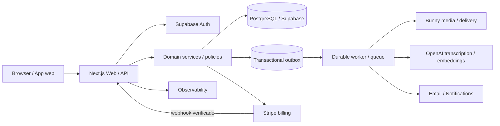
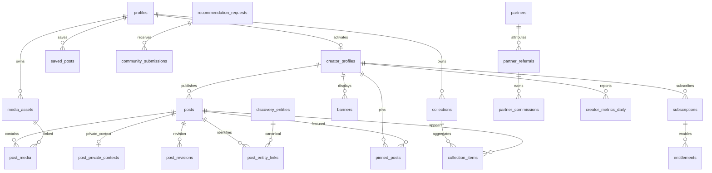
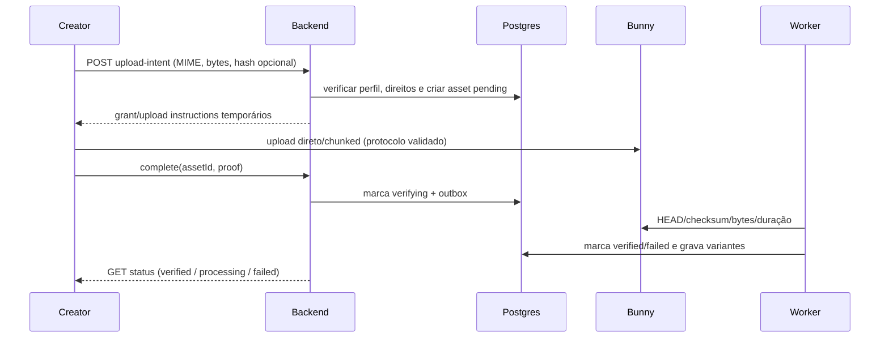
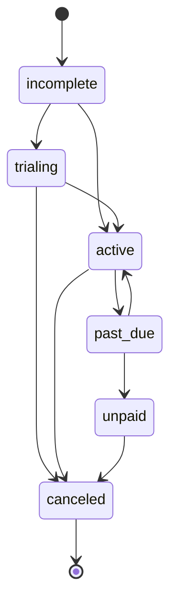

# FAVX — DOC 05: Backend & Database Specification

**Versão:** 1.0 — 05/11/2026  
**Classificação:** especificação de engenharia e baseline de implementação; não é deploy de produção.  
**Dependências:** DOC 01 PRD, DOC 02 TRD, DOC 03 App Flow e DOC 04 Design System.  
**Público:** engenharia, arquitetura, segurança, dados, QA, produto, Claude Code e operação.  
**Situação:** modelos e contratos para revisão técnica; migrações e testes entregues, execução no Supabase real ainda pendente.

> **Política de governança:** aprovação de produto prevalece sobre uma sugestão técnica. Onde há DEC-* aberto no PRD, o schema armazena estrutura extensível, mas NÃO fixa regra comercial, fiscal, jurídica ou operacional não aprovada. APIs e serviços devem falhar de forma controlada/feature flag desativada, em vez de presumir consentimento ou preços.

## 0. Resumo executivo

O backend do FAVX é concebido como **monólito modular**, web/API Next.js com serviços de domínio TypeScript, PostgreSQL/Supabase como fonte de verdade, Supabase Auth, Bunny para mídia, OpenAI para IA e Stripe para assinatura. Os módulos comunicam-se por casos de uso explícitos e eventos transacionais/outbox. A FAVX nasce com **User + Creator**, Creator Plus, Partners, Admin e busca circunscrita à página do creator ou aos salvos; global search, FAVX for Brands, Events e Proof são **FUTUROS**.

A entrega inclui (i) este documento, (ii) migrations de referência, (iii) catálogo de dados, (iv) contratos HTTP/OpenAPI, (v) fluxos e pseudocódigo de execução e (vi) matriz de testes e checklist. As migrations são uma **proposta testável, não validada**: rodar no ambiente Supabase local, revisar grants, RLS, permissões do service role, índices e custos antes de considerar código pronto.

### 0.1. Regras que nenhuma implementação pode violar

1. **Dados privados não aparecem em respostas públicas:** seguidores, seguindo, saves, views, impressões, cliques, analytics, buscas individuais, `post_private_contexts`, campanhas privadas e originais de mídia não passam pelo serializer público ou HTML/OG/JSON-LD/cache.
2. **Expiração de post/banner/pin é condição de leitura:** `visible_from <= now() < visible_until` quando limites existem, combinada com moderação, conta, direitos e entitlement. Worker assíncrono NÃO pode ser a única proteção.
3. **Original do creator é objeto privado íntegro**, não uma variante CDN; download demanda identidade, titularidade/direitos e grant efêmero do provedor.
4. **Eventos financeiros e comandos têm idempotência de negócio.** Um webhook repetido nunca gera duas comissões, upgrades ou reembolsos.
5. **Escopo de busca não pode ser ampliado pelo modelo.** Pesquisa em perfil A nunca consulta perfil B; busca em salvos nunca vaza conteúdo privado de outrem.
6. **Preferências não são permissões:** idioma, região, moeda, timezone, seguimento e participação em marketplace são dimensões distintas.
7. **Sem storage total de GB no produto.** Limites originais por arquivo continuam; custo físico e prevenção de abuso devem ter alertas e políticas transparentes.
8. **Data minimization:** intenção de consulta não equivale a permissão para segmentar, vender ou expor dados individuais; no futuro marketplace só dados agregados e acesso aprovado.

### 0.2. Legenda

| Status | Significado | Ação do time |
|---|---|---|
| APROVADO | Decisão validada na especificação de produto | implementar e testar |
| DERIVADO | Medida técnica necessária para cumprir o produto | validar em code review/POC |
| PROPOSTO | Alternativa arquitetural sugerida | registrar ADR, confirmar antes de assumir contrato |
| PENDENTE | Regra de produto/mercado não decidida | bloquear feature ou isolar por configuração |
| FUTURO | Preparação de dados sem feature no MVP | não criar telas/rotas comerciais |

## 1. Fonte de verdade, limites e arquitetura

### 1.1. Arquitetura lógica



**Crítica de arquitetura:** serviço de aplicação que decide acesso NÃO confia no browser nem em um único `creator_id` enviado pelo browser. A identidade vem da sessão verificada. O domínio passa `principal` com `userId`, status, autorização e correlation ID. O repositório só executa ação se houver política de propriedade/escopo satisfeita; RLS e grants reforçam a defesa. Evitar client com credencial `service_role` no navegador ou em URL.

### 1.2. Separação de schemas

- `auth`: identidade gerenciada Supabase; `auth.users` é referência, não tabela editada pela aplicação.
- `app`: **schema privado** com 66 tabelas base, fora de `Exposed schemas` da Data API. O SQL habilita RLS e revoga grants para `anon`/`authenticated` por padrão, depois concede leitura pontual ao titular.
- `extensions`: extensões PostgreSQL de vetor, trigramas e PostGIS, após verificar catálogo/versão. Nunca instalar PostGIS em `public` apenas por conveniência.
- `public`: manter enxuto; não usar views `SECURITY DEFINER` expostas como atalho de autorização.

**Escolha de transporte:** navegador chama endpoints server-side tipados em `/api/v1`; uma implementação futura pode usar RPC/data API autenticada somente após matriz de grants/RLS e testes próprios. Quando usar uma credencial privilegiada no servidor, **o serviço é o último perímetro de autorização**: queries administrativas devem exigir policy, verificar titular e registrar auditoria.

### 1.3. Convenções de persistência

- `id`: `uuid` para recursos e eventos; `auth.users.id` como identidade estável.
- `created_at`, `updated_at`, `deleted_at`: `timestamptz` UTC. `original_timezone` preserva intenção de agendamento. Não confundir hora local com UTC.
- Soft delete: campo de state + timestamp; não remover histórico financeiro sem política legal; relatórios agregados devem respeitar anonimização/eliminação.
- `version`: otimista (`If-Match`/`expectedVersion`), incrementado atomica/transacionalmente.
- Dinheiro: `minor_units bigint`, ISO 4217; evitar float para cobrança; conversão cambial nunca implícita.
- Consentimento: registros versionados por finalidade, decisão e momento; revogação deve refletir em workers, analytics e novas consultas.
- Conteúdo publicável: metadados sem segredo; original de mídia, conteúdo privado, buscas pessoais e direitos comerciais em tabelas separadas.

### 1.4. Estrutura de monorepo sugerida

```text
apps/web/app/(public)/...       # páginas públicas e SEO
apps/web/app/(private)/...      # User, Creator, Partner, Admin
apps/web/app/api/v1/...        # borda autenticada e API
packages/contracts/             # DTOs, schemas Zod, eventos e erros
packages/domain/identity/       # cases, policies, queries e commands
packages/domain/content/        # posts, lifecycle, banners, pins
packages/domain/media/          # Bunny adapters, uploads, rights
packages/domain/discovery/      # scope, search, FAVX Context, entities
packages/domain/commerce/       # billing, entitlements, partners
packages/domain/analytics/      # ingestão e agregação
packages/infrastructure/        # Supabase, Stripe, Bunny, OpenAI
supabase/migrations/            # SQL versionado deste pacote
supabase/tests/                 # pgTAP + RLS e integridade
workers/                         # consumidores outbox, fila e reconciliação
docs/                            # PRD/TRD/App Flow/Design System/DOC05
```

## 2. Regras de acesso, autenticação e autorização

### 2.1. Papéis de negócio e capability model

| Ator | Autorização de leitura | Escrita | Limitações |
|---|---|---|---|
| Visitante | perfil, post, coleção pública, pedido público, busca local publicada | nenhuma exceto fluxo comunitário explicitamente permitido e protegido | nunca analytics, followers, privado |
| User | conteúdo público + própria biblioteca, configurações e salvos | salvar, seguir, coleções pessoais, preferências | não escreve post creator sem ativação |
| Creator Free | own profile, own drafts/media/posts, métricas básicas permitidas | posts, captura, agendamento base, solicitações | analytics avançado, banners e pins Plus exigem entitlement |
| Creator Plus | dados próprios e recursos Plus | banners, pins, métricas avançadas, IA Plus conforme entitlements | limites e período pago validados no servidor |
| Partner aprovado | referrals, comissões e material da própria conta | solicitação e dados permitidos | nunca IDs individuais de audiência sem base apropriada |
| Support/Moderator | subconjunto necessário a suporte/moderação | ações auditadas conforme papel | sem extração financeira/privada irrestrita |
| Finance/Admin | dados e funções autorizadas por RBAC | cobranças internas, parceiros, moderação | dupla aprovação para operações financeiras críticas (proposto) |

A tabela `admin_memberships` registra RBAC, mas **não substitui** policy no servidor. Escopo contextual do recurso é verificado em cada endpoint. Conta suspensa, conteúdo denunciado e direitos de mídia devem afetar concessão de acesso. Headers ou payloads não podem escolher o papel. Se existir role no JWT, não confiar em `raw_user_meta_data` editável por usuário.

### 2.2. Segregação pública/privada e DTOs

O endpoint público usa allowlist: `id`, `username`, `title`, `body`, categorias permitidas, labels de patrocínio, rating pessoal e variantes públicas prontas. **Não serializar o row inteiro** (`SELECT *` + spread) porque novos campos privados poderiam vazar sem revisão. Perfil público NÃO pode incluir totais de seguidores, seguindo, cliques, impressões, saves, views, posições internas ou chaves de storage.

**Padrão de resposta a IDOR:** responder 404 para recurso alheio privado, independentemente de existir, sem indicar se o ID é válido. Ações mutáveis exigem `If-Match` ou versão e Idempotency-Key onde aplicável. Erros `403` para falta de feature/entitlement não devem expor detalhes de outra conta.

### 2.3. Matriz de políticas RLS

As migrations aplicam **default deny** com `ENABLE ROW LEVEL SECURITY` para todas as tabelas `app.*` e grants explícitos mínimos. Apenas leituras do próprio usuário em tabelas específicas estão inicialmente concedidas. A escrita direta de `profiles` pelo navegador está bloqueada para impedir alteração de `account_state`; a atualização normal deve passar por API com allowlist. Tabelas financeiras, analytics e jobs têm acesso apenas server-side.

| Grupo | `anon` DB | `authenticated` DB | API server autorizada |
|---|---|---|---|
| Perfil base e Creator | sem grant | leitura do próprio | DTO público saneado + edição permitida |
| Posts, contexto e mídia | sem grant | leitura da própria linha | CRUD após ownership, moderação e entitlements |
| Follows/salvos/coleções | sem grant | leitura própria | criar/remover/compartilhar mediante autorização |
| Busca/sessões e IA | sem grant | leitura da própria sessão | pipeline somente com escopo verificado |
| Analytics e agregações | sem grant | sem grant direto | dashboards por entitlement e owner |
| Billing/partners | sem grant | leitura pontual de commissions próprias | Stripe/financeiro/partner com RBAC |
| Admin/audit/outbox/jobs | sem grant | sem grant | operações de sistema auditadas |

**Risco conhecido a mitigar antes do deploy:** função `SECURITY DEFINER` com `search_path` não fixado; view que contorna RLS; grants herdados; política recursiva; privilégios excessivos de `service_role`; lógica de entitlement somente no cliente. A suíte de segurança deverá testar grants além de policies, inclusive para roles anon/authenticated.

## 3. Modelo de dados — mapa por domínio

Este documento adota **66 tabelas base** em 10 domínios (mais três opcionais para vetor/geo), organizadas por ownership e responsabilidade. A estrutura relacional a seguir é uma baseline técnica, não schema comercial irrevogável.

| Domínio | Entidades principais | Racional |
|---|---|---|
| Identity/Profile | profiles, creator_profiles, follows, blocked_users, links | identidade única com privado separado |
| Media | media_assets, media_upload_intents, media_variants, media_processing_jobs | original imutável e bytes fora do banco |
| Content | posts, post_revisions, post_media, post_links, coupons, ratings, contexts | publicação multimídia versionada |
| Presentation | banners, pinned_posts | calendário independente do post |
| User Library | collections, collection_items, saved_posts, share_tokens | coleções pessoais ou do Creator |
| Community | recommendation_requests, community_submissions | submissão privada até publicação explícita |
| Discovery | entities, evidence, search_docs, sessions, feedback | busca local hoje, canônicos no futuro |
| Analytics | analytics_events, metrics_daily, privacy_consents | gravação separada de exibição por plano |
| Commerce | plans, prices, subscriptions, entitlements, partners, commissions | Stripe source + projeção + last-click |
| Operations | admin, reports, audit, outbox, jobs, idempotency, flags | governança e filas duráveis |

### 3.1. Diagrama ER resumido



### 3.2. Contratos de integridade gerais

- FK com `ON DELETE CASCADE` em dados diretamente dependentes só é válida para **purge autorizado**. Exclusão lógica da conta ou post não executa cascatas e preserva histórico útil até a política legal permitir purge.
- `post_media.media_id` deve pertencer ao creator autor (trigger `0005_ownership_integrity`), salvo futuro fluxo comunitário explicitamente modelado.
- `post_private_contexts.owner_id` é necessariamente igual a `posts.creator_id` (trigger), e dados de contexto não podem participar de DTO, preview ou embedding compartilhado.
- `pinned_posts.creator_id` e `post_ratings.creator_id` precisam ser iguais ao autor do post (triggers).
- `community_submissions.creator_id` precisa ser o creator do pedido (trigger); a origem comunitária deve aparecer como atribuição explícita no post publicado.
- `posts.body` limita 10.000 caracteres no banco. Regras de imagem/vídeo/áudio exigem validação por bytes reais/duração no worker, não apenas no `CHECK` por causa dos metadados externos.
- Avaliação 0–10 e passo de 0,5 é uma **opção de modelagem proposta em PRD**, ajustável antes do lançamento; qualquer mudança exige migração de constraint.
- Datas de cupons/ofertas, publicação e consentimentos são independentes; um link vencido não deve manter selo de oferta ativa sem verificação.

## 4. Catálogo de tabelas — inventário e finalidade

A seguir, cada tabela lista o domínio, finalidade, visibilidade e suas colunas principais. Para **todas as colunas, tipo SQL e definição textual**, o pacote inclui `docs/data_dictionary.csv`. Para constraints, defaults, foreign keys e índices, o SQL versionado é a fonte técnica (ainda sujeito a teste).
#### DB-01 `app.profiles`

**Domínio:** Identidade/Preferências. **Finalidade:** Identidade unificada de pessoa, locale, timezone, moeda e estado de conta. **Exposição:** privado titular.  
**Campos-chave:** `user_id`, `currency`, `created_at`, `deleted_at`.  
**Regras:** propriedade, status e mutações documentados no SQL; endpoints devem impor validação de negócio e não retornar linhas brutas.

#### DB-02 `app.creator_profiles`

**Domínio:** Creator. **Finalidade:** Username, bio e estado de perfil público; não contém contadores públicos. **Exposição:** público DTO saneado; linha privada.  
**Campos-chave:** `user_id`, `created_at`.  
**Regras:** propriedade, status e mutações documentados no SQL; endpoints devem impor validação de negócio e não retornar linhas brutas.

#### DB-03 `app.reserved_slugs`

**Domínio:** Rotas. **Finalidade:** Slugs protegidos do sistema. **Exposição:** serviço.  
**Campos-chave:** `slug`, `reason`.  
**Regras:** propriedade, status e mutações documentados no SQL; endpoints devem impor validação de negócio e não retornar linhas brutas.

#### DB-04 `app.slug_redirects`

**Domínio:** Rotas. **Finalidade:** Redirecionamentos de usernames alterados. **Exposição:** serviço.  
**Campos-chave:** `creator_id`, `created_at`.  
**Regras:** propriedade, status e mutações documentados no SQL; endpoints devem impor validação de negócio e não retornar linhas brutas.

#### DB-05 `app.profile_links`

**Domínio:** Creator. **Finalidade:** Links configurados e ordenados do perfil. **Exposição:** público sob is_public.  
**Campos-chave:** `id`, `creator_id`, `created_at`.  
**Regras:** propriedade, status e mutações documentados no SQL; endpoints devem impor validação de negócio e não retornar linhas brutas.

#### DB-06 `app.follows`

**Domínio:** Social privado. **Finalidade:** Relações de seguir sem contagem pública. **Exposição:** somente titular e área privada.  
**Campos-chave:** `creator_id`, `created_at`.  
**Regras:** propriedade, status e mutações documentados no SQL; endpoints devem impor validação de negócio e não retornar linhas brutas.

#### DB-07 `app.blocked_users`

**Domínio:** Segurança. **Finalidade:** Relacionamentos de bloqueio. **Exposição:** privado titular.  
**Campos-chave:** `owner_id`, `created_at`.  
**Regras:** propriedade, status e mutações documentados no SQL; endpoints devem impor validação de negócio e não retornar linhas brutas.

#### DB-08 `app.media_assets`

**Domínio:** Mídia. **Finalidade:** Manifesto de originais, direitos e integridade. **Exposição:** privado titular.  
**Campos-chave:** `id`, `owner_id`, `original_key`, `original_state`, `rights_confirmed`, `can_download_original`, `moderation_state`, `created_at`, `deleted_at`.  
**Regras:** propriedade, status e mutações documentados no SQL; endpoints devem impor validação de negócio e não retornar linhas brutas.

#### DB-09 `app.media_upload_intents`

**Domínio:** Mídia. **Finalidade:** Permissão curta de upload e confirmação. **Exposição:** serviço.  
**Campos-chave:** `id`, `owner_id`, `expires_at`, `state`, `created_at`.  
**Regras:** propriedade, status e mutações documentados no SQL; endpoints devem impor validação de negócio e não retornar linhas brutas.

#### DB-10 `app.media_variants`

**Domínio:** Mídia. **Finalidade:** Derivados para entrega/preview. **Exposição:** serviço, URL por política.  
**Campos-chave:** `id`, `created_at`.  
**Regras:** propriedade, status e mutações documentados no SQL; endpoints devem impor validação de negócio e não retornar linhas brutas.

#### DB-11 `app.media_processing_jobs`

**Domínio:** Mídia. **Finalidade:** Fila de inspeção/processamento de arquivos. **Exposição:** serviço.  
**Campos-chave:** `id`, `state`, `created_at`.  
**Regras:** propriedade, status e mutações documentados no SQL; endpoints devem impor validação de negócio e não retornar linhas brutas.

#### DB-12 `app.posts`

**Domínio:** Conteúdo. **Finalidade:** Publicações, lifecycle e janelas de visibilidade. **Exposição:** público via filtro; privado titular.  
**Campos-chave:** `id`, `creator_id`, `lifecycle_state`, `moderation_state`, `visible_from`, `visible_until`, `version`, `created_at`, `deleted_at`.  
**Regras:** propriedade, status e mutações documentados no SQL; endpoints devem impor validação de negócio e não retornar linhas brutas.

#### DB-13 `app.post_revisions`

**Domínio:** Conteúdo. **Finalidade:** Histórico de edições e versionamento. **Exposição:** privado titular/auditoria.  
**Campos-chave:** `id`, `post_id`, `version`.  
**Regras:** propriedade, status e mutações documentados no SQL; endpoints devem impor validação de negócio e não retornar linhas brutas.

#### DB-14 `app.post_media`

**Domínio:** Conteúdo. **Finalidade:** Associação, ordenação e legendas de mídias. **Exposição:** público via post elegível.  
**Campos-chave:** `post_id`, `media_id`.  
**Regras:** propriedade, status e mutações documentados no SQL; endpoints devem impor validação de negócio e não retornar linhas brutas.

#### DB-15 `app.post_links`

**Domínio:** Conteúdo. **Finalidade:** Links externos, canonicalização e ordenação. **Exposição:** público via post elegível.  
**Campos-chave:** `id`, `post_id`, `created_at`.  
**Regras:** propriedade, status e mutações documentados no SQL; endpoints devem impor validação de negócio e não retornar linhas brutas.

#### DB-16 `app.categories`

**Domínio:** Taxonomia. **Finalidade:** Categorias navegáveis e hierarquia. **Exposição:** público curado.  
**Campos-chave:** `id`.  
**Regras:** propriedade, status e mutações documentados no SQL; endpoints devem impor validação de negócio e não retornar linhas brutas.

#### DB-17 `app.tags`

**Domínio:** Taxonomia. **Finalidade:** Tags canônicas. **Exposição:** público curado.  
**Campos-chave:** `id`.  
**Regras:** propriedade, status e mutações documentados no SQL; endpoints devem impor validação de negócio e não retornar linhas brutas.

#### DB-18 `app.tag_aliases`

**Domínio:** Taxonomia. **Finalidade:** Aliases e sinônimos. **Exposição:** serviço.  
**Campos-chave:** `alias_key`, `tag_id`.  
**Regras:** propriedade, status e mutações documentados no SQL; endpoints devem impor validação de negócio e não retornar linhas brutas.

#### DB-19 `app.post_categories`

**Domínio:** Taxonomia. **Finalidade:** Vínculos posts/categorias e proveniência. **Exposição:** público via post elegível.  
**Campos-chave:** `post_id`.  
**Regras:** propriedade, status e mutações documentados no SQL; endpoints devem impor validação de negócio e não retornar linhas brutas.

#### DB-20 `app.post_tags`

**Domínio:** Taxonomia. **Finalidade:** Vínculos posts/tags e proveniência. **Exposição:** público via post elegível.  
**Campos-chave:** `post_id`.  
**Regras:** propriedade, status e mutações documentados no SQL; endpoints devem impor validação de negócio e não retornar linhas brutas.

#### DB-21 `app.post_coupons`

**Domínio:** Ofertas. **Finalidade:** Cupons, condições e prazo. **Exposição:** público via post elegível e prazo.  
**Campos-chave:** `id`, `post_id`, `currency`, `expires_at`.  
**Regras:** propriedade, status e mutações documentados no SQL; endpoints devem impor validação de negócio e não retornar linhas brutas.

#### DB-22 `app.post_sponsorships`

**Domínio:** Publicidade. **Finalidade:** Disclosure obrigatório. **Exposição:** público via post elegível.  
**Campos-chave:** `post_id`, `created_at`.  
**Regras:** propriedade, status e mutações documentados no SQL; endpoints devem impor validação de negócio e não retornar linhas brutas.

#### DB-23 `app.post_ratings`

**Domínio:** Creator. **Finalidade:** Nota pessoal 0–10 opcional. **Exposição:** público via post elegível.  
**Campos-chave:** `post_id`, `creator_id`.  
**Regras:** propriedade, status e mutações documentados no SQL; endpoints devem impor validação de negócio e não retornar linhas brutas.

#### DB-24 `app.post_private_contexts`

**Domínio:** IA/Privacidade. **Finalidade:** Contexto oculto e transcrição de Creator. **Exposição:** privado, nunca DTO público.  
**Campos-chave:** `post_id`, `owner_id`.  
**Regras:** propriedade, status e mutações documentados no SQL; endpoints devem impor validação de negócio e não retornar linhas brutas.

#### DB-25 `app.banners`

**Domínio:** Campanhas. **Finalidade:** Banner independente com ciclo de visibilidade. **Exposição:** público se vigente e Plus ativo.  
**Campos-chave:** `id`, `creator_id`, `media_id`, `lifecycle_state`, `moderation_state`, `visible_from`, `visible_until`, `version`, `created_at`, `deleted_at`.  
**Regras:** propriedade, status e mutações documentados no SQL; endpoints devem impor validação de negócio e não retornar linhas brutas.

#### DB-26 `app.pinned_posts`

**Domínio:** Destaques. **Finalidade:** Fixação independente do post, slot e janela. **Exposição:** público se vigente e Plus ativo.  
**Campos-chave:** `id`, `post_id`, `creator_id`, `visible_from`, `visible_until`, `lifecycle_state`, `created_at`.  
**Regras:** propriedade, status e mutações documentados no SQL; endpoints devem impor validação de negócio e não retornar linhas brutas.

#### DB-27 `app.collections`

**Domínio:** Coleções. **Finalidade:** Coleções User/Creator e visibilidade. **Exposição:** privado/compartilhável/público.  
**Campos-chave:** `id`, `owner_id`, `created_at`, `deleted_at`.  
**Regras:** propriedade, status e mutações documentados no SQL; endpoints devem impor validação de negócio e não retornar linhas brutas.

#### DB-28 `app.collection_items`

**Domínio:** Coleções. **Finalidade:** Ordenação de posts dentro da coleção. **Exposição:** conforme política da coleção e post.  
**Campos-chave:** `post_id`.  
**Regras:** propriedade, status e mutações documentados no SQL; endpoints devem impor validação de negócio e não retornar linhas brutas.

#### DB-29 `app.saved_posts`

**Domínio:** Biblioteca. **Finalidade:** Salvamentos pessoais. **Exposição:** privado titular.  
**Campos-chave:** `user_id`, `post_id`.  
**Regras:** propriedade, status e mutações documentados no SQL; endpoints devem impor validação de negócio e não retornar linhas brutas.

#### DB-30 `app.collection_share_tokens`

**Domínio:** Compartilhamento. **Finalidade:** Capabilities revogáveis não listadas. **Exposição:** serviço; hash não exposto.  
**Campos-chave:** `id`, `token_hash`, `expires_at`, `created_at`.  
**Regras:** propriedade, status e mutações documentados no SQL; endpoints devem impor validação de negócio e não retornar linhas brutas.

#### DB-31 `app.recommendation_requests`

**Domínio:** Comunidade. **Finalidade:** Pedido criado por Creator. **Exposição:** público enquanto aberto.  
**Campos-chave:** `id`, `creator_id`, `state`, `created_at`, `expires_at`.  
**Regras:** propriedade, status e mutações documentados no SQL; endpoints devem impor validação de negócio e não retornar linhas brutas.

#### DB-32 `app.community_submissions`

**Domínio:** Comunidade. **Finalidade:** Sugestões recebidas e revisão. **Exposição:** privado por padrão.  
**Campos-chave:** `id`, `creator_id`, `state`, `created_at`.  
**Regras:** propriedade, status e mutações documentados no SQL; endpoints devem impor validação de negócio e não retornar linhas brutas.

#### DB-33 `app.discovery_entities`

**Domínio:** Busca futura. **Finalidade:** Entidade canônica produto/lugar/serviço. **Exposição:** serviço e indexável futuro.  
**Campos-chave:** `id`, `created_at`.  
**Regras:** propriedade, status e mutações documentados no SQL; endpoints devem impor validação de negócio e não retornar linhas brutas.

#### DB-34 `app.entity_aliases`

**Domínio:** Busca futura. **Finalidade:** Sinônimos de entidades. **Exposição:** serviço.  
**Campos-chave:** `id`.  
**Regras:** propriedade, status e mutações documentados no SQL; endpoints devem impor validação de negócio e não retornar linhas brutas.

#### DB-35 `app.post_entity_links`

**Domínio:** Busca futura. **Finalidade:** Ligação recomendação-entidade com confiança. **Exposição:** serviço.  
**Campos-chave:** `post_id`.  
**Regras:** propriedade, status e mutações documentados no SQL; endpoints devem impor validação de negócio e não retornar linhas brutas.

#### DB-36 `app.entity_evidence`

**Domínio:** Busca futura. **Finalidade:** Evidências e fontes dos atributos. **Exposição:** serviço.  
**Campos-chave:** `id`, `expires_at`.  
**Regras:** propriedade, status e mutações documentados no SQL; endpoints devem impor validação de negócio e não retornar linhas brutas.

#### DB-37 `app.post_search_documents`

**Domínio:** Busca. **Finalidade:** Documento lexical público e chave de indexação. **Exposição:** serviço; nunca expor index privado.  
**Campos-chave:** `post_id`, `creator_id`.  
**Regras:** propriedade, status e mutações documentados no SQL; endpoints devem impor validação de negócio e não retornar linhas brutas.

#### DB-38 `app.search_sessions`

**Domínio:** Busca IA. **Finalidade:** Sessões e escopo imutável Creator/Salvos. **Exposição:** privado sessão/usuário.  
**Campos-chave:** `id`, `scope_kind`, `scope_owner_id`, `created_at`, `expires_at`.  
**Regras:** propriedade, status e mutações documentados no SQL; endpoints devem impor validação de negócio e não retornar linhas brutas.

#### DB-39 `app.search_messages`

**Domínio:** Busca IA. **Finalidade:** Histórico curto de refinamentos. **Exposição:** privado sessão/usuário.  
**Campos-chave:** `id`, `created_at`.  
**Regras:** propriedade, status e mutações documentados no SQL; endpoints devem impor validação de negócio e não retornar linhas brutas.

#### DB-40 `app.search_feedback`

**Domínio:** Busca IA. **Finalidade:** Feedback de qualidade. **Exposição:** privado/agregado.  
**Campos-chave:** `id`, `post_id`, `created_at`.  
**Regras:** propriedade, status e mutações documentados no SQL; endpoints devem impor validação de negócio e não retornar linhas brutas.

#### DB-41 `app.analytics_events`

**Domínio:** Telemetria. **Finalidade:** Eventos idempotentes com timestamp e pseudônimo. **Exposição:** serviço.  
**Campos-chave:** `id`, `creator_id`, `post_id`, `event_dedupe_key`.  
**Regras:** propriedade, status e mutações documentados no SQL; endpoints devem impor validação de negócio e não retornar linhas brutas.

#### DB-42 `app.creator_metrics_daily`

**Domínio:** Analytics. **Finalidade:** Agregações diárias de creator. **Exposição:** privado + entitlement.  
**Campos-chave:** `creator_id`.  
**Regras:** propriedade, status e mutações documentados no SQL; endpoints devem impor validação de negócio e não retornar linhas brutas.

#### DB-43 `app.post_metrics_daily`

**Domínio:** Analytics. **Finalidade:** Agregações diárias por post. **Exposição:** privado + entitlement.  
**Campos-chave:** `post_id`.  
**Regras:** propriedade, status e mutações documentados no SQL; endpoints devem impor validação de negócio e não retornar linhas brutas.

#### DB-44 `app.banner_metrics_daily`

**Domínio:** Analytics. **Finalidade:** Agregações diárias por banner. **Exposição:** privado + entitlement.  
**Campos-chave:** `banner_id`, `day`, `impressions`, `clicks`.  
**Regras:** propriedade, status e mutações documentados no SQL; endpoints devem impor validação de negócio e não retornar linhas brutas.

#### DB-45 `app.privacy_consents`

**Domínio:** Privacidade. **Finalidade:** Histórico de escolha/base/versão. **Exposição:** privado titular/segurança.  
**Campos-chave:** `id`, `user_id`.  
**Regras:** propriedade, status e mutações documentados no SQL; endpoints devem impor validação de negócio e não retornar linhas brutas.

#### DB-46 `app.plans`

**Domínio:** Billing. **Finalidade:** Catálogo de planos. **Exposição:** servidor/consulta pública saneada.  
**Campos-chave:** `id`.  
**Regras:** propriedade, status e mutações documentados no SQL; endpoints devem impor validação de negócio e não retornar linhas brutas.

#### DB-47 `app.plan_prices`

**Domínio:** Billing. **Finalidade:** Preços por moeda e período; apenas aprovados. **Exposição:** servidor/consulta pública saneada.  
**Campos-chave:** `id`, `currency`, `minor_units`.  
**Regras:** propriedade, status e mutações documentados no SQL; endpoints devem impor validação de negócio e não retornar linhas brutas.

#### DB-48 `app.subscriptions`

**Domínio:** Billing. **Finalidade:** Projeção reconciliada de assinaturas Stripe. **Exposição:** privado titular/financeiro.  
**Campos-chave:** `id`, `creator_id`, `state`, `currency`, `created_at`.  
**Regras:** propriedade, status e mutações documentados no SQL; endpoints devem impor validação de negócio e não retornar linhas brutas.

#### DB-49 `app.subscription_events`

**Domínio:** Billing. **Finalidade:** Eventos assíncronos aplicados por provedor. **Exposição:** serviço.  
**Campos-chave:** `id`, `provider_event_id`.  
**Regras:** propriedade, status e mutações documentados no SQL; endpoints devem impor validação de negócio e não retornar linhas brutas.

#### DB-50 `app.entitlements`

**Domínio:** Billing. **Finalidade:** Permissões temporais de recursos Plus. **Exposição:** servidor.  
**Campos-chave:** `id`, `creator_id`, `feature_key`, `created_at`.  
**Regras:** propriedade, status e mutações documentados no SQL; endpoints devem impor validação de negócio e não retornar linhas brutas.

#### DB-51 `app.provider_webhook_events`

**Domínio:** Integração. **Finalidade:** Inbox deduplicada e resultado de webhook. **Exposição:** serviço.  
**Campos-chave:** `provider_event_id`.  
**Regras:** propriedade, status e mutações documentados no SQL; endpoints devem impor validação de negócio e não retornar linhas brutas.

#### DB-52 `app.partners`

**Domínio:** Partners. **Finalidade:** Inscrição e status de parceiro. **Exposição:** privado titular/admin.  
**Campos-chave:** `id`, `user_id`, `state`, `created_at`.  
**Regras:** propriedade, status e mutações documentados no SQL; endpoints devem impor validação de negócio e não retornar linhas brutas.

#### DB-53 `app.partner_clicks`

**Domínio:** Partners. **Finalidade:** Clique rastreado para atribuição. **Exposição:** serviço.  
**Campos-chave:** `id`, `event_dedupe_key`.  
**Regras:** propriedade, status e mutações documentados no SQL; endpoints devem impor validação de negócio e não retornar linhas brutas.

#### DB-54 `app.partner_referrals`

**Domínio:** Partners. **Finalidade:** Atribuição de usuário referido. **Exposição:** privado parceiro/admin.  
**Campos-chave:** `id`.  
**Regras:** propriedade, status e mutações documentados no SQL; endpoints devem impor validação de negócio e não retornar linhas brutas.

#### DB-55 `app.partner_commissions`

**Domínio:** Partners. **Finalidade:** Lançamento auditável de comissão. **Exposição:** privado parceiro/admin.  
**Campos-chave:** `id`, `coverage_period_start`, `coverage_period_end`, `currency`, `state`, `created_at`.  
**Regras:** propriedade, status e mutações documentados no SQL; endpoints devem impor validação de negócio e não retornar linhas brutas.

#### DB-56 `app.partner_payout_batches`

**Domínio:** Partners. **Finalidade:** Lotes de pagamento. **Exposição:** financeiro/admin.  
**Campos-chave:** `id`, `currency`, `state`, `created_at`.  
**Regras:** propriedade, status e mutações documentados no SQL; endpoints devem impor validação de negócio e não retornar linhas brutas.

#### DB-57 `app.partner_payout_items`

**Domínio:** Partners. **Finalidade:** Comissão incluída em lote. **Exposição:** financeiro/admin.  
**Campos-chave:** `payout_batch_id`, `commission_id`.  
**Regras:** propriedade, status e mutações documentados no SQL; endpoints devem impor validação de negócio e não retornar linhas brutas.

#### DB-58 `app.admin_memberships`

**Domínio:** Admin. **Finalidade:** RBAC administrativo. **Exposição:** serviço/admin auditado.  
**Campos-chave:** `user_id`, `created_at`.  
**Regras:** propriedade, status e mutações documentados no SQL; endpoints devem impor validação de negócio e não retornar linhas brutas.

#### DB-59 `app.moderation_reports`

**Domínio:** Moderação. **Finalidade:** Denúncias e tratamento. **Exposição:** privado suporte/moderação.  
**Campos-chave:** `id`, `state`, `created_at`.  
**Regras:** propriedade, status e mutações documentados no SQL; endpoints devem impor validação de negócio e não retornar linhas brutas.

#### DB-60 `app.audit_logs`

**Domínio:** Auditoria. **Finalidade:** Rastro de alterações sensíveis sem segredos. **Exposição:** serviço/admin.  
**Campos-chave:** `id`, `created_at`.  
**Regras:** propriedade, status e mutações documentados no SQL; endpoints devem impor validação de negócio e não retornar linhas brutas.

#### DB-61 `app.notifications`

**Domínio:** Notificação. **Finalidade:** Caixa de mensagens do usuário. **Exposição:** privado titular.  
**Campos-chave:** `id`, `created_at`.  
**Regras:** propriedade, status e mutações documentados no SQL; endpoints devem impor validação de negócio e não retornar linhas brutas.

#### DB-62 `app.notification_preferences`

**Domínio:** Notificação. **Finalidade:** Preferências de entrega. **Exposição:** privado titular.  
**Campos-chave:** `user_id`.  
**Regras:** propriedade, status e mutações documentados no SQL; endpoints devem impor validação de negócio e não retornar linhas brutas.

#### DB-63 `app.outbox_events`

**Domínio:** Jobs. **Finalidade:** Eventos transacionais para processamento. **Exposição:** serviço.  
**Campos-chave:** `id`, `state`, `created_at`.  
**Regras:** propriedade, status e mutações documentados no SQL; endpoints devem impor validação de negócio e não retornar linhas brutas.

#### DB-64 `app.scheduled_jobs`

**Domínio:** Jobs. **Finalidade:** Agendamento de tarefas duráveis com versão. **Exposição:** serviço.  
**Campos-chave:** `id`, `state`, `created_at`.  
**Regras:** propriedade, status e mutações documentados no SQL; endpoints devem impor validação de negócio e não retornar linhas brutas.

#### DB-65 `app.idempotency_keys`

**Domínio:** Segurança. **Finalidade:** Replay seguro de comandos mutáveis. **Exposição:** serviço.  
**Campos-chave:** `expires_at`, `created_at`.  
**Regras:** propriedade, status e mutações documentados no SQL; endpoints devem impor validação de negócio e não retornar linhas brutas.

#### DB-66 `app.feature_flags`

**Domínio:** Configuração. **Finalidade:** Desligamento seletivo de módulos. **Exposição:** serviço.  
**Campos-chave:** `flag_key`, `enabled`, `config`, `updated_at`.  
**Regras:** propriedade, status e mutações documentados no SQL; endpoints devem impor validação de negócio e não retornar linhas brutas.


## 5. Migrations, evolução e backfills

### 5.1. Ordem de execução

| Sequência | Artefato | Condição | Reversão |
|---|---|---|---|
| 0001 | `0001_app_schema.sql` | Supabase Auth + SQL role `authenticated` disponíveis | rollback por backup/snapshot em staging; não `DROP CASCADE` em produção |
| 0002 | `0002_optional_vector_geo.sql` | aprovar modelos de embedding, dimensões, disponibilidade PostGIS/pgvector | rollback lógico e reindexação; não quebrar search fallback |
| 0003 | `0003_seed_safe.sql` | códigos de plano e slugs revisados | upsert idempotente; não editar preços aprovados sem auditoria |
| 0004 | `0004_visibility_helper.sql` | após 0001; query pública e TTL verificadas | versionar função |
| 0005 | `0005_ownership_integrity.sql` | inserir triggers de associação e testes de integridade | migração versionada, manutenção de dados inválidos pré-existentes |

**Importante:** arquivos foram organizados para leitura, mas execução `supabase db reset`/`supabase migration up` em ambiente real não foi realizada nesta entrega. Os scripts de exemplo não substituem avaliação de privilégio do provedor e revisão de PK/FK em fixtures reais. Não ligar feature flags apenas porque o SQL aplicou com sucesso.

### 5.2. Padrão de migração segura

1. Registrar ADR e requisito/DEC originador.
2. Migração **expand** adiciona coluna/tabela nullable compatível com versão anterior da API.
3. Worker faz backfill versionado em lotes com checkpoint/monitoramento.
4. Leitura dupla e comparação validam integridade/contagem.
5. Ativar escrita e lógica nova sob feature flag; medir; preservar rollback.
6. Migração **contract** remove uso antigo depois de janela definida, nunca durante deploy misto.
7. Testar restore e dry-run de migração em clone de produção antes de alterações de dados.

Não modificar migration histórica aplicada; criar nova. Tabelas de analytics de alta volumetria devem ser candidatas a particionamento mensal **após medição**, não antecipar operação complexa sem necessidade. Definir retention + purge por finalidade antes de crescer histórico.

### 5.3. Estratégia de observabilidade SQL

- Medir `EXPLAIN (ANALYZE, BUFFERS)` com dataset representativo nas queries de perfil, busca lexical, listas de salvos e analytics.
- Acompanhar índices usados, crescimento, vacuum, conexões, lock waits e consultas lentas.
- Para dados de analytics, separar escrita de eventos brutos de agregados servidos; considerar tabela particionada após dados reais.
- SQL com tenant `creator_id` filtra na primeira etapa; índice deve incluir chaves de escopo e datas usadas.
- `pgvector` e `PostGIS` exigem testes de seletividade/geografia e POC de custos, antes de aprovar HNSW/GiST definitivos.

## 6. Padrões de API e contratos HTTP

### 6.1. Envelope, autenticação e versionamento

Prefixo `/api/v1`; JSON UTF-8; autenticação por cookie de sessão do Supabase com proteção CSRF em operações cookie-authenticated; bearer autorizado para integrações de serviço explicitamente suportadas. Headers: `X-Request-ID` aceito para correlação (servidor gera próprio ID confiável), `Idempotency-Key` para mutações relevantes, `If-Match` para alterações versionadas. `429` para rate limit, com backoff; 401 sessão ausente; 403 policy/entitlement; 404 recurso não localizável/no access; 409 conflito; 422 validação semântica; 500/503 erro interno.

```json
{
  "data": { "id": "uuid", "status": "published" },
  "meta": { "requestId": "trace-id", "version": 8 }
}
```

```json
{
  "error": {
    "code": "ENTITLEMENT_REQUIRED",
    "messageKey": "errors.entitlement_required",
    "details": [],
    "requestId": "trace-id",
    "retryable": false
  }
}
```

O servidor nunca deve entregar stack trace, chave Bunny, acesso Stripe, dados privados de Context ou payload de webhooks como `details`. Mensagens exibidas são localizadas nos seis idiomas. Logs armazenam `error.code`, trace, contexto redigido e severidade; conteúdo de áudio/transcrição é sensível.

### 6.2. Endpoints por domínio

| API | Método/rota | Auth | Side effect/idempotência |
|---|---|---|---|
| Identidade | `GET /me`, `PATCH /me` | user | PATCH com versão |
| Creator | `POST /creator/activate`, `PATCH /creator/profile` | user/creator | slug transacional; conflito 409 |
| Perfil público | `GET /profiles/{username}` | público | cache seguro e DTO allowlist |
| Posts | `POST /posts`, `GET/PATCH/DELETE /posts/{id}` | creator | versão, rascunho ou soft delete |
| Lifecycle | `POST /posts/{id}/publish`, `/hide`, `/archive`, `/restore` | creator | outbox e estado |
| Mídia | `POST /media/upload-intents`, `/media/{id}/complete` | dono | idempotência, validação mídia real |
| Download | `POST /media/{id}/download-grant` | dono | grant curto; audit |
| Context | `GET/PUT/DELETE /posts/{id}/context` | dono | nunca público |
| Banners | `POST /banners`, `PATCH /banners/{id}`, `DELETE /banners/{id}` | Plus | entitlement temporal |
| Pins | `POST /pins`, `PATCH /pins/{id}`, `DELETE /pins/{id}` | Plus | disputa slot/intervalo |
| Library | `POST /collections`, `GET/PATCH/DELETE /collections/{id}` | owner | private/public/unlisted |
| Library | `POST /posts/{id}/save`, `DELETE /posts/{id}/save` | user | dedupe por `(user,post)` |
| Community | `POST /recommendation-requests`, `POST /requests/{id}/submissions` | creator/user | moderação/limites |
| Busca | `POST /search/sessions`, `/search/sessions/{id}/messages` | público/owner | escopo fixo; quotas |
| Voz | `POST /search/voice/transcribe` | user ou sessão permitida | privacidade, validação MIME |
| Analytics | `POST /analytics/events`, `GET /creator/analytics/*` | server/creator | ingestão validada; entitlement de leitura |
| Billing | `POST /billing/checkout`, `GET /billing/subscription` | creator | Stripe idempotência + reconciliação |
| Webhooks | `POST /webhooks/stripe` | assinatura Stripe | inbox + dedupe |
| Partners | `POST /partners/application`, `GET /partners/dashboard` | user/partner | valida estado e attribution |
| Admin | `/admin/*` | admin RBAC | auditoria + least privilege |

Contratos JSON representativos e paths completos encontram-se em `contracts/openapi.yaml`.

### 6.3. POST `/api/v1/posts` — transação de criação

**Entrada:** título e descrição (texto <=10.000), listas tipadas de mídia já verificada/aceita, links e tags autorizados, datas de início/fim ou `draft`, timezone explícito; publicidade, cupom e rating opcionais. **Autorização:** user com Creator ativo; validar dono de cada mídia e limite sugerido de carrossel somente após aprovação do DEC-16. **Transação:** inserir post, vincular filhos e revisão inicial, criar outbox `post.created`, retornar id/version. **Resposta:** 201 e DTO privado; `422` se janela inválida, `409` se token idempotente reusado com payload diferente.

**Atualização:** exige `expectedVersion`/`If-Match`; em `UPDATE ... WHERE version=:expected`, incrementar `version`, inserir `post_revisions` e evento `post.updated` na mesma transação. Se nenhuma linha alterada, retornar 409 com semântica de conflito; nunca substituir edição concorrente sem avisar.

### 6.4. GET público de post — filtro inviolável

```sql
SELECT p.id, p.creator_id, p.title, p.body, p.published_at
FROM app.posts p
JOIN app.creator_profiles cp ON cp.user_id=p.creator_id
JOIN app.profiles u ON u.user_id=p.creator_id
WHERE p.id = :post_id AND cp.username=:username
  AND cp.is_public=true AND cp.creator_state='active' AND u.account_state='active'
  AND app.post_is_public(p,now());
```

A chamada SQL acima deve ocorrer no backend com role permitido, aplicando DTO público explícito; avaliações/links/cupons só entram se sua própria validade permitir. `ETag` e cache devem ser invalidáveis e seu TTL não pode servir conteúdo depois de `visible_until`. Se expirado entre lista e detalhe, detalhe responde indisponível. Pin exige **dupla verificação**: o post existe/publicável e a fixação está válida, ainda dentro do entitlement Plus.

## 7. Engenharia de mídia e armazenamento Bunny

### 7.1. Política original e direitos

- Imagem: até 20 MB por original; vídeo até 250 MB **e** 10 min; áudio até 20 MB **e** 10 min; texto até 10.000 caracteres; carrossel até dez itens como proposta pendente de confirmação formal.
- A origem é `native_capture`, `user_upload`, `external_reference` ou `community_submission`. Downloads de originais do creator ficam habilitados apenas para mídia própria com `rights_confirmed=true`, checksum e `original_state=verified`.
- Arquivo original é imutável após aceite. Caso usuário altere crop/edição, novo derivado é gerado sem sobrescrever bytes originais. Versionar variantes e metadados de processamento.
- Não presumir que URL CDN pública é URL autorizada para download original. Usar zonas privadas e mecanismo de autorização compatível com Bunny, POC antes de produção.

### 7.2. Sequência upload



Nenhum cliente pode chamar `complete` e marcar como `verified` por conta própria; o worker inspeciona o objeto real. Falha de rede preserva draft e permite retomada apenas se o provedor e o protocolo tiverem suporte validado. Preferir upload direto sem usar Vercel como proxy de bytes de vídeo; se não viável, escolher um backend específico de upload em POC. **Dados de credencial do Bunny jamais saem do servidor**.

### 7.3. Download seguro

```text
1. principal user authenticado + status ativo
2. asset.owner_id == principal.userId
3. origin_kind in (native_capture, user_upload)
4. rights_confirmed AND original_state == verified
5. media original ainda dentro das regras de retenção
6. gerar grant curto vinculado ao objeto e disposition attachment
7. auditar sem logar URL/credenciais
8. devolver URL efêmera e expiresAt; resposta private/no-store
```

Se o provedor não permitir revogar grant individual, diminuir TTL, isolar private origin e não incluir URL em telemetria. Validar `Content-Disposition`, comportamento em mobile, streaming/arquivo grande e revogação de conta.

### 7.4. Estados, custos, operações

`pending → uploading → verifying → verified` ou `failed`; derivados `pending → ready/failed`. Jobs para inspeção, thumbnails, transcode, waveforms, transcrição, indexação e limpeza; dead letter após retries e alerta. Monitorar bytes armazenados, consumo CDN, transcodificação, storage cost/creator/coorte e tentativas maliciosas. **Armazenamento acumulado ilimitado é promessa funcional**, não ausência de fair use técnico/antifraude nem licença para descartar originais.

## 8. Posts, banners, fixações e visibilidade temporal

### 8.1. Modelo de estado composto

Em cada consulta pública, a visibilidade é conjunção de:

`owner_active AND creator_public AND moderation_approved AND lifecycle_eligible AND now>=visible_from AND (visible_until IS NULL OR now<visible_until) AND !soft_deleted`.

Para banner/pin, adicionalmente exigir `entitlement_plus_active` e regra de overlap/slot. Campo `lifecycle_state` pode ficar `scheduled` até o worker conciliar, mas a query pública poderá exibir o conteúdo no momento certo; inversamente um estado `published` não pode manter item expirado visível. Estado materializado e elegibilidade são conceitos diferentes.

### 8.2. Agendamento consistente

- Converter horário informado no timezone IANA escolhido pelo creator para UTC e guardar ambos; em horário inexistente na transição DST, solicitar correção; em horário ambíguo, exigir escolha inequívoca.
- Criar transação com post/banner/pin e job com `expected_version`, dedupe por tipo+recurso+instante; registrar audit log; enfileirar outbox.
- Reconciliador varre janelas vencidas/due, corrige estados e emite notificações; repetição é segura; worker usa lock por recurso e valida versão antes de atualizar.
- O momento exato de ocultação não depende da pontualidade do worker. Para 10/nov às 10:00 na timezone especificada, `now >= visible_until` nega a exibição e também deve inviabilizar links/caches antigos.
- Uma fixação terminada tira o destaque, **não** despublica post. Um banner expirado esconde banner, preserva eventos.
- O armazenamento de métricas não é apagado ao ocultar, arquivar, suspender ou expirar; purge exige política de retenção.

### 8.3. Regra de slots e conflitos

Máximo de seis fixações Plus e dez banners Plus aprovado como direção; **a contagem exata** de banners e coleções, critérios de simultaneidade e posição final dependem DEC-01/02. Até confirmação, o backend deve reservar interfaces e constraints definíveis por política (`capacityPolicy`) sem fingir regras de sobreposição aprovadas. Recomenda-se, após decisão, transações com `SELECT ... FOR UPDATE` ou advisory lock por Creator/slot e reconsulta de intervalos sob isolamento adequado; testar duas abas e requisições concorrentes. Um índice simples não garante ausência de overlap temporal.

## 9. Conteúdo e estrutura editorial

### 9.1. Campos e semântica

Cada post pode conter descrição, mídias ordenadas, links externos, categorias/tags com origem (creator/IA/admin), cupons, indicadores de desconto, publicidade sinalizada e avaliação pessoal opcional. `post_revisions` guarda snapshot redigido antes da edição para rastreabilidade; **não** duplicar originais de mídia em cada revisão. URLs externas precisam de validação HTTPS/allowlist e proteção de SSRF no mecanismo de ingestão e thumbnails. Tracking/afiliado é separado de URL canonical para futura deduplicação.

### 9.2. Recomendações comunitárias

`recommendation_requests` mantém página/link do pedido. Envio nasce `community_submissions.pending` privado por padrão, mesmo que remetente não tenha conta quando permitido. Creator pode aprovar/rejeitar, mas publicação de conteúdo da comunidade deve registrar `submission_id`, atribuição, direitos e proveniência, jamais aparecer como recomendação própria do creator por omissão. A migration base tem `published_post_id`; **migração incremental adicional de proveniência** deve ligar post ao envio com status/consentimento e auditoria antes de ativar essa feature.

### 9.3. Coleções e salvos

Biblioteca pessoal é privada por padrão; URL compartilhável com token não listada usa somente **hash** persistido, chave aleatória de alta entropia entregue ao titular uma vez; revogar invalida o acesso no servidor e cache. Mesmo coleção pública ou unlisted **não deve renderizar post oculto/expirado/moderado**. Salvo de um post indisponível pode mostrar placeholder explicativo ao titular sem ressuscitar bytes privados.

## 10. Busca convencional, híbrida, conversacional e geográfica

### 10.1. Recorte e prevenção de vazamento

Hoje o escopo é `creator` ou `saved`. O ID de escopo é definido e validado pelo backend no início da sessão e permanece imutável em todos os refinamentos. **Jamais** permitir que prompt da IA, filtro, link ou payload alterem `scope_owner_id` ou executem query global. A busca global só pode ser ativada após aprovação explícita, feature flag e trabalho de governança de conteúdo.

### 10.2. Pipeline em camadas

1. Classificar intenção e entidades (produto/lugar/serviço), corrigir variações idiomáticas e normalizar texto.
2. Aplicar escopo e direitos **antes** da recuperação; criar conjunto de candidatos elegíveis pelo post real.
3. FTS lexical + aliases/tags + busca vetorial somente quando embeddings validados; filtros por data de criação, categoria e estado.
4. Se necessário, geocodificar localização manual ou localização consentida; distância por PostGIS somente com evidência confiável e precisão informada.
5. Combinar resultados com score transparente configurado, penalizar conteúdo expirado/atributos sem evidência; enriquecer com dados de post e proveniência.
6. IA pode redigir uma síntese somente dos candidatos elegíveis e com citações ao post; proibir inventar recursos, estabelecimentos, preços, horários e atributos.
7. Sessão persiste refinamentos com TTL/retention acordados; transcrição de voz segue proteção equivalente.

### 10.3. FAVX Context e embeddings

`post_private_contexts.context_text` é **input privado de recuperação** que a IA pode usar para relacionar recomendações e intenções; não é legenda pública, não pode ser exposto no autocomplete público, snippets, resumo, cards, métricas públicas nem logs sem redaction. O banco separa `post_embeddings` e `context_embeddings` opcionalmente: isso facilita controlar origem, deleção, versionamento de geração e regras de interpretação. Um match de Context pode justificar ranking, mas uma afirmação no resultado exige fonte pública/permitida. Tokens de busca por voz e áudio original seguem TTL e retenção definidos por política.

### 10.4. Busca geográfica

Começar por pesquisa com cidade/bairro explicitamente informados. Geolocalização precisa é opcional, contextual e com alternativa manual. `entity_locations` é tabela futura opcional PostGIS (geography WGS84) com fonte e precisão; não declarar `aberto agora` ou tempo de deslocamento sem informação verificada atual. Ranking pode expandir bairros vizinhos mediante raio geográfico, apresentando transparência de expansão; não usar proximidade geográfica de um local como inferência da localização precisa do usuário.

### 10.5. Teste de qualidade e custo IA

Criar benchmark com consultas de múltiplos idiomas, variações geográficas, sinônimos, consulta vazia, negativa, termos ambíguos, refino sucessivo e transcrição com ruído. Medir recall@k, precisão@k, false claims, vazamento de contexto (tolerância 0), latência, custo por busca e taxa de fallback. Limites de tokens, rate limit, fila e caching podem ser ativados por configuração; **não** fixar cota comercial por plano sem decisão de produto.

## 11. Métricas e analytics privados

### 11.1. Evento transacional vs evento de produto

Eventos de negócio (p.ex. `post.published`, `subscription.paid`) devem nascer no outbox **na mesma transação** da mutação. Eventos comportamentais (impression, view, click, save, search) chegam por borda de ingestão que valida esquema, timestamp, origem, dedupe, limites e consentimento/base aplicável. Um browser não pode enviar `creatorId` arbitrário para registrar conversão de outrem sem validação de relação/visibilidade.

### 11.2. Dicionário mínimo de métricas

| Métrica | Fonte válida | Cuidados |
|---|---|---|
| Visita ao perfil | `profile.viewed` | ignorar bots e refresh repetitivo; janela de dedupe |
| Impressão de post/banner | IntersectionObserver + backend | visibilidade/duração mínima a definir, não contar offscreen |
| Visualização de mídia | player engagement | duração mínima/taxonomia definida; distinto de impressão |
| Salvamento | `saved_posts` e evento correspondente | evento único; un-save como reversão de estado |
| Clique em link | redirect controlado ou handler tipado | contar cliques válidos; evitar URL aberta abusivamente |
| Busca | sessão validada e intenção agregada | não expor histórico individual no Creator |
| CTR | clicks/impressions | retornar `null` para divisão por zero, nunca inventar 0% |
| Seguidores | `follows` | número apenas ao dono, sem DTO/OG públicos |

### 11.3. Free vs Creator Plus

O pipeline registra **desde o primeiro dia** independentemente de assinatura. Free tem somente métrica básica de cliques no link geral do perfil; Plus desbloqueia séries históricas e métricas por conteúdo/categoria/pesquisa. Após downgrade, dados ficam preservados mas API de gráficos Plus responde 403 de entitlement; cancelar preserva acesso até fim de período pago conforme regra aprovada. O backend não deve retornar dashboards escondidos via UI.

### 11.4. Minimização / FAVX for Brands futuro

Preparar eventos com categorias, origem e referências normalizadas para futura agregação temática, sem registrar GPS preciso e histórico pessoal bruto de forma irrestrita. FAVX for Brands necessita opt-in voluntário, autorização por marca e classe de informação, threshold anti-reidentificação e revogação. **Nenhuma tabela de acesso comercial nem endpoint de marketplace estará ativo no MVP.** Definir retenção de eventos por finalidade com assessoria jurídica antes de ambiente de produção.

## 12. Billing Creator Plus / Stripe

### 12.1. Catálogo e entitlements

- Preços aprovados: BRL mensal **R$ 89,90** e anual **R$ 899,00**, USD mensal **US$ 19**, EUR mensal **€ 19**; anual USD/EUR em aberto. Trial de 14 dias; cancelamento a qualquer momento. Nunca gerar preço fictício em `plan_prices` para anual internacional.
- Stripe processa checkout/renovação; `subscriptions` é projeção local reconciliada e `entitlements` é controle server-side calculado. `plan_prices.is_approved=false` impede checkout mesmo se ID criado.
- Parâmetro `stripe_price_id` vem do ambiente seguro e deve estar associado a plan/currency/interval aprovado. Trial eligibility, impostos, método de pagamento e reembolsos ainda exigem aprovação.
- Plus expira conforme `valid_until`; recursos Plus ocultam-se publicamente quando benefício termina, sem apagar posts, banners, pins e analytics acumulados.

### 12.2. Estados e transições



O diagrama é um **subconjunto lógico** dos possíveis estados; estado real recebido via API Stripe deve ser mapeado explicitamente, não inferido apenas da sequência. Webhook assinado e reconciliação são obrigatórios; chegada fora de ordem exige reconsultar estado atual no provedor ou aplicar versionamento consistente.

### 12.3. Inbox/outbox financeiros

```text
Stripe -> webhook raw body -> verify signature -> provider_webhook_events UPSERT
      -> enqueue -> worker consult/reconcile Stripe state
      -> transaction(subscription, entitlements, subscription_events, outbox)
      -> partner_commissions iff eligible_payment_reference UNIQUE
```

Não criar comissão só porque `checkout.session.completed` chegou; comissão depende de pagamento qualificado e política final. Reembolso/chargeback deve criar ajuste reverso auditável, sem alterar silenciosamente lançamento original. Apenas cobrança base qualifica para R$19,90; add-ons excluídos. Payout anual ou em moeda estrangeira fica bloqueado até regra aprovada.

## 13. Partners: atribuição e comissão

### 13.1. Last eligible click

Em cada clique: validar parceiro aprovado, gerar ID imutável e timestamp, registrar origem sem coletar informação excessiva. No signup/primeiro checkout, motor de atribuição escolhe **último clique elegível** na janela aprovada e congela `partner_referrals.attributed_click_id`, com motivo e event ID. Autocadastro/cross-device/transferência e expiração da janela dependem dos DEC-05/06.

### 13.2. Comissão recorrente

R$ 19,90 por assinatura **base** ativa e paga atribuída, enquanto pagamento válido; cessa quando cancelar/não pagar. `partner_commissions` possui `eligible_payment_reference` UNIQUE por assinatura, estado e moeda. O backend calcula somente se contrato do cliente, ciclo de faturamento e valor de pagamento obedecerem à política aprovada. Comissões em planos anuais ou cobrados em USD/EUR não podem ser provisionadas como doze pagamentos mensais fictícios.

### 13.3. Payout e antifraude

Registrar lotes, aprovações, comprovantes e auditoria. Implementar prevenção de autorreferência, reversões, chargebacks, outliers e múltiplas contas; financeiro tem permissionamento distinto de moderação. Dados fiscais/bancários devem ter acesso restrito e, preferencialmente, ficar em provedor apropriado ou storage criptografado com controle de finalidade.

## 14. Administração, moderação, notificações e suporte

### 14.1. RBAC por caso de uso

`support` atende tickets e estado operacional; `moderator` triagem/decisão de conteúdo; `finance` assinaturas/comissões; `admin` gerencia produto; `superadmin` configura privilégios. Conceder/revogar papel exige audit log com `actor_id`, `subject_id`, before/after redigidos, motivo e correlação. Não permita usuário se autopromover editando JSON/JWT.

### 14.2. Moderação

Denúncia não publica mensagem privada, login ou contexto do Creator para a parte denunciada. Moderador pode ocultar post/banner ou suspender Creator, com motivo e histórico. Casos de copyright, publicidade e mídia de terceiros precisam de processo de contestação. Conteúdo reprovado não aparece em resultados nem fica servido por cache. Definir SLA/processo editorial e política multilíngue antes do lançamento.

### 14.3. Notificações

E-mail e in-app; templates nos seis idiomas, timezone válido, preferências do usuário e opt-out para comunicação promocional. Eventos transacionais essenciais de segurança/cobrança não devem ser tratados como marketing. Push é uma extensão pendente, não implementar permissões de push por engano.

## 15. Jobs, retries, falha e consistência

### 15.1. Taxonomia de tarefas

| Job | Trigger | Idempotência | Recuperação |
|---|---|---|---|
| media.verify | upload complete | asset+version | retry checksum/head |
| media.transform | mídia verificada | asset+variant revision | reprocessar variante |
| media.transcribe | áudio/vídeo pronto | asset+transcription revision | fila e revisão de creator |
| search.index | mudança pública ou Context | post+generation | backfill index seguro |
| posts.reconcile | clock periódico/outbox | post+version+timestamp | estado corrigido sem exposição |
| banners.reconcile | clock/outbox | banner+version | visibilidade por query já bloqueia |
| pins.reconcile | clock/outbox | pin+version | não despublicar post |
| analytics.aggregate | lote de eventos | window+creator | reprocessamento por watermark |
| stripe.reconcile | webhook/investigação | provider event id | retry Stripe + DLQ |
| partner.commission | pagamento válido | subscription+payment ref | UNIQUE e ledger |
| data.retention | schedule legal | owner+policy version | dry run + audit |
| notifications.send | outbox evento | notification id+channel | retry sem duplicar |

### 15.2. Semântica da fila

Assumir entrega *at least once*. Consumer deve ser reentrante. Worker marca claim (`FOR UPDATE SKIP LOCKED` ou equivalente de fila durável), valida versão/entitlement, grava resultado em transação e confirma evento; retries exponenciais com jitter, limite máximo configurável, DLQ e painel operacional. Não armazenar payload sensível na fila em texto puro; preferir ID de recurso, referência e reconsulta autenticada.

### 15.3. Reconciliação independente de cron

Cron periódico acorda reconciliação de datas, mas nunca garante segundo exato; restrições do plano Vercel devem ser verificadas. Query pública temporal é a fonte imediata do que deve ser exibido; revalidar cache, CDN, sitemap e prefetch. Para jobs perdidos, reconciliador procura due jobs e alterações de estado compatíveis e emite alertas. Evitar loops de polling por cada usuário; reconciliar em lotes.

### 15.4. Retenção e purge

Existem três decisões diferentes: (1) ocultação/expiração, (2) soft delete/recuperação, (3) purge definitivo dos bytes/dados. O período sugerido de lixeira de 30 dias **não está homologado**; a política geral histórica de retenção pós-cancelamento de três meses não deve ser aplicada automaticamente a todo tipo de dado sem confirmação de escopo e base legal. Implementar `retention_policy` versionável e `legal_hold`, testes dry-run, registro de eliminação e backups com políticas consistentes. Suspensão por moderação não altera a data de cobrança nem concede autorização extra.

## 16. Segurança e ameaças

| Ameaça | Onde aparece | Controle obrigatório |
|---|---|---|
| IDOR/BOLA | mídia original, context, analytics, posts draft | owner no servidor + grants/RLS + teste A/B |
| Broken access control | admin/finance/Plus | RBAC e entitlement revalidado |
| Leakage via cache/SEO | expiração de posts e indicadores privados | DTO allowlist + TTL por `visible_until` + invalidation |
| SSRF | ingestão externa de URLs | bloquear RFC1918, localhost, DNS rebinding, redirects internos |
| Prompt injection | busca/contexto/ingestão | separar instruções e dados, validar corpus, sem ferramentas privilegiadas |
| Webhook spoof/replay | Stripe/Bunny | assinatura, body raw, dedupe, estado reconsultado |
| XSS | rich text, social links | sanitização, CSP, urls permitidas |
| CSRF | sessões em cookies | SameSite, token/origin check em mutações |
| Exfiltração de originais | Bunny/storage/grant | storage privado + URL curta + logs redigidos |
| Fraude de attribution | parceiro/autocadastro | last-click auditável, antifraude, políticas |
| Reidentificação da audiência | future Brands | agregação + threshold + opt-in por marca |
| Data loss | original, DB, media jobs | backup/restore testado, verificação de integridade |

**OWASP ASVS** como baseline de verificação e WCAG 2.2 AA como baseline de interface são recomendações técnicas. Pen-test focado em API/RLS/links privados/Stripe antes do lançamento, incluindo ferramentas e testes de pentest autorizados em staging. Secrets por ambiente e rotação; nunca em Client Bundle.

## 17. Performance, escalabilidade, custo e SLOs propostos

| Indicador | Alvo inicial PROPOSTO — precisa medição | Medição/alerta |
|---|---|---|
| API público GET perfil/post | p95 < 500 ms servidor sem mídia | APM por rota |
| API CRUD | p95 < 800 ms excluindo upload | trace por domínio |
| Busca lexical | p95 < 900 ms em corpus inicial | queries por creator + EXPLAIN |
| Busca IA | p95 < 6 s para primeira resposta útil (não streaming completo) | latência por estágio, custos |
| Media verify / thumbnail | concluir eventual, sem SLA fixo antes de POC | lag de fila / fail rate |
| Disponibilidade core | proposta 99,9% mensal após adequação de infraestrutura | health synthetic |
| RPO banco | proposta ≤ 24h como mínimo inicial, endurecer com plano/backup | restore drill |
| RTO serviço | proposta ≤ 4h após incidentes elegíveis | runbooks |

Esses valores são **hipóteses de engenharia**, não SLA contratado. Dimensionar custo por creator ativo, GB (armazenado vs entregue), transcode, uso de busca/IA, eventos/DB, pagamentos e e-mails. Com plano Unlimited no conteúdo, instrumentar abuso, custos de contas de uso extremo e limites técnicos sem criar cota acumulada de GB oculta no produto.

### 17.1. Estratégia de cache e SEO

Páginas públicas devem ser indexáveis, mas dados de conteúdo vencido devem ser revogados no instante lógico; `revalidateTag`/invalidation + TTL limitado ao menor prazo e rechecagem de elegibilidade em cada rota sensível. Evitar HTML cacheado servindo post vencido. Recursos de Creator privados têm `Cache-Control: private, no-store`. OG images devem respeitar expiração e não incluir dados privados.

## 18. Testes, release e Definition of Done

### 18.1. Pirâmide de qualidade

- Unit: policies, estados, direitos de mídia, geração de filtros, price/commission calculations, lexical rank, validadores Zod.
- Integration: SQL migrations, constraints, triggers, grants/RLS, transaction rollback, fake adapters Bunny/OpenAI/Stripe.
- Contract: OpenAPI/DTO, serialização pública sem campos confidenciais, localization errors.
- E2E: jornadas J-01 a J-24 do DOC03, quatro perfis e seis idiomas; testing mobile/desktop.
- Security: matriz `tests/security_test_matrix.md`, testes A/B/Anon/Admin, webhooks falsos, replay, SSRF, leaked tokens.
- Reliability: drop worker, cron atraso, filas duplicadas, assinatura atrasada, clock/DST, upload 250MB falhando no meio, API concorrente.

### 18.2. Testes de regressão P0 para mídia/agendamento/privacidade

1. Post 08/nov 09:00–10/nov 10:00 é público no intervalo e negado a partir de `10:00:00` no timezone escolhido; atraso de worker não altera resultado.
2. Pin expirou e post segue publicado, sem posição de destaque; pin com Plus cancelado deixa de aparecer no fim do entitlement.
3. Conteúdo foi ocultado/editado/excluído, analytics já registrados continuam no histórico permitido, sem acesso público à mídia.
4. A tenta baixar original do B: servidor nega e log não expõe storage key; reuso da URL expirou falha.
5. A pesquisa Creator B via alteração de session ID: servidor mantém escopo A e nunca expõe B; resposta IA não inventa lugares.
6. Evento `invoice.paid` duplicado: uma atualização de entitlement e no máximo um lançamento de comissão elegível.
7. Free recebe apenas contador autorizado; gráficos Plus não existem em JSON/HTML/SSR.
8. Coleção compartilhada remove post expirado mesmo que cache da coleção anterior exista.
9. Consentimento revogado bloqueia novo compartilhamento comercial futuro, sem reviver grants antigos.

### 18.3. Critério de aceite para release

- Todas as migrations passam no Supabase local/staging e `supabase test db`; grants, RLS e IDOR negativos comprovados.
- POC Bunny verifica vídeo de 250 MB, original, derivados, grant privado e custos; 6 idiomas e 3 moedas navegáveis em sandbox.
- Sandbox Stripe prova trial, renovação, falha, cancelamento e reenvio de webhooks; políticas DEC relevantes aprovadas.
- Worker processa concorrência, falha, at-least-once e DLQ; cron tardio não vaza conteúdo.
- Backups e restauração testados; nenhum segredo em bundle; pen-test critico concluído.
- Logs/alertas e operação Admin preparados; políticas LGPD/contratos/termos aprovados.

## 19. Runbooks operacionais e incidentes

### 19.1. Vazamento de Context/analytics

1. Desligar endpoint/feature flag e bloquear fonte de vazamento.
2. Revalidar caches/CDN/snapshots e eliminar cópias indevidas no alcance técnico.
3. Coletar audit trails redigidos e preservar evidência conforme processo de incidentes.
4. Avaliar alcance e obrigações de notificação com jurídico/privacidade.
5. Corrigir DTO/grants/RLS e reexecutar suíte SEC-001..SEC-020.
6. Liberar sob canary com monitoramento e relatório de incidente.

### 19.2. Stripe fora de sincronia

1. Identificar subscription/webhook de origem pela chave imutável.
2. Validar assinatura e estado Stripe atual; não editar registros por SQL manual sem trilha.
3. Reprocessar inbox com retry seguro; recalcular entitlement por função versionada.
4. Comparar ledger de comissões e reverter lançamentos indevidos mantendo auditoria.
5. Reconciliar dashboard de Creator/Partner com comunicação apropriada.

### 19.3. Media job preso

1. Consultar `media_assets.original_state`, upload intent, processamento e metadados Bunny.
2. Bloquear publicação de derivado inválido, preservando original quando verificado.
3. Reenfileirar por `asset+variant+generation`, respeitando limite de tentativas.
4. Em erro irreversível, manter arquivo como failed e informar creator com recuperação.
5. Monitorar custo e evitar retry infinito.

### 19.4. Agendamento atrasado

1. Confirmar `visible_from/visible_until` UTC, timezone e estado moderado.
2. Validar que query pública e CDN já escondem expirados independentemente do worker.
3. Inspecionar `scheduled_jobs` e outbox, processar lote vencido e registrar tentativa.
4. Corrigir estado/analytics sem alterar início/fim originalmente planejados.
5. Criar postmortem se cron/queue/caches não atenderem baseline.

## 20. Contratos de eventos entre domínios

Envelope mínimo recomendado:

```json
{
  "eventId": "uuid",
  "eventType": "post.published",
  "aggregateId": "uuid",
  "aggregateVersion": 3,
  "occurredAt": "2026-11-05T18:00:00Z",
  "correlationId": "trace-id",
  "schemaVersion": 1,
  "payload": { "postId": "uuid", "creatorId": "uuid" }
}
```

Eventos que devem ter outbox: `creator.activated`, `media.verified`, `post.created`, `post.published`, `post.updated`, `post.expired`, `post.deleted`, `banner.activated`, `banner.expired`, `pin.ended`, `context.updated`, `submission.approved`, `subscription.entitlement_changed`, `payment.qualified`, `partner.commission.created`, `account.privacy_changed`. Contratos devem ser versionados e assinaturas de webhook separadas. Não colocar o texto do Context ou dados de cartão em payload do evento; usar referência e reconsulta autorizada.

## 21. Contratos de ambiente e secrets

| Variável (exemplo) | Ambiente | Política |
|---|---|---|
| `NEXT_PUBLIC_SUPABASE_URL` | cliente | URL pública, não segredo |
| `NEXT_PUBLIC_SUPABASE_PUBLISHABLE_KEY` | cliente | chave pública limitada por RLS/grants |
| `SUPABASE_SECRET_KEY` | servidor | credencial privilegiada; nunca browser |
| `BUNNY_STORAGE_ZONE`, `BUNNY_STORAGE_ACCESS_KEY` | worker/backend | acesso privado e rotacionável |
| `BUNNY_STREAM_LIBRARY_ID`, `BUNNY_STREAM_API_KEY` | backend | usar conforme POC de mídia |
| `STRIPE_SECRET_KEY`, `STRIPE_WEBHOOK_SECRET` | backend | keys diferentes por env |
| `OPENAI_API_KEY`, `OPENAI_EMBEDDING_MODEL`, `OPENAI_AUDIO_MODEL` | backend/worker | registrar versão, custo e quotas |
| `APP_BASE_URL`, `CRON_SECRET`, `JOB_SIGNING_SECRET` | backend/worker | rotacionar e validar origem |
| `SENTRY_DSN` ou similar | servidor/client com filtro | redigir dados de busca/Context |

Nunca publicar `.env` real no Git. Segredos devem estar em secret manager. Environments: local, preview, staging (sandbox Stripe/Bunny/OpenAI limites) e prod separados, com bucket/zona e Stripe account sob segregação lógica/contábil.

## 22. Deploy, CI/CD, rollback e operações de dados

Pipeline recomendado: format → lint → types → unit → contracts → migrations local → pgTAP + RLS → integração mock providers → E2E smoke em preview → security check → deploy staging → QA Produto → aprovação deploy prod → synthetic health → monitoração. Gates de proteção: migration destrutiva e config de schema exposto requerem aprovação manual. Usar feature flags para busca IA/billing/mídia. Rollback de código deve manter compatibilidade com schema expand; não fazer rollback SQL destrutivo em produção. Backup criptografado, restore drill e segredo por ambiente.

### 22.1. Review/ADR obrigatório para mudanças

Cada alteração deve indicar `FAVX-*` de PRD, `J-*` do DOC03, componente DS quando aplicável, tabelas, endpoints, testes, migração, impacto de custo/privacidade, rollback e estado de aprovação. Toda mudança de política comercial (cota, comissão, plano, precificação, cancelamento) exige aprovação de Produto/Financeiro/Jurídico conforme assunto.

## 23. Roadmap de dados — somente preparação para futuro

**Busca global:** entidades canônicas, aliases, URL normalizada, proveniência e evidência persistidas desde MVP para evitar grande refactor. Feature flag `global_search=false`; não permitir que consulta local ultrapasse escopo.

**FAVX for Brands:** modelo de agregação diária por categorias/intenção e registro de consentimentos podem evoluir sem dados individuais visíveis. Não criar automaticamente `brand_profiles`, `brand_campaigns`, `brand_creator_matches` nem perfis comerciais públicos neste MVP; em release futuro definir matching, autorização bilateral, períodos, threshold, revogação e regra jurídica de base legal.

**Events e Proof:** domínio e identidade podem ser reutilizados no futuro, mas tabelas de eventos/galerias e conta comercial não integram o baseline 0001. Features flags OFF sem endpoint ativo.

## 24. Dependências e decisões bloqueantes trazidas do PRD

| ID | Decisão pendente | Implicação técnica / bloqueio |
|---|---|---|
| DEC-01 | 6 coleções Plus: total ou destacadas; Free | não fixar quota em SQL/entitlements |
| DEC-02 | 10 banners: cadastrados, ativos ou slots; ordenação | capacity policy/overlap em serviço |
| DEC-03 | trial eligibility e cobrança prévia | checkout protegido por policy |
| DEC-04 | anual USD/EUR; imposto e métodos | `plan_prices` sem registros anuais não aprovados |
| DEC-05 | janela de atribuição/cross-device | referral engine bloqueado até configuração |
| DEC-06 | Partner anual/USD/EUR/payout | comissão não provisionada sem regra |
| DEC-07 | retenção/lixeira e backups | purge job desativado até aprovação |
| DEC-08 | direitos de mídia/terceiros | download habilitado só com direitos confirmados |
| DEC-09 | limiares de Free e fair use | não inventar limite acumulado de GB |
| DEC-10 | custo de IA/quota | buscar por texto funciona com fallback seguro |
| DEC-11 | geocoding/geoprecisão | geo opcional até POC |
| DEC-12 | métricas/dedupe/consentimento | dashboards rotulados como estimativas antes de calibrar |
| DEC-13 | idade mínima/menores | revisão legal antes de liberar tracking para todos |
| DEC-14 | SLA/moderação/suporte | operação manual/fila com política homologada |
| DEC-15 | identidade final/brand assets | backend armazena referências sem fixar logo |
| DEC-16 | carrossel máximo sugerido 10 | validar no API após aprovação |
| DEC-17 | push e preferências | notificação e-mail/in-app apenas |
| DEC-18 | social login/verificação | Supabase Auth configurável |
| DEC-19 | rating 0-10, passo 0,5 | constraint proposta em SQL, revisar antes de freeze |
| DEC-20 | moderação editorial multilíngue | release gate |
| DEC-21 | domínio/slugs/canônico | reservar slugs; configurar host final |
| DEC-22 | POC Bunny/privacidade de original | não ativar mídia sem validação |
| DEC-23 | Stripe por mercado e fiscal | billing internacional gated |
| DEC-24 | metas de negócio/observabilidade | instrumentar, calibrar depois |
| DEC-25 | base legal/finalidades/retention | consent e tracking produção bloqueados |

## 25. Requisitos técnicos auditáveis e rastreabilidade

| ID | Requisito / invariável | Teste de aceite |
|---|---|---|
| DB-SEC-001 | Nenhuma tabela sensível exposta por Data API | scan de schema + grants/anon |
| DB-SEC-002 | RLS habilitada em todas app.* | pgTAP smoke + introspecção |
| DB-SEC-003 | A nunca lê Context/analytics B | SEC-001..SEC-006 |
| DB-MED-001 | Original preservado com verificação | upload+checksum+download |
| DB-MED-002 | Original só do titular e com direitos | 403/404 cross-owner |
| DB-LIFE-001 | Expiração independente do cron | teste clock congelado, cache negativo |
| DB-LIFE-002 | Pin não afeta publicação do post | E2E de janela fixada |
| DB-SRCH-001 | Escopo imutável por sessão | spoof de session/creatorId negado |
| DB-SRCH-002 | Context nunca renderizado | snapshot DTO + prompt attack |
| DB-ANL-001 | Todas métricas privadas | varredura HTML/SSR/API |
| DB-ANL-002 | Free grava eventos e oculta Plus | downgrade/upgrade histórico |
| DB-BIL-001 | Webhook duplicado não duplica entitlement | replay stripe |
| DB-PAR-001 | Comissão por evento financeiro elegível único | unique + refund scenarios |
| DB-OPS-001 | Trabalhador pode retomar jobs após falha | duplicate events / DLQ |
| DB-OPS-002 | Logs não trazem tokens/PII desnecessária | redaction scanner |

## 26. Matriz de correspondência com DOC 03 e DOC 04

| Jornadas do DOC 03 | Domínios afetados | Testes e endpoints |
|---|---|---|
| J-01, J-02 | public DTO, follows, saves | GET profile/post, POST save |
| J-03, J-22 | identity, creator | activate, switch role |
| J-04, J-18, J-23 | media, posts, upload | intent/complete/grant + retry |
| J-05, J-06, J-07, J-08 | posts, banners, pins, outbox | lifecycle/optimistic concurrency |
| J-09, J-10 | community/moderation | submit/review/publish |
| J-11, J-21 | search, Context, PostGIS optional | scoped search, refine, fallback |
| J-12 | library/share | collections and tokens |
| J-13 | analytics/entitlement | metrics Free vs Plus |
| J-14 | billing/stripe | trial/cancel/reconcile |
| J-15 | partners | last click/commission/payout |
| J-16, J-20 | admin/operations | audit, moderation, reprocess |
| J-17, J-24 | privacy/notifications | consent, delete account, preferences |
| J-19 | offers/sponsorship | coupon, label and click |

Componentes de interação do DOC04 (modal destrutivo, calendário, uploader, recorder, skeleton, analytics card, search chips, paywall, toast, banners) devem consumir DTOs estáveis e erros localizados; o backend não devolve estilos, mas fornece estados, capabilities, limites aprovados e razões seguras.

## 27. Critérios de prontidão para DOC 06 / Claude Code

A execução não deve começar pelo dump de todas as tabelas sem testes: iniciar com scaffold, auth, schemas, grants/RLS, DTO público, migrations e smoke; só então mídia e publicação; seguir lifecycle, search, analytics, billing e Partners, fechando admin e hardening. Cada milestone precisa de PR pequeno, evidência de testes, migração/rollback e gate de decisão. **Nunca implantar tudo de uma vez** nem habilitar features comerciais PENDENTES por conveniência.

### 27.1. Definition of Ready de um módulo

- Requisito PRD aprovado ou isolado por flag; contrato API versionado; modelo de ownership/privacidade; tabelas/migration; testes de casos adversos; i18n/erro; orçamento/custo; runbook de falha; ADR se houver tecnologia nova.

### 27.2. Definition of Done de módulo

- TypeScript strict, lint, API Zod, SQL migrations testadas, testes A/B/anon, E2E de jornada, logs redigidos, alertas, acessibilidade, staging aprovado, documentação atualizada, plano de rollback e políticas pendentes resolvidas para feature ativada.

## 28. Fontes oficiais e validações externas

1. Supabase — Row Level Security: https://supabase.com/docs/guides/database/postgres/row-level-security (grants + policies; views e funções `SECURITY DEFINER`).
2. Supabase — pgvector: https://supabase.com/docs/guides/database/extensions/pgvector (vetores dimensionados conforme modelo).
3. Supabase — PostGIS: https://supabase.com/docs/guides/database/extensions/postgis (geography/geo GiST e extensão fora de public).
4. Supabase — extensions: https://supabase.com/docs/guides/database/extensions (disponibilidade e schema de extensões).
5. Vercel — cron e planos: https://vercel.com/docs/cron-jobs/usage-and-pricing (precisão e limites dependem do plano).
6. Stripe — Billing webhooks: https://docs.stripe.com/billing/subscriptions/webhooks (assinaturas mudam assíncronas).
7. Stripe — webhook signature: https://docs.stripe.com/webhooks/signature (verificação do corpo bruto).
8. Stripe — idempotent requests: https://docs.stripe.com/api/idempotent_requests (idempotência de mutações).
9. Bunny — documentação oficial: https://docs.bunny.net/ (verificar produtos Storage/Stream e URLs tokenizadas em conta real).
10. OpenAI — API docs: https://platform.openai.com/docs/ (modelos, limites, custos e política de dados atualizados na POC).
11. OWASP ASVS: https://owasp.org/www-project-application-security-verification-standard/.
12. WCAG 2.2: https://www.w3.org/TR/WCAG22/.
13. LGPD: https://www.planalto.gov.br/ccivil_03/_ato2015-2018/2018/lei/l13709.htm.

## 29. Anexo: passo a passo de avaliação do pacote SQL

```bash
# EXEMPLOS; requer Supabase CLI + Docker (ou ambiente compatível) e permissões próprias.
supabase start
cp sql/0001_app_schema.sql supabase/migrations/20261105000100_app_schema.sql
cp sql/0002_optional_vector_geo.sql supabase/migrations/20261105000200_optional_vector_geo.sql
cp sql/0003_seed_safe.sql supabase/migrations/20261105000300_seed_safe.sql
cp sql/0004_visibility_helper.sql supabase/migrations/20261105000400_visibility_helper.sql
cp sql/0005_ownership_integrity.sql supabase/migrations/20261105000500_ownership_integrity.sql
supabase db reset
# Montar pgTAP + testes de ownership/RLS e executá-los antes de produção:
supabase test db
```

Não aplicar scripts opcionais sem verificar permissões do ambiente. O migration 0002 é estritamente um ponto de decisão (modelo/dimensão de embeddings, índice e PostGIS), enquanto 0003 inclui preços *somente* aprovados. Valor 19,90 é regra de comissão contratual, não seed automática de pagamentos; sua moeda/regra internacional continua pendente.

## 30. Checklist de aceitação final

- [ ] PRD/TRD/DOC03/DOC04 rastreados; IDs e contratos revisados pelo time.
- [ ] Esquema `app` não exposto na Data API; RLS e grants testados sem `service_role` no browser.
- [ ] Tabelas e FKs passam migrations sob Supabase local e staging; teste de restore.
- [ ] Proprietário/rights/asset manifest e imagem/vídeo/áudio validados em Bunny.
- [ ] Público nunca recebe Context, dados de seguidores, métricas ou original privado.
- [ ] Agenda post/banner/pin com visibilidade por query e QA timezone/DST/cache.
- [ ] Busca local sem leakage; IA grounded e fallback quando serviço falha.
- [ ] Conteúdo comunitário privado por padrão com atribuição correta.
- [ ] Dados Plus gravados Free e acesso a dashboards por entitlement.
- [ ] Checkout Stripe, cancelamento, atraso e duplicatas processados em sandbox.
- [ ] Last-click elegível e comissões testadas com políticas finais aprovadas.
- [ ] Admin com least privilege, audit logs, denúncias e suporte operacional.
- [ ] Seis idiomas e BRL/USD/EUR sem conversão implícita.
- [ ] Retenção, consentimento, idade e direitos de terceiros aprovados legalmente.
- [ ] CI/CD, backups, incidentes, alertas, custos e DLQ avaliados antes do release.

---

**Encerramento DOC 05 v1.0.** Esta é uma **especificação de backend e banco completa na camada de arquitetura e baseline**, com migrations/contratos/matrizes de testes para validar. Ainda não é o backend implementado nem scripts homologados em produção. O próximo artefato é **DOC 06 — Plano de Execução Completo para Claude Code**.
