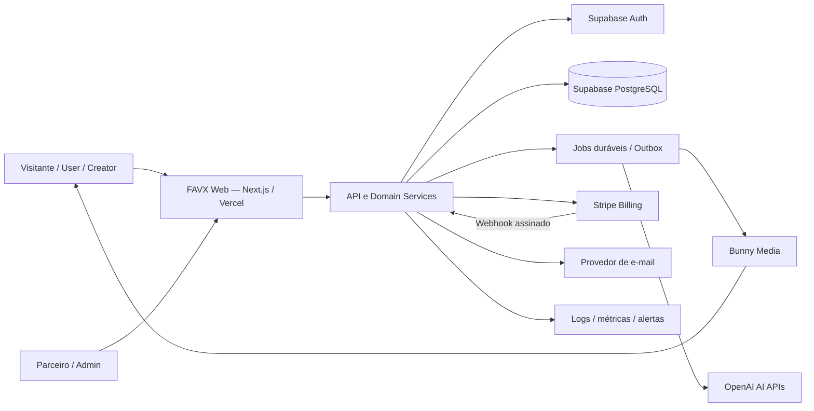

# FAVX — Technical Requirements Document (TRD)

**Versão:** 1.0 — baseline técnico proposto para revisão e aprovação.  
**Data de referência:** 04/11/2026.  
**Código:** FAVX-TRD-001.  
**Documento originador:** `FAVX_PRD_Ultra_Detalhado_v1_0.md`, PRD v1.0, 04/11/2026.  
**Release-alvo:** FAVX Creators + FAVX Users, MVP 1.0.  
**Documentos dependentes:** App Flow & Screen Specifications; FAVX Design System; Backend & Database Specification; Claude Code Execution Plan.  
**Estado:** especificação técnica de referência; decisões de provedor, custos, engenharia e compliance ainda sujeitas a validação técnica/contratual.

> **Regra de interpretação.** `APROVADO` = decisão de produto já estabelecida; `PROPOSTO` = escolha técnica recomendada neste TRD, não autorização para compras ou implantação; `VALIDAR` = requer POC, verificação contratual, operação, custo ou segurança; `BLOQUEANTE` = não lançar o módulo sem definição; `FUTURO` = arquitetura admite evolução, mas não significa implementar a funcionalidade agora. Não confundir design de solução com código já construído. Toda parametrização numérica sem homologação é **meta inicial de engenharia**, não garantia de desempenho.

## Guia de leitura e utilização

1. **Capítulos 0–5:** governança, visão técnica, arquitetura, stack e organização do código.
2. **Capítulos 6–18:** identidade, autorização, persistência, conteúdo, mídia, agenda, busca, IA, métricas, pagamentos, parceiros e operação.
3. **Capítulos 19–27:** contratos de API, integrações, segurança, privacidade, infraestrutura, observabilidade, performance, testes e recuperação.
4. **Capítulos 28–36:** catálogo de requisitos rastreáveis, decisões, riscos, matrizes de aprovação, exemplos de contratos/SQL e referências verificáveis.
5. A implementação SQL definitiva, políticas RLS completas e endpoints formalizados em OpenAPI serão entregues no documento **Backend & Database**; este TRD determina suas **restrições, comportamento, contratos-base e critérios de validação**. Especificações de cada tela e componentes ficam nos respectivos documentos de fluxo e design, sem sobreposição indevida.

## 0. Controle documental, governança e rastreabilidade

| Campo | Valor / responsabilidade |
|---|---|
| Fonte de verdade de negócio | PRD FAVX v1.0 + decisões explícitas posteriores |
| Fonte de verdade técnica | TRD FAVX v1.0 após aprovação de arquitetura |
| Segurança e tratamento de dados | Padrões de segurança, avaliação jurídica e registros de decisão |
| Responsável por decisões de produto | Product Owner / fundadora |
| Responsável por decisões de implementação | Engenharia, com validação de produto e segurança |
| Gestão de mudanças | ADR, issue rastreável, diff documental, testes e aprovação |
| Versionamento | SemVer documental por mudanças de compatibilidade de contratos, escopo e diretrizes |
| Critério de aceitação de módulo | Requisito funcional, serviço, RLS, telemetria, QA, rollback e documentação ligados a IDs |

### 0.1. Hierarquia de decisões

- Os comportamentos aprovados no PRD **não podem ser alterados silenciosamente** por escolha de framework, custo ou arquitetura. Restrições descobertas exigem ADR, impacto e novo aceite de produto.
- O TRD não aprova automaticamente as hipóteses pendentes do PRD (ex.: preços anuais USD/EUR, critérios de capacidade de banners, limites de coleções e política definitiva de retenção).
- **Não expandir o MVP:** busca global, Events, Proof, perfis comerciais completos e FAVX for Brands devem ficar em estágio de preparação, não em telas e APIs utilizáveis por terceiros.
- Todo contrato público, tabela crítica, métrica e permissão deve referenciar pelo menos um requisito do PRD e um teste.
- Escolhas operacionais devem admitir reversão por configuração quando a exigência de negócio ainda estiver indefinida.

### 0.2. Convenções normativas

`DEVE` = obrigatório; `NÃO DEVE` = proibido; `DEVERIA` = padrão proposto sujeito a exceções justificadas; `PODE` = opcional; `P0` = indispensável antes do release; `P1` = desejável na primeira estabilização; `FUT` = não implementável no MVP. `Owner` = identidade titular; `Creator` = papel de curadoria; `principal` = usuário autenticado ou serviço identificado; `tenant` = limite lógico de propriedade de recursos, **não** necessariamente um banco isolado.

## 1. Resumo técnico executivo

A FAVX será um aplicativo web responsivo, internacionalizado e visual-first, com páginas públicas de creators que podem ser acessadas sem login e áreas privadas para usuários, creators, parceiros e administração. A aplicação aceita conteúdo multimídia original, o organiza em publicações e coleções e permite pesquisa dentro de perfis, incluindo busca conversacional e voz. O sistema fornece analytics privados, assinaturas Creator Plus e meios de gestão e moderação. A arquitetura deve preservar a possibilidade futura de busca global e matching entre marcas e creators mediante participação e consentimento específico.

**Decisão arquitetural proposta:** monólito modular em TypeScript e Next.js, publicado na Vercel, com Supabase Auth e Postgres como fonte transacional, Bunny como infraestrutura de armazenamento/entrega de mídia, OpenAI para transcrição/embeddings/interpretação de intenção e Stripe para billing. Serviços de fila e tarefas duráveis não devem depender da vida útil de requisições HTTP. **Objetivo:** velocidade de entrega com limites de domínio suficientemente claros para expansão ou extração posterior.

### 1.1. Invariantes técnicos inegociáveis

1. Não há contadores de seguidores/seguindo nem métricas de conteúdo em payloads públicos, HTML, metadados OG, GraphQL, JSON incorporado ou caches acessíveis sem autorização.
2. Contextos privados (`FAVX Context`), histórico individual de busca e dados detalhados de audiência não podem ser devolvidos por endpoints públicos nem por relatórios comerciais futuros sem base e autorização próprias.
3. Toda ação de leitura/escrita de conteúdo privado aplica autorização **no servidor e na camada de dados**, jamais apenas por ocultação da interface.
4. A visibilidade temporal de posts, banners e fixações é calculada por condições persistidas, não depende de cron pontual para impedir exposição.
5. O arquivo original aceito deve permanecer íntegro, separado das variantes de entrega, até exclusão legítima; download só após autorização de propriedade e direitos.
6. Busca com IA somente cita ou exibe itens do conjunto elegível retornado pelo recuperador, respeitando o escopo por Creator/User, privacidade, expiração e moderação.
7. Eventos duplicados de cobrança, agendamento, analytics e webhook não podem multiplicar ações financeiras ou transições irreversíveis.
8. Moeda, idioma, região e fuso horário são atributos independentes; regras UTC e números em unidades menores de moeda são persistidos.
9. Todas as funções relevantes devem funcionar em mobile, com fallback de captura caso a permissão de câmera/microfone falhe.
10. A ausência de limite público cumulativo de mídia **não** autoriza armazenamento fisicamente infinito: capacidade, custos, mecanismos antiabuso e sustentabilidade precisam de políticas e alertas, sem inventar cotas comerciais no código.

### 1.2. Requisitos diretamente transpostos do PRD

| Requisito | Consequência técnica obrigatória |
|---|---|
| Identidade única User/Creator | auth principal único, papéis e ownership separáveis |
| Perfis públicos sem login | rotas SSR/SEO com DTO público mínimo e políticas antiabuso |
| Originais próprios baixáveis | storage segregado, entitlement e URLs efêmeras auditadas |
| Foto 20 MB / vídeo 250 MB e 10 min / áudio 20 MB e 10 min | validação duplicada client/server/worker; metadados reais de duração |
| Agendar e expirar post/banner/fixado | intervalos UTC, validação temporal, workers + filtros de leitura e cache |
| Analytics privados desde o Free | ingestão de eventos independente de entitlement de leitura |
| Creator Plus | máquina de estados comercial e controle de acesso centralizado |
| Busca conversacional local e por voz | sessão com escopo imutável, pipeline híbrido, fallback textual |
| Seis idiomas e BRL/USD/EUR | i18n desacoplado da moeda, regionalização e faturamento |
| Programa de parceiros desde o início | tracking last-click, atribuição auditável, comissões dependentes de pagamento |
| FAVX for Brands futuro | agregações e proveniência preparadas, nenhuma concessão comercial no MVP |

## 2. Arquitetura de referência e limites dos sistemas

### 2.1. Contexto C4 — nível 1

**Atores:** visitante; usuário autenticado; Creator Free/Plus; parceiro; operador de suporte; moderador; financeiro; superadmin. **Sistemas:** web FAVX, Supabase Auth/Postgres, Bunny, OpenAI, Stripe, serviço de e-mail e serviços externos opcionais (geocodificação, monitoramento). **Fronteira de confiança:** navegador não é confiável para authorization, configuração de limites, assinatura de URLs, impostos ou elegibilidade de assinatura.



*Observação:* a seta de Bunny para visitante representa **distribuição de derivados públicos**; originais e arquivos privados exigem URL temporária/autorização. Diagrama lógico, não documento de rede ou firewall completo.

### 2.2. Contêineres C4 — nível 2

- **Web pública:** Server Components/SSR para perfis e posts públicos; renderização responsiva; metadados indexáveis; busca com escopo de perfil.
- **Web autenticada:** áreas User, Creator, Partner e Admin; rotas e layouts separados; autorização em cada ação.
- **API Gateway in-app:** Route Handlers Next.js para endpoints `/api/v1`, login/session check, throttling, validação e orchestration.
- **Domínio de aplicação:** identidade, perfis, conteúdo, media, coleções, comunidade, search, context, analytics, entitlements, billing, partners, admin, notificações.
- **Banco transacional:** Postgres com tabelas relacionalmente consistentes, RLS, índices e extensões selecionadas.
- **Jobs e workers:** criação de variantes, inspeção de arquivos, transcrição, indexação, reconciliação temporal, agregados, e-mails, webhooks e retenção.
- **Mídia:** origem em zona de armazenamento segregada, variantes de imagem/áudio, streaming de vídeo quando validado, distribuição por CDN.
- **Telemetria:** logs estruturados e correlação, métricas técnicas, eventos de produto separados, trace e ferramentas de suporte.

### 2.3. Monólito modular e responsabilidades

A camada web pode importar contratos e casos de uso, **não** acessar diretamente tabelas de outros domínios com lógica dispersa. Cada domínio expõe `commands`, `queries`, `repositories`, `policies`, `events` e `schemas`. Somente infraestrutura e funções do banco com privilégios definidos podem realizar operações transacionais cruzadas. Evitar microserviços iniciais, filas sem persistência e duplicação de regras em cliente, API e jobs.

| Domínio | Dono das decisões | Eventos emitidos |
|---|---|---|
| Identity | sessão, principal, status de conta | `user.created`, `account.closed` |
| Creator/Profile | username, perfil, links e papéis | `creator.activated`, `profile.updated` |
| Content | posts, edição, patrocínio, ciclo de vida | `post.published`, `post.expired`, `post.deleted` |
| Media | originais, variantes, upload, captura e direitos | `media.uploaded`, `media.ready`, `media.failed` |
| Presentation | banners e fixações, sobreposição de horários | `banner.activated`, `pin.ended` |
| Collections | agrupamentos e salvamentos | `collection.updated`, `post.saved` |
| Community | solicitações, submissões, triagem | `submission.received`, `submission.approved` |
| Discovery | busca, contexto, indexação e entidades | `search.executed`, `index.updated` |
| Analytics | event log, agregações e dashboards | `analytics.batch_processed` |
| Billing | trial, pagamentos, assinaturas e entitlement | `subscription.activated`, `entitlement.changed` |
| Partners | atribuição, comissões e payout | `referral.attributed`, `commission.earned` |
| Trust/Admin | moderação, suporte e auditoria | `content.moderated`, `role.granted` |

### 2.4. Limites e princípios de consistência

- Postgres é a fonte de verdade para ownership, visibilidade, assinaturas, comissões, agendamentos, consentimentos e trilha de auditoria.
- CDN/cache é derivado, descartável e sempre invalidável; em caso de conflito entre cache e Postgres, prevalece Postgres.
- Stripe é fonte de verdade do processamento de pagamentos; o banco armazena projeções locais reconciliadas por webhooks e consulta quando necessário.
- Bunny é fonte de bytes de mídia, não de ownership e política de acesso; o banco mantém manifest, checksums e status.
- Embeddings são artefatos recomputáveis, com modelo, versão e proveniência; não substituem o texto de origem.
- Analytics comportamental pode ter consistência eventual e deduplicação; publicação/expiração e cobrança exigem consistência estrita de regras.
- Dados futuros de marketplace não ganham acesso aos eventos brutos simplesmente por estarem no mesmo banco.

## 3. Stack, dependências e alternativas

### 3.1. Matriz de escolhas

| Camada | Escolha | Status | Observação / condição |
|---|---|---|---|
| Frontend/servidor | Next.js App Router + React + TypeScript | APROVADO como direção | fixar versões exatas após compatibilidade e auditoria |
| Hospedagem web | Vercel | APROVADO como direção | plano deve suportar cron/minuto e uso comercial |
| SCM e CI | GitHub + GitHub Actions | APROVADO para repositório / PROPOSTO CI | branch protection e secrets por ambiente |
| Persistência/auth | Supabase Postgres + Supabase Auth | APROVADO como direção | usar RLS, backups, índices, SSR cookies |
| Extensões SQL | `pgvector`, `pg_trgm`, `unaccent`, `postgis` | PROPOSTO | verificar disponibilidade e versions antes de migrar |
| Mídia | Bunny Storage + CDN / Stream para vídeo | APROVADO Bunny; produtos específicos VALIDAR | POC de originals privados, ingest e transcodificação |
| IA | OpenAI APIs | APROVADO como direção | catálogo de modelos e orçamento parametrizados |
| Billing | Stripe | APROVADO como direção; operação regional VALIDAR | verificar impostos, Pix, recorrência, país e moedas |
| Estilo | Tailwind CSS + componentes acessíveis | PROPOSTO | tokens definidos no Design System, evitar estilo genérico |
| Form/validation | Zod + formulário acessível | PROPOSTO | schemas compartilhados onde seguro |
| Estado/data fetching | Server Components + cache controlado; TanStack Query onde pertinente | PROPOSTO | sem duplicar caches com semânticas distintas |
| Logs/erro | Sentry + logs estruturados | PROPOSTO | mascarar PII e contexto privado |
| Product analytics | PostHog ou similar + eventos próprios | VALIDAR | consentimento, custos e residência de dados |
| E-mail | Resend ou similar | VALIDAR | entrega, localização e DNS |
| Jobs | Vercel Queues/Workflows ou worker durável especializado + DB outbox | VALIDAR / POC | não usar cron como fila confiável |
| Observabilidade | OpenTelemetry compatível + dashboards | PROPOSTO | rastreabilidade sem payloads sensíveis |
| QA | Vitest, Testing Library, Playwright, pgTAP/RLS, axe | PROPOSTO | pipeline obrigatório para caminhos críticos |

### 3.2. Política de versões

- Usar versões estáveis suportadas, registradas em lockfile e matriz de compatibilidade; não escrever `latest` nem permitir upgrades automáticos de majors em produção.
- Registrar Node.js runtime homologado, `pnpm`/npm, versões de Postgres e extensões, SDKs de Supabase, Bunny, OpenAI e Stripe.
- Security advisory crítico exige atualização ou mitigação antes de lançamento. Integrações devem possuir adapters testáveis e não importar SDK diretamente nas regras de negócio.
- Reavaliar dependências a cada release; fontes oficiais são anexadas no fim do documento.

### 3.3. Provas de conceito bloqueantes antes de fechar a stack

**POC-M01 — mídia:** upload de vídeo de 250 MB a partir de conexão instável; retomada; preservação do original com checksum; variantes; download privado; navegador Safari iOS e Android Chrome; custo bruto e egress.

**POC-S01 — busca:** pgvector + FTS + PostGIS com recorte `creator_id`, 10 mil/100 mil posts sintéticos, recall de teste e proteção contra vazamento de escopo; avaliar oversampling e filtros eficientes em índices vetoriais.

**POC-J01 — agenda:** publicações e banners que expiram na fronteira temporal com requisição concorrente, falha de cron, deploy, mudança de fuso e cache aquecido.

**POC-B01 — billing:** trial de 14 dias, moeda e país, troca de ciclo, webhook duplicado/desordenado e eventuais métodos locais; provar que entitlement resulta do pagamento válido, não do redirect.

**POC-A01 — IA:** qualidade em seis idiomas, custo por consulta, classificação estruturada, transcrição, fallback sem IA e segurança de escopo.

## 4. Organização do repositório, padrões de código e módulos

### 4.1. Monorepo leve recomendado

```text
favx/
  apps/web/
    src/app/[locale]/                   # páginas públicas e privadas
    src/app/api/v1/                     # contratos HTTP versionados
    src/app/(admin)/                     # acesso separado por layout e autorização
    src/components/                     # composição de produto
    src/features/                       # UI por feature
  packages/
    domain/                              # entidades, policies, use cases
    contracts/                           # DTOs, schemas, enums e erros
    database/                            # tipagens, repositories, SQL helpers
    media/                               # adapter Bunny e manifests
    ai/                                  # modelos, prompting versionado, orçamento
    billing/                             # Stripe adapter, reconciliador
    analytics/                           # eventos, aggregators, políticas
    i18n/                                # seis catálogos e locale formatters
    ui/                                  # tokens e componentes FAVX
    config/                              # feature flags e runtime config
  supabase/
    migrations/                         # migrations imutáveis, revisadas
    seeds/                              # dados sintéticos sem PII real
    tests/                              # testes RLS e funções
  jobs/                                 # consumers e tarefas idempotentes
  tests/e2e/                            # fluxos ponta a ponta
  docs/                                  # PRD, TRD, ADR, OpenAPI, runbooks
  scripts/                               # checks reprodutíveis
  .github/workflows/                     # CI/CD
```

Pode ser um único Next.js app com `packages` locais; não dividir deploys sem justificativa de risco. Convencionar importação direcional `UI → Use Case → Repository → DB/Adapter`; proibir importação cíclica e acesso indiscriminado ao `service_role`.

### 4.2. Organização por domínio (exemplo)

```text
packages/domain/src/content/
  commands/create-draft.ts
  commands/schedule-post.ts
  commands/archive-post.ts
  queries/get-public-post.ts
  policies/can-edit-post.ts
  entities/post.ts
  events/post-scheduled.ts
  tests/schedule-post.spec.ts
```

O caso de uso recebe `PrincipalContext`, input validado, portas de repositorio/relógio, e devolve DTO ou erro tipado. Não deve depender de `Request`, `Response`, React, SDK Stripe ou `process.env` diretamente. Para relógio, injetar `Clock` para testar fronteiras temporais.

### 4.3. Qualidade de código e documentação

- `strict` no TypeScript; lint, format, no implicit `any`, checagem de dependências e testes em CI.
- Operações de escrita precisam de `actor`, `resource_id`, `correlation_id`, `idempotency_key` quando sensíveis.
- Date/time: `Date` para instantes, bibliotecas com IANA timezone ao tratar horário de parede. Persistência em `timestamptz` UTC e timezone original quando relevante.
- Dinheiro: inteiro de menor unidade da moeda + `currency` ISO 4217, jamais `float` para valores financeiros.
- UUIDs ou IDs aleatórios não enumeráveis; unicidades garantidas por constraints, não apenas validação frontend.
- Inputs externos nunca são SQL, comando shell, template livre de HTML nem destino de request sem validação.
- `docs/decisions/ADR-xxx.md` registra trade-off, alternativas, evidência, impactos, custos e aprovação.

## 5. Estratégia de renderização, roteamento, cache e SEO

### 5.1. Segmentos de rota

| Tipo | Exemplo lógico | Estratégia de renderização |
|---|---|---|
| Perfil público | `/{username}` | SSR ou revalidação curta, com gate de visibilidade |
| Coleção pública | `/{username}/collections/{slug}` | SEO quando pública; autorização por token quando link privado |
| Post público | `/{username}/p/{postIdOrSlug}` | SSR; resposta indisponível se expirado/oculto/moderado |
| Busca contextual | `/{username}/search` | client query + API sempre filtrada por scope |
| Conta User | `/app/...` | sessão obrigatória, `no-store` para dados privados |
| Creator workspace | `/creator/...` | sessão + ownership + entitlement por operação |
| Parceiro | `/partner/...` | policy partner, dados próprios |
| Admin | `/admin/...` | RBAC granular, auditoria, sem indexação |
| API | `/api/v1/...` | DTOs, cabeçalhos e versionamento |

**Nota:** o padrão de rota de idioma deve ser harmonizado com username raiz e slugs reservados. Não ativar `/pt-BR` na raiz sem política explícita para não competir com `/{username}`. Adotar negociação por cookie/cabeçalho e URLs de idioma em namespaces reservados ou subdomínio como ADR próprio.

### 5.2. Estratégia para expiração e caches

- `is_publicly_visible_at(t)` é verdade **somente se**: status elegível, revisão aprovada, moderação liberada, `published_at <= t`, `visible_from <= t` quando presente e `(visible_until IS NULL OR t < visible_until)`, mais vínculo ativo de Banner/Pin quando aplicável.
- Na fronteira `visible_until`, a API de conteúdo público e a resposta SSR devem negar acesso independentemente de cron. Os índices de busca e CDN podem ter sincronização posterior, mas **todo resultado é revalidado** no banco antes de ser retornado.
- Caches de dados públicos devem possuir TTL não superior ao tempo restante da publicação, e invalidação por evento; para rotas sensíveis, `no-store`/SSR dinâmico é o padrão inicial mais seguro.
- Autorização por URL de mídia pública otimizada pode sobreviver ao item expirado se a URL for permanente. **VALIDAR estratégia de mídia revogável:** preferir tokens com expiração apropriada ou arquitetura que não prometa remoção instantânea de bytes já distribuídos/copiados. A expiração de visibilidade do app não equivale a revogação retroativa de arquivos baixados por terceiros.
- `robots`, `canonical`, OG image e sitemap usam somente conteúdo elegível e não devem divulgar metadata privada.

### 5.3. SEO e segurança de apresentação

Geração controlada de `title`, `description`, Open Graph e canonical; texto sanitizado; CSP compatível com imagens/CDN; previews sem contagens privadas; `noindex` para salvos, contexto, comunidade pendente, banners inativos e dashboards; sitemap incremental. `hreflang` somente onde exista versão correspondente e conteúdo significativo. Mudanças de username usam redirects registrados com validade/política definidos; usernames não devem ser reciclados imediatamente se houver links antigos.

## 6. Identidade, autenticação, sessão e autorização

### 6.1. Principal e modelo de papéis

Uma identidade (`auth.users` + `profiles`) pode atuar como User e Creator; `creator_profiles` guarda contexto editorial e `subscriptions` diz respeito às funcionalidades pagas. Papéis operacionais são **independentes** do plano: `user`, `creator`, `partner`, `support`, `moderator`, `finance`, `admin`, `superadmin`. Um usuário pode acumular contextos permitidos, mas o frontend solicita contexto explícito de workspace ao atuar em mais de uma capacidade.

### 6.2. Sessão e cookies

- Supabase Auth com fluxo compatível com SSR; preferir PKCE e cookies seguros, `Secure`, `HttpOnly` quando o padrão/SDK permitir, `SameSite` adequado, domínio/rota restritos; atenção a documentação atual do SDK SSR.
- Backend sempre valida sessão contra serviço de autenticação e estado local da conta, não confia em cookie não verificado nem em simples flag `is_admin` fornecida pelo cliente.
- Sessões podem ser revogadas quando houver suspensão, exclusão, comprometimento ou alteração de segurança. Usar política de validade/rotação de refresh token oferecida pelo provider.
- Fluxos de recuperação de conta, troca de e-mail, logout em todos os dispositivos e autenticação reforçada para superadmin devem ser demonstráveis e testados.
- Cadastro nunca presume que o e-mail prova identidade comercial ou profissional. Verificação de Creator futura é fluxo separado.

### 6.3. Matriz essencial de autorização

| Operação | Visitante | User | Creator proprietário | Admin autorizado |
|---|---|---|---|---|
| Ler post publicado e elegível | Sim | Sim | Sim | Sim |
| Ler post privado/rascunho | Não | Não | Sim | Somente justificativa/política |
| Ler `post_contexts` | Não | Não | Sim | Por necessidade excepcional auditada |
| Gravar/editar post | Não | Não | Sim | Ações de moderação, nunca autoria silenciosa |
| Baixar original privado | Não | Não | Sim, verificação de direitos | Exceção administrativa documentada |
| Ver analytics avançados | Não | Não | Se entitlement Plus | Suporte/finance granular autorizado |
| Ver lista de seguidores alheia | Não | Não | Apenas os próprios dados, respeitando direitos dos seguidores | Acesso operacional estrito |
| Ver registros brutos de audiência | Não | Apenas seus dados | Não | Somente serviço/papel autorizado, minimização |
| Moderar submissões recebidas | Não | Não | Creator proprietário | Moderador |
| Conceder Plus | Não | Não | Não | Financeiro/admin por fluxo auditado |

### 6.4. RLS e segurança em profundidade

- RLS ativado em **todas** as tabelas acessíveis por API/Data API, inclusive views com implicações de segurança; negar por padrão e conceder políticas mínimas por comando.
- Acesso de service role apenas em ambientes confiáveis e em serviços com superfície reduzida. Service role **contorna RLS** em cenários comuns; acesso é compensado por checagem explícita, menor privilégio no desenho de cada job e auditoria.
- Queries públicas devem consultar **views/DTOs dedicados** com whitelist de colunas, e não `SELECT * FROM posts JOIN profiles`.
- Para endpoints de relatórios, checar `creator_id = auth.uid()` ou relacionamento de owner + entitlement validado no servidor; não aceitar `creator_id` arbitrário sem verificação.
- Funções `SECURITY DEFINER` somente quando indispensáveis: `search_path` imutável, schema qualificado, ownership fixo, grants mínimos e testes de elevação de privilégio.
- Separar RLS de visibilidade temporal: RLS determina quem **pode** acessar; predicado temporal determina se público **deve** acessar naquele instante.

### 6.5. Riscos específicos de autorização

Troca de conta, assinatura cancelada, usuário suspenso, app em duas abas, link antigo de post, URL temporária vazada, registro privado indexado, SSR caching cross-user, `Next.js` prefetch, Query RPC com `SECURITY DEFINER`, endpoint de upload público e objetos sem owner são vetores de teste obrigatórios. Não usar ID obscuro como substituto de autorização.

## 7. Modelo de dados de referência e integridade

> Este capítulo é o **contrato lógico mínimo**. DDL integral, triggers, índices definitivos, plano de partitions e políticas SQL específicas serão desenvolvidos no DOC 05. Não criar tabelas fictícias sem estabelecer owner e política de dados.

### 7.1. Convenções globais

Campos típicos: `id uuid primary key`, `created_at timestamptz not null`, `updated_at timestamptz not null`, `created_by uuid`, `version integer` (para controle otimista), `deleted_at timestamptz` apenas quando justificado. FKs explícitas, `ON DELETE` consciente; `NOT NULL` para invariantes; JSONB somente para extensões de atributos sem estabilidade relacional; colunas de moeda `amount_minor bigint`, `currency char(3)`. Nenhuma tabela de domínio deve utilizar e-mail como chave externa ou ID de usuário reutilizável.

### 7.2. Domínios de persistência e relações

| Família | Tabelas principais propostas | Regra de integridade |
|---|---|---|
| Identidade | `profiles`, `creator_profiles`, `user_preferences`, `profile_links`, `username_history` | `profiles.id` vinculado a auth; username único case-insensitive |
| Conteúdo | `posts`, `post_versions`, `post_media`, `post_links`, `post_coupons`, `post_sponsorships`, `post_ratings` | `posts.creator_id` owner obrigatório; versões imutáveis |
| Apresentação | `banners`, `banner_versions`, `post_pins`, `publication_schedules`, `visibility_transitions` | janelas e limites por plano; pin não apaga post |
| Mídia | `media_assets`, `media_variants`, `media_upload_sessions`, `media_processing_jobs`, `media_access_audit` | hash, owner, original imutável, status verificável |
| Organização | `collections`, `collection_items`, `saved_items`, `follows`, `collection_shares` | titularidade, unicidades por relação |
| Comunidade | `recommendation_requests`, `community_submissions`, `submission_publications`, `submission_moderation` | privado por padrão, autoria atribuída |
| Taxonomia | `categories`, `category_translations`, `tags`, `tag_aliases`, `post_categories`, `post_tags` | origem e taxonomia versionáveis |
| Busca/IA | `post_search_documents`, `post_embeddings`, `post_contexts`, `context_embeddings`, `search_sessions`, `search_messages` | indexar somente escopos elegíveis; private context isolado |
| Entidades futuras | `discovery_entities`, `entity_aliases`, `post_entity_links`, `entity_evidence` | merges auditáveis e reversíveis |
| Analytics | `analytics_events`, `creator_metrics_daily`, `post_metrics_daily`, `banner_metrics_daily`, `search_metrics_daily` | eventos deduplicados, relatórios privados |
| Billing | `plans`, `plan_prices`, `subscriptions`, `subscription_events`, `billing_webhook_events`, `entitlements` | projeção reconciliada de Stripe |
| Partners | `partners`, `partner_referrals`, `partner_attribution_events`, `partner_commissions`, `partner_payout_requests`, `partner_payouts` | comissão last-click com referência verificável |
| Operação | `admin_roles`, `admin_user_roles`, `audit_logs`, `moderation_cases`, `notifications`, `notification_preferences` | trilha imutável e ACL |
| Plataforma | `outbox_events`, `job_executions`, `idempotency_records`, `feature_flags`, `data_deletion_requests` | tratamento durável de efeitos colaterais |

**Nota de compatibilidade com o PRD:** os nomes são candidatos. A convenção final deve manter mapeamento de renomeação para as tabelas listadas no PRD (por exemplo `community_recommendations` vs `community_submissions`, `post_entity_links`, `post_contexts`). Não implementar duas representações da mesma entidade.

### 7.3. Tipos estruturados e intervalos

- Enum de status de conteúdo com transições aprovadas; não depender de flags contraditórias.
- `visible_from`, `visible_until`: `timestamptz` em UTC; `schedule_timezone` como IANA timezone e `schedule_local_input` apenas se necessário para auditoria de intenção.
- Intervalo válido exige `visible_until > visible_from` quando ambos presentes. Fronteira inicial inclusiva e final **exclusiva** (`[from, until)`).
- `visibility_snapshot` é materialização opcional, não fonte de verdade.
- Deleção lógica e moderação podem coexistir como dimensões separadas (`lifecycle_state`, `moderation_state`), para evitar ambiguidades.
- Banners e pins têm `active_from`/`active_until` independentes de publicação; `pin.post_id` precisa referenciar post elegível e do mesmo creator.

### 7.4. Consistência financeira

- FKs para `provider_customer_id`, `provider_subscription_id`, `provider_invoice_id` com índices únicos por ambiente/provedor.
- `billing_webhook_events(provider, event_id)` único, payload bruto minimizado e protegido, resultado de processamento, tentativas e instante de consumo.
- Comissão só avança para `earned` após evento de pagamento válido; `paid` exige registro de payout. Estornos e chargebacks geram ajustes contábeis, nunca alteração silenciosa de uma comissão passada.
- Não confiar em front-end para mudança de plano. `entitlements` são projeções computadas pela regra central e reconciliation, com cache curto e invalidação.

### 7.5. Índices iniciais mínimos e otimização

`creator_profiles(username_normalized)` único; `posts(creator_id, lifecycle_state, published_at desc)`; `posts(visible_until)` parcial; `post_pins(creator_id, active_from, active_until)`; `banners(creator_id, active_from, active_until)`; `saved_items(user_id, saved_at desc)`; `analytics_events(event_day, creator_id)` orientado a volume; `billing_webhook_events(provider, event_id)` único; `partner_referrals(attributed_subscription_id)` restrito; `post_search_documents` com GIN de `tsvector`, trigram e índice de escopo; PostGIS GiST somente para pontos válidos; HNSW para embeddings quando corpus/benchmarks justificarem. Cada índice deve ser medido em custo de escrita e plano de consulta.

### 7.6. Migrações e versionamento de dados

Migrações SQL incrementais, imutáveis após deploy, com rollback lógico ou migração compensatória quando necessário. Para alterações volumosas, usar `expand → backfill → switch → contract` sem bloquear leituras. Cada migração vem acompanhada de teste de RLS, `EXPLAIN`, verificação de FK/uniqueness e script de backfill idempotente. Dados de seed devem ser sintéticos e nunca copiados de produção sem anonimização verificável.

## 8. Engenharia de conteúdo, mídia, captura e download

### 8.1. Manifesto de mídia obrigatório

Cada `media_asset` representa **um original** e seu ciclo de vida, com campos: `id`, `owner_user_id`, `creator_id` (quando aplicável), `origin_type` (`in_app_camera`, `in_app_microphone`, `external_upload`, `import_future`), `storage_provider`, `storage_zone`, `storage_key`, `mime_declared`, `mime_detected`, `size_bytes`, `sha256`, `width`, `height`, `duration_ms`, `codec`, `container`, `exif_privacy_state`, `upload_state`, `processing_state`, `rights_declaration`, `created_at`, `verified_at`, `original_retention_state`. O sistema pode armazenar atributos adicionais em manifest versionado; **não expor chaves internas de storage**.

`media_variants` deve relacionar original a cada derivado e registrar `variant_type`, formato, resolução, bitrate, tamanho, status, hash, versão de pipeline, destino e data de geração. A existência de variante **não** substitui o original; a exclusão de variante pode disparar regeneração se o original estiver disponível.

### 8.2. Política de limites de entrada

| Tipo | Limite aprovado | Validações de servidor |
|---|---|---|
| Foto | 20 MB por arquivo | bytes, assinatura real, dimensões, decodificação e malware |
| Vídeo | 250 MB **e** 10 min por arquivo | tamanho e duração obtidos do conteúdo, codec, stream, container |
| Áudio | 20 MB **e** 10 min por arquivo | tamanho e duração reais, codec, container, transcrição opcional |
| Texto | 10.000 caracteres/publicação | Unicode e normalização definidas, não contar bytes como caracteres |
| Carrossel | máximo de 10 itens sugerido | **VALIDAR** como valor definitivo de produto |
| Total armazenado | sem cota cumulativa anunciada | acompanhar custo, detecção de abuso e política legítima de uso |

A validação de MIME declarado **nunca** substitui sniffing e checagem por decoder seguro. Formatos suportados exatos exigem matriz de POC por dispositivos; recomendar JPEG/PNG/WebP/HEIC quando suportado para foto e MP4/WebM/MOV quando pipeline aceitar, sem prometer suporte incondicional. Política de arquivos potencialmente perigosos: negar SVG ativo, executáveis, HTML e MIME misto não aprovado. O servidor aplica limites novamente, independentemente do frontend.

### 8.3. Sequência de upload segura

1. Cliente autenticado envia `POST /media/upload-intents` com `file_name` sanitizado, `size_bytes`, `declared_mime`, `purpose`, `origin_type` e `client_upload_id` estável.
2. Serviço confere owner, estado de conta, permissões, quotas de **requisições**/abuso, tamanho declarado e operação permitida; cria sessão `pending` com TTL e identificador não previsível.
3. Backend emite **credencial limitada** ou escolhe adaptador de upload gerenciado/proxy autenticado. Nunca entregar a chave mestra de Bunny Storage ou Stream a navegador.
4. Cliente transmite blocos/bytes com progresso, cancelamento, retries e retomada onde tecnologia permitir; para vídeos grandes, priorizar protocolo resumível conforme POC.
5. Confirmação (`complete`) não pode ser auto-declaração de sucesso: worker/servidor confere existência, bytes, checksum e metadados reais pelo provedor ou leitura controlada.
6. Resultado inválido: quarentena/remoção, erro claro e limpeza de upload órfão. Resultado válido: original imutável, `verified` e processamento das variantes.
7. Quando as variantes mínimas ficam prontas, o asset passa a `ready`; um post pode permanecer como rascunho/pendente enquanto vídeo processa.
8. Gerar evento de auditoria e telemetria de erro/latência/custo. A confirmação do POST deve ser idempotente por `client_upload_id`.

```mermaid
sequenceDiagram
  participant C as Client
  participant A as FAVX API
  participant D as Postgres
  participant B as Bunny
  participant J as Worker
  C->>A: POST /media/upload-intents
  A->>D: Criar sessão + owner + TTL
  A-->>C: Upload capability restrita / método suportado
  C->>B: Transferir bytes (ou upload adapter seguro)
  C->>A: POST /media/{id}/complete
  A->>D: Estado verifying; emitir outbox
  J->>B: Verificar integridade e metadados
  J->>D: Registrar original e variantes
  J->>B: Processar/transcodificar
  J->>D: ready | failed + reason
  C->>A: GET /media/{id}/status
  A-->>C: Estado autorizado
```

**Risco de integração:** os mecanismos de upload direto para Bunny Storage, Stream/TUS e qualquer SDK oficial devem ser validados com tokens assinados e privilégios restritos. Caso uma solução dependa de proxy na Vercel para 250 MB, revisar limites de tempo/body/egress e considerar worker/serviço de ingestão dedicado; **não** presumir que a plataforma suporta envio direto genérico com chave mestra exposta.

### 8.4. Captura nativa na web

- Utilizar APIs de navegador `getUserMedia` e `MediaRecorder` quando disponíveis e permitidas; em mobile, oferecer fallback `input[type=file]` com captura do SO quando suportado.
- Exigir contexto seguro (HTTPS), solicitação contextual de permissão, indicador de gravação e controles de iniciar/parar/regravar/descartar.
- Escolher codec/container por teste de `MediaRecorder.isTypeSupported`, não codificar H.264/MP4 como universal. Tratar rotação, interrupções, suspensão de aba, falta de espaço e microfone indisponível.
- O cliente mantém buffer/blobs apenas pelo tempo necessário; se upload não terminou, exibir que **não há cópia garantida na nuvem**. Para offline/retry, usar armazenamento local temporário quando seguro e suportado, com limite, aviso, limpeza e não depender disso como garantia absoluta.
- Exibir preview local, duração, tamanho e qualidade; aplicar as mesmas validações de uploads externos. O creator pode optar por salvar o arquivo no dispositivo antes do envio quando viável.
- Nunca iniciar câmera ou microfone silenciosamente. Telemetria não inclui áudio, vídeo nem imagem bruta.

### 8.5. Pipeline de imagem

1. Validar arquivo/decoder e remover scripts/metadados sensíveis da **cópia pública**.
2. Registrar dimensões, orientação, checksum e integridade original sem modificá-lo.
3. Produzir thumb, preview e display responsivos, com orientação normalizada e formatos compatíveis com browser (AVIF/WebP/JPEG conforme POC).
4. Gerar blur placeholder apenas de derivado público, sem expor EXIF/GPS.
5. Documentar quais operações preservam ICC/color profile; respeitar qualidade editorial, evitando sobrecompressão.
6. Reprocessamento deve criar nova versão de variante e invalidar cache; não substituir arquivo original.
7. Arquivos suspeitos permanecem em `quarantined` até decisão de segurança.

### 8.6. Pipeline de vídeo e áudio

**Vídeo:** original privado, análise de duração/container, transcodificação assíncrona ou Bunny Stream validado, poster/thumbnail, HLS/adaptive delivery quando suportado, legendas quando disponíveis, estado `processing`. Prevenir loops de transcodificação e custos repetidos por version idempotente.

**Áudio:** preservar original, validar duração e size, gerar preview/player e waveform opcional, transcrever por OpenAI mediante finalidade legítima, manter texto revisável e separá-lo da mídia. O creator escolhe publicar somente áudio, texto ou ambos. Conteúdo transcrito exige indicação interna de `source=AI` e timestamp da geração; não converter automaticamente contexto privado em descrição pública.

### 8.7. Download de originais próprios

`POST /media/{mediaId}/download-grant` ou rota equivalente **DEVE** revalidar: usuário autenticado, owner real do arquivo, disponibilidade e status, direito/licença declarado, conta não suspensa para esta operação e eventuais restrições legais. Resposta contém **redirect ou URL curta assinada** para o objeto protegido, nunca chave de storage. TTL de referência: 1–5 min, **PROPOSTO**, sob POC; o acesso deve ser auditado com metadata mínima e sem registrar token em logs.

**Atenção à distinção de direito:** `origin_type=in_app_camera` não prova juridicamente autoria; upload e gravação própria exigem declaração de direitos. Para mídias com licença de terceiros ou material comunitário, permissões devem proibir exportação automática que contrarie licenças. `original` e `optimized` são opções separadas; download de otimizado não exige substituir original.

### 8.8. Não disponibilidade, retenção e exclusão

- Falha de upload gera sessão `failed` ou `abandoned` e limpeza automática de objeto órfão após janela de segurança.
- Falha de processamento preserva original se íntegro; permite reprocessar com limite de tentativas.
- Exclusão de post **não implica** apagar mídia referenciada por outro post, rascunho ou coleção. Gerenciar reference counting **transacional** ou verificação de vínculos antes de exclusão material.
- Soft delete e janela de recuperação (30 dias **sugeridos**, não aprovados) não substituem exclusão definitiva quando devida; objetos em Bunny, thumbnails, buscas, caches e transcrições precisam fazer parte do plano de purga.
- Backups podem ter retenção própria e devem integrar política de minimização e comunicação ao titular.

### 8.9. Medição e alertas de mídia

Registrar `upload_started`, `upload_verified`, `upload_failed`, `transcode_ready`, `transcode_failed`, `download_grant_issued`, `download_failed`, bytes ingressados, bytes armazenados por classe, bytes servidos por CDN, minutes transcoded, storage growth, variáveis de custo e erros por browser/codec. Métricas de operação não podem conter mídia bruta. Alertas de gasto e de falha em lote antes de abertura pública.

## 9. Publicações, banners, fixações e máquina temporal

### 9.1. Modelo composto de estado

É incorreto armazenar um único `is_published`. Proposta: `lifecycle_state` (`draft`, `scheduled`, `published`, `hidden`, `expired`, `archived`, `pending_deletion`, `deleted`), `moderation_state` (`pending`, `approved`, `restricted`, `removed`), `visible_from`, `visible_until` e `version`. Para banners e pins, acrescentar entidade/janela própria. Pode-se representar status persistido e derivar `effective_visibility` em query; não confiar exclusivamente no status denormalizado.

### 9.2. Regra de visibilidade definitiva

Um post é público **se e somente se**: creator e conta elegíveis; conteúdo moderado e publicado; não oculto/arquivado/excluído; mídia mínima pronta quando exigida; data de publicação atingida; início de janela atingido; fim de janela não atingido. Banners acrescentam entitlement/slot válido e janela própria; pins acrescentam post ativo e janela de fixação válida. **Fronteira final exclusiva**: exatamente em `10/11 às 10:00`, não é mais público naquele instante.

O timestamp UTC da consulta deve ser obtido de fonte confiável no backend/DB. Cliente pode mostrar contagem regressiva aproximada, mas relógio do aparelho **não** determina visibilidade.

### 9.3. Três clocks e fusos

1. `client_locale_timezone`: nome IANA escolhido/detectado, editável.
2. `scheduled_wall_time`: data/hora que o creator digitou, usada para UI e auditoria.
3. `scheduled_instant_utc`: instante efetivo que controla leitura e jobs.

Quando uma data/hora local não existir por horário de verão, pedir ajuste. Quando for ambígua, selecionar offset explicitamente ou aplicar política clara aprovada; não escolher silenciosamente. Mostrar timezone em formulário, preview e confirmação. Uma mudança posterior no fuso da conta **não deve mudar retroativamente** o instante UTC já agendado, salvo reagendamento consciente.

### 9.4. Jobs e reconciliação

- Um scheduler recorrente consulta due transitions usando índices, batches limitados, lock/lease, `FOR UPDATE SKIP LOCKED` quando aplicável e `WHERE version = expectedVersion`.
- Regras de leitura já negam conteúdo expirado mesmo quando worker atrasa. O worker atualiza projeções, métricas e indexação, invalida cache e despacha notificações.
- Em caso de fila parada, reconciliation examina conteúdo vencido e pendente, reconstrói efeitos idempotentes e registra atraso mensurável.
- Retry com backoff e dead-letter por aplicação, com console admin para reprocessar; cada transição possui `transition_id`/`idempotency_key` único.
- Uma execução pode coincidir com edição do creator: utilizar transação/controle de versão para que job antigo não reative banner reagendado.

### 9.5. Banners — lifecycle e versão

Um banner é `creative` + destino permitido + metadados de disclosure + janela ativa + posição/tipo + histórico de versões. Diferenciar `available_slot` de número de banners **cadastrados**. Limite Plus de **10 banners** está aprovado como valor, mas o que ele conta (criados/simultâneos/slots) continua **DEC-02**; implementar policy abstrata parametrizada, não regra hardcoded. Quando `active_until` passa, banner some de perfil e do sistema de seleção, sem apagar analytics. Reativação cria nova janela/versão, vinculando campanhas diferentes a períodos analíticos próprios.

### 9.6. Posts fixados — objeto de posicionamento

`post_pins` referencia post e creator; registra ordem/prioridade, `active_from`, `active_until`, estado e `created_by`. Desfixar ou expirar pin **não altera** publicação do post. O limite Plus de **6 fixados** é aplicado a intervalos que se sobrepõem (recomendação funcional já descrita); regras de prioridade e conflitos precisam ser validadas. Caso o post base expire, é moderado ou apagado, a fixação é inelegível mesmo que sua janela esteja vigente.

### 9.7. Reativação, edição, exclusão e histórico

- Cada edição relevante cria `post_version` ou trilha de `post_change_log`; preservar data de publicação original, autor da ação, datas de alterações e impacto sobre indexação.
- Link profundo permanece estável enquanto conteúdo existir e estiver elegível; excluído/expirado retorna resposta apropriada sem metadata privada.
- `archive` oculta mas mantém controle do owner. `pending_deletion` inicia janela de recuperação; `purged_at` representa remoção material efetiva.
- Métricas históricas atribuídas ao ID do objeto e período não devem ser reescritas sem ajuste auditado.
- Conteúdo indisponível salvo por outro usuário deve aparecer como **referência indisponível**, sem mostrar cópia vazada do post.

### 9.8. Matriz de condições extremas

| Cenário | Comportamento obrigatório |
|---|---|
| Cron falha por 1 h | Nenhum conteúdo vencido aparece publicamente; alerta operacional |
| Duas abas reagendam post | Controle de versão detecta conflito; última gravação não sobrescreve silenciosamente |
| Banner ativo no downgrade | Perde elegibilidade conforme período de acesso; histórico e configuração preservados |
| Expiração durante resposta de busca IA | Revalidar elegibilidade antes de exibir card e antes de abrir detalhe |
| Horário de verão ambíguo | Interface resolve/explica offset; DB salva instante unívoco |
| Reação a pin expirado | Post continua público normalmente se elegível |
| CDN contém imagem anterior | Cache/invalidação não deve divulgar metadata privada; remoção física futura possui limites explícitos |
| Término == início | Rejeitar configuração |
| Suspensão administrativa | Override de moderação impede exposição apesar de agendamento ativo |
| Exclusão e retry de publish | Estado terminal prevalece; job antigo não republica |

## 10. Organização, coleções, salvamentos e seguidores

### 10.1. Separação de propriedade

Coleções do Creator organizam posts de seu perfil; coleções do User organizam descobertas salvas, podendo referenciar creators distintos. Usar modelo relacional que distinga `collection.owner_user_id`, `collection.creator_id` opcional, `collection.kind` e `visibility`. Salvar um post cria referência controlada, não cópia integral permanente; a indisponibilidade do original respeita o owner e os direitos de conteúdo.

### 10.2. Estados e regras

- Coleção `private`, `public` ou `unlisted-link` somente conforme política aprovada; token de compartilhamento deve ser aleatório e revogável.
- Ordem manual persistida por chaves de ordenação sem renumerar milhares de itens, quando possível.
- `saved_items` impõe unicidade por `(user_id, post_id)` e operações idempotentes.
- `collection_items` exige dono da coleção e item válido; ao excluir de coleção não excluir o post do Creator nem o salvamento global sem ação distinta.
- URLs públicas de coleção não devem expor saves privados, lista de seguidores ou estatísticas do owner.
- Se o post deixa de ser público, excluir do índice público e mostrar estado indisponível na coleção compartilhada, não resolver para post privado.

### 10.3. Seguidores/seguindo sem placares

`follows(follower_user_id, creator_id, created_at)` com unicidade, bloqueios e configurações. A lista e contagem do próprio usuário e do próprio creator podem estar disponíveis em áreas privadas sob autorização. **Nunca retornar listas ou contagens no DTO público**. A API de seguir pode expor apenas `is_following` ao próprio usuário autenticado, sem revelar a audiência de terceiros. Pedidos de dados e exportação da conta devem contemplar essas relações; anti-spam e bloqueios são derivados necessários.

## 11. Recomendações da comunidade e proveniência

### 11.1. Fluxo base

Creator cria solicitação com identificador e link dedicado; seguidor envia recomendação por formulário com texto, URL e mídia quando permitido pela política final. Submissão entra **privada**, em fila de avaliação do creator. Owner decide aprovar, rejeitar, ocultar, remover ou publicar. A publicação derivada precisa identificar **origem comunitária**, com atributos e consentimentos pertinentes; nunca atribuir a fala de outro como opinião pessoal do Creator.

### 11.2. Segurança dos envios

Formulário público exige throttling, detecção de spam, validação de URLs e de conteúdo; arquivos comunitários só entram se política de mídia para terceiros for formalizada. Links externos passam por canonicalização e defesa SSRF se forem buscados para preview. Regras de denúncia e moderação permitem remoção em caso de fraude, assédio ou conteúdo inadequado. Não fornecer ao remetente acesso à fila interna nem à identidade de outros participantes.

### 11.3. Modelo de responsabilidade

`submission.author_type`, `submission.author_user_id` opcional, consentimento e declarações de direitos separados de `published_by_creator_id`; campo `source_disclosure` imutável depois da publicação sem auditoria. A indexação da recomendação comunitária preserva essa proveniência em busca e em futuras entidades canônicas. Interpretação de avaliação 0–10 do Creator não pode ser fabricada a partir da opinião do seguidor.

## 12. Motor de busca híbrido, conversacional, voz e geografia

### 12.1. Escopo de segurança obrigatório

Busca no MVP somente dentro de um perfil Creator específico ou da biblioteca própria do usuário. Um objeto de `SearchScope` deve conter `scope_type` (`creator_public` ou `user_saved`), `scope_owner_id`, `principal_id` quando privada, `visibility_now`, permissões e filtros imutáveis por sessão. **Não** implementar global search no MVP; `global` como escopo reservado por feature flag desabilitada e sem endpoint público operacional.

Uma sessão criada em perfil A não pode ser reutilizada com `creator_id` B por simples edição do payload. A API recalcula o escopo pelo caminho/permissão e valida cada item antes do retorno. Índices vetoriais e caches por consulta devem incluir `scope_id` e política de visibilidade.

### 12.2. Etapas do recuperador

1. **Normalização:** Unicode, acentos, idioma, correção leve e termos de categoria, sem apagar texto original.
2. **Interpretação de intenção:** quando necessário, extrair `query_text`, `category`, `date_range`, `entity_type`, `location`, `radius_km`, `must_have_features`, `negative_constraints`, `sort`, `clarification_needed` via JSON estruturado validado por schema.
3. **Lexical recall:** PostgreSQL full-text search/trigram com índices filtrados pelo escopo e estado.
4. **Semantic recall:** embeddings do post público, título, descrição, tags, taxonomia e contexto privado separado como **sinal de recuperação**; nunca retornar o texto privado.
5. **Geo:** resolver local especificado pelo usuário ou localização consentida, preferir geografia de entidade verificável; filtro de raio e expansão controlada por PostGIS.
6. **Fusion:** combinar lexical/semântico/geográfico com uma regra parametrizada, inicial por RRF ou ranking normalizado medido com conjunto de queries.
7. **Hard filters e revalidação:** owner, visibilidade em `NOW()`, moderação, tipo e filtros restritivos; links e features precisam de evidência.
8. **Reranking opcional:** segundo estágio limitado a top K para custo, baseado em sinais fundamentados e score estável.
9. **Render:** cards de posts reais, trechos sustentados, indicação de origem, badges de oferta/patrocínio, sem texto livre inventado.
10. **Feedback:** registrar sucesso/zero resultado/refinamento/click sem publicar histórico individual.

### 12.3. Corpus indexável

`post_search_documents` contém `post_id`, `creator_id`, `locale`, `index_version`, `public_text`, `fts_document`, `category_ids`, `entity_ids`, `location_geography` quando apropriado, `visibility_state`, `updated_at`. Contexto privado fica em tabela/índice independente e é acessado somente por função confiável para recall, sem retornar `context_text`. **Cuidado:** embeddings derivados de contexto privado podem revelar semântica indiretamente por inferência. Impedir acesso direto aos vetores, remover detalhes de score de consulta e avaliar necessidade de uso agregado, não publicamente reversível.

### 12.4. Busca conversacional e sessão

`search_sessions` registra scope, owner quando autenticado, idioma, estado, prazo de expiração e preferências de consentimento. `search_messages` pode guardar somente mensagens necessárias para continuidade, com TTL e controles para apagar; evitar armazenar áudio bruto desnecessariamente. Uma nova pergunta refinadora herda filtros relevantes, podendo removê-los explicitamente (“agora sem espaço kids”). Mostrar chips de filtros editáveis e permitir reiniciar a busca. A IA **não** deve afirmar que encontrou recomendações antes de receber resultados reais.

### 12.5. Busca por voz

Capturar áudio temporário; obter permissão explícita; verificar tamanho/duração e transcrever usando adapter OpenAI; permitir correção do texto reconhecido. Política de retenção de áudio de consultas deve ser estritamente curta e definida juridicamente. Em caso de falha/custo-limite, apresentar campo de texto e não bloquear pesquisa. Não enviar voz para provedor sem aviso/consentimento adequado.

### 12.6. Localização e provas

- Localização do usuário é opcional; aceitar bairro/cidade digitado manualmente e geolocalização consentida. Não salvar coordenadas precisas por padrão em eventos de analytics.
- Geocodificação de “Flamengo, Rio de Janeiro” exige resolver ambiguidade, país/município e fonte de lugar, sem assumir que todo termo é coordenada de estabelecimento.
- Queries “perto de”, “a até X km” usam PostGIS e `ST_DWithin`/ordenação por distância; proximidade a bairros vizinhos pode ampliar raio com sinalização ao usuário.
- Features como “espaço kids” exigem informação estruturada ou evidência presente nas recomendações/registro verificado. Ausência de informação não pode ser convertida em certeza negativa.
- Escolha de provedor de geocoding e termos de uso (armazenamento permitido, cache, quotas) é **DEC-11** e exige POC.

### 12.7. Ranking, limites e explicabilidade

Pesos de relevância são experimentais. Recomendações podem ser ranqueadas por match lexical, semântico, distâncias quando aplicáveis, data, completude, relevância de categoria, intenção de busca e avaliação 0–10 do Creator quando disponível; **não** introduzir popularidade pública ou tratamento comercial oculto. Conteúdo patrocinado exibido na busca precisa seguir política transparente futura, sem confundir relevância orgânica com anúncio.

As métricas de qualidade incluem `zero_result_rate`, `search_to_click_rate`, `top_k_recall`, `latency_p50/p95`, `fallback_rate`, `hallucination_audit_rate`, `cost_per_1000_searches` e consultas com escopo incorreto (tolerância zero).

### 12.8. Proteção contra injeção de prompt e abuso

Conteúdo de posts, links, submissões e FAVX Context é **dado não confiável**, ainda que escrito pelo próprio creator. Prompt do sistema determina regras fixas; modelo não executa comandos, navega URLs arbitrárias nem escolhe permissões; saída interpretativa passa por schema e validação; IDs retornados devem pertencer à lista de candidatos autorizados. Rate limiting por IP/sessão/conta e orçamento por feature; circuit breaker para falha ou pico de custo do fornecedor; query lexical fallback. Não usar mensagens de busca ou contexto como instrução para alterar regras de ranking/escopo.

### 12.9. Estrutura de avaliação da busca

Criar corpus sintético com pelo menos 200 consultas rotuladas por humanos representando os seis idiomas, sinônimos brasileiros/portugueses europeus, categorias, localizações, termos parciais, cupons, recência, erros ortográficos e ambiguidades. Métricas: precisão top 5, recall top 10, `nDCG@10`, taxa de resultados indevidos por expiração e taxa de informação não sustentada. **Metas numéricas devem ser homologadas após linha de base**, não inventadas como resultado comprovado.

## 13. FAVX Context, recomendações e embeddings

### 13.1. Contrato de privacidade do Context

Cada post pode conter contexto privado separado de descrição pública. Somente o creator proprietário pode criar, editar ou excluir; administração apenas acesso excepcional sob necessidade legítima, auditoria e controles de suporte. Pode ser digitado ou gravado e transcrito; o original de áudio privado recebe ACL específica. O público não consegue ler, baixar, indexar por motor de busca aberto, inspecionar em JSON/SSR, ou descobrir o texto do Context por feature de busca.

### 13.2. Tratamento semântico seguro

Pipeline: `context_updated` -> normalização -> moderação/validação -> gerar embeddings da versão -> indexar em repositório privado -> marcar `ready`. `context_embeddings` inclui versão, modelo, dimensões, hash do texto, `created_at`, `valid_until` quando houver e estado. Atualização invalida embeddings anteriores em consultas novas. Exclusão do Context remove texto e agenda eliminação dos vetores derivados conforme políticas aplicáveis.

### 13.3. Uso na busca

O FAVX Context pode ajudar a recuperar post relevante (por exemplo, ocasião ideal, público ou detalhe de experiência), mas a justificativa pública precisa estar **fundamentada em dados que possam ser apresentados legitimamente**. Se apenas o contexto privado mencionar um atributo e o creator não autorizou publicação desse detalhe, o sistema pode apresentar o card como candidato relevante sem declarar o atributo como fato; alternativamente pedir revisão/publicação de atributo. Recomendar ferramenta de “Transformar trecho em informação pública” com confirmação explícita **futura**, não automática.

### 13.4. Rating pessoal do Creator

A avaliação opcional `0..10` em passos de `0,5` é uma opinião do autor, persistida com `rating_value` numérico decimal e autoria; o formato exibido respeita locale (`9,5/10` no pt-BR). Não misturar com pontuação dos usuários, estrelas externas ou média coletiva; não usar rating como prova objetiva de qualidade ou dado verificado. Toda alteração deve atualizar o índice e preservar versão relevante.

## 14. Entidades canônicas e busca global futura — preparação mínima

### 14.1. Objetivo e não objetivos

Desde o MVP, os posts podem ser ligados a uma entidade normalizada (`product`, `service`, `place`, `experience`, `media`, `event`) por aliases, link canônico, identificadores do fornecedor, geolocalização, nomes e embeddings. A fusão de duas entidades deve ser revisável e reversível. **Não criar motor público global, feed global, perfis comerciais nem comparador de preços automáticos no MVP.**

### 14.2. Proveniência e evidência

Atributos de entidade devem manter `source_type`, `source_post_id`/`source_url` permitido, `confidence`, `last_checked_at`, tipo de licença e `is_publicable`. Um atributo inferido somente por IA jamais vira fato verificado sem fonte adequada. Evitar guardar textos externos sem permissão; links podem apontar para serviços de terceiros sem importar seus conteúdos ilegalmente.

### 14.3. Matching e governança

`post_entity_links` permite N:N entre posts e entidades, status de vinculação (`suggested`, `creator_confirmed`, `reviewed`) e motivo resumido. Merge de entidades gera registro de auditoria com IDs de origem e destino. Corrigir false positive sem destruir post nem métricas de seus autores. Embeddings indexados podem ser recalculados por versão e idioma. Preparar consultas por entidade e creators distintos, sem habilitar UX global.

## 15. Analytics privado, eventos e agregações

### 15.1. Política: gravar desde o primeiro dia, expor por plano

Eventos são instrumentados mesmo para creators Free, respeitando consentimento e minimização; a elegibilidade da **visualização** não muda a ingestão permitida. O Free só vê métrica geral de cliques no link do perfil; o Creator Plus desbloqueia relatórios históricos avançados de recomendações, coleções, buscas, banners e crescimento, conforme especificação do PRD. Downgrade oculta o dashboard e recursos Plus sem apagar automaticamente eventos legítimos já existentes; eliminação legal prevalece.

### 15.2. Envelope de evento proposto

```json
{
  "event_id": "uuid-v4",
  "event_name": "post_link_clicked",
  "event_version": 1,
  "occurred_at": "2026-11-04T12:30:00Z",
  "ingested_at": "2026-11-04T12:30:01Z",
  "actor_user_id": null,
  "anonymous_session_id": "rotating-opaque-id",
  "creator_id": "owner-uuid",
  "post_id": "post-uuid",
  "banner_id": null,
  "scope": "creator_public",
  "source": "public_post",
  "locale": "pt-BR",
  "consent_state": "allowed_for_this_purpose",
  "properties": {"link_id": "link-uuid", "destination_domain": "example.com"}
}
```

O exemplo apresenta **campos ilustrativos**, não valores reais. O evento nunca deve conter Context, texto de busca completo com PII, tokens, e-mails em claro, IP preciso em propriedade exportável, URL privada com credencial ou coordenada exata, salvo fundamento excepcional e documentação específica.

### 15.3. Taxonomia mínima de eventos

| Grupo | Eventos | Definição resumida |
|---|---|---|
| Aquisição | `profile_viewed`, `by_favx_clicked`, `signup_started`, `signup_completed` | visita validada por critérios de medição |
| Conteúdo | `post_opened`, `post_impression`, `post_shared`, `post_link_clicked` | separar card visível vs abertura real |
| Organização | `post_saved`, `post_unsaved`, `collection_opened`, `collection_shared` | dedupe ações repetidas e refresh |
| Busca | `search_submitted`, `search_refined`, `search_zero_results`, `search_result_clicked` | métricas da intenção sem publicar histórico bruto |
| Banner | `banner_impression`, `banner_clicked`, `banner_ended` | campanha/janela correlacionadas |
| Creator | `creator_activated`, `post_published`, `media_upload_failed` | eventos de funil/qualidade |
| Assinatura | `trial_started`, `subscription_activated`, `payment_failed`, `subscription_cancelled` | reconciliados com Billing |
| Parceiros | `partner_link_clicked`, `referral_attributed`, `commission_earned` | regras financeiras próprias |
| Qualidade | `search_feedback_submitted`, `support_ticket_created` | consentimentos específicos e antifraude |

### 15.4. Dicionário de métricas e definições

- **Impressão de post:** card efetivamente visível, com limiar de tempo/proporção **a definir** e deduplicação por janela; não contar renderizações não vistas.
- **Visualização de post:** abertura do detalhe válida, excluindo bots e requisições pré-carregadas.
- **Clique de link:** ação de saída do link rastreável do FAVX; medir no redirect seguro, sem impedir navegação por falha do tracking.
- **Salvamento:** primeira inserção idempotente da relação `saved_items`, sem duplicar se várias tentativas.
- **Compartilhamento:** intenção de compartilhar via share sheet/copy, distinguindo cópia de link de conversão efetivamente comprovada.
- **Visitante único:** estimativa baseada em sessão/consentimento e janela de dedupe, não prometer identificação perfeita cross-device.
- **CTR:** cliques válidos divididos pelas impressões válidas no período/segmento definido, com aviso sobre bases pequenas.
- **Top searches:** agregação de categorias/termos sanitizados; consultas sensíveis podem ser suprimidas, generalizadas ou excluídas.

### 15.5. Pipeline de ingestão e agregados

Eventos de alta frequência devem ser enviados em lotes, com `event_id` único, limites, validação de `event_version`, carimbo do servidor e origem; usar tabela append-only particionada ou serviço de analytics escolhido após benchmark. A agregação diária reconcilia late events e idempotência, materializa indicadores por creator/post/banner/coleção e fecha janelas temporais com tolerância controlada. `source_of_truth` de billing e de saves **não** é analytics, e divergências são auditadas.

### 15.6. Privacidade e futuro FAVX for Brands

- Creator recebe **métricas agregadas do próprio conteúdo**, não listas de visitantes individuais, buscas identificáveis ou perfis pessoais da audiência.
- Nenhum painel público entrega número de seguidores, salvamentos, impressões, cliques ou views.
- Dados de audiência agregados para eventual marketplace só serão compartilhados após `opt-in` voluntário, manifestação de interesse específica e escopo de permissão aprovado; não criar endpoints de marcas agora.
- Futura segmentação regional ou temática requer limiares mínimos contra reidentificação, prevenção de grupos pequenos e revisão jurídica. O consentimento do creator, isoladamente, não autoriza violar direitos de pessoas da audiência.
- Números sintéticos usados em previews não devem ser exibidos como dados reais sem rótulo de demonstração.

## 16. Billing, Creator Plus e entitlements

### 16.1. Matriz comercial aprovada

| Item | Valor/regra | Estado |
|---|---|---|
| Creator Plus BR mensal | R$ 89,90 | APROVADO |
| Creator Plus BR anual | R$ 899,00 | APROVADO |
| Creator Plus USD mensal | US$ 19,00 | APROVADO |
| Creator Plus EUR mensal | € 19,00 | APROVADO |
| USD/EUR anual | PENDENTE | não inventar preço |
| Trial | 14 dias | APROVADO; elegibilidade/método pendentes |
| Banners Plus | até 10 | APROVADO; semântica de limite pendente |
| Posts fixados Plus | até 6 | APROVADO |
| Coleções Plus | até 6 | APROVADO como valor; interpretação pendente |
| Cancelamento | a qualquer momento | APROVADO; benefícios até fim do período pago |
| Métricas avançadas | somente Plus; eventos armazenados para Free | APROVADO |

**Atenção à expressão “dois meses grátis no anual”:** R$ 899 contra 12 × R$ 89,90 = R$ 1.078,80, economia de R$ 179,80, praticamente duas mensalidades de R$ 89,90. A mensagem deve utilizar valores comerciais e divulgação correta de tributos/preços conforme mercado.

### 16.2. Estados de assinatura e access-control

Estados locais sugeridos: `none`, `trialing`, `active`, `past_due`, `grace_period`, `cancel_at_period_end`, `cancelled`, `expired`, `suspended`, `incomplete`. Nem todos correspondem um-a-um ao enum do Stripe; adapter traduz e reconcilia. Entitlement deve considerar assinatura **e** data da validade, account status, flags de operação e política de grace. Falha de pagamento não pode conceder Plus indefinidamente; cancelamento não deve retirar benefícios antes do fim da vigência de um período já pago, salvo exceção legítima.

### 16.3. Fluxo de Checkout

1. Cliente solicita plano/currency/ciclo; backend valida catálogo e disponibilidade da região.
2. Backend cria/recupera customer e sessão de checkout com chave idempotente, trial/regras e URL de retorno.
3. Frontend redireciona para checkout; retorno não prova pagamento.
4. Stripe notifica eventos; endpoint verifica assinatura sobre corpo bruto, armazena `event_id` único e responde rapidamente.
5. Worker reconcilia assinatura/invoice/customer com provider em caso de eventos fora de ordem; publica `entitlement.changed` transacionalmente.
6. Interface consulta entitlement após retorno, com estado de pagamento pendente até confirmação.
7. Dunning, alteração de ciclo e reembolso seguem regras e notificações próprias.

**VALIDAR** operação Stripe para entidade jurídica, moedas, cobrança fiscal, Pix/recorrência e métodos locais. Não documentar Pix recorrente como garantido sem prova comercial técnica/regional.

### 16.4. Webhooks e reprocessamento

- Validar assinatura Stripe (`Stripe-Signature`) com chave por ambiente e raw body, sem transformar payload antes da verificação.
- Insert first em `billing_webhook_events` com unique key e retenção; processamento assíncrono idempotente.
- Não presumir entrega em ordem. Para mudança crítica, consultar estado atual no provider.
- Reconciliador periódico verifica inconsistências entre contratos locais e Stripe.
- Eventos de trial/pausa/cancelamento/reembolso e troca de cartão devem ter testes de simulação.
- Cada concessão/revogação de benefício gera audit trail com motivo, intervalo de vigência e fonte.

### 16.5. Downgrade de recursos Plus

Banners, fixados, coleções acima de capacidade e analytics não devem ser destrutivamente apagados. Após término de acesso, visibilidade/uso dos recursos exclusivos é restrita; dados e métricas persistem de acordo com política. Um upgrade posterior permite reativar itens elegíveis sem reconstrução manual e sem expor retroativamente valores privados. A regra para coleções Plus pendentes exige decisão antes da codificação da policy.

## 17. Programa de parceiros, atribuição e comissões

### 17.1. Regra financeira aprovada

A comissão é **R$ 19,90 mensais recorrentes por assinatura-base ativa e paga** originada por parceiro, sem comissão em add-ons. A comissão cessa quando a assinatura é cancelada ou deixa de gerar pagamento válido. Atribuição por **último clique** foi escolhida; janela de atribuição e exceções de device/identidade ainda são pendentes. A regra para planos anuais e receitas em USD/EUR também permanece pendente, portanto não simular repasse internacional automático em produção.

### 17.2. Motor de atribuição

- Entrada por link de referência com `partner_id` público opaco, timestamp e origem; gravar clique com política de consentimento e proteção contra spoofing.
- Quando houver consentimento e identificação permitida, relacionar último clique elegível ao signup, checkout e subscription, respeitando janela definida em DEC-05.
- Criar registro de atribuição **congelado**, com `attributed_partner_id`, `attribution_rule_version`, `source_click_id`, instante, subscription, país e motivo de eventual alteração.
- Descartar autocadastro, uso fraudulento, parcerias abusivas e cobranças revertidas. Registro `partner_commissions` deve se vincular à fatura/base paga que originou elegibilidade.
- Uma assinatura não pode pagar duas comissões para o mesmo ciclo/billable period; índice único `(subscription_id, invoice_id, commission_kind)` recomendado.
- Quando a assinatura deixa de pagar, não gerar novos lançamentos. Ajustes por chargeback são lançamentos de estorno, não deleção silenciosa de histórico.

### 17.3. Portal, payout e auditoria

Parceiro possui candidatura, aprovação, termos, link individual, dashboard de cliques/signup/conversão, comissões `pending/eligible/approved/paid/adjusted`, pedidos de saque, dados fiscais/bancários restritos e histórico. Financeiro aprova payouts com conferência humana/duplo controle quando aplicável. O portal **não** deve expor e-mail ou dados de saúde/vida pessoal de assinantes referidos. A equipe opera filas de revisão, alertas de fraude e trilha de ajustes.

### 17.4. Moedas e anualidades

Comissão comercial denominada em BRL não significa que o Stripe ou a FAVX converterá automaticamente moeda nem que o pagamento anual gera 12 créditos imediatos. Definir regra de competência financeira, câmbio, impostos, periodicidade e reversão por contrato antes de ligar planos internacionais ao programa. Feature flag deve bloquear cenários ainda não homologados.

## 18. Administração, moderação, suporte, notificações e políticas

### 18.1. Separação de áreas operacionais

O painel Admin é aplicação interna autenticada, não uma extensão das permissões comuns do Creator. Subáreas: operação geral, contas/perfis, conteúdo/denúncias, assinaturas/financeiro, parceiros/saques, taxonomia e localização, moderação, suporte, IA/mídia, saúde de jobs, auditoria, flags e tradução. Cada subárea possui autorização por ação e entidade, não por simples presença de `role=admin`.

### 18.2. RBAC e elevação de privilégios

Papéis propostos: `support_read`, `support_write_limited`, `moderator`, `finance_read`, `finance_approve`, `partner_ops`, `content_ops`, `platform_ops`, `superadmin`. O sistema deve suportar grants restritos, separação de funções e validade de acesso. Superadmin deve usar MFA e sessão reforçada; ações sensíveis exigem motivo, identidade, diff e auditoria. Contas administrativas não podem ser testadas em produção por acesso direto ao banco com credenciais compartilhadas.

### 18.3. Moderação e confiança

`moderation_cases` relaciona denúncia, recurso, política violada, evidência referenciada, decisão, revisão e apelação. Ação `remove` deve refletir-se em perfil, buscas, sitemap, link profundo, banners/fixados e thumbnails sob política compatível. Não apagar imediatamente arquivos usados como evidência legítima quando houver base para retenção; separar armazenamento de evidência do fluxo público e estabelecer revisão jurídica da retenção. Operações em massa têm dry-run, limites e logging.

### 18.4. Saúde de creators e satisfação

Dashboard interno pode incluir ativação, frequência de publicação, tráfego, taxa de buscas sem resultado, retenção, uso de funcionalidades, status de assinatura e satisfação por feedback voluntário. A métrica de satisfação deve indicar fonte, janela e amostra; **não** inventar nota de “satisfação” por inferência silenciosa de cliques. Dados dessa área são operacionais restritos e não são compartilhados com marcas no MVP.

### 18.5. Notificações e comunicação

Eventos notificáveis: boas-vindas, confirmação de acesso, upload/processing concluído ou falho, agendamento programado, publicação publicada/expirada, submissão comunitária recebida, assinatura/trial/pagamento, retorno de suporte, repasse de parceiro. Cada notificação respeita `notification_preferences`, idioma e opt-out quando aplicável. Mensagens transacionais indispensáveis podem ter base própria e devem ser diferenciadas de marketing. Idempotência evita múltiplos e-mails para o mesmo evento; fallback in-app em caso de falha de provedor quando viável.

### 18.6. Suporte e operação de emergência

Suporte não deve se passar pelo usuário nem manipular seu Context privado como rotina. Acesso excepcional (`break-glass`) exige justificativa, escopo temporal, aprovação e log de consulta. Ferramentas de operação permitem: visualizar status de job sem segredos, reprocessar mídia com segurança, reexecutar webhook deduplicado, invalidar cache, desativar feature flag, impor moderação e bloquear credencial comprometida.

## 19. Internacionalização, moedas, fuso e acessibilidade técnica

### 19.1. Matriz de idiomas e formatação

Idiomas obrigatórios: **pt-BR, pt-PT, en, es, it, fr**. Arquivos traduzíveis contêm chaves estáveis sem texto hardcoded, com pluralização, gênero e interpolação segura. `Accept-Language` é somente sugestão inicial; preferência de conta/cookie prevalece. Traduzir fluxos de auth, onboarding, mensagens de erro, e-mails, termos relevantes, cabeçalhos, SEO, central de ajuda e área Admin dentro do escopo prometido.

### 19.2. Moedas independentes

BRL, USD e EUR são suportados por catálogo monetário controlado, não por conversão automática de interface. Manter `country_of_sale`, `billing_currency`, `plan_price_id` e `stripe_price_id`; o usuário pode selecionar idioma em francês e pagar em BRL quando a disponibilidade permitir. Não usar taxa FX flutuante para determinar fatura contratual. Comissões de parceiros e impostos possuem políticas independentes.

### 19.3. Datas e fusos

Armazenar instantes em UTC, fuso IANA por preferência e especificar data local/offset em agendamentos. `Intl.DateTimeFormat`/biblioteca de timezone confiável para renderizar. Testar América/São_Paulo, Europa/Lisbon, Europa/Rome, America/New_York e UTC com mudanças de horário de verão; não assumir UTC-3 universal para Brasil nem data curta ambígua.

### 19.4. Conteúdo dos creators

Recomendações escritas pelos creators não são automaticamente traduzidas em seis idiomas. A UI é traduzida; conteúdo permanece no idioma original até existir recurso de tradução autorizado e devidamente identificado. Metadados de busca podem ser normalizados multilíngue em índice interno sem mudar o sentido público; termos como nome de produto/lugar/cupom devem permanecer fiéis à fonte.

### 19.5. Acessibilidade e mídia

Meta **WCAG 2.2 AA**: navegação por teclado, foco visível, labels e erros sem depender só de cor, contraste, redução de movimento, alternância de idioma declarada, área de toque adequada, transcrição/legendas nos fluxos elegíveis, controles de vídeo/áudio acessíveis, feedback em live regions, diálogos com focus trap e retorno de foco. Tratar glassmorphism e blur como decoração, sem sacrificar contraste nem performance.

## 20. Contratos HTTP, APIs públicas/privadas e padrões de erro

### 20.1. Convenções de API

Base proposta: `/api/v1`. JSON UTF-8, `Content-Type: application/json` salvo upload/webhook, `request_id` por requisição, autenticação contextual, `Idempotency-Key` para comandos críticos, `ETag`/`If-Match` onde edição concorrente for relevante, paginação por cursor opaco, limites de payload, versão de schema e política clara de erros. Toda rota documentada em OpenAPI 3.1, schemas Zod e testes de contrato; nomes finais são sujeitos ao DOC 05.

### 20.2. Resposta de sucesso e de erro

```json
{
  "data": {"id": "resource-uuid", "status": "scheduled"},
  "meta": {"request_id": "request-uuid", "version": 1}
}
```

```json
{
  "error": {
    "code": "VISIBILITY_WINDOW_INVALID",
    "message_key": "errors.visibility_window_invalid",
    "request_id": "request-uuid",
    "details": [{"field": "visible_until", "reason": "must_be_after_visible_from"}]
  }
}
```

O servidor entrega `message_key`/detalhes seguros para localização; nunca vaza stack trace, SQL, token, URL assinada, e-mail alheio, dados de transações privadas ou nome de tabela interna em mensagens públicas. Status HTTP típicos: 400 input malformado, 401 não autenticado, 403 sem permissão, 404 inexistente ou indisponível sem revelar existência, 409 conflito de estado/versão, 422 semântica inválida, 429 limite, 503 indisponibilidade controlada.

### 20.3. Grupos de endpoints propostos

| Área | Método / recurso | Auth | Observações de contrato |
|---|---|---|---|
| Conta | `GET/PATCH /me` | User | campos próprios em whitelist |
| Sessões | `/auth/...` | provider/SSR | contratos conforme Auth, CSRF e sessão |
| Creator | `POST /creator/activate` | User | unique username transacional |
| Perfil público | `GET /profiles/{username}` | Público | DTO minimal; sem analytics |
| Perfil próprio | `PATCH /creator/profile` | Owner | validar slug e links |
| Posts | `POST /posts`, `PATCH /posts/{id}`, `DELETE /posts/{id}` | Creator owner | versão otimista e trilha de mudança |
| Publicação | `POST /posts/{id}/publish`, `/schedule`, `/hide`, `/archive` | Creator owner | transição de estado validada |
| Context | `GET/PUT/DELETE /posts/{id}/context` | Creator owner | proibido em DTO público |
| Mídia | `POST /media/upload-intents` | Owner | capability restrita |
| Mídia | `POST /media/{id}/complete`, `GET /media/{id}/status` | Owner | validação do original |
| Download | `POST /media/{id}/download-grants` | Owner | URL curta; event audit |
| Coleções | `POST/GET/PATCH/DELETE /collections` | owner/público conforme ação | separa DTO público e privado |
| Salvos | `POST/DELETE /posts/{id}/save`, `GET /me/saved` | User | idempotente e privado |
| Seguir | `POST/DELETE /creators/{id}/follow` | User | nunca devolve contagem alheia |
| Comunidade | `POST /requests/{id}/submissions` | Público com antiabuso | submissão privada |
| Moderação Creator | `GET /creator/submissions`, `POST /submissions/{id}/approve` | Owner | origem comunitária preservada |
| Busca | `POST /search/sessions`, `POST /search/sessions/{id}/messages` | Público/privado pelo escopo | proteção de custo e rate-limit |
| Busca voz | `POST /search/voice/transcribe` | conforme policy | áudio efêmero, avisos e limite |
| Banner | `POST/PATCH/DELETE /creator/banners` | Plus owner | agenda e quotas versionadas |
| Pin | `POST/DELETE /creator/pins` | Plus owner | vinculado a post existente |
| Analytics | `GET /creator/analytics/*` | Owner + Plus | agregados, não raw events |
| Billing | `POST /billing/checkout`, `GET /billing/subscription` | Owner | idempotência + estado provider |
| Webhook | `POST /webhooks/stripe` | assinatura provider | raw body, dedup |
| Parceiros | `/partners/application`, `/partners/dashboard`, `/partners/payouts` | Partner | somente dados próprios |
| Admin | `/admin/*` | RBAC | logs e justificativas |

**URLs públicas de posts/coleções e rotas exatas** precisam respeitar conflitos de username raiz, locale e slugs reservados. Não criar endpoint público de `analytics_events`, `search_messages` pessoais, `post_contexts`, `media_assets` privados, `billing_webhook_events` ou `data_sharing_consents`.

### 20.4. Controle de concorrência e idempotência

Criar `Idempotency-Key` para upload-intent, completar upload, publish/schedule, checkout, partner payout e moderação repetível. Mesmo payload + mesma chave retornam resultado equivalente; mesma chave + payload diferente responde conflito. Edição exige `version`/`If-Match` para evitar perda de dados entre abas. Worker verifica `version` e estado atual antes de efetivar. Não depender de “frontend desabilitou botão” como proteção.

### 20.5. Contrato de paginação e filtros

Cursor opaco indexado por `(sort_time, id)` evita inconsistências de offset em listas mutáveis. `limit` padrão/modo máximo configurável; ordenação determinística, `next_cursor` assinado/validado, filtros por status, categoria, data local convertida para UTC e visibilidade. API nunca permite filtro arbitrário por proprietário que contorne RLS.

### 20.6. Links externos, redirects e SSRF

Saídas para links de creator devem passar por allowlist de protocolos `https:` (eventualmente `http:` com política), evitar `javascript:`, `data:`, credenciais embutidas e hosts privados. Para previews obtidos no backend, bloquear ranges RFC1918/loopback/link-local, DNS rebinding, redirect para rede interna, portas suspeitas, resposta volumosa e payload ativo; limitar timeout e bytes. Consentimento/termos dos provedores externos devem ser respeitados.

## 21. Jobs duráveis, eventos de domínio, outbox e consistência

### 21.1. Catálogo de jobs

| Job | Disparo | Critério de sucesso | Retry / dedup |
|---|---|---|---|
| `verify_media_upload` | upload complete | checksum/metadados confirmados | chave asset/version |
| `process_media_variants` | asset verified | variantes prontas | asset/pipeline_version |
| `transcribe_audio` | áudio autorizado | transcript versionado | asset/transcription_version |
| `embed_post` | post/context alterado | vetor e índice atualizados | post/content_hash/model |
| `refresh_search_document` | post/category/visibility mudou | índice elegível atualizado | post/index_version |
| `apply_due_publication_transitions` | agenda periódica | projeções reconciliadas | content/transition/version |
| `invalidate_public_cache` | publish/hide/edit/moderate | URLs/tag invalidada | resource/version |
| `aggregate_analytics_daily` | evento/agenda | métricas atualizadas | day/scope/job_version |
| `process_stripe_event` | webhook recebido | projeção atualizada | provider_event_id |
| `reconcile_subscriptions` | periódico/admin | inconsistências resolvidas | subscription/checkpoint |
| `compute_partner_commissions` | invoice válida | lançamentos sem duplicar | subscription/invoice |
| `send_notification` | outbox | entrega rastreada | notification/event |
| `purge_data` | término de retenção/pedido | componentes apagados ou exceção registrada | deletion_request/id |

### 21.2. Transactional outbox

Comandos transacionais registram alteração de estado **e** evento em `outbox_events` na mesma transação Postgres. Consumer publica ao mecanismo durável; `processed_at` e `attempt_count` evitam perda silenciosa em crash. Protocolo de entrega pode ser `at-least-once`; exatamente uma **ação de negócio** é alcançada por idempotência + unique constraint + compare-and-set, não por promessas de “exactly-once queue”.

### 21.3. Scheduler e precisão temporal

A plataforma Vercel Cron é adequada para disparar reconciliação, mas **não garante disparo exato em segundo nem retry automático** e pode entregar duplicatas/sobrepor execuções. Para publicação e expiração, o job não é a única barreira de privacidade. Solução proposta: query temporal autoritativa + cron no menor intervalo permitido por plano + index invalidation + worker durável de reconciliação. Se SLA exigir precisão visual em segundos na CDN, especificar serviço especializado e medir custo; não prometer precisão superior ao plano contratado.

### 21.4. Falhas e dead letters

Jobs têm `max_attempts`, backoff com jitter, classificação de erro transitório/permanente, timeout e DLQ implementada por aplicação se provedor não fornecer. Um operador pode reprocessar com idempotency key, reason e audit log. Reconciliadores devem comparar estados, não reenviar pagamentos ou mutações sem chave segura.

## 22. Modelo de ameaças, AppSec, segredos e proteção contra abuso

### 22.1. Inventário dos ativos sensíveis

Originais privados, Context, tokens de mídia, cookies de sessão, dados de faturamento e payout, históricos individuais, location, dados de relacionamento, moderação, chaves de OpenAI/Bunny/Stripe, roles admin e registros de consentimento. **Nunca** registrar secretos ou conteúdo integral sensível em sistema de telemetria geral.

### 22.2. STRIDE — matriz de ameaças e controles

| Ameaça | Exemplo FAVX | Controle obrigatório |
|---|---|---|
| Spoofing | atacante usa ID de creator alheio | auth server-side, RLS e owner checks |
| Tampering | modifica `visible_until`, comissão ou rating via payload | validação, transação, audit trail, immutable events |
| Repudiation | nega alteração administrativa/payout | logs append-only, actor/justificativa, relógio confiável |
| Information Disclosure | DTO público inclui `save_count` ou `post_context` | serializers whitelist, RLS, testes negativos |
| Denial of Service | spam de busca IA ou upload de vídeo | WAF/rate limit, budgets, quotas operacionais, circuit breakers |
| Elevation of Privilege | RPC com service role acessível a todos | separação credenciais, grants mínimos, invocação autenticada |
| SSRF | preview acessa `169.254.169.254` | validação DNS/host/redirect, egress restrito |
| CSRF/XSS | ação usando sessão/cookie e conteúdo HTML perigoso | CSRF/origin checks, output escaping, CSP, sanitização |
| IDOR/BOLA | download de mídia alheia por UUID | autorização por objeto, signed grants curtos |
| Prompt injection | post tenta instruir modelo a revelar Context | isolamento de tool/data, output schema, candidate allowlist |
| Replay | Stripe webhook repetido gera comissão dupla | event ID único, reconciliation, idempotência |
| Cache leakage | SSR privado cacheado publicamente | `no-store`, cache-key por auth/locale e testes |

### 22.3. Políticas de segurança web

HTTPS/HSTS; cookies com atributos adequados; validação de `Origin` para mutações; CSP com nonce/política consciente de CDN; headers de segurança; proteção contra open redirect; multipart limite; content security; upload scan; prevenção de e-mail enumeration; MFA admin. Todas as dependências devem passar por análise de vulnerabilidades e licenças.

### 22.4. Limitação por camadas

`rate_limit` por IP e sessão anônima para descoberta, por principal para CRUD, por creator para volume operacional de processing, por parceiro para endpoints financeiros e por role para admin. Gastos com IA têm limites de orçamento por operação e tenant/sessão, sem criar inadvertidamente cota pública acumulada de armazenamento. Quando limite é atingido, retornar erro localizado e retry policy, não falha silenciosa.

### 22.5. Gestão de segredos

Chaves nos secret managers de ambiente; scopes mínimos; rotação; staging e produção separadas; nada em `NEXT_PUBLIC_` além de credenciais explicitamente públicas; commits bloqueados por secret scanning. Em suporte, logs jamais revelam URL assinada, token de download, session cookie, Stripe secret, Bunny access key, transcrição privada ou prompt privado.

### 22.6. Testes de autorização negativa

Criar usuário A, usuário B, creator A, creator B, visitante e admin limitado; para **cada** endpoint/tabela privado, testar cross-user/cross-creator, conta suspensa, assinatura expirada, recurso expirado, contexto privado, arquivo original, lista de seguidores, analytics, dados de payout, change of role, e resposta de erro não enumerável. Bloquear release se o payload público contiver **qualquer** campo de métricas privadas ou permissões internas.

## 23. Privacidade, LGPD, retenção, consentimento e dados futuros

### 23.1. Inventário e classificação

| Classe | Exemplos | Classificação e proteção |
|---|---|---|
| Pública | post publicado, descrição, capa autorizada | publicação somente na janela e com moderação |
| Particular | dados de conta, salvos, listas de follows | owner + base de tratamento; RLS |
| Sensível por contexto | buscas individuais, localização precisa, áudio de voz, Context | mínimo necessário, TTL menor, acesso excepcional |
| Comercial | assinaturas, invoices, payout e dados bancários | papéis financeiros, criptografia, auditoria |
| Operacional | erros de job, performance, incidentes | sem PII/payload por padrão |
| Conteúdo protegido | originais, submissões não públicas, moderação | ACL estrita, signed grants e políticas de rights |

### 23.2. Finalidades e base jurídica

Cada categoria de tratamento deve registrar finalidade, necessidade, base legal aplicável, quem é controlador/operador, compartilhamentos, retenção, transferência internacional e canal de exercício de direitos. Não confundir aceite de termos com consentimento livre e informado. Especialmente: cookies/analytics, geolocalização, voz, buscas, IA externa, dados de menores e futuro marketplace exigem avaliação específica por jurídico/privacidade.

### 23.3. Política de retenção como matriz

Não definir prazo legal sem estudo. Estrutura parametrizável por categoria: `search_audio_temp`, `search_session_text`, `anonymous_identifiers`, `analytics_raw_events`, `analytics_aggregates`, `media_originals`, `media_variants`, `post_context`, `soft_delete_window`, `audit_logs`, `billing_records`, `partner_payout_records`, `backup_snapshots`. Cada linha deve ter owner, prazo aprovado, evento de início, exceções legais e procedimento de purga verificável. **30 dias de lixeira permanece proposta, não decisão definitiva.**

### 23.4. Exportação e exclusão do titular

Orquestrar pedido com protocolo e autenticação reforçada quando necessário; exportar dados pessoais elegíveis em formato legível/estruturado; excluir/anomizar por finalidade, propagar a provedores e índices, preservar apenas registros legalmente exigíveis com explicação. Antes de remover arquivo, verificar links/referências; bloquear nova publicação durante eliminação. O processo registra status, etapas, falhas, data de conclusão, exceptions e canal de atendimento.

### 23.5. Privacidade de localização e intenção

Localização precisa é usada efemeramente para responder à consulta, se o usuário autorizar. Dashboard do Creator deve mostrar **agregações** de região e interesse, com limiares e precisão segura. Consultas como “clínica perto da minha casa” podem revelar informação privada por combinação de localização, histórico e timestamp; não repassar consulta completa a creator ou marca. Descrever no aviso de privacidade o uso de provedores de IA e geocodificação.

### 23.6. Future FAVX for Brands

Modelar no futuro `creator_marketplace_opt_in`, `sharing_policy`, `brand_interest`, `brand_consent_scope`, `consent_version`, `valid_from/until`, `revoked_at`, `audit_access`. No MVP **não** criar permissão implícita, endpoint para marcas ou relatório de match. Mesmo depois, dados apresentados serão agregados e sujeitos a limiar mínimo, transparência, revogação de acessos futuros e regras de proteção de usuários da audiência.

### 23.7. Menores de idade e conteúdo de terceiros

Idade mínima, parental consent e política de conteúdo são **DEC-13 / DEC-20**. Produto não deve inferir idade, saúde ou outras categorias sensíveis da audiência para vender match comercial. Não disponibilizar download irrestrito de conteúdo com direitos de terceiros e não afirmar autenticidade jurídica apenas pela captura nativa. Disponibilizar denúncia, apelação e processo de takedown.

## 24. Infraestrutura, ambientes, CI/CD e migrations

### 24.1. Ambientes isolados

`local` (Supabase CLI/dev e mocks), `preview` por PR com dados sintéticos, `staging` semelhante à produção, `production` com banco/credenciais próprios. **Nunca** apontar preview para banco/Stripe produção; e-mails de teste devem ser roteados a sandbox. Secrets por ambiente; URL canônica de produção dedicada após DEC-21. Backups/migrations precisam cobrir data e storage manifest.

### 24.2. Pipeline de integração

1. Commit/PR -> lint, `tsc --noEmit`, validação de schemas e formatting.
2. Testes unitários e de contrato.
3. Banco temporário com migrations + testes SQL/RLS/constraints.
4. Integração de adapters com mocks e sandboxes oficiais, incluindo webhook.
5. Playwright de jornadas P0 (mobile/desktop), axe e snapshots visuais essenciais.
6. Security scanning: dependências, secrets, headers, queries suspeitas, vulnerabilidades em container/worker se houver.
7. Preview com aprovação de QA/Produto.
8. Migração `expand` e deploy canário; monitorar métricas, habilitar feature flag; rollback automatizado onde seguro.

### 24.3. Estrutura de configuração

`env.schema.ts` valida startup: `SUPABASE_URL`, `SUPABASE_ANON_KEY`, `SUPABASE_SERVICE_ROLE_KEY` somente server, `DATABASE_URL` com mínimo privilégio, `BUNNY_STORAGE_ZONE`, `BUNNY_STORAGE_KEY`, `BUNNY_CDN_HOST`, `BUNNY_STREAM_LIBRARY_*` quando selecionado, `OPENAI_API_KEY`, `STRIPE_SECRET_KEY`, `STRIPE_WEBHOOK_SECRET`, `CRON_SECRET`, provedor de mail, observability. Não criar variáveis de secrets publicáveis e nunca colocar chaves em documentação de exemplo com aparência real.

### 24.4. Estratégia de deploy

Implementar deploy idempotente com migrações backward-compatible primeiro, app depois, job/version switch e remoção posterior de código legado. Rotas e worker precisam aceitar durante janela de deploy payloads versão N e N+1. Ações de publish/cancelamento em andamento exigem reconciliation depois de rollback. Dependências de provedor e cache podem exigir drenagem de worker e congelamento curto de operações financeiras, comunicado internamente.

### 24.5. Backups e restauração

Configurar PITR/backup do Postgres conforme plano efetivo contratado e política de retenção. Para mídia, manter procedimento de inventário, prova de integridade e recuperação de originais separado de backups de banco. Restaurar só o banco sem os objetos Bunny deixaria registros órfãos: plano de DR deve prever os dois sistemas e reconciliação. Testar restauração periódica em ambiente isolado, relatando RPO/RTO alcançado, não apenas assumido.

## 25. Observabilidade, SLOs, incidentes e operação

### 25.1. Logging e tracing

JSON logs estruturados com `timestamp`, `level`, `service`, `environment`, `request_id`, `correlation_id`, `actor_hash` opcional, `resource_id` autorizado, `duration_ms`, `error_code`, `provider`; mascarar PII e payload. OpenTelemetry spans para API -> DB -> queue -> provider. Correlação entre payment webhook, assinatura e entitlement é obrigatória; entre upload e processing também.

### 25.2. Indicadores operacionais

| Pilar | Métricas e alertas |
|---|---|
| Disponibilidade | HTTP 5xx, latência P50/P95/P99 por rota, cold starts |
| Pesquisa | latência lexical/semântica/IA, zero result, fallback, custo por consulta |
| Banco | conexões, lock contention, slow queries, índice, replication/backup |
| Upload | upload fail %, abandonos, verify mismatch, média de bytes/segundo |
| Vídeo | duração de transcode, backlog, taxa de falha e egress |
| Tempo | atraso máximo de reconciliação, expiração incorreta (bloqueio de release) |
| Billing | webhook delay, duplicados, event lag, mismatch de entitlement, pagamentos falhos |
| Parceiro | comissão duplicada, payout pending, reconciliação de invoices |
| Segurança | auth anomaly, RLS denied, rate-limit, suspeita de scraping |
| Custos | gasto diário e projeção de IA, mídia, CDN, banco, e-mails |

### 25.3. SLOs propostos para homologação

| Serviço | Meta de projeto inicial — **não comprometida** | Condição de medição |
|---|---|---|
| Disponibilidade pública | 99,9% mensal | sintético externo e exclusão apenas de manutenção aprovada |
| Perfil público SSR | P95 até 1,5 s servidor, sem imagens | região de teste, tráfego e cache definidos |
| Busca lexical em perfil | P95 até 700 ms | corpus/queries definidos na POC |
| Busca com IA | P95 até 5 s para resposta inicial útil | medir sem transcrição e com provider saudável |
| Autorização/CRUD | P95 até 800 ms | cenário normal e carga acordados |
| Upload | não fixar tempo absoluto | monitorar progressão e recuperação em rede móvel |
| Processamento | 95% dos assets elegíveis em janela testada | SLA por tamanho/formato após POC |
| Correção de expiração | zero conteúdo expirado em API pública | por predicate em tempo real, não por cron |
| RPO/RTO | definidos após testes de DR | contrato do plano de banco e storage |

Metas são hipóteses de engenharia que precisam de baseline antes de virarem SLA. Não incluir tempo de processamento de vídeo no SLA de resposta de criação de post síncrona.

### 25.4. Runbooks e severidade

`SEV1` vazamento de conteúdo privado, cobrança incorreta em escala, arquivos originais perdidos, conteúdo expirado exposto; `SEV2` falha generalizada de uploads, checkout ou busca; `SEV3` lentidão/degradação localizada; `SEV4` defeito cosmético. Cada incidente possui canal, owner, decisão de mitigação (`disable AI search`, `freeze payouts`, `force no-store`, `revoke media tokens`), recovery, RCA e acompanhamento da correção.

## 26. Capacidade, custos e escalabilidade

### 26.1. Princípios econômicos

O FAVX combina tráfego público potencialmente muito superior ao número de creators pagantes, uploads de arquivo pesado, conversão de mídia e IA na busca. Custos podem crescer mais rápido que receita; medir custo por creator ativo, por usuário pesquisador e por 1.000 impressões, sem prometer “armazenamento infinito sem custo”. Organizar budget alerts por fornecedor e por workload.

### 26.2. Modelo de custos unitários

**Mídia mensal** = `(GB armazenados originais + variantes) × preço GB-mês` + `(GB CDN transferidos × custo egress)` + `(minutos de transcoding × taxa)` + pedidos de API/otimização.

**IA mensal** = `(tokens de entendimento × preço input/output)` + `(tokens de embeddings × tarifa)` + `(minutos transcritos × tarifa)` + retries + evals + moderação, descontados caches válidos.

**Banco e jobs** = computação, armazenamento, backups/PITR, conexões, logs, fila durável e invocações. **Stripe** = tarifas por venda, eventuais impostos e chargebacks. **Programa de parceiros** = recorrência comercial aplicável + impostos/custos de payout.

### 26.3. Cenários para teste de sensibilidade — variáveis, não previsões

| Variável | Conservador | Intermediário | Estresse |
|---|---:|---:|---:|
| Creators ativos | 1.000 | 10.000 | 100.000 |
| Posts novos/creator/mês | 3 | 8 | 15 |
| Bytes médios de original/post | 5 MB | 20 MB | 50 MB |
| Consultas de busca por visita | 0,4 | 1,2 | 2,0 |
| Visitas/creator/mês | 100 | 1.000 | 10.000 |
| Cache hit público | 30% | 60% | 75% |

Os valores acima são **simuladores** para planejar benchmarks, não dados reais de demanda. Não transformar tais números em orçamento sem tarifas contratuais atuais e medições de MVP. A CDN e IA podem dominar o custo mesmo com banco barato.

### 26.4. Índices e estratégia de scale-up

- Fase 1: Postgres com índices eficientes, paginadores, caches corretos, outbox e fila durável.
- Fase 2: particionar analytics por data/volume, otimizar full-text/vector indexes e usar banco read replica quando necessário e compatível com stack.
- Fase 3: se busca global e corpus crescerem, avaliar motor de busca especializado, mantendo adapters; migrar por dual-write/backfill e teste A/B de equivalência.
- Fase 4: expandir jobs de mídia, regiões/CDN e mecanismo de feature delivery; não antecipar microserviços sem gargalo medido.

### 26.5. Custos e limites de IA

Implementar `AIModelRegistry` com feature (`search_intent`, `embedding`, `transcription`, `tag_suggestion`, `safety`), modelo/version, custo unitário, timeout, max tokens, limite de requests e fallback. Roteamento de modelo barato para tarefas simples, modelo mais capaz apenas quando necessário. Logar tokens/segundos por feature com identificação não pessoal agregável; cachear embeddings por hash de conteúdo; não transcrever novamente áudio imutável a cada busca.

## 27. Estratégia de testes, QA e segurança de release

### 27.1. Pirâmide de testes

- **Unitários:** validação de intervalos, payload, policy, consentimento, rating 0,5, quotas Plus, parser de filtros e state machines.
- **Integração:** Postgres real local, RLS, FK, triggers, roles, cron reconciliation, storage adapter stub, Stripe sandbox e AI stubs.
- **Contrato:** OpenAPI/Zod, event envelope versionado, webhook signature, payloads e serializers públicos.
- **E2E:** criação e edição de conta, Creator, post multimídia, agenda, busca local, salvos, Plus/trial, parceria, moderação, exclusão.
- **Não funcionais:** carga, soak, chaos de provider, testes de privacidade e a11y.

### 27.2. Matriz de navegador/dispositivo

| Plataforma | Fluxos P0 |
|---|---|
| iOS Safari atual | câmera/microfone fallback, upload, salvar arquivo, login, share sheet |
| Android Chrome atual | captura, vídeo, redirecionamento, download |
| Windows Chrome/Edge | CRUD, drag/drop, agenda, billing, teclado |
| macOS Safari/Chrome | captura/preview, performance, cookies/SSR |
| Leitor de tela/teclado | navegação, controles de mídia, foco e erros |
| Conexão lenta/offline | progresso, retry, estado de rascunho, fallback IA |

Matriz de versões específicas deverá ser fixada no plano de QA e revisada conforme market share; não prometer compatibilidade ilimitada com browsers legados.

### 27.3. Testes temporais determinísticos

Injetar relógio e simular `t = visible_from - 1ms`, `t = visible_from`, `t = visible_until - 1ms`, `t = visible_until`, mudança para timezone com DST, jobs concorrentes, retries e cache preexistente. Verificar post, banner, fixado, perfil, sitemap, resultado de busca, deep link, coleções e analytics; a invariância deve ser testada também no banco e no DTO público.

### 27.4. Testes de privacidade e cross-tenant

Para cada papel, usar tokens válidos de A e B e ausência de token: tentativa de download, consulta de Context, stats, seguidores, payout, busca pessoal, rascunhos, URLs de mídia e ações Admin. Montar suíte de **deny tests**, snapshot de whitelist pública e fuzz em IDs, filtros e parâmetro de owner. Toda regressão de vazamento bloqueia deploy.

### 27.5. Testes de IA

Queries em seis idiomas, localização ambígua, atributos ausentes, texto adversarial em posts, Context contendo instrução “ignore previous instructions”, `creator_id` de outro perfil, lista de resultados vazia, payload de consulta enorme, alta latência/OpenAI indisponível, rate limit e custo. Resposta nunca retorna ID de outro escopo nem faz afirmação sem fonte autorizada.

### 27.6. Testes financeiros e de parceiros

Trial 14 dias, cobrança após trial conforme política homologada, cancelamento durante trial/período pago, upgrade/downgrade, inadimplência, invoice duplicada, webhook fora de ordem, chargeback, cupom (se existir), concorrência de last-click, pagamento anual e moedas não homologadas bloqueadas, comissão apenas quando há pagamento válido, sem add-ons e sem self-referral.

### 27.7. Gates de release

- 100% dos P0 com critério de aceite marcado e evidência.
- Nenhum endpoint público retorna fields proibidos nem original privado.
- Todos os testes de RLS de separação de contas passam.
- Sem falhas críticas/altas de AppSec abertas sem mitigação formal.
- Billing e quotas aprovados por Produto/Financeiro, países de lançamento validados.
- Operação de mídia/IA dispõe de limitação de custos, logs e caminhos de fallback.
- Ativação, busca, upload, agendamento e cancelamento testados em mobile.
- Runbooks, alertas, backups e restores demonstrados.

## 28. Catálogo normativo de requisitos técnicos verificáveis

Este catálogo transforma a arquitetura em critérios testáveis. Cada item tem prioridade e **prova objetiva**. A aprovação do TRD não aprova escolhas comerciais ainda pendentes. IDs são estáveis; o DOC 05 deverá vincular tabelas, migrations, policies e endpoints a eles.

### 28.1. Plataforma, organização e deploy

- **TRD-PLT-001 · P0 · Build reprodutível.** Dependências e runtime devem ser versionados e fixados. **Teste:** CI instala do lockfile em ambiente limpo e reproduz build sem intervenções manuais.
- **TRD-PLT-002 · P0 · Configuração segura.** Variáveis de ambiente são validadas no startup, secrets nunca vão ao bundle público. **Teste:** scanner e bundle inspection não encontram secret.
- **TRD-PLT-003 · P0 · Contratos por domínio.** Regras de negócio não podem viver exclusivamente em componentes React. **Teste:** unit tests invocam domínio sem web runtime.
- **TRD-PLT-004 · P0 · Separação de ambientes.** Preview/staging não utilizam dados, keys ou webhooks de produção. **Teste:** auditoria de configuração e smoke test de sandbox.
- **TRD-PLT-005 · P0 · GitHub CI.** PR bloqueado por lint, types, unit, integração de RLS e smoke E2E críticos. **Teste:** provocar teste falho impede merge.
- **TRD-PLT-006 · P0 · Releases reversíveis.** Feature flags e migrations compatíveis permitem rollback do app. **Teste:** simular rollback com esquema expandido.
- **TRD-PLT-007 · P1 · ADR obrigatório.** Mudanças relevantes registram decisão, alternativas e risco. **Teste:** checklist de PR exige ADR quando contratos/stack mudarem.
- **TRD-PLT-008 · P0 · Tracing.** API e workers propagam correlation ID. **Teste:** consultar uma publicação e localizar todos os spans relacionados sem PII.

### 28.2. Identidade, RLS, papéis e autorização

- **TRD-AUTH-001 · P0 · Identidade única.** User ativa Creator sem nova identidade. **Teste:** salvos, sessão e id permanecem após ativação.
- **TRD-AUTH-002 · P0 · Sessões SSR.** Backend valida usuário com Supabase Auth; cliente não escolhe owner. **Teste:** cookie inválido/revogado falha.
- **TRD-AUTH-003 · P0 · RLS por tabela.** Tabelas pessoais/privadas negam leitura/escrita a outra conta. **Teste:** suíte pgTAP usuário A/B/anon.
- **TRD-AUTH-004 · P0 · DTO público.** Perfis/posts públicos não retornam contadores de seguidores, views, saves, cliques. **Teste:** snapshot JSON/HTML/OG sem campos proibidos.
- **TRD-AUTH-005 · P0 · Context isolado.** Apenas creator owner consulta contexto. **Teste:** API, RPC e table grants negam acesso público/cross-owner.
- **TRD-AUTH-006 · P0 · Dono da mídia.** Apenas proprietário legitimado pode obter grant de original. **Teste:** request cross-owner retorna 403/404 sem URL.
- **TRD-AUTH-007 · P0 · RBAC administrativo.** Suporte e financeiro não têm privilégios transversais. **Teste:** matriz allow/deny por subárea.
- **TRD-AUTH-008 · P0 · Audit admin.** Toda ação sensível guarda ator, recurso, motivo e diff mínimo. **Teste:** ação sem audit falha transação ou gera alerta bloqueante.
- **TRD-AUTH-009 · P0 · Entitlement server-side.** Planos não são concedidos por campo do frontend. **Teste:** request forjado sem Plus é recusado.
- **TRD-AUTH-010 · P0 · Account suspension.** Suspensão revoga operações/visibilidade previstas. **Teste:** token antigo de conta suspensa não cria nem publica.

### 28.3. Post, estado temporal, edição e mídia

- **TRD-CNT-001 · P0 · Conteúdo versionado.** Edições relevantes geram versão e preservam link estável quando elegível. **Teste:** duas versões mantêm histórico e métricas por post.
- **TRD-CNT-002 · P0 · Estado composto.** Lifecycle, moderação e janela temporal são avaliados juntos. **Teste:** combinação moderado+expirado nunca pública.
- **TRD-CNT-003 · P0 · Agendamento UTC.** `visible_from/until` são instantes UTC a partir de timezone escolhido. **Teste:** timezone/horário de verão reproduz instante esperado.
- **TRD-CNT-004 · P0 · Fronteira exclusiva.** Post some em `t >= visible_until`. **Teste:** clock mock em ±1 ms em todas as superfícies.
- **TRD-CNT-005 · P0 · Independência de cron.** Job atrasado não torna post vencido público. **Teste:** desligar cron e chamar API/SSR/search.
- **TRD-CNT-006 · P0 · Edição concorrente.** Version check impede sobrescrita silenciosa. **Teste:** duas abas recebem conflito legível.
- **TRD-CNT-007 · P0 · Soft delete.** Exclusão lógica retira do público e salva histórico permitido. **Teste:** post indisponível em deep link e dashboard preserva métrica.
- **TRD-CNT-008 · P0 · Cleanup seguro.** Purga de post não deleta original ainda referenciado. **Teste:** mídia ligada a dois posts permanece após primeira exclusão.
- **TRD-MED-001 · P0 · Limites originais.** Foto 20 MB, vídeo 250 MB/10 min, áudio 20 MB/10 min. **Teste:** arquivos nos limites aceitos; acima recusados, duração real conferida.
- **TRD-MED-002 · P0 · MIME confiável.** Conteúdo inválido não é aceito por extensão renomeada. **Teste:** fuzz de MIME/decoder.
- **TRD-MED-003 · P0 · Preservação original.** Original aceito não é sobrescrito por variant pipeline. **Teste:** SHA-256 idêntico após processamento/download.
- **TRD-MED-004 · P0 · Variantes isoladas.** Entrega pública usa somente derivado permitido; original privado segregado. **Teste:** request direto ao original sem grant é negado.
- **TRD-MED-005 · P0 · Upload seguro.** Client não recebe segredo mestre Bunny. **Teste:** inspeção de network e bundle.
- **TRD-MED-006 · P0 · Verificação de upload.** `complete` não cria asset pronto sem bytes/checksum válidos. **Teste:** arquivo truncado não vira `ready`.
- **TRD-MED-007 · P0 · Captura com consentimento.** Câmera/microfone só ligam após permissão, e fallback existe. **Teste:** deny permission e browser sem MediaRecorder.
- **TRD-MED-008 · P0 · Download auditado.** Owner baixa original por URL curta; outra conta não. **Teste:** grant expira e não aparece em log.
- **TRD-MED-009 · P0 · Processing durável.** Falha de worker conserva original e permite retry sem criar duplicatas. **Teste:** crash durante transcodificação.
- **TRD-MED-010 · P0 · EXIF seguro.** Derivado público não expõe localização sensível por padrão. **Teste:** extrair metadata da imagem exibida.
- **TRD-MED-011 · P1 · Media cost telemetry.** Bytes, egress e transcode monitorados. **Teste:** dashboard técnico concilia amostra com provedor.

### 28.4. Banners, pins e organização

- **TRD-PRES-001 · P0 · Banner independente.** Banner possui janela própria, versões e métricas sem depender do post. **Teste:** expiração de banner não altera publicação base.
- **TRD-PRES-002 · P0 · Pin independente.** Fim do pin retira destaque, não publicação. **Teste:** post retorna à ordenação normal.
- **TRD-PRES-003 · P0 · Capacidade Plus.** Limites 10 banners/6 pins aplicados via entitlement configurável. **Teste:** capacidade recusada de modo transacional em concorrência; semântica pendente bloqueia implementação final.
- **TRD-PRES-004 · P0 · Downgrade reversível.** Benefício suspenso sem apagar configuração e analytics permitidos. **Teste:** reupgrade recupera dados.
- **TRD-PRES-005 · P0 · Agendas conflitantes.** Slots incompatíveis são detectados na gravação. **Teste:** duas gravações simultâneas não excedem capacidade aprovada.
- **TRD-ORG-001 · P0 · Coleções privadas.** Sem token/acesso de owner não podem ser lidas. **Teste:** lista/ID previsível/URL não vazam dados.
- **TRD-ORG-002 · P0 · Save idempotente.** Repetições não geram duplicatas. **Teste:** duas solicitações concorrentes criam uma relação.
- **TRD-ORG-003 · P0 · Conteúdo indisponível.** Item oculto não expõe post na coleção pública/salvos. **Teste:** banner/post vencido em coleção retorna placeholder seguro.
- **TRD-ORG-004 · P0 · Follows privados.** Apenas titular consulta sua lista/contagem; público não vê números. **Teste:** API GET perfil/seguidores A/B.
- **TRD-ORG-005 · P0 · Compartilhamento revogável.** Token unlisted pode ser revogado, com TTL quando definido. **Teste:** link revogado não abre coleção.

### 28.5. Comunidade, IA, busca e entidades

- **TRD-COM-001 · P0 · Envio privado.** Submissão de seguidor nunca publica automaticamente. **Teste:** visitante não consegue consultar fila/URL da submissão.
- **TRD-COM-002 · P0 · Proveniência preservada.** Post derivado traz origem comunitária pública correta. **Teste:** DTO não declara autoria original Creator.
- **TRD-COM-003 · P0 · Antispam.** Link de solicitação suporta controles de volume e moderação. **Teste:** burst de requisições limitado.
- **TRD-SRCH-001 · P0 · Escopo obrigatório.** Toda busca restringe creator ou salvos próprios. **Teste:** query adversarial de Creator A nunca retorna B.
- **TRD-SRCH-002 · P0 · Fallback lexical.** Busca continua útil sem OpenAI. **Teste:** provider IA fora, resultados lexicais válidos.
- **TRD-SRCH-003 · P0 · Revalidação de visibilidade.** Resultados expirados/removidos nunca retornam. **Teste:** expiração entre embedding e render.
- **TRD-SRCH-004 · P0 · FTS + semântica.** Query híbrida aplica filtros e ranking determinístico. **Teste:** conjunto rotulado/EXPLAIN e sem overfetch cross-scope.
- **TRD-SRCH-005 · P0 · Prompt injection.** Texto não confiável não altera escopo/permissões. **Teste:** corpus com instruções maliciosas.
- **TRD-SRCH-006 · P0 · Grounding.** Atributos factuais exibidos têm fonte autorizada. **Teste:** consulta “espaço kids” sem evidência não afirma presença.
- **TRD-SRCH-007 · P0 · Sessão conversacional.** Refinamento mantém apenas filtros intencionados e permite reset. **Teste:** teste de duas perguntas opostas.
- **TRD-SRCH-008 · P0 · Busca por áudio.** Transcrição tratada como dado temporário e revisável. **Teste:** áudio falha e campo texto continua.
- **TRD-SRCH-009 · P0 · Geolocalização opcional.** Negar permissão não bloqueia busca textual/manual. **Teste:** browser deny location.
- **TRD-SRCH-010 · P0 · Custos e rate-limit.** Por sessão/conta/IP/provedor, com fallback. **Teste:** saturação não gera chamadas ilimitadas.
- **TRD-CTX-001 · P0 · Context privado.** Texto, áudio e vetor são isolados da API pública. **Teste:** sem campos/leaks em JSON/SSR/busca.
- **TRD-CTX-002 · P0 · Embeddings versionados.** Edição/exclusão invalida o vetor anterior. **Teste:** versão velha não influencia consulta após purge.
- **TRD-CTX-003 · P0 · Context não publicável automaticamente.** Busca não transforma detalhe privado em afirmação pública. **Teste:** dado presente só no Context não é exposto.
- **TRD-ENT-001 · P1 · Entidades canônicas.** IDs, aliases e vínculo post/entidade podem ser criados sem busca global. **Teste:** duas recomendações do mesmo produto recebem associação reversível.
- **TRD-ENT-002 · P1 · Source evidence.** Atributos de entidade guardam proveniência/licença. **Teste:** merge preserva trilha e não marca inferência como verificada.

### 28.6. Métricas, monetização e parceiros

- **TRD-ANL-001 · P0 · Ingestão desde Free.** Eventos de criadores Free são coletados conforme base/consentimento. **Teste:** evento aparece em armazenamento sem aparecer em dashboard Plus.
- **TRD-ANL-002 · P0 · Métricas privadas.** API pública não contém contadores e dashboards requerem entitlement. **Teste:** serialização pública e downgrade.
- **TRD-ANL-003 · P0 · Event dedup.** `event_id` evita duplicidade por retry. **Teste:** mesmo evento 2× não duplica indicador.
- **TRD-ANL-004 · P0 · Métricas definidas.** View, impression, click e save possuem dicionário e teste. **Teste:** QA instrumentado confere contagem esperada.
- **TRD-ANL-005 · P0 · Audit de custos.** Consumo de IA/egress por funcionalidade calculável. **Teste:** relatório diário de amostra.
- **TRD-BIL-001 · P0 · Catalogo financeiro.** BRL/USD/EUR não derivam de locale. **Teste:** pt-PT com BRL e en com EUR não trocam moeda por idioma.
- **TRD-BIL-002 · P0 · Webhook autenticado.** Stripe signature validada em corpo bruto. **Teste:** assinatura falsa e replay rejeitados/dedup.
- **TRD-BIL-003 · P0 · Reconciliation.** Eventos desordenados produzem estado final correto. **Teste:** invoice pago antes de subscription updated.
- **TRD-BIL-004 · P0 · Trial 14 dias.** Elegibilidade versionada e sem concessão por redirect. **Teste:** retorno de checkout sem webhook não concede Plus indevido.
- **TRD-BIL-005 · P0 · Cancelamento.** Benefícios seguem fim de período pago e política de trial. **Teste:** cancelar 1 dia antes não corta período já pago.
- **TRD-BIL-006 · P0 · Downgrade preserva dados.** Analytics e configuração Plus não são apagados por troca de plano. **Teste:** upgrade após downgrade restaura elegibilidade.
- **TRD-BIL-007 · P0 · Regiões validadas.** Sem preço/método aprovado, checkout correspondente é bloqueado. **Teste:** tentativa USD/EUR anual pendente recebe erro controlado.
- **TRD-PAR-001 · P0 · Last-click.** Referido guarda último clique válido segundo janela homologada. **Teste:** cenários de dois parceiros e atribuição concorrente.
- **TRD-PAR-002 · P0 · Comissão por pagamento.** R$ 19,90 por assinatura-base paga ativa; sem add-ons. **Teste:** invoice de add-on não gera comissão.
- **TRD-PAR-003 · P0 · Sem comissão duplicada.** Invoice/event retry não gera duas linhas. **Teste:** webhook duplicado e concorrente.
- **TRD-PAR-004 · P0 · Anti-fraude.** Self-referral e chargeback são tratados. **Teste:** pagamento estornado gera ajuste auditável.
- **TRD-PAR-005 · P0 · Portal restrito.** Parceiro vê somente seus dados e agregados permitidos. **Teste:** manipular ID de outro parceiro não revela conversões.
- **TRD-PAR-006 · P0 · Pagamentos internacionais bloqueados até regra.** **Teste:** comissão em moeda ainda não definida não é paga automaticamente.

### 28.7. Administração, segurança, privacidade e operação

- **TRD-ADM-001 · P0 · Painel operacional.** Admin tem filas de upload, agenda, webhook, moderação e custo. **Teste:** falha de job é localizada/reprocessável.
- **TRD-ADM-002 · P0 · Moderação em todas as superfícies.** Conteúdo removido some de perfil, busca, card e public DTO. **Teste:** recurso moderado com CDN/SSR aquecidos.
- **TRD-ADM-003 · P0 · RBAC granular.** Papel financeiro não lê contexto privado nem muda moderação. **Teste:** deny matrix.
- **TRD-ADM-004 · P0 · Justificativa auditada.** Payout/moderação/suspensão geram evento imutável. **Teste:** log verificável.
- **TRD-PRV-001 · P0 · Inventário de dados.** Finalidade, base legal, retention e provider mapeados. **Teste:** DPIA/checklist LGPD aprovado.
- **TRD-PRV-002 · P0 · Data deletion workflow.** Pedido de apagamento alcança originais, variantes, vetores e analytics elegíveis. **Teste:** executar pedido sintético e validar ausência.
- **TRD-PRV-003 · P0 · Consentimento granular.** Geolocalização/voz/marketing respeitam escolha do titular. **Teste:** negar opt-in bloqueia processamento correspondente.
- **TRD-PRV-004 · P0 · Marketplace fechado.** Nenhum endpoint de marca permite relatório ou match no MVP. **Teste:** scan de rotas e feature flags.
- **TRD-SEC-001 · P0 · Proteção de secrets.** Keys fora do cliente/log/repo. **Teste:** scanner e revisão de network.
- **TRD-SEC-002 · P0 · Defesas web.** CSP/CSRF/XSS/SSRF/rate limits implementados conforme ameaça. **Teste:** DAST, unit fuzz, casos maliciosos.
- **TRD-SEC-003 · P0 · Signed media.** Grant de mídia privado é de curta duração, escopado e auditado. **Teste:** token expira e não é reutilizável além de permissões.
- **TRD-SEC-004 · P0 · Sem vazamento cross-cache.** Dados de usuário A não surgem em resposta de B. **Teste:** SSR, prefetch, CDN e navegação concorrente.
- **TRD-OPS-001 · P0 · Backup/restore.** Restauração de banco e reconciliação de mídia demonstradas. **Teste:** exercício em staging isolado.
- **TRD-OPS-002 · P0 · Incidentes.** Runbook e alertas SEV1 para vazamento/expiração/cobrança. **Teste:** game day e owner de plantão definido.
- **TRD-OPS-003 · P0 · Observabilidade.** SLOs e custo monitorados sem PII. **Teste:** dashboards de request, queue, IA e CDN.
- **TRD-OPS-004 · P0 · Feature flags.** IA conversacional e integrações caras podem ser desativadas sem tirar busca textual do ar. **Teste:** circuit breaker de provider em staging.
- **TRD-I18N-001 · P0 · Seis idiomas.** Fluxos e erros principais têm traduções. **Teste:** 6 locales + placeholders/plurais.
- **TRD-I18N-002 · P0 · Timezones.** Agendamento preserva instante entre fusos. **Teste:** datas de DST e Brasil/Europa.
- **TRD-A11Y-001 · P0 · WCAG 2.2 AA.** Fluxos críticos acessíveis. **Teste:** axe + teclado/leitor de tela.
- **TRD-PERF-001 · P0 · Perf budgets.** Métricas de latência e custo publicadas e medidas. **Teste:** teste de carga baseline e aprovação SLO.
- **TRD-PERF-002 · P0 · Proteção econômica.** Alertas de gasto de mídia/IA e mecanismos antiabuso. **Teste:** simular esgotamento de budget/falha provider.

## 29. Rastreabilidade PRD → TRD → Backend → Testes

| Família PRD | Famílias TRD | Entrega futura de engenharia | Teste de aceite obrigatório |
|---|---|---|---|
| FAVX-ID / FAVX-PRO | TRD-AUTH, TRD-PLT | Auth, perfil, roles, políticas RLS | acesso A/B/anon; username único |
| FAVX-POST / FAVX-MED | TRD-CNT, TRD-MED | posts, versões, manifest, download | integridade SHA, mídia cross-owner negada |
| FAVX-LIFE | TRD-CNT, TRD-PRES | temporal SQL, jobs, cache | expiração no instante e cron desligado |
| FAVX-LIFE / FAVX-PLUS | TRD-PRES, TRD-BIL | entitlements, banner/pin calendar | quota e downgrade não destrutivo |
| FAVX-COL / FAVX-PRO | TRD-ORG | coleções, saves, follows | visibilidade privada e idempotência |
| FAVX-COM | TRD-COM | solicitações/submissões/moderação | submissão não publica automaticamente |
| FAVX-SRCH | TRD-SRCH, TRD-CTX | FTS, embeddings, voz, PostGIS | busca no escopo; Context nunca exposto |
| FAVX-ANA | TRD-ANL | event store, agregados, privacidade | métricas Free registradas, Plus gated |
| FAVX-PLUS / FAVX-BIL | TRD-BIL | Stripe, trial, renewal, entitlements | webhook reorder/dup e pagamento válido |
| FAVX-PAR | TRD-PAR | last-click, commission, payouts | invoice idempotente; sem add-ons |
| FAVX-ADM | TRD-ADM, TRD-OPS | dashboards, moderação, auditoria | RBAC negativo + reprocessamento |
| FAVX-I18N / FAVX-UX | TRD-I18N, TRD-A11Y | translations, tokens, a11y | seis idiomas / mobile / teclado |
| FAVX-FUT | TRD-ENT, TRD-PRV | data model preparatório | marketplace/global off por flag |

**Nota:** os prefixos acima são famílias lógicas; a matriz fina `PRD-REQ-ID -> TRD-REQ-ID -> endpoint -> migration -> test file` deve ser exportada como CSV/manifest no DOC 06. A nomenclatura precisa ser conciliada com os IDs exatos da seção 29 do PRD no controle de mudanças.

## 30. Registros de decisão arquitetural (ADRs) propostos

| ADR | Decisão inicial | Alternativas consideradas | Critério para fechar |
|---|---|---|---|
| ADR-001 | Monólito modular Next.js | microserviços, backend separado | time-to-market + isolamento de domínios e funções |
| ADR-002 | Supabase Auth/Postgres com RLS | auth custom, DB gerenciado separado | suporte, segurança e DX em produção |
| ADR-003 | Bunny para media com original privado | Supabase Storage, Cloudflare R2, S3 | custo/egress, upload 250 MB, segurança, qualidade |
| ADR-004 | FTS + pgvector + PostGIS | search SaaS dedicado | benchmark de escopo, custo e recall |
| ADR-005 | Jobs duráveis + outbox | somente Vercel Cron, job fire-and-forget | retry, dedup, observabilidade, custo |
| ADR-006 | Stripe Billing | provedor regional/merchant-of-record | operação legal/fiscal, métodos e moedas |
| ADR-007 | DTOs públicos whitelist | RLS por si só + ORM genérico | privacidade e prevenção de regressão |
| ADR-008 | Context privado em índice separado | indexar texto misto público/privado | evitar exfiltração e controlar proveniência |
| ADR-009 | Dados de métricas próprios + ferramenta analítica | analytics apenas provider | portabilidade, privacidade e custo |
| ADR-010 | Cron reconcile e predicate temporal | publish somente por worker | expiração precisa apesar de cron falho |
| ADR-011 | Caminho de i18n sem conflito com username raiz | `[locale]/{username}` irrestrito | SEO e roteamento sem collisions |
| ADR-012 | Soft-delete + purge por política | apagamento imediato, retenção indefinida | direitos do titular, métricas agregadas e restore |
| ADR-013 | Feature flags server-controlled | flags client-only | impedir acesso a futuro marketplace/global |
| ADR-014 | Modelo de comissão versionado e auditável | cálculo apenas em dashboard | pagamento/chargeback e multi-currency |

### 30.1. Template obrigatório de ADR

**Contexto**, **problema**, **opções avaliadas**, **decisão**, **justificativa**, **trade-offs**, **riscos**, **efeitos em segurança/privacidade**, **custo projetado**, **dependências e versões**, **observabilidade**, **plano de rollback**, **responsável**, **data** e **estado** (`proposed`, `accepted`, `superseded`). Decisões sobre mídia, billing, localização e retenção são **bloqueantes** para módulos correspondentes.

## 31. Pendências, hipóteses e bloqueios antes de implementação

A fila abaixo relaciona decisões do PRD e decisões técnicas adicionais. Não codificar uma hipótese como verdade definitiva sem aprovação.

| ID | Questão pendente | Consequência técnica | Bloqueia |
|---|---|---|---|
| DEC-01 | Limite de 6 coleções Plus: total ou destaques; regras Free | entitlement + schema de coleção | feature de quota |
| DEC-02 | 10 banners: totais, simultâneos ou espaços; posições | slot allocation + conflito de agenda | banners Plus |
| DEC-03 | Trial: quem tem direito, método de pagamento e reentrada | state machine, checkout | billing |
| DEC-04 | Preços anuais USD/EUR e operação fiscal/regional | catálogo price IDs | billing internacional |
| DEC-05 | Janela de último clique e vinculação cross-device | referral attribution | programa parceiros |
| DEC-06 | Comissão em plano anual/moeda estrangeira e payout | ledger de commissions | payout internacionais |
| DEC-07 | Política final de soft delete, originais, eventos e backup | purge jobs, retention table | GDPR/LGPD release |
| DEC-08 | Licenças/mídia de terceiros e disponibilidade de download | rights model e bloqueios | media launch |
| DEC-09 | Política de abuso e limites comerciais do Free | entitlements + rate-limit | modelo Free |
| DEC-10 | Orçamento e política de uso de busca por IA | budgets / circuit breaker | busca IA pública |
| DEC-11 | Provedor de geocoding e tratamento de localização | adapter, termos e caching | busca geo |
| DEC-12 | Definição de impressão/único e consentimento de analytics | dicionário de evento | dashboards |
| DEC-13 | Política de idade mínima/menores | consent flows, gating | produção |
| DEC-14 | SLA, canais e staff de suporte/moderação | Admin policies/runbook | produção |
| DEC-15 | Tokens visuais, logotipo FAVX e guidelines finais | Design System | UI final |
| DEC-16 | Confirmar 10 mídias por carrossel | Zod, UI, quotas | editor final |
| DEC-17 | Push/in-app/e-mail e default settings | notification drivers | notificações não críticas |
| DEC-18 | Social login e verificação de Creator | Auth provider setup | login adicional |
| DEC-19 | Escala rating 0–10, step 0,5 homologada | post ratings constraints | rating |
| DEC-20 | Política editorial, denúncia, moderação e apelação | moderation workflows | produção |
| DEC-21 | Domínio canônico, slugs reservados, idioma por URL | routing/SEO | lançamento |
| DEC-22 | POC Bunny Storage vs Stream, original privado e egress | adapter/pipeline | mídia |
| DEC-23 | Validação Stripe/tributos/métodos de pagamento | billing provider | receita |
| DEC-24 | Metas comerciais e orçamentos econômicos | observability budgets | otimização, não bloqueia protótipo |
| DEC-25 | Data governance, consentimento e transferência internacional | privacy state | produção |
| TEC-01 | Serviço durável de jobs: Vercel Queues vs alternativa | adapter, DLQ e pricing | assíncronos P0 |
| TEC-02 | Estratégia de upload de 250 MB sem repassar bytes pelo Vercel | upload architecture | mídia P0 |
| TEC-03 | Provedor de e-mail e SPF/DKIM/DMARC | mail adapter | notificações transacionais |
| TEC-04 | Analytics provider e política de cookies por região | client SDK, consent | tracking produção |
| TEC-05 | Dimensionamento/modelo de embeddings e política de vetores | pgvector schema | semantic search |
| TEC-06 | Política de cache CDN para expiração e moderação | caching adapter | disponibilidade segura |
| TEC-07 | Política de publicação em múltiplos países da entidade legal | compliance/billing/privacy | abertura internacional |
| TEC-08 | Padrão de identificação única e privacy thresholds de futura marca | schema futuro | marketplace futuro, não MVP |
| TEC-09 | Política de direitos em áudio/vídeo e moderação automatizada | rights pipeline | mídia P0 |
| TEC-10 | Plano Supabase/region/backups e RPO/RTO | pricing e runbook | go-live |

**Regra:** decisões técnicas não resolvidas são `VALIDAR`; decisões comerciais não resolvidas são `PENDENTE`. Uma feature que dependa delas deve permanecer behind a feature flag, mock de UI ou bloqueada até aceite, mas não ser falsamente apresentada como pronta.

## 32. Riscos técnicos prioritários e mitigação

| Prioridade | Risco | Sinal precoce | Mitigação e contingência |
|---|---|---|---|
| Crítica | Vazamento de Context/métricas por API/RLS/SSR | payload inesperado; teste negativo falha | DTO whitelist, RLS, revisão de policies, bloqueio de deploy |
| Crítica | Original perdido após transcode ou bug | checksum mismatch; órfãos crescentes | original imutável, manifest, reconciliation, restore test |
| Crítica | Expiração falha por cron/cache | banner vencido visível | predicate em leitura, no-store/TTL curto, cron só projeção |
| Crítica | Cobrança/entitlement incorreto | divergência Stripe/local | dedup, reconciliation, estado transitório, chargeback runbook |
| Alta | Custos de IA sem previsibilidade | custo/1000 buscas sobe; bot traffic | cache, modelo barato, budgets e throttle |
| Alta | Custos de egress/vídeo ilimitado | bytes servidos superam receita | variantes, CDN, antiabuso, monitor de COGS |
| Alta | Busca falha em locale/contexto | hallucination audit e zero results | gold set, grounding e fallback lexical |
| Alta | Gestão de países sem compliance | método pagamento indisponível | rollout por jurisdição verificada |
| Alta | DB cresce por analytics brutos | latência/disco; locks | partitions, retenção, arquitetura de eventos |
| Alta | Upload 250 MB falha em mobile | altas taxas de abandono | resumable upload, progress, rede móvel test |
| Alta | Direitos autorais em mídia/submissões | denúncias frequentes | licenças, moderação, takedown e audit |
| Média | Entidade canônica errada | merges false positive | sugestões revisáveis, unmerge versionado |
| Média | Introdução precoce de microserviços | overhead deploy/custo | modular monolith + testes de contratos |
| Média | Dependência extrema de fornecedor | interrupção provider | adapter, circuit breaker, export e contingency |
| Média | Ambiguidade dos limites Plus | tickets e bugs comerciais | resolver DEC-01/02 antes de codificar quotas |

## 33. Checklist técnico de prontidão e aceite do TRD

### 33.1. Definition of Ready técnico por feature

- [ ] Requisito do PRD vinculado ao requisito técnico TRD.
- [ ] Regras de propriedade, entitlement e privacidade escritas.
- [ ] Entrada/saída, erros, sessão e versões de payload definidos.
- [ ] Estado, transições e exceções aprovados.
- [ ] Tabelas, constraints, índices, RLS e migration delineados.
- [ ] Fluxos de tela, estados, microcopy e Design System identificados.
- [ ] Provedores/SDKs validados ou colocados atrás de adapter com POC.
- [ ] Jobs/webhooks com idempotência e audit trail descritos.
- [ ] Telemetria, custo e testes definidos.
- [ ] Nenhuma decisão bloqueante pendente ou implementação flag-off explícita.

### 33.2. Definition of Done técnico por feature

- [ ] Código tipado e revisado; testes unitários e de integração passam.
- [ ] Testes de RLS/API cross-owner e privacidade passam.
- [ ] Contrato OpenAPI publicado e sincronizado com validação Zod.
- [ ] Erros/estados loading, offline, vazio, falha e sucesso funcionam.
- [ ] Internacionalização e acessibilidade verificadas em fluxos críticos.
- [ ] Métricas e logs estruturados em dashboards sem dados sensíveis.
- [ ] Rollback e reconciliação são possíveis; migrations documentadas.
- [ ] Testes E2E relevantes no mobile e desktop completos.
- [ ] Produto revisou atendimento do PRD; QA anexou evidência por ID.
- [ ] Custos e limitações de provider verificados em staging.

### 33.3. Bloqueios absolutos de lançamento

1. Métricas, listas de seguidores, salvos privados ou FAVX Context aparecem publicamente.
2. Originais privados são baixáveis por outro usuário/visitante sem autorização.
3. Post/banner fixado ou conteúdo expirado continua disponível via API/search por falta de job.
4. Stripe/webhook pode conceder Plus após pagamento não comprovado ou gerar comissão duplicada.
5. Mídia original aceita é silenciosamente descartada pelo pipeline.
6. Não existe procedimento de exclusão de dados/denúncia/moderação adequado.
7. IA produz atributos factuais inventados sem flag/controle ou retorna recursos fora do escopo.
8. Falta monitoramento básico de segurança, erros, custos e recuperação de dados.
9. Funcionalidades internacionais são comercializadas sem validação tributária/operacional.
10. Captação de áudio/localização ocorre sem informação/autorização apropriada.

## 34. Exemplos de implementação — referências não executáveis sem revisão

> Código ilustrativo para comunicar invariantes, **não migrations prontas**. Ajustar schemas, extensions, funções RLS e nomenclatura no DOC 05; aplicar revisão de segurança e teste SQL antes de produção.

### 34.1. Predicado SQL de visibilidade temporal

```sql
-- EXEMPLO: o predicado deve integrar autorização, moderação e ownership.
SELECT p.id, p.creator_id, p.title
FROM app.posts AS p
JOIN app.creator_profiles AS cp ON cp.id = p.creator_id
WHERE p.creator_id = :creator_id
  AND p.lifecycle_state = 'published'
  AND p.moderation_state = 'approved'
  AND cp.public_visibility_enabled = true
  AND (p.visible_from IS NULL OR p.visible_from <= now())
  AND (p.visible_until IS NULL OR now() < p.visible_until)
  AND p.deleted_at IS NULL
ORDER BY p.published_at DESC, p.id DESC
LIMIT :limit;
```

**Atenção:** aplicar condição equivalente em *toda* query pública, inclusive RPC de busca vetorial; `now()` é timestamp consistente por transação, adequado para checagens atômicas. Caso a operação se estenda por muitos segundos, revalidar antes da resposta final. Tabela `app` é nome ilustrativo; compatibilizar com schemas reais e RLS.

### 34.2. Check constraint de janela

```sql
ALTER TABLE app.posts
ADD CONSTRAINT post_visibility_window_valid
CHECK (
  visible_from IS NULL
  OR visible_until IS NULL
  OR visible_until > visible_from
);
```

Para pins/banners, índices sobre `(owner_id, active_from, active_until)` e constraints em transações de criação. Se capacidade depender de contagem de intervalos sobrepostos, validar com transação serializável/advisory lock por owner para impedir write skew.

### 34.3. Reconciliador idempotente

```ts
// PSEUDOCÓDIGO — adaptar ao worker e transação definitiva.
async function reconcileExpiredPost(cmd: {
  postId: string;
  expectedVersion: number;
  now: Date;
}) {
  return database.transaction(async (tx) => {
    const post = await tx.posts.lockForUpdate(cmd.postId);
    if (!post) return { outcome: 'missing' };
    if (post.version !== cmd.expectedVersion) return { outcome: 'stale_job' };
    if (post.visibleUntil === null || post.visibleUntil > cmd.now) {
      return { outcome: 'not_due' };
    }
    if (post.lifecycleState !== 'published') return { outcome: 'already_not_public' };
    await tx.posts.markExpired(post.id, post.version);
    await tx.outbox.insertOnce(`post.expired:${post.id}:${post.version}`, {
      postId: post.id
    });
    return { outcome: 'expired' };
  });
}
```

O `post.version` mudou dentro da transação? Incrementar na atualização e assegurar chave do evento por transição efetiva, não pela versão antiga se a estratégia final for diferente. Independentemente de execução desse worker, **a query pública temporal já deve ocultar o post**.

### 34.4. Download grant — política mínima

```ts
// PSEUDOCÓDIGO. Não retornar storage key ou credenciais Bunny.
async function createDownloadGrant(principal: Principal, mediaId: string) {
  requireAuthenticated(principal);
  const asset = await mediaRepo.getById(mediaId);
  if (!asset || asset.ownerUserId !== principal.userId) throw notFound();
  if (!asset.canDownloadOriginal || asset.originalState !== 'verified') {
    throw forbidden('ORIGINAL_NOT_AVAILABLE');
  }
  await mediaPolicy.assertRightsAndAccountStatus(principal, asset);
  const grant = await privateMediaProvider.createShortLivedGrant({
    objectKey: asset.privateOriginalKey,
    contentDisposition: 'attachment',
    ttlSeconds: 120
  });
  await audit.log('media.original_grant_issued', principal, asset.id);
  return { url: grant.url, expiresAt: grant.expiresAt };
}
```

No provedor definitivo, confirmar suporte ao método de URL assinada adequado; se token de download não puder ser revogado individualmente, reduzir TTL e tratar como capability temporária. Não devolver `grant.url` em logs/traces.

### 34.5. Política de entitlements

```ts
// PSEUDOCÓDIGO; a política financeira final depende da assinatura validada.
function canUsePlusFeature(ctx: CreatorContext, feature: PlusFeature, at: Date) {
  if (ctx.accountSuspended) return false;
  const e = ctx.entitlements.find((item) => item.feature === feature);
  return Boolean(e && e.validFrom <= at && (e.validUntil === null || at < e.validUntil));
}
```

`ctx.entitlements` precisa ser produzido no backend a partir de subscription/provisioning confiável; nunca passar objeto construído pelo browser diretamente para autorização.

### 34.6. Exemplo de consulta de busca com escopo

```sql
-- EXEMPLO conceitual: misturar recall semântico e filtros pode exigir CTEs,
-- oversampling e confirmação do plano de execução com corpus real.
SELECT d.post_id
FROM app.post_search_documents d
JOIN app.posts p ON p.id = d.post_id
WHERE d.creator_id = :authorized_creator_id
  AND p.creator_id = :authorized_creator_id
  AND p.lifecycle_state = 'published'
  AND p.moderation_state = 'approved'
  AND (p.visible_from IS NULL OR p.visible_from <= now())
  AND (p.visible_until IS NULL OR now() < p.visible_until)
ORDER BY d.embedding <=> :query_embedding
LIMIT 20;
```

Revisar tipo/operador exato conforme extensão e dimensão. O filtro de scope precisa funcionar com plano de índice real; índices HNSW e filtros seletivos podem retornar menos resultados que o limite desejado, exigindo iterative search e revalidação de candidato. Não apresentar score de `post_contexts` como dado público.

## 35. Plano técnico de validação por marcos

| Marco | Entregáveis técnicos | Critério de aceite |
|---|---|---|
| M0 — Fundamentos | repo, CI, env, auth, base RLS, tokens técnicos | A/B/anon isolados; build e staging OK |
| M1 — Publicação básica | profiles, editor text/link, collections, posts, DTO público | post privado vs público correto; deep link SEO |
| M2 — Mídia e captura | Bunny adapter POC, uploads, variants, downloads, fallbacks | 250 MB/10 min; checksum; cross-owner negado |
| M3 — Temporal e Plus | posts agendados, banners, pins, quotas e worker | expiração correta sem cron; concorrência protegida |
| M4 — Busca e Context | FTS, pgvector, voice, geo, scoped conversation | relevância testada; zero leakage; fallback lexical |
| M5 — Analytics e billing | event pipeline, Stripe, entitlements, métricas | cobrança idempotente; métricas privadas |
| M6 — Parceiros e admin | last-click, comissão, moderação, dashboards | sem duplicatas; RBAC e auditoria |
| M7 — Preparação de release | localizações, QA mobile, backups, performance, políticas | checklist P0 e aceite jurídico/comercial |

Esses marcos são **ordem lógica técnica**, não cronograma com duração. O plano de execução do Claude Code detalhará épicos, tarefas, dependências, critérios de PR e checkpoints, sem fixar prazos não estimados.

## 36. Referências técnicas oficiais, bibliografia e verificação

As referências abaixo foram consultadas para limitar afirmações a capacidades documentadas. Elas **não** substituem uma POC em conta FAVX, contrato comercial, revisão tributária nem verificação de versão na implantação. URLs podem mudar; registrar data da consulta no changelog de ADRs.

1. **Supabase — Geo queries com PostGIS:** https://supabase.com/docs/guides/database/extensions/postgis — tipos espaciais, índice GiST, instalação em schema dedicado.
2. **Supabase — pgvector:** https://supabase.com/docs/guides/database/extensions/pgvector — embeddings, operações vetoriais e comportamento de filtros.
3. **Supabase — HNSW indexes:** https://supabase.com/docs/guides/ai/vector-indexes/hnsw-indexes — índice aproximado e filtros seletivos.
4. **Supabase — SSR Auth:** https://supabase.com/docs/guides/auth/server-side — sessão SSR/cookies e PKCE, observando maturidade do SDK.
5. **Supabase — Database extensions:** https://supabase.com/docs/guides/database/extensions — lista de extensões e práticas de instalação.
6. **Vercel — cron jobs / limites por plano:** https://vercel.com/docs/cron-jobs/usage-and-pricing — frequência e precisão conforme plano.
7. **Vercel — managing cron jobs:** https://vercel.com/docs/cron-jobs/manage-cron-jobs — idempotência, concorrência, retries e segurança.
8. **Vercel — queues:** https://vercel.com/docs/queues — comportamento de fila, durabilidade e idempotência.
9. **Vercel — queues concepts:** https://vercel.com/docs/queues/concepts — redelivery e semântica at-least-once.
10. **Bunny — produtos e documentação:** https://bunny.net/blog/introducing-the-new-bunny-net-developer-documentation/ — Storage, Stream, CDN, Optimizer e APIs.
11. **Bunny — Storage API / autenticação e zonas:** https://bunny.net/faq/ — Storage API com credencial de zona; não expor no browser.
12. **Bunny — upload SDK oficial (verificar integração):** https://www.npmjs.com/package/@bunny.net/upload — opção de handler e upload do cliente, sujeita a homologação.
13. **OpenAI — Transcriptions API:** https://developers.openai.com/api/reference/resources/audio/subresources/transcriptions/methods/create — formatos, modelo e limites efetivos a conferir.
14. **OpenAI — Transcribe model:** https://developers.openai.com/api/docs/models/gpt-transcribe — capacidade de transcrição e política de modelo/preço sujeitas a atualização.
15. **Stripe — subscriptions/webhooks (documentação canônica):** https://docs.stripe.com/billing/subscriptions/webhooks — eventos e estado assíncrono de assinatura.
16. **Stripe — Webhooks signatures:** https://docs.stripe.com/webhooks/signature — verificação de evento assinado.
17. **Stripe — Idempotent requests:** https://docs.stripe.com/api/idempotent_requests — retry seguro de mutações financeiras.
18. **WCAG 2.2:** https://www.w3.org/TR/WCAG22/ — critérios de acessibilidade.
19. **OWASP ASVS:** https://owasp.org/www-project-application-security-verification-standard/ — verificação de requisitos de segurança de aplicação.
20. **Lei Geral de Proteção de Dados Pessoais (LGPD):** https://www.planalto.gov.br/ccivil_03/_ato2015-2018/2018/lei/l13709.htm — revisão jurídica necessária para aplicação a finalidades concretas.

---

**Encerramento do TRD v1.0.** Este documento estabelece a arquitetura proposta e os requisitos técnicos verificáveis para o MVP FAVX; ainda não constitui aprovação comercial, contrato de infraestrutura, política jurídica final, DDL pronto ou código implantado. A próxima peça da sequência documental é **DOC 03 — App Flow & Screen Specifications**, seguida de Design System, Backend & Database e Claude Code Execution Plan. Todo item bloqueante deve ser resolvido antes de implementação irrevogável da área respectiva.
